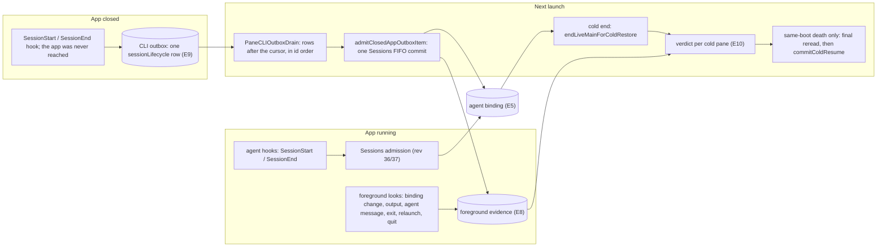

# Session restore after a reboot: how it is built

Date: 2026-10-22, revision 28 (R3 rebuilt on Sessions as pane-context rev 36/37 left it). R1, R2 and the restore phase (item 13) are unchanged. Revision 28 replaces R3's items 5–10, "R3 interfaces", and R3's parts of "What exists", "Entity binding", "What runs where", "Where the code lives" and "Proof". It goes with [Specification revision 11](2026-09-28-session-restore-specification.md).

The owner's 2026-10-05 inventory (pane-context Program Design rev 36, sharpened by rev 37 on 10-06) removed four things revision 27's R3 relied on:
- hooks recording every lifecycle report before sending;
- a second admission path with "the same qualification" as a live request;
- source generations, occurrence replay and historical binds;
- the launch sweep.

Revision 28 keeps rev 36/37 whole and gets R3's guarantee another way. It rests on these owner decisions:

| Date | Decision | What it means here |
| --- | --- | --- |
| 2026-09-30 | "that IPC CLI has its own [store] and hooks are fine" | The CLI store may hold hook reports |
| 2026-10-05 | Rev 36 inventory: "a hook writes nothing to the CLI store" | Hooks stay out of the store whenever the app can take them |
| 2026-10-18 | R3 decision 1 = B, with the question "do we keep track of sessions status? we should in local.sqlite or somewhere if it's associated with a pane" | A hook records a SessionStart or SessionEnd only when the app was never reached, the rule offline notices already follow. A closed-app end reaches the pane's binding in `local.sqlite` through Sessions (items 6 and 8) |
| 2026-10-21 | R3 decision 2 = B1 | A same-boot death resumes after one FIFO decision, with a stated window (item 10) |
| 2026-10-21 | "a. accept the race for now" | The warm-status race is an accepted residual (R3 residuals; Spec SR13a) |

In short: the closed-app record is a second kind in the CLI's existing offline outbox, imported by the existing `PaneCLIOutboxDrain`. A stored end can end only its own session's binding, and only when nothing newer about that session is known. Looks become foreground evidence, which the stored reports also write. The verdict reads the main that the cold restore ended. Drafts and their review records are kept outside this document.

**Revision 27** (2026-10-02, R3 advisor pass). Three rules close paths to a wrong resume, each with a missed resume as its worst case:
- a refused report marks the affected binding `evidence_unordered`;
- lost or replaced CLI-store history marks every binding with no reported end;
- the pre-restore look follows newer looks at the same incarnation.

Revision 28 keeps the third (A1, item 7) and replaces the first two with item 8's refused-row and history-loss evidence. The main-thread allowances are listed under "What runs where".

**Revision 26** (R3 review round 1, F6): item 13's resumed-SessionStart end uses `markRestorePhaseEnded`, the person-input boundary, so it orders after an in-flight drain.

**Revision 25** (R3 review round 1): item 7's classification decides completeness per pane, not per `ps` pass. A process exiting in one pane no longer turns every pane's look into `.unknown`.

**Revision 24** (R3 as built, amendment 13): a cold pane waits for resume readiness inside the activation scheduler, as a per-pane eligibility checked before a pane can be picked or claimed (items 4 and 10). R2's quit capture and R3's quit look share the one shutdown bound and run concurrently (item 7).

**Revision 23** (R1 as built): item 5's check runs at the pane's first render, and its outcome names exactly what it can see (`matchedAtFirstRender`, `recreated`, `uncheckable(reason)`).

**Revision 22** (R3 delivery, S3). Two boundaries are settled in code:
- the foreground observation repository reaches `local.sqlite` only through transaction closures (`ForegroundObservationSQLiteAccess`);
- the observer reads live pane → zmx session membership off-main from one Core read (`liveZmxSessionsByPane`).

Both are in item 7.

Revision 21 (2026-09-30; owner, option A: warm and unverified reconnects carry the restore script as a fallback plan; the post-attach check is telemetry only). Revision 20 (owner: the CLI store has one writer). `cli_lifecycle_report` rows are immutable, the hook writes once, the app's settlement pass is gone, and cleanup deletes only rows at or below the mark the app returns at login. Unread rows are never deleted. Revision 19 (the N3 residual). The output trigger now comes from the projector's activity window, which opens and closes once per burst and repeats after every quiet. The compact output state has no repeating start edge. Every discarded window sends its close.

Revision 18 (R3 review round 3, N1–N3):
- an exit is a trigger for a fresh look, never a record by itself, so a zmx-killed agent keeps its positive look;
- the watch is checked against the sampled process after registration, only the current watch (`watchId`) counts, and a refused watch has a typed failure with a per-pane retry;
- output arms a look when it starts; a trigger during a running look is kept as a follow-up; sequences are taken at snapshot;
- silent transitions are an accepted residual.

Revision 17. The pull is **trigger-driven** instead of a fleet-wide 60 s poll, with typed evidence interfaces and an explicit no-main-actor table (owner, 2026-09-30). Revision 16 adds the agent **exit watch**, which pushes each agent's exit, with the 60 s look as the pull fallback (owner, 2026-09-30). Revision 15 gives unordered evidence a durable "awaiting cutoff" state and a conservative fence (the F3 residual). Revision 14 answers R3 review round 2:
- F3: unordered evidence recovers only from a report recorded after it;
- F6: typed lifecycle columns plus an `endReason` wire field; typed identity columns; no blobs;
- F7: the late-end limitation is stated honestly;
- F2: the stale window is in the Spec.

Revision 13 answers R3 review round 1 (F1–F7):
- a binding ended only by sweeps stays eligible, and looks track the latest binding;
- the intake reads a handled prefix and tolerates gaps;
- provenance is decided by S0;
- every cold pane waits for readiness;
- the envelope reuses the same qualification;
- a resumed start is a new occurrence (`report_id`).

Revision 12 writes R3 from the owner's 2026-09-29/30 settlements: lifecycle hooks are kept in the `agentstudio` CLI's own SQLite store while the app is closed, a final look runs at normal quit, and the flock handoff is gone. Revision 11 moves the startup handoff witness from the terminal leader's **environment** to its **arguments**: implementation found that macOS returns no environment to a third-party reader for any process (R1 S3 stop, confirmed below), while arguments stay readable. Revision 10 answered design review round 7: discovering the new session is event-driven, not a failure, and the startup observer's outcome is total, including `.unobservable`.

**Owner confirmed (2026-09-30):**
- SR12a: a stopped or background agent isn't resumed;
- SR12b: a session lost without a reboot resumes only with no reported end;
- the full RS7 evidence window;
- the SR13 late-end limitation;
- the push exit watch plus pull looks.

R1 and R2 don't depend on R3.

## What exists (checked)

| Area | Fact | Anchor |
| --- | --- | --- |
| Attach | `zmx attach <id> <shell> -i -l` is built by `ZmxBackend.buildAttachCommand` with no liveness check. | `Core/RuntimeEventSystem/Runtime/ZmxBackend.swift:194-217` |
| Startup command | `TerminalRestoreRuntime` is `@MainActor`, synchronous and has no lifecycle state. A restored pane whose attach preparation fails gets a `.failedToStart` placeholder. | `Features/Terminal/Restore/TerminalRestoreRuntime.swift:5-60`; `WorkspaceSurfaceCoordinator+ViewLifecycle.swift:394-453` |
| Mount | `WorkspacePreparedContentMountCoordinator.mount()` is async. It joins the terminal and nonterminal lanes for one generation, and panes without geometry wait. | `App/Coordination/WorkspacePreparedContentMountCoordinator.swift:137-206,393-404` |
| Activation | `TerminalActivationScheduler` is an actor. A fixed worker fleet admits panes, visible ones first. | `Features/Terminal/Restore/TerminalActivationScheduler.swift:5-9,383` |
| zmx inventory | In zmx 0.8.1, `list` gives `name`, `pid`, `clients`, `created=<epoch>`, `cwd`, and `cmd` (**frozen at attach**). A dead session shows `status=cleaning up` once, then is absent. `pid=` is zmx's pty wrapper process; the shell is its child. | lab 2026-09-29; `loop.zig:1093-1118` |
| Foreground program | The wrapper's `tpgid` names the tty's foreground group, and `ps` rows with `pgid == tpgid` are the foreground job. `args`' first token identifies the program; `comm` is cut at 16 characters. **Agent tools run detached** (`tty=??`, own group) and never take the foreground. | POC 2026-09-29 (Claude `Bash(sleep 30)`, Codex background terminal) |
| Session identity | Claude: `--session-id` or `--resume` with the UUID is visible in `args`; plain `claude` shows no id. Codex: never visible; the id is the UUID in `~/.codex/sessions/.../rollout-<ts>-<uuid>.jsonl`. Neither holds its transcript open (`lsof`). | POC 2026-09-29 |
| Daemon death | A SIGKILL of the daemon ends the whole tree. Labels live only in memory (`loop.zig:580`) and die with it. zmx persists nothing about a session. | lab 2026-09-29 |
| zmx pre-exec crash | zmx 0.8.1 sometimes dies in the forked child before exec (`mfm_free` → `main.main`, SIGTRAP). The pane is then left with only a cursor. The lab reproduced it twice. | `~/Library/Logs/DiagnosticReports/zmx-2026-09-29-0723*.ips`, `-0727*.ips` |
| Cold command | `/bin/sh -c '<script>'` after the name is `execvpe`'d directly (`daemonize.zig:15-27,74`). Inside it, `exec zsh -i -l -c '<resume argv>; exec zsh -i -l'` loads the person's rc files and PATH, runs the resume, and leaves an interactive shell when the agent exits. **The same conversation came back:** Claude's transcript grew in place (39 → 51 lines), and Codex showed its earlier marker. Folders containing spaces and quotes worked. | POC 2026-09-29 |
| History | `history --vt` is capped at **10,000 lines** (`cfg.zig:12`): 60k lines gave 0.92 MB in 0.13 s. A dead socket exits 1. A hung daemon exits **0 with empty stdout** (`main.zig:1473-1478`, source only). | lab 2026-09-29 |
| Process introspection | `KERN_PROCARGS2` returns a same-uid process's **arguments** but **no environment** to a third-party reader: `omit_env_vars` stays set unless the reader holds a private Apple entitlement (`kern_sysctl.c`, `sysctl_procargsx`). Reproduced: `ps -E` shows no environment for our own child on macOS 26.5 with SIP on, and a child's arguments carry a token until its `exec` replaces them, with the same pid. | R1 S3 grounding 2026-09-30; orchestrator repro 2026-09-30 |
| Inherited agent env | A process launched with `CLAUDE_CODE_CHILD_SESSION` and related variables turns off Claude's transcript saving, which silently breaks a later `--resume`. | POC 2026-09-29 |
| Permanent retirement | **The shared final-retirement step is `WorkspaceSurfaceCoordinator.retirePanesPermanently(_:)`.** It was added by #381, which reached this branch with the 2026-09-29 main merge. It's called from `consumeUndoRetirements` (undo expiry, boot recovery, undo receipt) **and directly** from the background and drawer discards. Today it retires the pane activity clock. | `WorkspaceSurfaceCoordinator.swift:437-454`; `+PaneDiscard.swift:18,47` |
| Repository removal isn't retirement | `removeRepo` only filters topology. `Pane.worktreeId` is an optional link. Removing or changing a repository or worktree unassigns its panes and never removes their sessions or snapshots. | `WorkspaceMutationCoordinator+RepositoryTopology.swift:111-118`; `Core/Models/Pane.swift:131` |
| Hook reasons dropped | Claude sends `reason` (`prompt_input_exit`, `other`, and others); the Codex fixture shows `exit`. Our payload decoders don't read it. | `ClaudeCodeHookProjection.swift:35-63`; `CodexHookProjection.swift:39-78`; fixtures `claude-code-2.1/SessionEnd.json`, `codex-0.154/session-end.json` |
| Hooks when the app is closed | Lost: a failed IPC call writes stderr and returns. The only offline spool (`PaneNotificationSpoolWriter`: locked, append-only, drained by the app) accepts only offline-eligible model notifications. *Rev 28: superseded for R3 by the rows below.* | `ClaudeCodeHookInvocation.swift:79-81`; `OfflineSpool/PaneNotificationSpoolWriter.swift:86-215`; `AgentStudioIPCClientCommandLineRunner.swift:55-63,282-294` |
| End cause in Sessions | `reduceSourceEnd` drops the end of an already-ended source (`:124-128`). `reducePrepareForLaunch` ends every active source at launch (`:167-186`) and can't tell quit from crash. It runs after the first interactive frame. *Rev 28: superseded for R3 by the rows below.* | `SessionsEvidenceReducer+Completion.swift`; `AppDelegate+IPC.swift:44-58,180,299-333` |
| Provider end hooks | Claude: none on SIGKILL or reboot; `other` on SIGHUP. Codex: flaky (missed 3 of 10 normal closes), and its reason is documented as always `other`. `claude --resume <id>` keeps the id. | code.claude.com hooks and sessions docs; developers.openai.com/codex/hooks; openai/codex#49003 |
| Input path | All person input arrives on main through `GhosttySurfaceView` overrides: `keyDown`/`keyUp`/`flagsChanged` (`:45-68`), mouse, `paste` (`:408`), `insertText` (`:490`). Programmatic `SurfaceManager.sendInput` is separate. Ordered activity ingress detaches the preceding aggregate, then applies the control. | `GhosttySurfaceView+Input.swift`; `GhosttyActionRouter+LocalActions.swift:140-161`; `TerminalActivityProjector.swift:382-400` |
| Sessions migrations | The local migrator's latest is `014_ipc_credentials_pane_only`; boot-optional migrations append to `migrator`. *Rev 28: superseded for R3 by the rows below.* | `WorkspaceLocalMigrations.swift:14-21`, `+IPCCredentials.swift:118` |
| zmx session identity | `ZmxSessionControl.observe(path:bootID:)` returns `ZmxSessionIdentity`: the boot id, the daemon's and the terminal leader's process incarnations, the process group, and `sessionCreatedAt`. It verifies the peer and parent relationships. `retire` already relies on "a local process can't survive a kernel boot". The ownership journal records an identity only for sessions whose cleanup is pending. `created=` in `zmx list` is whole-second wall clock (`loop.zig:616`). | `ZmxSessionControl.swift:26-43,45-60`; `ZmxBackend.swift:323-333`; `WorkspaceCoreRepository+SessionOwnership.swift:88-104` |
| Launch ordering | Launch holds terminal activation, starts `mount()` as an `async let`, waits for the first interactive frame, releases activation, schedules IPC initialization (ingestion, sweep, spool drain, server), and only then awaits mount settlement. IPC initialization and terminal activation run independently of each other. *Rev 28: superseded for R3 by the rows below.* | `AppDelegate+LaunchRestore.swift:63-72`; `AppDelegate+IPC.swift:180-191` |
| Activation settlement | The activation fleet releases a pane once its native surface is mounted, not once zmx, the shell or an agent is ready. | `TerminalActivationScheduler.swift:347-368`; `PreparedTerminalMountAdmissionPort.swift:264-270`; `WorkspaceSurfaceCoordinator+TerminalContentMounting.swift:116-122` |
| Activity input sink | `submitTerminalActivityInput` awaits an optional sink and returns `Void`. With no router bound, it silently does nothing. The router binds in a boot `Task` after `projector.configure`. | `GhosttyActionRouter+TerminalActivityInput.swift:33-40`; `AppDelegate+TerminalActivityBoot.swift:42-44`; `TerminalActivityRouter.swift:139-160` |
| Synchronous ordered boundary | `TerminalLocalActionAccumulator` orders its per-surface state under an `NSLock`, taken synchronously from callbacks; title barriers already detach this way. | `TerminalLocalActionAccumulator.swift:343-365,455-460` |
| Process output | `ProcessExecutor` decodes stdout to a trimmed `String`, so bytes aren't preserved. zmx doesn't bound scrollback by bytes (`max_scrollback_bytes = null`, `loop.zig:219-223`). | `Infrastructure/ProcessExecutor.swift:131-134` |

**Checked again for revision 28** (2026-10-21, main `7582f1c38`; migrations at `c902837e9`). For R3, these rows replace "Hooks when the app is closed", "End cause in Sessions", "Sessions migrations" and the sweep in "Launch ordering" above:

| Area | Fact | Anchor |
| --- | --- | --- |
| CLI offline outbox | The CLI's store has a kind-tagged outbox, `cli_outbox` (`002_cli_outbox`): `id` AUTOINCREMENT, `kind` TEXT with no CHECK, `pane_id`, `message_id` UNIQUE, `payload_json`, `created_at`. The CLI writes a row only when the app was never reached: `IPCDescriptorClientFailure.permitsOfflineQueue` (`endpointUnavailableBeforeSubmission`, or `notSubmitted` from a connect, socket, authentication-transport or command-write failure). The notice writer rounds `created_at` to milliseconds. A row decode issue carries only the row id and field. | `PaneNotificationOfflineHandler.swift:6-15`; `CLIStore.swift:39-50,242-243` |
| Outbox drain | `PaneCLIOutboxDrain` (an actor) reads the store identity and refuses a foreign or replaced store, reads rows after its per-store cursor in id order, admits each with the cursor as a commit participant in the effect's transaction, and stops at a retryable row, holding the rest. On a read failure it returns an empty report. Its notice admission accepts only `.noticeOnly` methods. It runs detached once IPC is listening and ingestion is prepared. The cursor table is `pane_context_cli_outbox_cursor` (019). | `PaneCLIOutboxDrain.swift:64-144,79-80,161`; `AppDelegate+IPC.swift:207,287-316` |
| Hook delivery | `ProviderHookStatusReporting.submit` delivers each hook on the pane-token route, and with no token or after `authenticationRejected`, on the pane-claim route (#598). Background Claude sessions (`CLAUDE_CODE_SESSION_KIND=bg` or a nonempty `CLAUDE_JOB_DIR`) return before submitting. Cursor's hooks use the same reporting function and include a SessionEnd. | `ProviderHookStatusReporting.swift:44-81`; `ClaudeCodeHookInvocation.swift:49`; `ProviderHookInvocation.swift:183-218`; `CursorHookProjection.swift` |
| Sessions binding (rev 36/37) | One hook admission path and no launch sweep. A restored main stays unconfirmed until its first hook, and any other session's hook supersedes an unconfirmed main (`decideBinding`). A SessionStart naming an ended binding reopens it and keeps its id. A non-start hook against an ended binding is recorded only. | `SessionsEvidenceReducer+Mutations.swift:41-48,50-55` |
| Sessions evidence | `sessions_evidence.occurred_at` is the admission wall time in whole seconds. A live SessionStart is stored as `evidence_kind = 'activityStarted'` with `provider_event = 'sessionStart'`; `SessionsEvidenceKind` has no start case, and the loader decodes every row before filtering by status. Status hydration counts only `applied` evidence, and the cached-status path returns early for `recordedOnly`. A live end updates cached status and publishes it. `applyHook` runs commit participants inside one repository write closure; `endLiveBinding` opens its own transaction. The binding upsert updates only status, end time and revision. `SessionsCommitParticipant` exists, and the outbox cursor participant implements it. | `SessionsRepository+Writing.swift:62-67,152-158`; `SessionsHookAdmission.swift:24-29`; `SessionsRepository+Codecs.swift:40-64`; `SessionsRepository+Loading.swift:165-173`; `SessionsStatusRuntime.swift:32`; `SessionsIngestion+Status.swift:85-88,132-194`; `SessionsRepository.swift:15-45,50-78`; `SessionsCommitParticipant.swift`; `CLIOutboxCursorCommitParticipant.swift` |
| Offline eligibility | `session.event` declares `offlineEligibility: .never`. `IPCMethodOfflineEligibility`'s cases are Codable through a private `Kind`; the catalog entry's validating schema hard-codes `["never", "noticeOnly"]`; the metadata validator allows `.noticeOnly` only on `pane.message.send`; `offlineNotificationDescriptors` lists the notice recipe, which fixtures take as `descriptors.first`. The client parser's model-call check is true only for `.noticeOnly` with `.notify`. | `IPCSessionMethodDescriptors.swift:105`; `IPCMethodDescriptorMetadata.swift:75-97`; `IPCMethodCatalogEntry.swift:243-251`; `IPCMethodMetadataValidator.swift:197-204`; `IPCBuiltInMethodCatalog+Discovery.swift:18-27`; `IPCDescriptorInvocationParser.swift:483-486` |
| Local migrations | Main's latest is `028_add_local_pane_activity`, a boot-required migration that `bootRequiredMigrator` registers before the optional `014`–`027`. The Agent Line cutover (#57) adds `029_reset_agent_line_messages`. Revision 28's migrations follow it. | `WorkspaceLocalMigrations.swift:4-28` |

## Entity binding

| Spec entity | Owner | Home | Shape at boundaries | Kind |
| --- | --- | --- | --- | --- |
| E1 Terminal pane | Workspace (existing) | pane row + `zmx_session_id` | unchanged | persisted |
| E2 zmx session | zmx (external) | `ZmxSessionInventory` (new, `Core/RuntimeEventSystem/Runtime/`) | `.complete([ZmxSessionID: ZmxInventoryEntry])` where `ZmxInventoryEntry = .alive(wrapperPid) \| .refused \| .unresponsive`, and an absent key means absent. zmx prints `cleaning up` for a refused connection and `unreachable` for a timeout or unexpected error (`util.zig:964-977`), so `.refused` is proof and `.unresponsive` isn't; or `.unavailable(ZmxInventoryFailure = .timedOut \| .exitedNonZero(Int32) \| .unparsable)` | derived per probe |
| E3 Scrollback snapshot | `ScrollbackStore` (new, `Features/Terminal/Restore/`) | `<data root>/scrollback/<paneId>.vt`, mode 0600 | `.present(Data) \| .absent \| .unreadable(ScrollbackUnreadableReason)` | persisted (file) |
| E4 Restore kind | the terminal restore decision | `TerminalRestoreKind` | `.warm \| .cold(TerminalColdRestorePlan) \| .unverified(checkedAt)` | derived per launch |
| E5 Agent binding | Sessions (existing) | main's `sessions_pane_binding` and its `sessions_evidence` rows; no new column | `SessionsBindingRecord`, unchanged. A SessionEnd, the agent's `commandFinished`, or another session binding as the pane's main ends it (rev 36/37). A closed-app SessionEnd for the pane's own live main ends it when nothing newer about that session is known (item 8). The cold restore ends the live main and returns it as `ColdEndedMain` (item 9). States: live (confirmed or not), ended, none | persisted |
| E8 Foreground evidence | one repository, the table's single writer: `PaneForegroundObserver` writes looks through it, and item 8's closed-app restore participant writes reported evidence through it; the verdict reads it through an App port | `terminal_pane_foreground_evidence` (migration `030`), one current row per pane | `ForegroundEvidence = .look(program, sessionIdentity) \| .reportedEnd \| .reportedOtherSessionEnd(ReportedSession) \| .reportedOtherStart(ReportedSession) \| .reportsUnreadable(.historyLost \| .rowRefused)`, each with its binding generation and `(observerLaunchId, sequence)`; a Core restore contract. Reported evidence holds until a different binding becomes the pane's latest | persisted, current state |
| E9 Closed-app report | the CLI writes it, only when the app was never reached; the app's `PaneCLIOutboxDrain` imports it once | one `sessionLifecycle` row in the CLI's existing `cli_outbox`; handled through the per-store cursor `pane_context_cli_outbox_cursor` (019); the adopted store history in `terminal_restore_outbox_identity` (`032`) | `CLISessionLifecycleEntry` → `ClosedAppOutboxItem`, keyed by (provider, the provider's session id, pane), with the time the hook began; states waiting, handled, refused | persisted |
| E10 Resume verdict and E6 Resume command | `SessionResumeResolving` (Sessions port, composed in App) | computed | `ResumeEvidence = .knownExited \| .interruptedCandidate(ResumeInvocation) \| .unknown(ResumeUnknownReason)`; E6 is the `ResumeInvocation`. Decided after the drain's read and the cold end; a same-boot death is confirmed at `commitColdResume` | derived |
| E7 Restore phase | `TerminalActivityProjector` (existing Panes owner) | in memory | `.active(restoreGeneration) \| .ended` | derived |

## Choices

### R1: detect and restore

1. **One inventory per mount, off-main, behind the existing first-frame gate (SR1, SR2, SR4).** `ZmxSessionInventoryProbe` (`@concurrent nonisolated`) runs `zmx list` once, with a deadline (`AppPolicies.Restore.inventoryProbeDeadline`), inside `mount()` before the terminal lane activates. **Only proof means dead**:
   - `.alive` → `.warm`;
   - absent from a complete inventory, or `.refused` → `.cold`;
   - `.unresponsive` (a timeout or unexpected error for that one session) → `.unverified` for that pane only;
   - a whole-inventory `.unavailable` → `.unverified` for every pane.

   **The warm baseline:** for each `.alive` session, the probe also takes one `ZmxSessionControl.observe(path:bootID:)`, which gives its `ZmxSessionIdentity` (boot id plus daemon and terminal-leader process incarnations). If the identity can't be observed, the pane is `.unverified`, never `.warm` on the PID alone.

   **The first window isn't delayed** because of the existing launch shape (confirmed in round 3): activation is held, `mount()` runs as an `async let`, the first interactive frame is awaited independently, then activation is released. The map travels with the mount generation. `TerminalRestoreRuntime.startupCommand(for:kind:)` stays pure and synchronous.
2. **The cold command (SR3, SR6a, SR10, SR11).** `ZmxBackend.buildColdRestoreCommand(_ plan: TerminalColdRestorePlan)` produces `zmx attach <id> /bin/sh -c '<script>' agentstudio-restore-<attemptID>`. The last argument is the script's `$0`: the startup **token** (item 3). `TerminalColdRestorePlan` is a **Core** contract (`Core/RuntimeEventSystem/Runtime/`). It carries **every value the command needs**, so the builder reads nothing ambient:
   - `zmxExecutable: URL` and `zmxDirectory: URL`, which `TerminalRestoreRuntime` already resolves for today's attach;
   - `sessionID: ZmxSessionID`, the pane's stored id, never derived;
   - `loginShell: URL`, the configured shell;
   - `folderCandidates: [URL]`
   - `notice: ColdRestoreNotice`
   - `replayFile: URL?`
   - `resume: ResumeInvocation?`
   - `attemptID: ColdRestoreAttemptID`

   `TerminalRestoreRuntime` builds the plan from the pane and configuration it already reads, and passes it to the builder.

   The script:
   1. unsets the inherited `CLAUDE_CODE_*` markers;
   2. `cd`s to the first existing folder;
   3. **prints the notice line first**;
   4. `cat`s the replay file and prints the marker;
   5. `exec`s the login shell (with `-c '<argv>; exec <shell> -i -l'` when resuming). This is the script's **only** in-process `exec`; everything else is a builtin or a child process (`cat`). Item 3 relies on that.

   Each value is quoted once by the existing helper.

   **Every restore reconnect carries the script (owner, 2026-09-30, option A; Spec SR2a).**
   - `TerminalRestoreKind.warm` and `.unverified` also carry a **fallback** `TerminalColdRestorePlan`, built like a cold plan: the same folder candidates and notice, R2's replay file when there is one, and never a resume.
   - `TerminalRestoreRuntime.startupCommand(for:kind:)` sends `buildColdRestoreCommand` for all three kinds. `nil` (a new pane, or a repair outside the launch cohort) keeps the plain attach.
   - zmx ignores a startup command when the session is alive (`loop.zig:704-712`, "session already exists, ignoring command"), so a correct warm check changes nothing.
   - **What this path doesn't get (accepted by the owner):** no restore phase is armed and no `ColdStartObserver` watches it, since both are set up only for panes classified cold. A failed start there shows the ordinary exited-pane view, and with R2 the replay may briefly count as activity.

3. **Start outcome in the current launch (SR5; R2-4).** A **startup window**, owned by R1, runs from the cold start until the shell handoff is confirmed or has failed. It's **independent of the activity restore phase** (SR6b): your first input ends activity suppression as SR6b says, but it neither confirms nor cancels startup. The two can overlap in time; they don't share a flag. Nothing the terminal *shows* can confirm the handoff:
   - process identity: zmx's parent returns from `forkpty` before the child execs (`daemonize.zig:98-124`);
   - output: zmx prints `session "<id>" created` and clear-screen bytes itself (`loop.zig:769-776`, `main.zig:1636-1641`);
   - a title token: the rest of the script can't be relied on after a failed `exec`, because macOS `/bin/sh` is bash, and non-interactive bash exits on a failed `exec`.

   So the **OS** confirms it:
   - **The token.** The plan carries a `ColdRestoreAttemptID` (UUIDv7), and the command passes `agentstudio-restore-<attemptID>` as the script's `$0`. It is in the terminal leader's **argument vector** in every image before the handoff: zmx's forked child (a copy of the daemon, whose arguments include the whole command), `/bin/sh`, and any re-exec of `/bin/sh` into bash. The final `exec <loginShell>` replaces the arguments, and the token disappears. The token lives in the arguments, not the environment, because macOS returns no environment to our reader (see What exists).
   - **The watch** runs off-main in `ZmxSessionControl`'s Darwin layer, beside `observe`, in two event-driven stages. Each stage registers first and checks second, so no event is missed:
     1. **Discovery.** A mounted surface isn't a running session: Ghostty starts the subprocess on its own I/O thread (`Surface.zig:732-738`, `termio/Exec.zig:86-103`), and zmx creates its socket later, inside the new process (`loop.zig:739-763`). So the observer:
        1. registers `kqueue` `EVFILT_VNODE` (`NOTE_WRITE`) on the zmx directory;
        2. **then** checks whether the socket exists;
        3. on its appearance, calls `observe(path:bootID:)` for the new session's identity.

        While the socket is absent, the window is **discovering**. That isn't failure: an early `ENOENT` after mount is normal.

        **The socket appears before it listens.** zmx calls `bind` and then `listen` (`socket.zig:113-114`), so a connection in between is **refused** (`ECONNREFUSED`). The R1 diagnostic on 2026-09-30 hit this in 16 of 30 cold starts. `ZmxSessionControl` reports a refused connect as its own typed failure, `.connectionRefused`, separate from `.unavailable`. During discovery, a refusal means **still discovering**. The observer retries the connect on a short bounded backoff (`AppPolicies.Restore.discoveryConnectRetryDelays`: 1, 2, 4, 8, 16 and 32 ms, via `Task.sleep(nanoseconds:)` in the observer actor). That delay is unavoidable, because the kernel gives no event for `listen`. If the socket is still refusing after the last retry, the window **stays discovering**, and settles only on a real fact: the surface's command exiting, or the socket being removed. It never fails on time alone.

        **Connected before the child's `setsid`.** zmx forks after it's listening, so a connect can also succeed before the pty child has become its own process-group leader. `observe` then throws `unexpectedProcessGroup` or `unexpectedProcessParent`, and those are also **still discovering**. The typed failure carries `info.terminalPID`. The observer registers `EVFILT_PROC` `NOTE_EXEC | NOTE_EXIT` on that pid **first**, then re-observes once. forkpty's child always calls `setsid` before its first exec, so it re-observes again at that `NOTE_EXEC`. A `NOTE_EXIT` before any successful observe is a failure. There's no sleep for this case.
     2. **Handoff.** With the terminal leader's pid from that identity, the observer:
        1. registers `EVFILT_PROC` with `NOTE_EXEC | NOTE_EXIT` on it;
        2. **then** reads its argument vector with **one** `sysctl KERN_PROCARGS2` call into a buffer of `KERN_ARGMAX` bytes, as `ps` does. Only the arguments are used. There's no separate size query: a size query followed by a read races an exec that happens in between, and that race returns `EIO`. The R1 diagnostic on 2026-09-30 hit `EIO` in 30 of 30 real cold starts, every one at an intermediate exec (zmx child or `/bin/sh`), and every one readable on the very next read. An `EIO` from the single read is retried **immediately**, up to `AppPolicies.Restore.processArgumentsReadAttempts` (3) times, with no sleep. Only then does the read count as unreadable. So an intermediate exec never ends the window as unobservable because of that race, and a later failure of the final exec is still reported (SR5).

        Feasibility was checked in XNU: `EVFILT_PROC` doesn't require the target to be our child, `KERN_PROCARGS2` requires the same uid and returns arguments (never the environment, for us), and `NOTE_EXEC` fires after a successful exec.
   - **Outcomes:**
     - **Handed off:** at a `NOTE_EXEC` or at the post-registration check, the leader is alive, it is still the process from the discovered session's identity (same pid **and** start time, so a reused pid can't pass), and its arguments **no longer carry this attempt's token**. The login shell is running. This is sound because the only way a live leader loses the token is the script's final `exec`: every earlier image carries it, and the script execs nothing else in-process (item 2). A check that still finds the token keeps the window pending, including across `/bin/sh`'s own re-exec.
     - **Failed:**
       - `NOTE_EXIT` before handoff;
       - once the session was discovered, `observe` finds its endpoint gone or refused;
       - or the surface's command exits before handoff, **including while discovering**. A session that never creates its socket ends its attach client, and that exit is the failure fact. No timer is involved.

       This covers a zmx child dying before exec, a script error, a zmx diagnostic followed by an exit, and a failed final `exec`. **It doesn't depend on whether you've typed anything.** The pane shows a restore-start failure reason in this launch, carrying the exit status when there is one, through the existing placeholder and overlay owner (a specific reason, not the generic "Process Exited"). There's no retry.
     - **Unobservable:** the observer couldn't establish the witness at all. That's the case when:
       - the `kqueue` registration returned an error;
       - `observe` returned `timeout` or `processUnverifiable`;
       - or the process-args read failed, or returned no argument vector (`EINVAL`, `EIO`, or a zombie leader).

       The window ends as `.unobservable(reason)`. No failure is shown (the shell may be running fine), and the reason goes to telemetry as a closed case. **Can't tell** is never reported as **died**, and never left pending.
     - **Pending:** discovering or awaiting handoff, with a watch installed. There's no time-only failure. Retiring the surface or cancelling activation ends the window and removes its `kqueue` registrations.

   The result type is `ColdStartOutcome = .handedOff | .failed(ColdStartFailure) | .unobservable(ColdStartUnobservableReason)`, where `ColdStartUnobservableReason = .watchRegistrationFailed(errno: Int32) | .identityUnverifiable | .processArgsUnreadable(errno: Int32)`. It's the observer's total result.
   - **Nothing is left behind.** The token disappears with the final `exec`, so the person's shell carries no restore variable. The token never reaches logs, telemetry or OTLP.
4. **Staggered starts (SR4).** Cold starts use the existing activation scheduler. Its admission order and worker count are unchanged; R3 adds only the per-pane resume eligibility described in item 10. `TerminalActivationScheduler` claims and activates **one prepared terminal at a time**, visible first (`AppPolicies.TerminalActivation.restoreMaximumConcurrentAdmissions = 1`; its single worker is what keeps candidate selection race-free). Activating a cold pane mounts its surface, which starts its `zmx attach`, and the worker moves on once it's mounted. So starts are staggered by activation, but the login shells may still be initializing together. **There's no separate start-slot limit:** gating the single worker on a slot would stall warm panes behind a cold pane's handoff, and a claim-time "not yet" outcome would be a new scheduler seam. That seam is added only if the 20-cold-pane measurement (Proof, R1) shows a real CPU or latency problem. The startup observer (item 3) runs per cold pane, with no slot. Its watch task is owned by the coordinator, cancelled on retirement and at teardown, and announces its outcome as a typed fact.
5. **Recreation after attach (SR2a).** For warm and unverified panes, one off-main `observe` is compared by **identity** with the warm baseline from item 1.
   - **When it runs: the pane's first render.** Attach completion itself can't be observed:
     - zmx has no attached-client query;
     - Ghostty has no PTY event;
     - the handoff token can't tell an attach that created the session from a session that was already alive.

     So the coordinator arms the check at mount (`beginPostAttachRecreationCheckIfNeeded`). It keeps the pending check by pane (`pendingPostAttachRecreationChecksByPaneID`) and runs it when the router's `.firstRender` arrives (`receivePostAttachFirstRender`). Ghostty renders before any PTY data, so that first render comes right after the native mount. The `observe` and the comparison run in a `@concurrent nonisolated` helper; the main actor only arms the check and records the result.
   - **What it can say** (`PaneRecreationCheckOutcome`):
     - `recreated`: a different identity answered. This is definitive whenever it's seen. The pane has already shown SR3's notice, because the reconnect carried the restore script (item 2), so the check only records the recreation in telemetry.
     - `matchedAtFirstRender`: the baseline identity still answered at first render. This doesn't claim the session survived the attach: a recreation between this look and the real attach completing is invisible to it by construction.
     - `uncheckable(reason)`, with these reasons:
       - `missingBaseline`: an unverified pane, which never had a baseline;
       - `paneUnavailableBeforeFirstRender`: exit, retirement, unmount or cancellation before the first render;
       - `observationFailed(ZmxSessionControlFailure)`, including the pre-setsid window right after a recreation;
       - `observationFailedUnrecognized`.

     Nothing is shown in the pane for any outcome.
   - `PaneRecreationChecker.checkForRecreation` stays a pure comparison of two identity blobs.

   A PID or a clock is never a substitute for identity.

### R3: resume evidence (Spec SR11–SR14, E8–E10)

Items keep their earlier numbers (5–10); R1 also has an item 5, so they're referred to by name.

No single signal proves "the machine killed this exact agent". The design stores **evidence only**, never `shouldResume`, and decides once per cold pane at launch. R3 must guarantee:

- a cold pane resumes its agent by exact id **only** when the evidence says it was likely interrupted (Requirements RS6, RS7; Spec SR11);
- otherwise it gets a shell, and when an identifiable session might still be resumable, the shell carries a one-line notice naming its provider and short id (SR12);
- SR12a, SR12b, SR13 and SR14 (owner-confirmed 2026-09-30; SR12b's and SR13's order stated 2026-10-21);
- SR11's accepted window: a change after the app's last look that leaves no evidence can still read as interrupted, for example Ctrl-Z while the app is closed, or an end the CLI couldn't record.

The rule every item serves: **a missed resume is acceptable; a wrong resume is not.**



```
App open    agent hook ──session.event──► Sessions (rev 36 rows) ──► binding, status, activity
                                          foreground looks ──► E8 foreground evidence
App closed  SessionStart / SessionEnd hook ──app never reached──► CLI outbox: one sessionLifecycle row

Next launch, after IPC is listening and ingestion is prepared
  PaneCLIOutboxDrain reads rows after the cursor, in id order.
  Each lifecycle row is ONE local.sqlite transaction:
    Sessions FIFO: a SessionEnd for the pane's own live main, with nothing newer known ──► binding ended
    restore participant: E8 reported evidence about the pane's latest binding
    cursor participant: last_handled_id

Per cold pane
  mount(): R1 restore kind (.cold) + launch boot                              [before first frame]
  ① drain finished (or its readiness deadline passed)                         [off-main]
  ② Sessions: .cold ends the pane's live main, returning it (nil if none)     [rev 36's planned handoff]
  ③ verdict = ended main + E8 evidence + inventory
  ④ same-boot death only: outbox reread, then commitColdResume (one FIFO decision)
  ⑤ cold plan: resume exact id | shell | shell + notice
     resumed SessionStart reopens the binding (rev 36 row 3)
```

Sessions keeps one hook admission path. A stored report enters it through one narrow mutation, which can only end the report's own session. R3 owns its evidence (E8) and its decision (E10). They meet at two values: the main that the cold end ended, and the pane's latest binding as Sessions read it when a stored report was admitted.

5. **Which hooks (SR11a).** Only SessionStart and SessionEnd from Claude Code and from Codex. While the app is open, they reach Sessions through main's admission exactly as today, with no new field. `IPCSessionEventIdentity` does **not** gain `endReason`: no step reads the reason, and SR12 shows a known exit as a plain shell. **Any** reported end means the agent ended.
   - **Why looks exist (2026-09-29 lab).** Claude sends no SessionEnd on SIGKILL or reboot, and `other` on SIGHUP. A zmx daemon's death hangs up its terminal, so Claude then reports an end, and SR12b's same-boot resume applies only when no end was reported. Codex missed 3 of 10 normal closes. The looks in item 7 cover what the hooks miss.
   - **Two hook sources record nothing while the app is closed:**
     - background Claude sessions (`CLAUDE_CODE_SESSION_KIND=bg` or a nonempty `CLAUDE_JOB_DIR`) return before submitting (`ClaudeCodeHookInvocation.swift:49`, #613);
     - Cursor. R3 doesn't resume Cursor. Main's Cursor rule (#613) binds the next Cursor conversation at its first live prompt.
   - **What ends a binding is Sessions' rule** (rev 36/37): a SessionEnd, the agent's `commandFinished`, or another session binding as the pane's main. Item 8 adds one narrow case: a stored SessionEnd for the pane's own live main.
   - Every other hook (`UserPromptSubmit`, `Stop`, `PreToolUse`, `PermissionRequest`, `Subagent*`, `Interrupt`, compaction) stays live-only and never affects resume.

6. **The closed-app record (E9, SR11b).** The CLI's existing offline outbox gains a second kind. This answers the owner's 2026-09-30 settlement ("that IPC CLI has its own [store] and hooks are fine") inside rev 36's rule that a hook writes nothing to the store when the app can take it.
   - **Which reports.** Only a SessionStart or SessionEnd from Claude Code or Codex. Cursor's hooks go through the same reporting function and include a SessionEnd (`ProviderHookInvocation.swift:183–218`, `CursorHookProjection.swift`), so the writer checks the provider explicitly, not only the event name. Refusals, activity hooks and status-only reports never queue.
   - **When the CLI writes.** In `ProviderHookStatusReporting.submit` (`ProviderHookStatusReporting.swift:44–81`), when the last delivery attempt fails with `IPCDescriptorClientFailure.permitsOfflineQueue` (`PaneNotificationOfflineHandler.swift:6–15`): `endpointUnavailableBeforeSubmission`, or `notSubmitted` from a connect, socket, authentication-transport or command-write failure. That is the rule offline notices already use: the app never received the request. Both of main's routes count, and the row keeps the original provider and event params on both:
     - with a pane token: the authenticated delivery;
     - with no token, or after `authenticationRejected`: the pane-claim status report (#598). In the rejected case the app refused the first attempt and never received the second.

     No other outcome writes: success; `deliveryUncertain` (the app may have it, and it's running); a remote refusal; background Claude sessions (they return before submitting).
   - **Its time.** The hook captures the report's time when it starts handling the event, before the delivery attempt and before any store open or busy wait, and passes it to the writer. For this kind, `created_at` is that captured time, not the append time, so a writer delayed between the failed delivery and the append can't look newer than a hook the app admitted in the meantime. The lifecycle writer stores it **floored** to whole milliseconds. The notice writer's rounding (`CLIStore.swift:242–243`) is not reused, because rounding up could make an older report look newer.
   - **Row.** One `cli_outbox` row, written at the existing location (`AGENTSTUDIO_CLI_STORE` plus its channel):

     | Column | Value |
     | --- | --- |
     | `id` | outbox order (AUTOINCREMENT, never reused) |
     | `kind` | `sessionLifecycle` |
     | `pane_id` | from `AGENTSTUDIO_PANE_ID` |
     | `message_id` | a UUIDv7 report id minted for each hook run (UNIQUE) |
     | `payload_json` | the `session.event` params object as the live call sends it: provider, event (`sessionStart` \| `sessionEnd`), the provider's session id, the correlation id. This is the params object, not the JSON-RPC envelope offline notices store |
     | `created_at` | the captured report time, UTC milliseconds, floored |

     `CLIOutboxKind` gains `sessionLifecycle`, and `CLIOutboxEntry` gains `.sessionLifecycle(CLISessionLifecycleEntry)`. The writer is a lifecycle sibling of the notice writer in the same store module. The notice handler (`PaneNotificationOfflineHandler`) stays notice-only. `kind` is TEXT with no CHECK (`002_cli_outbox`), so the CLI store needs no migration.
   - **IPC change.** `session.event`'s descriptor declares `offlineEligibility: .never` (`IPCSessionMethodDescriptors.swift:105`) and becomes `.sessionLifecycleOnly`. Every owner of that value moves in the same change:
     - `IPCMethodOfflineEligibility`'s Codable cases (`IPCMethodDescriptorMetadata.swift:75–97`);
     - the catalog entry's validating schema, which hard-codes the allowed kinds today (`IPCMethodCatalogEntry.swift:243–251`). Every descriptor erasure validates against it, so a missing case fails at descriptor construction;
     - `IPCMethodMetadataValidator` (`IPCMethodMetadataValidator.swift:197–204`), which allows `.noticeOnly` only on `pane.message.send`, also allows `.sessionLifecycleOnly` only on `session.event`;
     - `offlineNotificationDescriptors` (`IPCBuiltInMethodCatalog+Discovery.swift:18–27`) adds the `session.event` recipe after the notice recipe. Notice stays first, because existing fixtures take `descriptors.first`.

     Two consumers compare against `.noticeOnly` and stay as they are: the client parser's model-call check (`IPCDescriptorInvocationParser.swift:483–486`, true only for `.noticeOnly` with `.notify`), so no model call queues as a lifecycle row; and the drain's notice admission (`PaneCLIOutboxDrain.swift:161`), which keeps refusing anything but a notice, while lifecycle rows take item 8's dispatch. `session.refusal`, `session.status` and `session.query` stay `.never`. The payload-level event and provider gate lives in the writer and the drain, not in the validator.

     **Version boundary.** A typed decoder from an older build can't decode `{kind: "sessionLifecycleOnly"}`, so an older `discoverCatalog()` fails against a newer app. Ordinary hook and CLI calls use compiled recipes and don't fetch the remote catalog, so they're unaffected, and `command.list` entries carry no eligibility field. The bundled app and CLI are the contract (pane-context PD choice 4); external agents' own catalog decoders aren't known.
   - **Budget.** The write runs inside the hook's existing deadline, which starts when the hook process starts: `CLIPolicy.hookCallLimit` (2 s), or `synchronousLifecycleHookLimit` (250 ms) for Codex's synchronous SessionEnd. The store open and its busy wait are capped at the remaining budget, not the 1 s first-open budget; startup, stdin and a first-open migration all spend it. Out of budget, the report is lost and a diagnostic is written (the residual "a closed-app end the CLI couldn't record"). The deadline is checked, not enforced, so nothing relies on a hook process ending on time (item 10).
   - **Purge.** The outbox's existing rule (`auth.login`'s `cliStoreReadThrough` `outbox` mark). A row the app hasn't handled is never deleted.
   - **Duplicates.** An end the app admitted and also stored finds its binding already ended, unless the binding was reopened in between. The ordering rules in item 8 then keep the stored copy from ending the reopened run.
   - **Trust boundary.** The store is owner-only local state, trusted like the user's own shell; rows aren't authenticated per pane. The drain checks the store identity and channel, that the pane exists and isn't retired, and that the params decode for an eligible provider and event. A stored row can only write veto evidence or end its own session's binding (item 8); none of its effects can make a pane a resume candidate. The worst a forged row can do is a missed resume and an ended status until the session's next SessionStart.

7. **Foreground evidence (E8, SR11c).** `PaneForegroundObserver` is an actor in `Features/Terminal/Restore/`. One pass runs one `ps` for all panes, and one `observe(path:bootID:)` per pane whose latest binding is live (confirmed or not) and holds no reported evidence, bounded by `maximumConcurrentIdentityObservations`. Per pane it records a look, which is one kind of the pane's **foreground evidence** (a Core restore contract):

   ```
   ForegroundEvidence =
     .look(program: .shell | .claudeCode | .codex | .other | .unknown, sessionIdentity)
     .reportedEnd                                         // a closed-app SessionEnd named this binding's session
     .reportedOtherSessionEnd(provider, conversationId)   // a closed-app SessionEnd named any other session (F3)
     .reportedOtherStart(provider, conversationId)        // a closed-app SessionStart named another session, or the pane had no binding (F4)
     .reportsUnreadable(.historyLost | .rowRefused)

   each carries:
     paneId: UUID
     bindingGenerationId: UUID?            // the pane's LATEST binding it is about; nil when the pane had none
     observerLaunchId: UUID                // one per app launch (UUIDv7)
     sequence: UInt64                      // monotonic within observerLaunchId; the observer owns the order
     observedAt: Date                      // display only; never an ordering key
   a look also carries:
     zmxSessionId: ZmxSessionID
     sessionIdentity: Data                 // the opaque ZmxSessionIdentity: boot id + daemon/leader incarnations
   ```

   - **Reported evidence is final for the binding's current run.** Once reported evidence is stored for a pane, no later look replaces it. A look can show that an agent holds the foreground, but it can't prove the agent is the binding's own session rather than one started while the app was closed that hasn't sent a hook. Reported evidence is cleared only when a **different binding** becomes the pane's latest (a new session binds as main): the `.bindingChanged` trigger reaches the observer, which clears it through the repository. A reopen of the same binding does not clear it (F7): main reopens a binding for any SessionStart naming it, including a delayed one from an old run, and keeps the binding id (`SessionsEvidenceReducer+Mutations.swift:41–48`), so a reopen doesn't prove which session is running. The cost, stated: a pane whose session was reported ended or replaced, and that the person later resumes by hand in the app, isn't auto-resumed again until a new session binds there. That's a missed resume, never a wrong one.
   - **Item 8's Sessions effect doesn't replace this.** A delayed old SessionStart can still reopen a binding that a closed-app end ended. The `.reportedEnd` evidence is what keeps that binding from being resumed later.
   - **"Latest", with no sweep.** There's no launch sweep on main. A pane's latest binding is its live main, or the ended binding it keeps until a new main binds (rev 36 step 3). Looks and reported evidence attribute to that binding.
   - **Never `zmx list` here.** zmx's session listing deletes any socket that refuses a connection (`util.zig:70-75`). A new pane's session sitting between `bind` and `listen` would lose its socket to a periodic list. So looks enumerate the zmx directory and call `ZmxSessionControl.observe` per pane, which never deletes. They don't run `zmx list`.
   - **Storage:** `terminal_pane_foreground_evidence` (migration `030`), one current row per pane. Its repository is the table's single writer; the observer's looks and item 8's restore participant both write through it.
     - **Columns:** `pane_id` TEXT PK; `evidence_kind` TEXT (`look`, `reportedEnd`, `reportedOtherSessionEnd`, `reportedOtherStart`, `reportsUnreadable`, parsed into the enum); `binding_generation_id` TEXT NULL; `observer_launch_id` TEXT; `sequence` INTEGER; `observed_at` TEXT (UTC); for a look, `zmx_session_id` TEXT and `program` TEXT (parsed into the enum); for the two "other" kinds, `reported_provider` and `reported_conversation_id` (TEXT); for `reportsUnreadable`, `unreadable_reason` TEXT (`historyLost` \| `rowRefused`, parsed in Swift). A column that doesn't belong to the row's kind is NULL.
     - **The session identity** is stored as typed columns: `identity_version`, `boot_id`, `daemon_pid`, `daemon_start_seconds`, `daemon_start_microseconds`, `leader_pid`, `leader_start_seconds`, `leader_start_microseconds`, `process_group_id`, `session_created_at`, NULL for the reported kinds. There's no blob. The repository maps them to and from `ZmxSessionIdentity`.
     - **Validation:** a row whose columns don't match its kind (a missing required field, or a field from another kind) is dropped as no evidence. TEXT and INTEGER only, with no enum CHECKs and no triggers. A dropped row leaves the pane with no look, so its verdict can't be a candidate.
     - **The Core contract** keeps `sessionIdentity` opaque, as R1's `.warm(identity:)` does.
     - **How it reaches the database (rev 22).** The repository uses a package `ForegroundEvidenceSQLiteAccess` of transaction closures, and nothing else (rev 22's `ForegroundObservationSQLiteAccess`, renamed with the table).
       - The App adapter `WorkspaceForegroundEvidenceSQLiteAccess` sits over Core's `performApplicationLocalWrite`/`Read`, mirroring `SessionsSQLiteAccess`.
       - No `DatabaseWriter` crosses a module boundary, and Core stays the one transaction owner. Item 8's participant writes in the `Database` of the Sessions commit it joins, through the repository's synchronous write function.
   - **Which panes it looks at (rev 22).** The observer gets live pane → zmx session membership off-main from one Core-owned read, `WorkspaceSQLiteDatastoreActor.liveZmxSessionsByPane(workspaceId:)`.
     - It's an async GRDB read of `pane_content_terminal` joined with `pane` for the workspace, provider zmx only. A stored identifier that doesn't parse fails the read rather than being skipped.
     - It reads the last persisted graph, so it can trail in-memory edits by up to one flush. The observer tolerates that: a removed pane yields nothing, and an added pane is seen on the next look.
     - There's no main-actor gathering, and no snapshot or receipt contract is reused for it.
   - **The exit watch: push, with the look as the pull fallback** (owner, 2026-09-30). When a look classifies a pane's foreground as an agent, the observer registers one kernel exit watch on **that agent process**: `kqueue` `EVFILT_PROC` `NOTE_EXIT` on macOS, behind the same syscall seam as R1's handoff watch (`pidfd_open` plus `epoll` is the Linux equivalent for a later adapter).
     - **An exit is a trigger, not a record (N1).** `NOTE_EXIT` says the process exited (`kqueue(2)`). It says nothing about what holds the pane's foreground now, or whether the session survived. So the watch writes nothing itself. It makes the pane's look **due now** (`processExited`), and that ordinary look decides:
       - the session answers `observe` with the **same** identity as the look that armed the watch → classify its foreground as any look does and write that: usually `.shell`, or whatever program or agent took over;
       - the session is gone, refuses, answers with a **different** identity, or can't be verified → **write nothing**. The look from before the death stands. That's the positive evidence SR12b needs after `zmx kill` or a zmx crash with no end reported (`loop.zig:1062` is zmx's kill path).
     - **Attached to the sampled process (N2).** At registration the kernel attaches `EVFILT_PROC` by pid (XNU `filt_procattach` → `proc_find`). A pid reused between the look's `ps` sample and registration would therefore be watched by mistake. The adapter closes this the way R1's handoff watch does (item 3):
       1. register first;
       2. then read the pid's start time (`proc_pidinfo` `PROC_PIDTBSDINFO`, `pbi_start`) and compare it with the sampled `ProcessIncarnation`.

       A mismatch, or `ESRCH` at registration, means the sampled process is already gone. The watch yields `.alreadyGone` (treated exactly like `.exited`) and deregisters. Only a match yields a live watch.
     - **Only the current watch counts (N2).** The observer gives each watch a `watchId` (UUIDv7) and keeps one `CurrentExitWatch { watchId, incarnation, bindingGenerationId }` per pane. Every watch event carries its `watchId`, and the observer acts on it only when it's the pane's current watch. Replacing, retiring or quitting clears the current watch **first**, so an event from an older watch that is already on its way is dropped, whatever its timing. Cancelling a kernel watch can't recall an event that was already delivered; the id check can. Because an exit only makes a look due, a stale event that got through would cost one extra look, never a wrong record.
     - **A watch that can't be registered (N2).** Registration can also fail for reasons other than a gone process: `EACCES`, `ENOMEM`, or any other error that isn't `ESRCH` (`kqueue(2)` ERRORS). These yield `.unavailable(ProcessExitWatchFailure)`, which is neither an exit nor a shell.
       - Nothing is written.
       - The pane gets a **watch-retry deadline** of `lookMaxDelay`. Each retry is an ordinary look that tries the watch again, until one registers or the look no longer finds an agent.
       - This is the only per-pane repeat, and only panes whose watch failed get it.
       - Telemetry counts the failures by class.
     - **Replacement and cleanup:** a look that finds a different agent process in the pane replaces the current watch (old one cancelled, new `watchId`). Retiring the pane, or quitting the app, removes its watches.
     - **Limits:** there's at most one watch per pane (bounded by panes), and nothing runs until an exit.
     - **What stays with the look:** noticing a new agent, Ctrl-Z (the kernel doesn't report a suspension), and re-registering watches after a relaunch. Nothing watches while the app is closed; that gap belongs to the future always-on helper.
   - **A trigger-driven pull, not a periodic poll** (owner, 2026-09-30). Under the repo's selection rule this is a latest-state projection plus an expensive refresh plus a future-eligibility deadline, so it gets **one reschedulable next-deadline task and no fleet-wide periodic polling**. A pane's look becomes **due** when something could have changed its foreground:

     | Trigger (typed input) | Source (off the main actor) | Due |
     | --- | --- | --- |
     | `.bindingChanged` | `SessionsIngestion` actor commit | now |
     | `.outputBegan(burstWindowId)` | `TerminalActivityProjector` actor: the pane's **activity window opens**. That's the first row growth after the previous window closed (`mergeWindow` creates a window with a new UUIDv7 id). It repeats after every quiet interval | arms demand: due `lookMaxDelay` from now, unless something earlier arrives |
     | `.outputSettled(burstWindowId)` | `TerminalActivityProjector` actor: that window **closes**, either after quiet (`closeUnseenWindow`) or because it's discarded (surface replaced or closed, projector reset). Ctrl-Z and `&` always print, e.g. "suspended" plus a prompt | last output + `lookSettleDelay` (5 s), never past the armed max |
     | `.agentMessage` | the Sessions adapter, which never touches the main actor (turn done, stop, notification) | last message + `lookSettleDelay`, never past the armed max |
     | `.appQuitting` | a single forward from `applicationShouldTerminate`: the main actor sends one value and does nothing else | now (the final look) |
     | `.relaunched` | first activation after launch | now, for panes whose latest binding is live and holds no reported evidence (this re-registers exit watches) |
     | *(internal)* `processExited` | the pane's **current** exit watch (`.exited` or `.alreadyGone`) | now: a fresh look, never a direct record |
     | *(internal)* `watchRetry` | the pane's current exit watch (`.unavailable`) | `lookMaxDelay`, repeated until a watch registers or no agent is found |

     The two internal reasons come only from the observer's own watches, so no outside producer can forge an exit.

     - **Demand arms when output starts, not when it stops (N3).** `.outputBegan` makes the pane pending with its max deadline at once. So output that never goes quiet still gets a look by `lookMaxDelay`. Quiet (`.outputSettled`) only picks the efficient earlier time. The observer keeps `outputActive: burstWindowId?` per pane. `.outputBegan` sets it; `.outputSettled` clears it only when the ids match, so a late close can't clear a newer burst.
       - **The producer is the projector's activity window, not the compact output state.** `TerminalOutputBurstState` is a compact indicator. It carries `addedRows` forward and doesn't return to `.quiet` after a burst (`nextOutputBurst`, `TerminalActivityProjector.swift:589-611`), so it has no repeating start edge. The activity window does: it opens on growth (`mergeWindow`, lines 501-531, admitted only when `rowsAdded` increases), closes after the quiet debounce (`scheduleUnseenClose` → `closeUnseenWindow`, lines 630-650), and opens again with a new id on the next growth.
       - **Every open has exactly one close.** Every path that discards an open window sends the close edge with its id: surface replacement inside `consumeAggregateState`, `closeSurface`, and `reset`, not only the quiet close. Without this, `outputActive` could stick and re-arm a look every `lookMaxDelay` forever.
       - **Window tracking can't depend on an unrelated consumer.** The window is tracked only when `activitySink` is set (line 546). Production sets it (`AppDelegate+TerminalActivityBoot.swift:35`), and the gate becomes "either consumer is configured".
       - Nothing else in the projector changes: `TerminalOutputBurstState`, its compact outcomes and the atom stay exactly as they are.
     - **Per-pane scheduling state:**

       ```
       idle ──trigger──▶ pending(dueAt, maxAt) ──dueAt──▶ running(followUp: nil)
                            ▲   │ delay triggers push dueAt later (debounce);
                            │   │ "now" triggers pull it to now; nothing moves it past maxAt
                            │   ▼
       running ──trigger──▶ running(followUp: merged demand)      // kept, never absorbed
       running ──commit──▶ pending(followUp)                        if a follow-up was kept
                        ─▶ pending(dueAt = maxAt = now + lookMaxDelay)   if outputActive
                        ─▶ idle                                     otherwise
       ```

       - `maxAt` is fixed by the first trigger that makes the pane pending.
       - The observer keeps **one** task sleeping (on the injected clock) until the earliest `dueAt` across panes, and reschedules it when that changes.
       - There's no fleet-wide timer. A pane with no triggers gets no looks.
     - **Single-flight keeps follow-up intent and checks for stale results (N3; the repo's selection rule).** A trigger that arrives while a pane's probe is running is **kept** as a follow-up. The running probe can't absorb it, because its snapshot may predate the change. Two rules protect the stored look:
       1. The look's `sequence` is taken **when its snapshot starts**, before `ps`, so any look that starts later has a higher sequence, and a slower older probe can never overwrite it. Admission is unchanged: strictly newer by `(observerLaunchId, sequence)`, plus the binding generation read inside the transaction.
       2. A look's result arms or replaces an exit watch only if that look is still the pane's latest admitted look.
     - **Accepted residual.** A foreground change that adds no rows, reports nothing and ends no watched process isn't seen until the pane's next trigger. The projector counts rows added, so a change drawn in place on the screen doesn't arm a look. Output triggers also exist only for panes the projector receives samples for. The transitions this design cares about do print: the shell prints "suspended" for Ctrl-Z or a stop signal, `&` prints the job, and an exit is pushed. Spec SR11c records this gap as accepted; the design doesn't claim the triggers cover every transition.
     - `lookSettleDelay` (5 s) and `lookMaxDelay` (60 s) live in `AppPolicies.Restore`.
     - There's no `commandFinished` trigger: shell integration isn't injected into zmx panes by default (advisor report, 2026-09-30).
   - **The quit look** runs in the observer actor. It's bounded by `AppPolicies.Restore.quitLookDeadline`, inside the existing 2 s shutdown bound, and runs before Sessions finishes. R2's quit capture (item 11) runs concurrently with it inside that same bound, never after it. If it doesn't commit in time, the previous look stands, quit proceeds, and the owned task is cancelled.
   - **Classification:** find the foreground job through `tpgid`, then every row whose `pgid == tpgid`. `argv[0]` is read only from those rows and never stored. A group classifies by the first known agent binary in it, otherwise `.other`. An empty or incomplete `ps` gives `.unknown`, never `.shell`. A stopped or background agent isn't in the foreground, so the look reads `.shell`.
     - **Completeness is per pane** (revision 25). One `ps` pass serves every pane, but each pane is judged only on its own leader and foreground-group rows, so one pane's churn never erases another pane's look:
       - a `ps` that fails or can't be parsed makes **every** pane `.unknown`;
       - if a pane's leader, or one of its rows, is unreadable or has changed group since `ps`, that pane is `.unknown`;
       - a row whose process has exited since `ps` (`ESRCH`) blocks only a **negative** result. A readable known agent in the group still classifies as that agent, but without one the pane is `.unknown`, never `.shell`. An agent's own short-lived tool processes therefore can't erase its look.
   - **Write admission for a look,** atomic in the repository transaction:
     - the pane isn't retired;
     - `bindingGenerationId` equals the pane's latest binding generation, read inside the transaction;
     - the pane's stored evidence isn't reported evidence about that binding (finality, above);
     - the look is strictly newer by `(observerLaunchId, sequence)`, and a new launch supersedes older launches. There's no identity-difference bypass.
   - **Preserving the pre-restore look.** A cold restore hands the pane's stored look to the resolver as a one-shot value **before** the new session's first look can be admitted.
     - **The candidate is tied to an incarnation** (rev 27, R3 advisor A1). A newer admitted look at the **same** session incarnation as the cached candidate replaces it, whatever it says (`.shell`, `.other` and `.unknown` included). Only a proven incarnation replacement freezes the candidate, protecting it from the new session's first look. "The prior launch always wins" is gone: an agent that exited to a shell while the app was closed, inside an incarnation that then died, isn't resumed.

8. **Importing closed-app reports (`PaneCLIOutboxDrain`, new kind; E9, SR11b).** What the drain already does on main (`PaneCLIOutboxDrain.swift:64–144`):
   - reads the store identity, and refuses a foreign or replaced store;
   - reads rows after the per-store cursor (`pane_context_cli_outbox_cursor`, migration 019), in id order;
   - admits each with the cursor as a commit participant in the effect's transaction;
   - stops at a retryable row and holds the rest.

   It runs once IPC is listening and ingestion is prepared, detached (`AppDelegate+IPC.swift:207, 287–316`), at **every** launch, warm panes included. Evidence persists until a different binding becomes the pane's latest, so the cursor can always advance. R3 changes four things about it: what a read reports, how history is checked, what each item does, and when a stored end may reach Sessions.

   **A closed read outcome.** Every drain run, including B1's final reread (item 10), returns one `ClosedAppReadOutcome`, which is R3's readiness signal:

   | Outcome | When |
   | --- | --- |
   | `.complete(throughId)` | the identity was read and every row up to the highest id seen at open was handled |
   | `.verifiedEmpty` | the store file does not exist at its path **and** no history identity was adopted (first use) |
   | `.historyLost` | the history check below found a transition. Its evidence is written, and the read then continues on the present store, if any |
   | `.unreadable(reason)` | any other read failure: `.unavailable`, `.readOnly`, a corrupt or undecodable file, a failed cursor read. Main's drain returns an empty report on these today (`:79–80`); R3 never treats them as empty |
   | `.incomplete(heldAtId)` | `busy`, or a row returned retryable and the rest of the prefix is held |

   Absence is established by the file's absence (a file-system check at the configured store path), never inferred from `CLIStoreFailure.unavailable`. The drain retries `busy` and `.incomplete` until `AppPolicies.Restore.resumeReadinessDeadline`. A cold pane waits for `.complete`, `.verifiedEmpty` or a completed `.historyLost` read. Past the deadline, or on `.unreadable`, readiness is `.unavailable` and every waiting cold pane is `unknown(.reportsNotRead)`. Nothing is persisted for that, so the next launch reads again.

   **History identity.** A restore-owned one-row table, `terminal_restore_outbox_identity(store_id TEXT NULL, adopted_at TEXT)` (migration `032`), records which store's history R3 has adopted. The notice cursor table stays as it is.
   - No row (first R3 launch, upgrades included): adopt the present store's id, or none. Not a loss.
   - Adopted none, and a store is present: adopt it. Not a loss; there was no history to lose.
   - Adopted S, and the present store is S: no change.
   - Adopted S, and the store is absent, has another id, or is refused (`channelMismatch`, `invalidIdentity`, `superseded`): **history lost**. In one transaction: `.reportsUnreadable(.historyLost)` for every pane with any latest binding, live or ended (so a binding the cold end is about to end is covered), then adopt the present identity, or none. A later store change is a new transition, including S coming back after T.

   So one replacement vetoes only the bindings that were latest when it happened. A different session that binds later in that pane clears the veto (finality, item 7) and can resume normally.

   **What each item does.** Each outbox item goes through one Sessions FIFO mutation, `admitClosedAppOutboxItem`, with the cursor participant. Inside that one commit, Sessions reads the pane's latest binding X (its live main, or the ended binding it keeps) and hands it to the restore participant. The pane must exist and not be retired; the drain reads the persisted pane graph, and a pane added within the last flush can't have a closed-app row.

   | Item | Sessions effect | Restore participant |
   | --- | --- | --- |
   | `.report(r)`, a valid lifecycle row | an End: only the narrow end below. A Start of X's own session (provider and session id equal to X's): one recorded-only evidence row on X's generation, the precedence fact below. Any other start: none | E8 reported evidence about X, by the table below |
   | `.refused(paneId?)`: an undecodable row, an unknown or ineligible kind or variant, a non-Claude/Codex provider, a foreign or retired pane | none | `.reportsUnreadable(.rowRefused)` for the named pane. When no pane decodes from the row (the decode issue carries only the row id and field, `CLIStore.swift:39–50`), for every pane with a latest binding |
   | `.historyLost` | none | as above, plus the identity adoption |

   The cursor advances in the same transaction for every item. A refused row no longer takes main's cursor-only branch.

   The restore participant's evidence for a valid report:

   | Report | Evidence written for the pane (about X, or about no binding) |
   | --- | --- |
   | `sessionEnd` for X's session | `.reportedEnd` |
   | `sessionEnd` for any other session | `.reportedOtherSessionEnd(provider, id)`: it may be older, a child, or a session that replaced X, and the drain can't tell (F3) |
   | `sessionStart` for a session other than X's, or with no X | `.reportedOtherStart(provider, id)` (F4) |
   | `sessionStart` for X's own session (resumed outside the app) | none; the Sessions precedence fact only |

   When several rows touch one pane, the strongest wins in this order: `reportsUnreadable` > `reportedOtherStart` > `reportedOtherSessionEnd` > `reportedEnd`. A reported kind always replaces a look about the same binding.

   **The narrow end.** A `.report` ends X in Sessions only when all of these hold:
   - the report is a SessionEnd;
   - X is live;
   - X is the same (provider, the provider's session id);
   - it's the newest stored report for that (provider, session, pane) in the whole read, whatever its outbox position. A stored SessionStart for the same session whose time is at or after the end's, anywhere in the read, cancels the end's Sessions effect. Outbox ids order the cursor, not the runs: a resumed run's start can commit before the old run's delayed end;
   - nothing about X is as new as the report. Every `sessions_evidence.occurred_at` for X's generation (the admission wall time, stored as whole seconds, `SessionsRepository+Writing.swift:155`), floored to whole milliseconds, is strictly earlier than the report's time, which is already floored at write. Flooring both sides means rounding can never make an older report look newer. An equal millisecond changes nothing.

   A cancelled end still writes its conservative restore evidence, and the cursor still advances in id order.

   **Stored starts leave a precedence fact.** When the drain handles a stored SessionStart whose (provider, session id) equals the pane's latest binding X, live or ended, the same commit adds one evidence row to X's generation. That row has:
   - the report id as its record id;
   - the existing live-start shape: evidence kind `.activityStarted` with provider signal `.sessionStart` (SQL `evidence_kind = 'activityStarted'`, `provider_event = 'sessionStart'`), as a live SessionStart is stored today (`SessionsHookAdmission.swift:24–29`, `SessionsRepository+Writing.swift:152–158`). `SessionsEvidenceKind` has no start case, and the loader decodes every row before status filtering (`SessionsRepository+Codecs.swift:40–64`, `SessionsRepository+Loading.swift:165–173`), so no new value may be written;
   - origin `reported`, status effect `recordedOnly`;
   - X's conversation, source and binding generation ids, and the current operation revision;
   - `occurred_at` equal to the report's floored time.

   It binds nothing, reopens nothing and changes no status: status hydration counts only `applied` evidence (`SessionsStatusRuntime.swift:32`), and the cached-status path returns early for `recordedOnly` (`SessionsIngestion+Status.swift:85–88`). It lives as long as Sessions evidence does, and nothing on main deletes `sessions_evidence` rows. Because the narrow end already requires every evidence time for X to be strictly earlier, an older end handled in a later read, a retry or the next launch finds this row and leaves Sessions unchanged. A purged outbox row changes nothing either, because the fact sits in `local.sqlite`. The whole-read lookahead stays, for the case where the end's row is handled before a newer start's row in the same read.

   **How the end is applied.** X ends through the existing end semantics, all inside the same repository write closure as the participants (as `applyHook` does, `SessionsRepository.swift:15–45`). `endLiveBinding` opens its own transaction (`:50–78`), so it isn't reused as is. The transition occurrence id is set to the report id explicitly, because today's binding upsert updates only status, end time and revision (`SessionsRepository+Writing.swift:62–67`). After the commit, still inside the FIFO, the mutation applies the existing end to cached status and publication the way a live end does (`SessionsIngestion+Status.swift:132–194`: status binding and state, `publishStatus`, `sessionEnded`). A repository-only write would leave an already-hydrated sidebar row showing the agent. No activity is synthesized.

   **Why the end is this narrow.** Rev 37 keeps every restored main unconfirmed until its first hook, and main's `decideBinding` lets any other session's hook supersede an unconfirmed main (`SessionsEvidenceReducer+Mutations.swift:50–55`). That's right for a live hook, which proves its session is running in the pane now. A stored report proves only that something happened while the app was closed. So a stored report never goes through `decideBinding`, and it can end only its own session, with nothing newer known about that session. A stored start never binds. It can't show which program holds the foreground, so it stays restore evidence (`.reportedOtherStart`).

9. **The cold end, and the verdict (E10).**
   - **The cold end (rev 36's planned handoff, wired here).** For each `.cold` pane, after its readiness step (item 10), Sessions runs one FIFO mutation, `endLiveMainForColdRestore(paneId) -> ColdEndedMain?`. It ends that pane's live main, confirmed or not, through the existing binding end, and returns `{bindingGenerationId, provider, conversationId}`; with no live main, it returns nil. Until R3 lands, a cold pane's main stays live and unconfirmed, and rev 37's rule ends it at the next session's first hook. When item 8 already ended the pane's main, the cold end finds no live main and returns nil.
   - **The verdict.** `SessionResumeResolving.resumeEvidence(for: ResumeEvidenceInput) -> ResumeEvidence`, off-main. It's a pure function of the `ColdEndedMain?`, the pane's E8 evidence, the pre-restore look candidate (A1, item 7), and this launch's inventory and boot id.

     | Result | When |
     | --- | --- |
     | `.interruptedCandidate(ResumeInvocation)` | **all** of these hold: a `ColdEndedMain`; its provider is known; the pane's evidence is a `.look` for that binding generation whose program is that provider; the look's session identity names a daemon that's gone (a different boot, or absent or refused in this launch's inventory, which `.cold` already means); the id parses as a `ProviderSessionId`. A same-boot death is then confirmed at `commitColdResume` (item 10) |
     | `.knownExited` (shell, no notice) | the evidence is `.reportedEnd`; or there's no `ColdEndedMain` and no reported evidence: the pane's binding had already ended in the app (a SessionEnd, `commandFinished`, another session binding, or item 8's narrow end), or the pane never had one. A seen command exit ends its binding, so that pane shows a plain shell (Spec row "exit without an end") |
     | `.unknown(reason)` (shell plus notice) | anything else. The notice names `.reportedOtherStart`'s session when that's the evidence (F4), otherwise the ended main's. Reasons: `.changedWhileClosed` (another session's start or end), `.historyLost`, `.reportRefused`, `.noObservation`, `.observationMismatch` (another generation or incarnation), `.programNotAgent`, `.invalidSessionId`, `.unknownProvider`, `.reportsNotRead` |

     There's no sweep reading, no `provider_ended_at`, no historical-start flag and no unordered state; each answered a question rev 36 no longer asks. The wording is always "likely interrupted", never "confirmed". The stale-positive window is inherent: an exit or suspension after the last look, just before a sudden restart, still reads as a candidate (Spec SR11).

10. **Readiness, same-boot deaths (B1), outcomes and the resumed start.**
    - **Readiness.** `RestoreResumeReadiness` is published from item 8's first drain read of this launch: `.ready` on `.complete`, `.verifiedEmpty` or a completed `.historyLost` read; `.unavailable` on `.unreadable`, or when `resumeReadinessDeadline` passes first. **Every cold pane** waits for it. Warm and unverified panes never wait, and the first frame never waits.
    - **Order, per cold pane** (F2: the read always comes before the cold end):
      1. readiness is `.ready`. Otherwise the pane is `unknown(.reportsNotRead)`;
      2. the pane's cold end returns (item 9);
      3. the verdict is decided;
      4. a same-boot death then goes through the B1 decision below. A reboot death needs nothing more.
    - **Which deaths are reboot deaths (F10).** The test is the **app's own previous run**, not the look. A pane's zmx session exists in a boot only after the app has run in that boot and created or attached it. While the app is closed, hooks can only write outbox rows; nothing activates a binding. So if the app's previous run was in an **earlier boot** than now, no run of any pane's binding can have happened in this boot. Every cold pane's latest run died with that earlier boot, and no process or app-held event from it survives the kernel boot. If the previous run was in **this boot**, every cold pane is a same-boot death, even one whose stored look names an older boot: the binding may have reopened in this boot (main keeps the binding id on reopen) before that run's first look was stored.
      - **Record:** `terminal_restore_launch_boot` (migration `031`), one row in `local.sqlite` (`boot_id` TEXT, `recorded_at` TEXT UTC, display only). At launch, before `mount()` creates or attaches any zmx session, the app reads the previous row, then replaces it with this boot's id (`kern.bootsessionuuid`, the boot id R1's zmx identity already uses). Migration `031` is therefore **boot-required**, registered with `bootRequiredMigrator` and applied before `mount()`, not one of the optional migrations main runs after mount.
      - **No previous row** (the first launch with R3, or a lost row) counts as same-boot. That's conservative: it can only add a B1 decision on that one launch.
      - The look's own boot and incarnation still matter for the candidate (item 9: the session it names must be gone). They just don't decide the reboot or same-boot branch.
    - **Why same-boot deaths are different (F1, F9).** When a session dies in this boot (a zmx crash or `zmx kill`, SR12b), an end from it can still be in flight. It might be held in the app's IPC server after the hook exits (`AgentStudioAppIPCConnectionReader.swift:124–134` → `AgentStudioIPCSessionsAdapter.swift:46–60`), or be a failed-connect writer that commits its row late. `CallDeadline` is checked, not enforced (`CallDeadline.swift:12–69`), so no elapsed time proves it settled. Every check has a last moment, and the resume runs after it.
    - **B1: resume same-boot deaths at two named cutoffs (owner, 2026-10-21).** Just before each same-boot cold plan is installed, the activation scheduler's `releaseAwaitingResumeReadiness` does three things:
      1. **The final reread.** It re-runs the drain, including the history check, for rows after the cursor, each handled as in item 8. If the reread's outcome is not `.complete` or `.verifiedEmpty`, there's no resume: the pane is `unknown(.reportsNotRead)`, or `unknown(.historyLost)` after a transition.
      2. **A recomputed verdict.** It always recomputes the verdict from the pane's current E8 evidence, not only when a row named the pane. A history loss or a refused row written by the reread is a veto even though no admitted row names the pane. The verdict can only get weaker.
      3. **The FIFO decision.** If the verdict is still a candidate, it runs `commitColdResume(paneId, bindingGenerationId) -> Bool` as one Sessions FIFO mutation. It returns true only if, since the cold end, the pane has admitted no live evidence for that binding (recorded-only included) and no new binding.

      Stored rows visible to the final reread and live facts admitted before the FIFO decision are honored. A stored row committed after the reread isn't honored for this resume, even if it commits before the decision, the plan's install or the command runs; neither is an IPC event the FIFO admits after the decision. The later effect of such an end depends on order (F9):
      - an old **live** end admitted after the decision and **before** the resumed agent's SessionStart is recorded-only against the cold-ended binding. The SessionStart then reopens the binding, so the next restore can resume it again;
      - an old live end admitted **after** the resumed SessionStart ends the reopened binding (SR13). The next cold restore is a shell;
      - a late **stored** end is read at the next launch as `.reportedEnd`, so the next cold restore is a plain shell.

      In every case, if the late end was the person's own exit, the resume that already ran was wrong. The owner accepted that window for SR12b's auto-resume after a zmx crash or `zmx kill`.
    - **Where a cold pane waits (amendment 13).** The wait lives in `TerminalActivationScheduler` as a per-pane **resume eligibility**. It's checked before a pane can be picked or claimed, so a waiting cold pane never holds the single attach slot:
      - A pane the mount marks for restore classification starts as `awaitingClassification`.
      - When its kind arrives (`enqueueRestoreKind`), a warm or unverified pane, or one with no kind, has its kind installed through the admission port and becomes eligible at once. A cold pane moves to `awaitingResumeReadiness`.
      - At readiness, `releaseAwaitingResumeReadiness` installs each decided cold plan, after B1's decision for a same-boot death, and those panes become eligible.
      - A pane retired while it waits ends as `pane_retired` (`retireAwaitingResumeReadiness`).

      Only eligible queued panes can be picked. So warm panes keep activating one at a time, visible first, while cold panes wait, and the single native-start cap (`restoreMaximumConcurrentAdmissions = 1`) is unchanged. `activate()` settles only when no pane is queued or still waiting on eligibility. Between drains it waits on one `eligibilityWaiter` stream (newest-only buffer), registered on the actor before it suspends. Every eligibility change, every retirement and `cancelAndReplace` signal that stream, so a release can't be lost. `memberState(for:)` reports `.awaitingResumeReadiness` and `.retired`.
    - **Outcomes.**
      - `.interruptedCandidate`: the cold plan carries the `ResumeInvocation`, and the pane shows "Resumed <provider> session <short id> after restart";
      - `.knownExited`: a shell;
      - `.unknown`: a shell plus a notice naming the provider and short id.

      R3's outcome line flows into R2's notice composer (`TerminalColdRestorePlanBuilder`), which already composes the R1 line, the fallback-folder reason and "any R3 outcome lines". Resume syntax (proven in the 2026-09-29 POC): `claude --resume <uuid>` and `codex resume <uuid>`. They run inside `exec <loginShell> -i -l -c '<argv>; exec <loginShell> -i -l'`, with the id as one quoted argument.
    - **The resumed start.** The resumed agent's SessionStart arrives live. The cold end ended the pane's binding for that session, and no confirmed main is live, so rev 36 row 3 reopens it ("reopen S's binding as P's main (a resume)"). It ends the matched restore phase (item 13). There's no new occurrence id and no new source generation. Reported evidence is **not** cleared by this (item 7, F7).
    - **A crash after the cold end and before the resume runs** loses that pane's resume: at the next launch, there's no live main to return. That's a missed resume, stated.
    - **SR13, stated by order.** A same-boot end still in flight from the old run follows B1's order above: before the resumed start it's recorded only and the start reopens the binding; after the resumed start it ends the resumed run's binding, so that pane isn't auto-resumed at a later restart; a stored late end is a plain shell at the next launch. No per-run correlation mechanism is added.

### R2: scrollback

11. **Capture (SR7–SR9).** `ScrollbackSnapshotter` (an actor) calls a **byte-preserving** capture, a new `ZmxBackend.captureHistory(_:) async -> ScrollbackCaptureResult`, which reads stdout as `Data` with a byte ceiling (`AppPolicies.Restore.captureByteCeiling`). The trimmed-`String` `ProcessExecutor` API isn't used.
    - **Results:** `ScrollbackCaptureResult = .accepted(Data) | .empty | .deadlineExceeded | .exceededCeiling | .launchFailed(errno: Int32) | .readFailed | .exitedNonZero(Int32)`. That's total: every launch, read and exit outcome maps to one case. Only `.accepted` replaces a snapshot. The owner accepted this best-effort check (F6).
    - **What gets captured: every live session, every interval, with no dirty signal.** Row growth misses in-place TUI rewrites and live sessions without a surface. So each tick captures **every** live zmx session in the inventory (bounded by `maximumConcurrentCaptures`) and **writes only when the bytes differ** from the stored snapshot. The comparison is made in the **persisted-byte domain**: the capture is first transformed exactly as it would be stored (cap, reset prefix, marker), and then its SHA-256 is compared with the stored file's. There's no activity or scrollbar dependency. zmx's history is at most 10,000 lines per session, so a full pass stays bounded. Its CPU and disk cost is measured with 15–20 panes, which is part of R2's proof.
    - **Load validation** (SR10), when reading a snapshot for replay:
      - the file is readable;
      - its size is 1 byte to 2 MiB;
      - it decodes as UTF-8 after the reset prefix.

      Anything else is `.unreadable`, and the pane shows "no saved output". There's no checksum history and no metadata.
    - **Stored form:** the newest 2 MiB **including** the VT reset prefix and any marker. An over-long line is cut at a UTF-8 scalar and escape-sequence boundary.
    - **One capture per pane at a time** (single-flight), and the periodic and quit captures share it. Each attempt writes a unique `.tmp` file, then renames it.
12. **Retirement (SR9, R2-5).** `ScrollbackStore` and the foreground evidence repository hook into **`retirePanesPermanently`**, beside `paneActivityClock?.retire`. Undo expiry and every direct discard pass through it. Repository or worktree removal deletes nothing.
    - **At retirement:** the store records a per-pane **retired tombstone** before deleting, and cancels that pane's in-flight capture.
    - **Late writes:** a capture that finishes afterwards checks the tombstone under the store's actor before renaming, so a late write can't recreate the file. The foreground evidence repository rejects writes for retired panes in its transaction, looks and reported evidence alike.
    - **Undo:** undo before expiry never reaches `retirePanesPermanently`, so snapshots survive an undo.
    - **Privacy:** snapshot bytes and argv never reach logs, traces or OTLP.

### The restore phase (SR6b; Panes consumes it off-main)

13. **Armed with acknowledgment; ended at a synchronous ordered boundary (R2-6).**
    - **Arming.** Terminal activation awaits `TerminalActivitySourceInput.restorePhaseArmed(paneID:restoreGeneration:)` and requires an **acknowledgment**. The submit returns `RestorePhaseArmAcknowledgment = .armed | .projectorUnbound`, not `Void`. If the projector isn't bound yet, activation waits for the router's bound fact (the router publishes it after `configure` and binding) and then arms. It never creates the surface unarmed.
    - **Ending on person input.** The cold `GhosttySurfaceView` holds a latch that's nil elsewhere. On a non-modifier `keyDown`, `paste` or committed `insertText`, the latch **synchronously** records `restorePhaseEnded(restoreGeneration)` under the surface's `TerminalLocalActionAccumulator` lock (new: `markRestorePhaseEnded(surfaceID:generation:)`), splitting pending activity at that exact point. The existing drain then publishes the pre-input aggregate, the control, then later activity, in that order. Nothing is lost after the latch clears, and there's no `Task` racing output.
    - **Ending on the resumed agent's start.** SessionStart ends the phase only if its provider session id matches this attempt's `ResumeInvocation.sessionId` and it arrives in the current launch (not a spooled replay). The projector deduplicates by generation. Old generations and replaced surfaces are ignored.
    - **Ending ordered for SessionStart (corrected, rev 26):** a matched live SessionStart ends the phase at the **same accumulator boundary as person input**: `markRestorePhaseEnded` on the pane's current surface, reached with one MainActor hop to resolve that surface.
      - If the lane is idle, the call folds pending activity into the end and schedules a drain.
      - If a drain is already in flight, the call records the end, and `finishDrain` delivers it after that batch.

      Either way, restore-time output reaches the projector inside the phase. A pane with no surface uses the pane-keyed end. `applyOrderedActivityControl` was named here before, but it folds only pending activity and misses an in-flight drain (R3 review round 1, F6).
    - **Gating during the phase is Panes' consumer, specified in Panes' brief** `~/Documents/dev/project-dev/agent-studio.pane-fixes/tmp/design-workflows/2026-09-25-panes-stage1/restore-phase-consumer-brief.md`. That brief is the authority; the summary here is for readers only. It also skips `commandFinished` settling while armed, and ignores stale and duplicate ends. The projector keeps `restorePhaseByPane[paneID] = generation`, independent of the surface-keyed `PaneState`: it survives surface replacement and is cleared by an end with a matching generation or by permanent close.
      - **While active,** the projector keeps compact scrollbar and pin state only. It admits **no** unseen window, activity window or agent candidate, and reads no last line.
      - **On `.restorePhaseEnded`,** it sets `outputBurst = .quiet(latestTotal)`, clears `previousLastOutputLine` and `hasReadableActivityBaseline`, and the first readable line after that becomes the baseline.
      - Panes owns this consumer and lands it in the same stack as R1.
    - **MainActor work:** one latch load per input event on cold panes, and a nil check elsewhere. That's small bounded admission, not zero instructions. It's measured by a benchmark of the input handler itself.

## R3 interfaces (evidence producers write records; the verdict reads records)

```
platform seams (macOS now; a Linux adapter later; agentd reuses them)
  ProcessExitWatching (push)   TerminalForegroundProbing (pull)   ZmxSessionControlling (exists)
        │                               │                                 │
producers ──────────────────────────────┴─────────────────────────────────┘
  agent hooks, app open → Sessions admission (rev 36/37)
  agent hooks, app never reached → CLI outbox → PaneCLIOutboxDrain → admitClosedAppOutboxItem (one Sessions FIFO commit)
  PaneForegroundObserver (actor): triggers and current-watch exits → next deadline → probe → admitted look → exit watch
  [future] agentd: the same seams, the same records, while the app is closed
records (one writer each)
  agent binding + its evidence (Sessions)     foreground evidence (Terminal restore repository)
decision
  endLiveMainForColdRestore → SessionResumeResolving → knownExited | interruptedCandidate | unknown
  same-boot death: final reread → commitColdResume
```

```swift
// Platform seams and the observer (Features/Terminal/Restore, platform adapters)
package protocol ProcessExitWatching: Sendable {        // push seam: kqueue NOTE_EXIT on macOS, pidfd_open + epoll on Linux
    /// Registers, then checks that the pid still has the sampled start time; a mismatch is `.alreadyGone`.
    func watchExit(of process: ProcessIncarnation, watchId: UUID) -> ProcessExitWatch   // cancellable; yields one event
}
package enum ProcessExitWatchEvent: Sendable {
    case exited(watchId: UUID)
    case alreadyGone(watchId: UUID)                                 // ESRCH, or the start time no longer matches
    case unavailable(watchId: UUID, ProcessExitWatchFailure)        // neither an exit nor a shell
}
package enum ProcessExitWatchFailure: Sendable { case permissionDenied, resourceExhausted, other }
package protocol TerminalForegroundProbing: Sendable {  // pull seam: one ps pass on macOS, /proc on Linux
    func probeForeground(of sessions: [ZmxSessionID]) async throws -> [ZmxSessionID: ForegroundSnapshot]
}
package struct ForegroundSnapshot: Sendable {
    let sessionIdentity: Data                    // opaque ZmxSessionIdentity
    let foregroundProcess: ProcessIncarnation?   // pid plus start time; what an exit watch attaches to
    let program: ForegroundProgram               // .shell | .claudeCode | .codex | .other | .unknown
}
package enum ForegroundLookTrigger: Sendable {
    case bindingChanged, agentMessage, appQuitting, relaunched
    case outputBegan(burstWindowId: UUID), outputSettled(burstWindowId: UUID)   // the projector's activity-window open and close
}
actor PaneForegroundObserver { func note(_ trigger: ForegroundLookTrigger, pane: UUID) }   // exits reach it only through its own watches

// Restore evidence (Core/Models/Restore)
package enum ForegroundEvidence: Sendable, Equatable {
    case look(ForegroundProgram, sessionIdentity: Data)
    case reportedEnd
    case reportedOtherSessionEnd(ReportedSession)
    case reportedOtherStart(ReportedSession)
    case reportsUnreadable(ReportsUnreadableReason)
}
package enum ReportsUnreadableReason: Sendable, Equatable { case historyLost, rowRefused }
package struct ReportedSession: Sendable, Equatable { let provider: ResumeProvider; let conversationId: String }
package enum ResumeEvidence: Sendable, Equatable {
    case interruptedCandidate(ResumeInvocation)
    case knownExited
    case unknown(ResumeUnknownReason)
}
package enum ResumeUnknownReason: Sendable, Equatable {
    case noObservation, observationMismatch, programNotAgent, changedWhileClosed
    case historyLost, reportRefused, invalidSessionId, unknownProvider, reportsNotRead
}
package protocol PaneForegroundEvidenceRepository: Sendable {
    func admit(_ look: PaneForegroundLook) async throws -> ForegroundEvidenceAdmission
}
package protocol SessionResumeResolving: Sendable { func resumeEvidence(for input: ResumeEvidenceInput) async -> ResumeEvidence }

// Sessions (Features/Sessions): three new entry points
package struct ColdEndedMain: Sendable, Equatable {
    let bindingGenerationId: UUID
    let provider: ResumeProvider
    let conversationId: ProviderSessionId
}
func endLiveMainForColdRestore(paneId: UUID) async throws -> ColdEndedMain?

package struct ClosedAppLifecycleReport: Sendable, Equatable {
    let reportId: UUID
    let paneId: UUID
    let providerIdentifier: String          // the identifier Sessions keys conversations by
    let providerConversationId: String
    let event: ClosedAppLifecycleEvent      // .sessionStart | .sessionEnd
    let reportedAt: Date                    // captured when the hook began, before delivery; floored to ms
    let newerOrEqualSameSessionStartInRead: Bool  // drain: any matching stored start in the whole read with time >= this one
}
package enum ClosedAppOutboxItem: Sendable, Equatable {
    case report(ClosedAppLifecycleReport)
    case refused(paneId: UUID?)             // nil: no pane decodes; every pane with a latest binding
    case historyLost(adopting: UUID?)       // the store id to adopt, or none
}
package enum ClosedAppOutboxOutcome: Sendable, Equatable {
    case endedOwnMain(bindingGenerationId: UUID)
    case unchanged(ClosedAppUnchangedReason)  // .start, .noLiveMain, .otherSession, .newerEvidence, .laterStart, .refused, .historyLost
}
/// Receives the pane's latest binding, read inside the same FIFO commit. Synchronous; joins the same `Database`.
package protocol ClosedAppRestoreEvidenceParticipant: Sendable {
    func commit(in database: Database, item: ClosedAppOutboxItem, latestBindings: SessionsLatestBindings) throws
}
func admitClosedAppOutboxItem(
    _ item: ClosedAppOutboxItem,
    restoreEvidence: any ClosedAppRestoreEvidenceParticipant,
    participants: [any SessionsCommitParticipant]
) async throws -> ClosedAppOutboxOutcome
func commitColdResume(paneId: UUID, bindingGenerationId: UUID) async throws -> Bool

// App/PaneAgents: the drain's result, R3's readiness signal
package enum ClosedAppReadOutcome: Sendable, Equatable {
    case complete(throughId: Int64)
    case verifiedEmpty
    case historyLost(thenComplete: Int64?)
    case unreadable(ClosedAppReadFailure)
    case incomplete(heldAtId: Int64?)
}

// CLI store (AgentStudioCLIStore)
enum CLIOutboxKind: String { case notice, sessionLifecycle }
package struct CLISessionLifecycleEntry: Sendable, Equatable { /* id, paneID, messageID, payloadJSON, reportedAt (created_at) */ }

// IPC (AgentStudioProgrammaticControl)
package enum IPCMethodOfflineEligibility { case never, noticeOnly, sessionLifecycleOnly }  // + catalog schema + validator (item 6)
```

- **The two platform seams are the only macOS-specific code.** Tests fake them, and a Linux adapter replaces them.
- **Producers never call the resolver.** A new producer (agentd, a remote host) plugs in underneath without changing the decision.
- **Nothing here is `@MainActor`.** The main actor only sends the quit and relaunch triggers, receives the decided cold plan, and resolves the surface for the matched resumed-SessionStart end (below).
- `SessionsLatestBindings` is the pane's latest binding (generation, provider, the provider's session id, status), or, for an all-pane item, every pane's latest binding. Sessions already reads these values. `SessionsCommitParticipant` is main's existing participant protocol, which the cursor participant (`CLIOutboxCursorCommitParticipant`) already implements.
- `PaneForegroundLook` is the `.look` record of item 7: the shared fields plus `zmxSessionId` and `sessionIdentity`. The restore participant writes reported evidence through the same repository, synchronously, in the commit's `Database`.

## What runs where

| Work | Where | Why |
| --- | --- | --- |
| `zmx list`, `zmx history`, `ps`, `observe(path:bootID:)`, file I/O | `@concurrent nonisolated` helpers; the `ScrollbackStore`, `ScrollbackSnapshotter` and `PaneForegroundObserver` actors | blocking process, socket and disk I/O (SE-0461) |
| Inventory → restore kind; observation → classification; resume evidence | off-main | derivations and domain decisions |
| Closed-app row write (`sessionLifecycle` in `cli_outbox`) | the CLI process (`agentstudio hook`), the only writer, and only when the app was never reached (`permitsOfflineQueue`) | not the app; the app reads the store and never writes it |
| Closed-app read, Sessions end, evidence write, identity adoption, cursor advance | `PaneCLIOutboxDrain` (actor, detached, off-main, after IPC is listening and ingestion is prepared) → `admitClosedAppOutboxItem` as one `SessionsIngestion` FIFO commit with the restore and cursor participants, then the cached-status end inside the FIFO | the existing drain path; SQLite I/O off the main actor |
| `RestoreResumeReadiness` | published from the drain's first read outcome of the launch | the drain owns the read |
| Cold end | `SessionsIngestion` FIFO, called off-main from the readiness step | Sessions owns the binding |
| Same-boot decision (B1) | an outbox reread, then `commitColdResume` as one `SessionsIngestion` FIFO mutation, from the activation scheduler's `releaseAwaitingResumeReadiness` | one ordered decision point |
| `terminal_restore_launch_boot` read and replace | App launch restore, before `mount()` | the reboot test must see the previous run |
| Foreground looks (`ps` plus `observe`, **never `zmx list`**), trigger scheduling, exit watches, and their writes | `PaneForegroundObserver` actor plus its repository; the platform seams run blocking calls as `@concurrent` | nothing on the main actor (owner, 2026-09-29/30) |
| Which panes have a live zmx session | `WorkspaceSQLiteDatastoreActor.liveZmxSessionsByPane(workspaceId:)`, an async read of the persisted graph | off-main; trails in-memory edits by at most one flush, which the observer tolerates (rev 22) |
| `.outputBegan` / `.outputSettled` | `TerminalActivityProjector` actor calls the observer directly, once per activity-window open and once per close or discard | an existing off-main owner; no bus case, no main-actor hop, and one call per burst edge, not per output sample |
| The quit trigger | `applicationShouldTerminate` (AppKit, main thread) sends one `.appQuitting` value to the observer | a hand-off, no work |
| Resume verdict | `SessionResumeResolving`, called off-main from the readiness step | the mount receives the decided cold plan as a value |
| Command choice | `TerminalRestoreRuntime` (`@MainActor`, pure) | existing owner; no I/O |
| Input latch | `GhosttySurfaceView` → `TerminalLocalActionAccumulator` lock (synchronous, one load) | AppKit delivers input on main; the decision happens in the projector |
| Restore-phase state | `TerminalActivityProjector` (actor) | Panes owner |

No new atom. `ScrollbackStore` is a file repository. The foreground evidence table has a single writer, its repository.

### Main-thread allowances (rev 27, R3 advisor A4; four in revision 28)

The main actor does exactly these restore-evidence steps, and the cost run (Proof, R3) measures each one **separately**. None of them is counted as part of the zero-main-actor phases:

| Allowance | Where | Why it's on the main actor |
| --- | --- | --- |
| Quit forward | `applicationShouldTerminate` sends one `.appQuitting` value | AppKit delivers it there; it's a hand-off with no work |
| Activation and relaunch forward | `AppDelegate+LifecycleRouting` sends `.relaunched` | the same kind of hand-off |
| Applying the decided mount value | the coordinator receives the cold plan | it publishes to UI-owned state |
| Matched resumed-SessionStart end | one hop to resolve the pane's surface and call `markRestorePhaseEnded` (item 13, rev 26) | the accumulator boundary is surface-keyed; it happens once per resumed pane per launch |

Revision 27's per-row pane-membership allowance is gone: the drain reads the persisted pane graph, and a pane added within the last flush can't have a closed-app row.

## Where the code lives (import-safe)

| Unit | Home | Consumers |
| --- | --- | --- |
| `ZmxSessionInventory`, the probe, `TerminalColdRestorePlan`, `ColdRestoreNotice`, `buildColdRestoreCommand`, `captureHistory`, `ColdStartOutcome` | `Core/RuntimeEventSystem/Runtime/` | Terminal, App |
| Restore vocabulary shared by Terminal and Sessions: `ProviderSessionId`, `ResumeProvider`, `ResumeInvocation`, `ForegroundEvidence`, `PaneForegroundLook`, `ReportedSession`, `ResumeEvidenceInput`, `ResumeEvidence`, `ResumeUnknownReason` | `Core/Models/Restore/` | Terminal (produces), Sessions (consumes), App (assembles) |
| `TerminalRestoreKind`, `ScrollbackStore`, `ScrollbackSnapshotter`, `PaneForegroundObserver`, the foreground evidence repository | `Features/Terminal/Restore/` | App |
| `admitClosedAppOutboxItem` (the repository closure plus the cached-status end), `endLiveMainForColdRestore`, `commitColdResume`, `SessionResumeResolving` | `Features/Sessions/` (`SessionsIngestion`, `SessionsIngestion+Status`, `SessionsRepository`) | App |
| Closed-app write in the hook flow: time captured at entry, the provider and event gate, the lifecycle writer behind a seam the hook tests fake | `AgentStudioIPCClientCore/ProviderHooks/ProviderHookStatusReporting.swift`, in `submit`'s failure branches | CLI |
| The `sessionLifecycle` kind and entry | `Sources/AgentStudioCLIStore/` (`CLIOutboxKind`, `CLIOutboxRecord`); no CLI store migration | CLI (the only writer), App drain (reader) |
| `.sessionLifecycleOnly` eligibility | `AgentStudioProgrammaticControl`: `IPCMethodDescriptorMetadata`, `IPCMethodCatalogEntry`'s schema, `IPCMethodMetadataValidator`, `IPCSessionMethodDescriptors`, `offlineNotificationDescriptors` | CLI, App |
| Drain dispatch, read outcome, history check, busy retry, same-read start lookahead, `RestoreResumeReadiness` | `App/PaneAgents/PaneCLIOutboxDrain.swift` | — |
| The closed-app restore evidence participant | `App/PaneAgents/` (App joins Sessions and Terminal), over the evidence repository in `Features/Terminal/Restore/` | — |
| `terminal_restore_launch_boot` read and replace, before `mount()` | `App/Boot/` launch restore, through a Core restore repository | — |
| Local migrations `030_create_terminal_pane_foreground_evidence`, `031_create_terminal_restore_launch_boot` (boot-required, registered with `bootRequiredMigrator`, applied before `mount()`) and `032_create_terminal_restore_outbox_identity`, after #57's `029_reset_agent_line_messages` | `Core/State/MainActor/Persistence/WorkspaceLocalMigrations+*.swift` | — |
| Wiring: mount, arm acknowledgment, `RestoreResumeReadiness`, the pre-restore look handoff, the retirement hooks | `App/` | — |
| Limits: probe, history and confirmation deadlines; `resumeReadinessDeadline`; capture interval, byte ceiling and cap; identity-observation concurrency; `lookSettleDelay`, `lookMaxDelay`, `quitLookDeadline` | `AppPolicies.Restore` | — |

Terminal and Sessions never import each other. App joins them through the Core restore vocabulary and the participant protocol Sessions defines.

## Proof (per PR)

- **R1.**
  - **First:** investigate the 2026-09-28 fatal Ghostty crash (a restored surface under `~/Documents`, Sentry `afcb6b99`). The new head didn't reproduce it in three restores; the leading hypothesis is a stale 09-27 build.
  - **Units:**
    - the inventory parser: alive, unreachable, absent, garbled → unavailable;
    - the kind mapping;
    - cold-command quoting (spaces, quotes) and the folder fallback;
    - unsetting the inherited `CLAUDE_CODE_*` markers.
  - **Integration with real zmx:**
    - kill the daemon → cold, started;
    - live → warm, same token;
    - probe failure → unverified;
    - a same-name replacement within one second → recorded as recreated (identity, not time);
    - zmx dying before exec, with the parent's output allowed → a restore-start failure **in this launch**; no false handoff;
    - macOS `/bin/sh` re-execing into bash → not treated as the handoff (the token survives it);
    - the leader's arguments carry the token before the final `exec` and not after, with the same pid (the handoff witness itself, against real zmx);
    - a handoff completing before the kqueue registration → caught by the check after registering;
    - a final `exec` that fails (a non-executable or missing login shell) → `NOTE_EXIT` before handoff → failure reason;
    - **the intersection:** early input during a held replay, **then** a final `exec` that fails. Activity suppression ends at the input, and the startup failure is still reported;
    - early input, then the script exiting before its handoff → failure;
    - a zmx diagnostic followed by an exit → failure;
    - a pane retired while its start is pending → its window ends, its watch task finishes, and later panes proceed;
    - **discovery:** Ghostty's subprocess start (or zmx before it creates its socket) is held while the native mount completes. The initial absence emits no failure and keeps the slot; releasing the hold leads to a normal handoff for the same attempt;
    - a session that never creates its socket, with its attach exiting → failure;
    - unobservable cases, each taking `.unobservable` (no false failure, no false handoff): a `kqueue` registration error, an `observe` timeout, a process-args read failure;
    - `.refused` → cold, `.unresponsive` → unverified, in the same successful list;
    - **option A:** a session killed between the check and the reconnect → the restore script runs and the pane shows SR3's notice. A live warm or unverified session reconnects with the same token and prints nothing. The post-attach check, run at first render, records the recreation by identity (`recreated`), and an unverified pane records `uncheckable(missingBaseline)`;
    - staggered starts: 20 cold panes begin one at a time in visible-first order, a warm pane mounted alongside isn't delayed, and the first frame isn't delayed; the shells' combined start cost is measured (a marker-scoped trace), and a start limit is added only if it shows a problem;
    - the first frame published while the probe is held.
  - **Journey:** cold panes show fresh shells and notices.
- **R2.**
  - **Units:** capture judgment (accepted, empty, deadline, ceiling, failed); the cap counted with the reset and marker bytes; a long Unicode or VT line; byte fidelity (leading whitespace kept).
  - **Integration:**
    - capture, replace, and keep on failure;
    - single-flight across the periodic and quit captures;
    - deletion through **both** direct discards and undo expiry;
    - survival across undo before expiry and across repository removal;
    - a late capture after retirement doesn't recreate the file;
    - an in-place redraw with unchanged rows, and a live session with no surface, are both captured;
    - an unchanged capture doesn't rewrite the file;
    - each result case: launch failure, read failure, non-zero exit, empty, deadline, ceiling;
    - load validation rejects an empty, oversized or non-UTF-8 file;
    - a hidden or restoring pane is still captured.
  - **Journey:** replay, then the marker, then the prompt. The replayed text becomes the new daemon's own history, so it survives a second cold restore.
- **R3:**
  - **Evidence table:** every agent row of Spec "When things go wrong" is one integration case against real zmx. Each asserts the verdict, and whether the provider is invoked and with which exact UUID. The advisor's case table (`tmp/workspace-control/restore-r3/advisor/`) is the checklist.
  - **Baselines (F6, F8).** Pinned main has no R3 resume path, so "no provider invoked" on main proves nothing. Each case names its own wrong outcome and a control that can reach it:
    - **a live candidate whose only veto is a closed-app row** (`.reportedEnd`, `.reportedOtherSessionEnd`, `.reportedOtherStart` against a bound session, history loss): the red runs the R3 build with the drain replaced by an empty-outbox seam and must actually invoke the provider with that UUID; the green runs the real drain (shell, no invocation);
    - **a notice outcome with no binding** (F4's B start): the red is a missing or wrong notice (no B id) with an empty-outbox seam; the green names B. No invocation happens either way, and none is claimed;
    - **an ordering case** (an end admitted after the cold end and before `commitColdResume`): the red skips the decision's evidence check and must invoke the UUID; the green doesn't;
    - one **positive control** per provider, separate from the safety fixtures: an interrupted binding with a matching look and no evidence against it resumes its exact UUID.
  - **Hook write policy:** a real failed-connect hook (no socket, and a refused socket) writes one `sessionLifecycle` row, on the token route and on the pane-claim route. Success, `deliveryUncertain` and a remote refusal write none. So do a background Claude hook and a Cursor hook. Use one fake delivery seam per outcome, plus one real failed-connect hook against a real store.
  - **Budget:** with the app down, Codex SessionEnd commits within 250 ms. With the store held busy past the budget, the hook exits 0 with no row and a diagnostic.
  - **IPC:** `session.event`'s catalog entry shows `.sessionLifecycleOnly`. The drain refuses another `session.event` variant as `ineligibleVariant`. Catalog: construct and erase the session descriptor; encode and decode the complete app catalog; reject `.sessionLifecycleOnly` on an unrelated method; activity, refusal and Cursor inputs never queue.
  - **Several real CLI processes writing one store:** rows are handled in id order, and the drain holds the rest of the prefix at a retryable row.
  - **Reader cases:** every row kind in item 8's tables, including an other-session end with no matching start (F3) and a start with no binding (F4); the strongest-kind order across rows; a refused row with a named pane, and with none; read failures `busy` past the deadline, `superseded`, corrupt, `channelMismatch`, `invalidIdentity`.
  - **Read outcomes:** first use with a genuinely missing store gives `.verifiedEmpty`. A present corrupt store, and a read-only or denied store, give `.unreadable`. With a positive candidate, only `.verifiedEmpty` or `.complete` may invoke. The test inspects the readiness outcome, not row counts.
  - **History loss (F2):** a cursor for another store id, a cursor with no store, and each refused-store reason, with a positive look present, and with the cold end running both before and after the history check is first possible, give unknown and no invocation.
  - **History identity:** handle S→T loss; later bind and positively observe a different session Y; restart repeatedly on unchanged T; cold-restore Y, which resumes. Only the original affected generation stays vetoed. T→S is a new transition. A first R3 launch on a store that already has notice cursors is not a loss.
  - **Busy past the readiness deadline:** waiting cold panes are `unknown(.reportsNotRead)`, and nothing is invoked.
  - **Finality (F7):** each reported kind over a later positive look → still vetoed. A delayed old SessionStart that reopens the same binding after a recorded other start, followed by a positive look and a cold restore → the old session is never invoked. A new session binding as main clears it. A same-id resume outside the app (a stored start of X) leaves it.
  - **Sessions effect:**
    - a warm relaunch after a closed-app end of the pane's main: the binding is `ended` in `local.sqlite`, and the sidebar row shows no live agent;
    - a stored end for another session leaves an unconfirmed main live. This is the rev 37 hazard, and the red runs the row through `decideBinding`;
    - a stored start never binds;
    - a stored end older than evidence already admitted for the same binding changes nothing, in both cases: a live hook admitted before the drain, and a late row read at the next launch;
    - **status publication:** a closed-app end applied on an already-hydrated pane and on an unconfirmed pane updates the real status atom and the sidebar row, not only the repository;
    - **transaction:** a fault injected after the Sessions write, after the evidence write and before the cursor write leaves all three unchanged, in a real local transaction.
  - **Same-id ordering:**
    - an old end held between the failed delivery and the append, while a same-id resumed start is admitted live, then appended and imported under a strictly increasing clock;
    - a stored end X followed by a stored start X on a warm unconfirmed pane, then an ordinary live hook;
    - the reverse commit order: the newer start X (time t2) commits as row 41, and the older held end X (time t1 < t2) commits as row 42, both in one read;
    - distinct sub-millisecond inputs (an end captured at …1.0006 s, a live start admitted at …1.0008 s) through the real lifecycle writer and readback and the real Sessions evidence write, never two already-equal fake dates;
    - a newer start X handled and the cursor advanced past it, then a retryable notice holds the prefix, then the older held end X appends and a retry reads only the later rows. Also the same with the end read at the next launch, and with handled outbox rows purged in between. Read the cursor back to prove the start was already handled;
    - the start row, written through the real repository codec, reloads through status hydration and `session.query` with both discriminators intact, still vetoes the older end after cursor advance, relaunch and purge, and leaves an existing working, needs-you or ended state unchanged. A raw `MAX(occurred_at)` query is not sufficient proof;
    - **the accepted warm-status race (SR13a):** end X is stored; X is resumed by hand in the pane while the app is closed, and again while it's starting; its start writer is held until the drain has read only the end. X's binding ends and the row shows no live agent; the later stored start doesn't reopen it; the next **live** SessionStart does. Nothing is invoked;
    - positive control: a true closed-app exit with no newer start ends the binding and updates the sidebar.

    Run each on that launch and on the next warm launch. Except where the case expects the end, the binding, its source, `session.query` and the sidebar stay live; the restore veto may remain.
  - **The cold end:** a live main ends and is returned, whether confirmed or unconfirmed; no main → nil. The resumed SessionStart reopens through rev 36 row 3 (one binding, no new generation) and ends the restore phase. It does not clear reported evidence (F7). A crash between the cold end and invocation → the next launch gives a shell (the stated missed resume).
  - **Final reread:** hold execution after the first verdict, then introduce a store replacement, a refused or undecodable row, and a retryable notice ahead of an end, and release the reread. Each gives no invocation. A clean reread stays the positive control.
  - **Same-boot (B1, F1, F9):** held-step cases at every boundary, each asserting the actual next-launch verdict:
    - an end admitted before `commitColdResume` → shell, no invocation;
    - a reread that admits a row for the pane → no resume;
    - a stored end committed after the reread and before the FIFO decision → the resume runs (the first cutoff), and the next restore is a plain shell;
    - a live end admitted after the decision and before plan install → the resume runs (the stated window);
    - a live end after the decision and before the resumed SessionStart → recorded-only, and the next restore can resume again;
    - a live end after the resumed SessionStart → the next restore is a shell.
  - **Reboot classification (F10):** reopen binding g in boot B; hold its first current-run look; crash the app; hold the agent's end writer across the next launch's first read; kill the boot-B daemon. The relaunch in boot B finds the previous run's boot = B, so it's a same-boot death and goes through `commitColdResume`. Positive control: a genuine reboot (previous run in boot A, now boot B) with an interrupted run resumes its exact UUID. A missing launch-boot row is same-boot. The F7 control (a reported veto across a same-binding reopen) still holds. `031` is applied before `mount()` on an upgraded database.
  - **Version skew:** a build without the kind reads a lifecycle row as `unknownKind` and moves the cursor past it. This documents the residual.
  - **Purge:** the existing outbox purge tests cover purge, plus one new case: an unhandled lifecycle row survives the purge, and then decides the actual verdict.
  - **Exit watch (real zmx and real processes; assert the stored look and the observer's current watch, not call order):**
    - a look sees a fake agent in a live session; the agent exits; the fresh look records `.shell`; a later cold restore gets unknown (no resume);
    - a look sees the agent; `zmx kill` the session with no end reported; the exit fires; the fresh look finds the session gone and writes nothing. The stored look stays positive, and the reboot-equivalent resumes **that exact id** (SR12b);
    - the agent exits while another program takes the foreground → the fresh look records that program, never `.shell`;
    - the session is replaced under the same name (a different identity) → nothing written;
    - pid reuse: a fake seam reports a start time that no longer matches the sample → `.alreadyGone`, no live watch; the real adapter registers on an exited pid → `ESRCH` → `.alreadyGone`;
    - an old watch's exit held across a watch replacement, then released → dropped by `watchId`; the stored look and the current watch are the new ones;
    - `.unavailable` (fake seam: `EACCES`) → nothing written; on the controlled clock the pane re-looks at `lookMaxDelay` until the seam accepts a watch;
    - retiring the pane and quitting remove its watches.
  - **Stale window (F2):** documented verdicts, with no elapsed-time assertion:
    - a positive quit look, then a suspend while the app is closed, then a reboot → a candidate;
    - a positive quit look, then Codex exits with no end recorded, then a reboot → a candidate;
    - the same with Claude's end recorded in the outbox → known exited.
  - **End precedence:** a zmx kill that hangs up Claude (reported `other`) gives known exited. A reboot-equivalent with no end reported resumes.
  - **Quit look:** a look held past `quitLookDeadline` keeps the previous look, quit replies, and the owned task is cleaned up. Waits are on typed facts, not sleeps.
  - **Looks:**
    - a stale look after a rebind is rejected;
    - a new launch supersedes older rows;
    - the pre-restore look is handed off before the new session's first look;
    - a newer look at the same incarnation replaces the cached candidate (A1);
    - `ps` incomplete → `.unknown`.
  - **Cost:** a marker-scoped trace with 15–20 live panes, showing **zero main-actor time** for gathering, scheduling, probing, watching, importing and deciding. The four main-thread allowances are measured separately as hand-offs.
  - **Trigger-driven pull (assert the final stored look, not probe counts alone):**
    - a quiet pane with no triggers gets no probes;
    - the **real** `TerminalActivityProjector` fed output that never goes quiet (no hand-fed begin or settle triggers) → a look by `lookMaxDelay`, and again every `lookMaxDelay` while it continues;
    - **later bursts re-arm:** feed burst A and let its real quiet close run until the observer is idle. Then feed burst B continuously, with no hand-fed triggers → B arms again and the current look is stored by `lookMaxDelay`. Repeat with burst C to show the producer is reusable;
    - quiet closes demand without changing the compact output state: the `TerminalOutputBurstState` outcomes are identical with and without the observer attached;
    - a surface replaced mid-burst sends the close edge, `outputActive` clears, and the pane doesn't keep re-looking; a late close carrying an older window id doesn't clear a newer burst;
    - output settle and agent message debounce to one look at the settle deadline, never past the max;
    - a trigger held after a probe's snapshot: the fake probe blocks after reading; the foreground changes and a trigger arrives; release. The first result commits, then a follow-up look runs, and the final stored look is the current foreground;
    - a slower older probe finishing after a newer one → refused by sequence (taken at snapshot);
    - `.relaunched` re-registers exit watches.

    All of these run on a controlled clock (`TestPushClock`), with no wall-clock waits.
  - **Journey:** a debug app with real Claude and Codex panes → kill the zmx daemons (the reboot-equivalent) → reopen → each pane resumes its exact session or shows the right notice, observed by focus-free IPC. A second journey closes the app, ends one agent, reopens, and observes the ended binding and its sidebar row.
- **Restore phase:**
  - early key, paste or IME during a held replay;
  - an unbound or delayed projector at arm time;
  - SessionStart racing the first input, including a mismatched id and a spooled start;
  - surface replacement with a queued old control;
  - key-up and modifier-only presses don't end the phase;
  - a benchmark of the **input handler itself**, before and after.
- **Cost:** the observer and capture measured with 15–20 live panes on a machine that isn't overloaded.
- **Every PR:** `mise run test` at the exact head (clean tree, so the receipt is valid), then reviewer and advisor review, then a merge under the owner's grant.

## Removed from R3 in revision 28, and why

| Removed | Why |
| --- | --- |
| Record-then-send for every lifecycle hook; the `(store_id, sequence)` on live sends | Rev 36: a hook writes nothing to the CLI store when the app can take it. A start or end is kept only when the app was never reached (item 6) |
| `CLILifecycleReportIntake` into Sessions admission, "the same qualification" | Rev 36: one admission path. A stored report reaches Sessions only through item 8's narrow end, which can end only the report's own session |
| The `cli_lifecycle_report` table and its `lifecycleReport` read-through mark | The existing `cli_outbox`, its cursor (019) and its purge mark carry the new kind |
| `report_id` as the Sessions occurrence id; replacing Codex's UUIDv5 | Rev 36 removed hook occurrence replay. The report id is the outbox `message_id` and the precedence fact's record id |
| S0 and live/historical provenance; historical binds; `started_from_historical_report` | A stored start never binds. Reboot deaths have nothing in flight; same-boot deaths go through B1's two cutoffs |
| Unsequenced reports, `evidence_unordered`, the fence, and the refused-row and lost-history marks on bindings (rev 27 A2, A3) | Live hooks never touch the store, so they can't be out of order with it. Refused rows and lost history become restore evidence (`.reportsUnreadable`, item 8) |
| Migration 015 (binding end facts), `sessions_cli_report_cursor`, and rev 27's 016 and 017 | E5 needs no new column. Rev 28's migrations are `030`–`032` |
| The `endReason` wire field and `ProviderEndReason` | No observable use; SR12 shows no reason |
| Reading "ended only by sweeps" | There's no launch sweep; the cold end returns the main it ended |
| The per-row main-actor membership allowance | The drain reads the persisted graph |
| `.sameBootDeath` (draft B2) | The owner chose B1 |

Kept from R3 as built, to port from the local branch `restore-r3-rework` (`b15626162`):
- the foreground observer, exit watch and probes, with their tests;
- the cold-plan resume command;
- the activation-scheduler eligibility (amendment 13);
- the restore-phase end on the resumed start (rev 26).

R3's own CLI store table is not ported; the outbox replaces it.

## R3 residuals (accepted; each is a missed resume or a stated gap)

- A closed-app end the CLI couldn't record (store busy past the hook's budget, disk full, or no store location) can still cause a wrong resume after a reboot. A diagnostic is written. That's the same exposure as Codex missing an end, and inside SR11's accepted window.
- A session started while the app was closed reaches the pane's status only at its first live hook, as on main today. Its stored start doesn't bind it.
- **The warm-status race (owner, 2026-10-21, option A; Spec SR13a).** X ends while the app is closed, and its end is stored. The person resumes X by its exact id in the same pane while the app is closed or starting. The resume's start hook also fails to connect, and its row commits only after the launch's drain has read. The read sees only the end, so it ends X in Sessions. X is running, but its sidebar row shows no live agent, and X's later hooks are recorded-only (rev 36 row 3) until X's next **live** SessionStart; a later stored start doesn't repair it. It never causes a resume.
- If the wall clock moved backwards, the staleness guard can apply a stale closed-app end, so a live agent's binding shows as ended until its next SessionStart. Or it can skip a true end, leaving the binding live and unconfirmed. Neither causes a resume.
- A catalog decoder from an older build rejects the new eligibility kind. The bundled app and CLI move together; external agents' decoders are unverified.
- Running an app build older than R3 after an R3 build consumes waiting lifecycle rows as `unknownKind`, without effect. A later R3 launch doesn't see them.
- A look can't tell an unbound closed-app session from the binding's own agent. Finality covers every reported case. With no report at all (the old agent killed, a new one started with its start lost, then a reboot), rev 27's attribution gap remains.
- Reported evidence can veto resumes across several restarts, until a different session binds in that pane. That's a missed resume, by design.
- A crash between the cold end and the resume loses that resume.
- Under B1, a same-boot end visible only after its cutoff (a stored row committed after the final reread, or a live event admitted after `commitColdResume`) isn't honored for that resume, and its effect on the next restore depends on order (item 10).
- The always-on helper (agentd) would remove the closed-app gap entirely. Revision 28 doesn't depend on it.

## Open

1. Settled by the owner: SR12a, SR12b, the RS7 window, the SR13 limitation and the exit watch (2026-09-30); B (2026-10-18); B1 (2026-10-21); the warm-status race, option A (2026-10-21). The app-closed gap waits for the always-on helper (agentd).
2. Codex has no id visible from outside the process. The design relies on the hook's `session_id` and never scans rollout files.
3. Panes launched by an app that itself inherited agent markers may pass `CLAUDE_CODE_*` markers to every pane. The cold script unsets them; whether all panes should is a separate Terminal issue.
