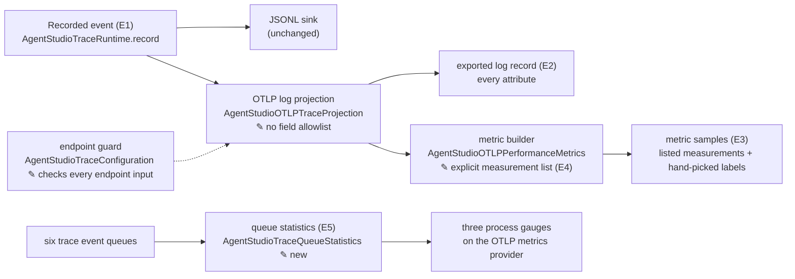
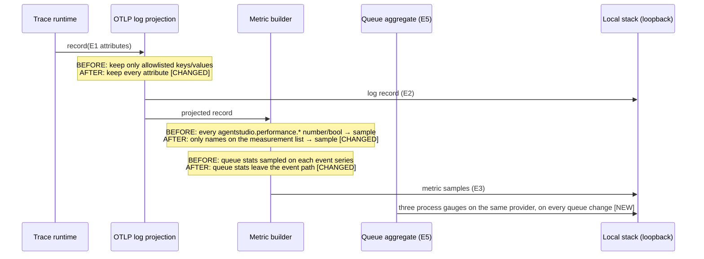

# Local telemetry without the field filter — Program Design

Requirements: [requirements](2026-10-12-otlp-export-without-field-allowlist-requirements.md) (U1–U4) → Specification: [specification](2026-10-12-otlp-export-without-field-allowlist.md) (E1–E6, R1–R10, V1–V7; revised 2026-10-15 after review) → this Program Design.

## How it works

Today, one filter decides two things: which log fields are exported, and which numbers become metrics. Metrics are built from the already filtered log record, and every surviving `agentstudio.performance.*` number or boolean becomes a sample.

The design splits the two decisions:

- the log projection stops filtering fields;
- the metric builder gets its own explicit measurement list, and that list alone decides which numbers become samples.

`✎` marks a changed component. Recording, JSONL and the tag selection stay unchanged. The endpoint guard now checks every input that decides the exporter's endpoint (R2). The trace event queues change in one way: each registers with, and reports to, the process-level queue aggregate (E5), whose gauges feed the OTLP metrics provider independently of log emission.

## Where each entity lives

| E | Semantic owner | Home | Schema / type home | Shape at each boundary | Disposition |
| --- | --- | --- | --- | --- | --- |
| E1 Recorded event | `AgentStudioTraceRuntime` | `Infrastructure/Diagnostics/AgentStudioTraceRuntime.swift` (existing, unchanged) | `[String: AgentStudioTraceValue]` attributes, body, resource (existing) | runtime → sinks (existing) | runtime |
| E2 Exported log record | `AgentStudioOTLPTraceProjection` | `Infrastructure/Diagnostics/AgentStudioOTLPTraceProjection*.swift` (modified: key/value allowlists, identifier, error and payload-name gates and the array omission are removed) | `AgentStudioOTLPProjectedLogRecord` (existing) | projection keeps `.string`, `.int`, `.double`, `.bool`, `.stringArray` (array omission removed) → `AgentStudioOTLPBootstrapper`'s metadata adapter (`AgentStudioOTLPBootstrapper.swift:275–287`, unchanged): strings `.string`, arrays `.array`, numbers and booleans `.stringConvertible` → swift-otel 1.0.5 encodes them as text (`OTelLogRecord+Proto.swift:82`). R1 is stated on that text form | exported |
| E3 Metric sample | `AgentStudioOTLPPerformanceMetrics` | `Infrastructure/Diagnostics/AgentStudioOTLPPerformanceMetrics.swift` (modified) | `AgentStudioOTLPPerformanceMetricSample` (existing) | record → sample(label, dimensions, value) (existing). The metric dimension helpers take over the value checks the projection used to apply to picked dimensions (for example the five interaction kinds, `AgentStudioOTLPTraceProjection+ControlledStrings.swift:48–50`, and the RepoExplorer value sets, `AgentStudioOTLPRepoExplorerTaxonomy.swift:398–445`), applied where the dimension is built (`AgentStudioOTLPPerformanceMetrics.swift:234–245, 362–449, 773–790`). A value outside the set adds no label; the log keeps it | derived |
| E4 Measurement | `AgentStudioOTLPPerformanceMetrics` (explicit list) | sibling `AgentStudioOTLPMeasurementList.swift` (new) | `Set<String>` of attribute names, each with a comment naming its emitter (new) | gate in the sample mapping (changed); the admitted-event counter (`counter(for: metricEvent)`, metrics file line 31) and the duration-derived instruments stay outside the gate | static |
| E5 Queue statistics | each `AgentStudioTraceEventQueue` reports into one process-level aggregate (new), which owns the totals for the whole process. The bootstrapper attaches the aggregate to the OTLP metrics provider: when it creates the metrics backend (`AgentStudioOTLPBootstrapper.swift:42–76`), it creates the three gauges with that backend's factory (the same private factory the per-event instruments use; nothing calls `MetricsSystem.bootstrap`, so a gauge without it is a no-op) and calls `attach(gauges:)`. Attaching records the retained totals at once; every later change records again. `shutdown()` detaches before the provider stops; totals, including cumulative drops, stay in the aggregate. With OTLP disabled or refused, nothing attaches | `Infrastructure/Diagnostics/AgentStudioTraceQueueStatistics.swift` (new, lock-protected value owner); the six queues (Bridge, RepoExplorer, AtomLib, Performance, Startup, TCC) register on creation | per queue: dropped (cumulative), pending, backlog. Totals: sum of dropped (survives retirement), sum of pending, peak of summed backlog | Edges: queue enqueue, drop, drain and retire → `report(queueId, delta)` → recompute totals → `Gauge.record` for dropped (cumulative), pending and peak backlog. Retirement removes the queue's pending and backlog, keeps its drops, and records the gauges at once. The three gauges carry resource labels only. The per-event attribute copies stay in logs (R1) and stop feeding metrics. | derived |
| E6 Local stack | shared host (out of scope) | `~/dev/ai-tools/observability` (unchanged) | — | loopback OTLP HTTP (unchanged) | external |

Other changes:

- **Taxonomy:** the sidebar metric taxonomy admits `surface=panes` and grouping `activity`. Today `SidebarMetricSurface` and the controlled group-mode values reject them (R5).
- **Verifier scripts:**
  - `verify-debug-observability.sh`, `verify-beta-observability.sh` and `verify-bridge-observability.sh` drop their ID and path absence checks and keep their secret-value checks;
  - `verify-sidebar-performance-workload.sh` reads the process-level queue gauge instead of the copy on `runtime_delivery.snapshot`.
- **Docs:** every passage found by the V6 search is updated (R8). That includes the observability doc's "OTLP Projection" section, its JSONL-only identifier rule (~line 99) and its allowlisted-fields safety line (~line 227), and the CLAUDE.md "OTLP output is source-scrubbed" sentence. The new CLAUDE.md sentence keeps the rule that agent message text is never recorded in telemetry (R10).

## Request path, before and after

## Alternatives considered

| Option | What changes | Verdict |
| --- | --- | --- |
| **Delete the log filter; give metrics an explicit list (selected)** | Logs carry everything. Metrics carry listed measurements, with queue statistics once per process. | Matches U1–U3; series count drops (R7). |
| Keep the filter and widen it | Add the missing keys and values | Rejected: keeps the hand-kept list the owner wants gone (U1), and every new field still needs a list edit. |
| Delete the filter; derive metrics from every number | No metric list | Rejected: flags, sequences and every new number become series, which is the "slop" U2 forbids. |

## The explicit measurement list

The list is derived from the current emitters in source, not from a metric-store snapshot. The first implementation slice enumerates every numeric attribute an emitter records under both metric source namespaces, `agentstudio.performance.*` and `agentstudio.bridge.*` (the Bridge mapping is `AgentStudioOTLPPerformanceMetrics.swift:662`), each with its file anchor. Existing Bridge measurements, such as `agentstudio.bridge.native_capacity.entry.count`, stay. It then classifies each one as a real duration, count, size or occupancy, or as a flag, sequence or bookkeeping value. The runtime census (`tmp/otlp-lane3-evidence.md` §3: 20 flag and 3 sequence gauges) is a cross-check, not the source. Measurements that are rare at runtime, such as IPC detail duration and reply bytes, stay. Booleans never become samples. A future numeric field becomes a metric only by adding it to the list in the same change that emits it. That is the review point for cardinality.

## Invalid states and how they are kept out

| Invalid state | Decision |
| --- | --- |
| A flag, sequence or unlisted number becomes a metric series | Rejected at the sample mapping: a name not on the list produces no sample. Enforced by an automated test (V3). |
| Queue statistics labeled per event | The queue keys are handled before the per-event sample path and emitted without the `event` dimension (automated test, V3). |
| Export to a non-loopback address | The guard in `AgentStudioTraceConfiguration` (`:151–157, 325–359`) checks the shared endpoint today. swift-otel's public backend constructors then reapply the process environment (`OTel+Backends.swift:110–114, 228–232, 354–358`), and a per-signal `OTEL_EXPORTER_OTLP_{LOGS,METRICS,TRACES}_ENDPOINT` takes precedence over the shared one (`Environment.swift:77–87`). The resolving API is internal to the SDK. So the guard reads those three variables from the same process environment, and refuses OTLP export (JSONL only, as for a remote shared endpoint) if any one that is set is not loopback. The variable list is swift-otel 1.0.5's; a swift-otel bump rechecks it (V2's real-receiver test fails if precedence changes). Redirects: an accepted residual (owner, 2026-10-21; R2 is endpoint-only), because swift-otel follows up to 20 from a configuration the app cannot reach. |

## Failure

- **Local stack unreachable:** unchanged. Export is fail-open, and JSONL still writes.
- **Collector redaction:** unchanged. It still removes token, secret, password and payload patterns. This design relies on the loopback endpoint check, not on redaction.

## How each requirement works and how it is proven

| U | R | E | Owner | Interface | Shape and home | State | Failure | Proof |
| --- | --- | --- | --- | --- | --- | --- | --- | --- |
| U1, U3 | R1: every recorded attribute appears unchanged in the encoded export (app boundary) | E1, E2 | `AgentStudioOTLPTraceProjection` | `project(record)` (existing entry) | `AgentStudioOTLPProjectedLogRecord`, AnyValue incl. arrays | stateless | none: no filter left to fail | V1 at the encoded boundary: real sink → bootstrapper → exporter → loopback receiver, decoded and compared per family; V4 real launch log query |
| U3 | R2: loopback-only effective endpoint | E6 | `AgentStudioTraceConfiguration` | endpoint validation: shared (existing) plus the three per-signal variables (new) | endpoint config (existing) | unchanged | any non-loopback input → JSONL only | V2 existing configuration tests, per-signal refuse/allow tests, one real-receiver precedence test |
| U3 | R3: atoms opt-in unchanged | E1 | `AgentStudioTraceTag` | wildcard parsing (existing) | tag set (existing) | unchanged | — | V2 existing tests |
| U2, U3 | R4: samples only for listed measurements and queue stats | E3, E4, E5 | `AgentStudioOTLPPerformanceMetrics` | sample mapping gated by the measurement list | `Set<String>` list; `AgentStudioOTLPPerformanceMetricSample` | stateless | unlisted → no sample | V3 metric tests; V4 series census |
| U2, U4 | R5: hand-picked labels and values; Panes and activity admitted | E3 | metric taxonomy and dimension helpers | dimension selection (existing) plus the value checks moved from the projection | `SidebarMetricSurface` + group-mode values (modified); existing value sets (moved) | stateless | value outside the set → no label | V3, through projection → metric builder, counter included |
| U3 | R6: queue totals process-level only | E5, E3 | `AgentStudioTraceQueueStatistics`, attached by `AgentStudioOTLPBootstrapper` | queue registration and report (new); `attach(gauges:)` / `detach()` (new) | three total gauges from the backend's factory, resource labels only | cumulative drops survive retirement and detach; pending and backlog are current | not attached → totals kept, nothing exported | V3 through the real provider: changes before the provider exists, pending back to zero with no later log, retirement, shutdown; V4 (no `trace_queue` series with `event` label) |
| U2 | R7: removed noise gone; growth only from itemized restored cohorts with closed labels; counts reported | E3 | `AgentStudioOTLPPerformanceMetrics` | — | — | — | — | V4 before/after census on the same workload |
| U3, U5 | R8: docs and CLAUDE.md updated; message-text rule kept | none: documentation | docs owner | — | the two passages | — | — | V6 |
| U5 | R10: message text never recorded, so never exported | E1, E2 | the event recorders (unchanged: none records message text today) | — | — | — | a future recorder adding message text breaks V7 | V7 marker-scoped launch before/after |
| U3 | R9: verifiers pass; only negatives tied to the retired export filter removed | E2, E3 | verifier scripts | their queries | the scripts named above; Bridge ingress validation (`BridgeTelemetryWireSchema.swift:19`) unchanged | — | — | V5 real-launch verifier runs |
