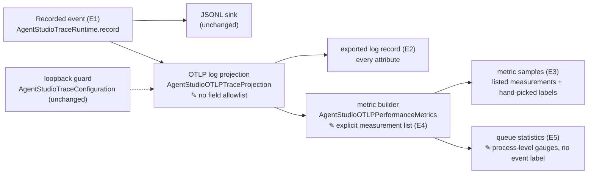
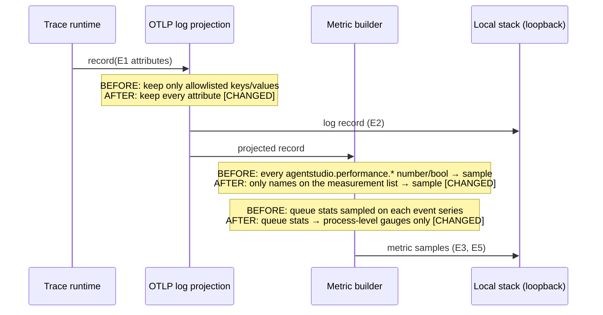

# Local telemetry without the field filter — Program Design

Requirements: [requirements](2026-10-12-otlp-export-without-field-allowlist-requirements.md) (U1–U4) → Specification: [specification](2026-10-12-otlp-export-without-field-allowlist.md) (E1–E6, R1–R9, V1–V6) → this Program Design.

## How it works

Today, one filter decides two things: which log fields are exported, and which numbers become metrics. Metrics are built from the already filtered log record, and every surviving `agentstudio.performance.*` number or boolean becomes a sample.

The design splits the two decisions:

- the log projection stops filtering fields;
- the metric builder gets its own explicit measurement list, and that list alone decides which numbers become samples.

`✎` marks a changed component. Recording, JSONL, the trace event queue, the loopback guard and the tag selection stay unchanged.

## Where each entity lives

| E | Semantic owner | Home | Schema / type home | Shape at each boundary | Disposition |
| --- | --- | --- | --- | --- | --- |
| E1 Recorded event | `AgentStudioTraceRuntime` | `Infrastructure/Diagnostics/AgentStudioTraceRuntime.swift` (existing, unchanged) | `[String: AgentStudioTraceValue]` attributes, body, resource (existing) | runtime → sinks (existing) | runtime |
| E2 Exported log record | `AgentStudioOTLPTraceProjection` | `Infrastructure/Diagnostics/AgentStudioOTLPTraceProjection*.swift` (modified: key/value allowlists, identifier, error and payload-name gates and the array omission are removed) | `AgentStudioOTLPProjectedLogRecord` (existing) | `.string`, `.int`, `.double`, `.bool`, `.stringArray` → OTLP AnyValue (array support added) | exported |
| E3 Metric sample | `AgentStudioOTLPPerformanceMetrics` | `Infrastructure/Diagnostics/AgentStudioOTLPPerformanceMetrics.swift` (modified) | `AgentStudioOTLPPerformanceMetricSample` (existing) | record → sample(label, dimensions, value) (existing) | derived |
| E4 Measurement | `AgentStudioOTLPPerformanceMetrics` (explicit list) | same file, or a sibling `…MeasurementList.swift` if the list is long (new) | `Set<String>` of attribute names (new) | gate in the sample mapping (changed) | static |
| E5 Queue statistics | trace event queue (producer, unchanged); metric builder (process-level reporting, changed) | `AgentStudioTraceEventQueue.swift` (unchanged); metrics file (modified) | three `agentstudio.performance.trace_queue.*` attributes (existing) | metric gauges `…trace_queue_*` with resource labels only (changed: no `event` dimension) | derived |
| E6 Local stack | shared host (out of scope) | `~/dev/ai-tools/observability` (unchanged) | — | loopback OTLP HTTP (unchanged) | external |

Other changes:

- **Taxonomy:** the sidebar metric taxonomy admits `surface=panes` and grouping `activity`. Today `SidebarMetricSurface` and the controlled group-mode values reject them (R5).
- **Verifier scripts:**
  - `verify-debug-observability.sh`, `verify-beta-observability.sh` and `verify-bridge-observability.sh` drop their ID and path absence checks and keep their secret-value checks;
  - `verify-sidebar-performance-workload.sh` reads the process-level queue gauge instead of the copy on `runtime_delivery.snapshot`.
- **Docs:** the observability doc's "OTLP Projection" section and the CLAUDE.md "OTLP output is source-scrubbed" sentence are updated (R8). The new CLAUDE.md sentence keeps the rule that agent message text is never recorded in telemetry (R10).

## Request path, before and after

## Alternatives considered

| Option | What changes | Verdict |
| --- | --- | --- |
| **Delete the log filter; give metrics an explicit list (selected)** | Logs carry everything. Metrics carry listed measurements, with queue statistics once per process. | Matches U1–U3; series count drops (R7). |
| Keep the filter and widen it | Add the missing keys and values | Rejected: keeps the hand-kept list the owner wants gone (U1), and every new field still needs a list edit. |
| Delete the filter; derive metrics from every number | No metric list | Rejected: flags, sequences and every new number become series, which is the "slop" U2 forbids. |

## The explicit measurement list

The list contains the measurement names the evidence census classified as real durations, counts, sizes or occupancies. That is every current metric name except the 20 flag gauges and 3 sequence gauges; the census source is `tmp/otlp-lane3-evidence.md` §3, in the implementation worktree. Booleans never become samples. A future numeric field becomes a metric only by adding it to the list in the same change that emits it. That is the review point for cardinality.

## Invalid states and how they are kept out

| Invalid state | Decision |
| --- | --- |
| A flag, sequence or unlisted number becomes a metric series | Rejected at the sample mapping: a name not on the list produces no sample. Enforced by an automated test (V3). |
| Queue statistics labeled per event | The queue keys are handled before the per-event sample path and emitted without the `event` dimension (automated test, V3). |
| Export to a non-loopback address | Unchanged guard in the trace configuration (existing tests, V2). |

## Failure

- **Local stack unreachable:** unchanged. Export is fail-open, and JSONL still writes.
- **Collector redaction:** unchanged. It still removes token, secret, password and payload patterns. This design relies on loopback-only export, not on redaction.

## How each requirement works and how it is proven

| U | R | E | Owner | Interface | Shape and home | State | Failure | Proof |
| --- | --- | --- | --- | --- | --- | --- | --- | --- |
| U1, U3 | R1: every recorded attribute appears unchanged in the exported log | E1, E2 | `AgentStudioOTLPTraceProjection` | `project(record)` (existing entry) | `AgentStudioOTLPProjectedLogRecord`, AnyValue incl. arrays | stateless | none: no filter left to fail | V1 projection tests per family; V4 real launch log query |
| U3 | R2: loopback-only export | E6 | `AgentStudioTraceConfiguration` | endpoint validation (existing) | endpoint config (existing) | unchanged | non-loopback → JSONL only (existing) | V2 existing configuration tests |
| U3 | R3: atoms opt-in unchanged | E1 | `AgentStudioTraceTag` | wildcard parsing (existing) | tag set (existing) | unchanged | — | V2 existing tests |
| U2, U3 | R4: samples only for listed measurements and queue stats | E3, E4, E5 | `AgentStudioOTLPPerformanceMetrics` | sample mapping gated by the measurement list | `Set<String>` list; `AgentStudioOTLPPerformanceMetricSample` | stateless | unlisted → no sample | V3 metric tests; V4 series census |
| U2, U4 | R5: hand-picked labels; Panes and activity admitted | E3 | metric taxonomy | dimension selection (existing) | `SidebarMetricSurface` + group-mode values (modified) | stateless | — | V3 |
| U3 | R6: queue statistics process-level only | E5, E3 | `AgentStudioOTLPPerformanceMetrics` | queue-key branch (new) | three gauges with resource labels only | latest value per process | — | V3; V4 (no `trace_queue` series with `event` label) |
| U2 | R7: fewer series, counts reported | E3 | `AgentStudioOTLPPerformanceMetrics` | — | — | — | — | V4 before/after census on the same workload |
| U3, U5 | R8: docs and CLAUDE.md updated; message-text rule kept | none: documentation | docs owner | — | the two passages | — | — | V6 |
| U5 | R10: message text never recorded, so never exported | E1, E2 | the event recorders (unchanged: none records message text today) | — | — | — | a future recorder adding message text breaks V7 | V7 marker-scoped launch before/after |
| U3 | R9: verifiers pass; secret checks kept | E2, E3 | verifier scripts | their queries | the scripts named above | — | — | V5 real-launch verifier runs |
