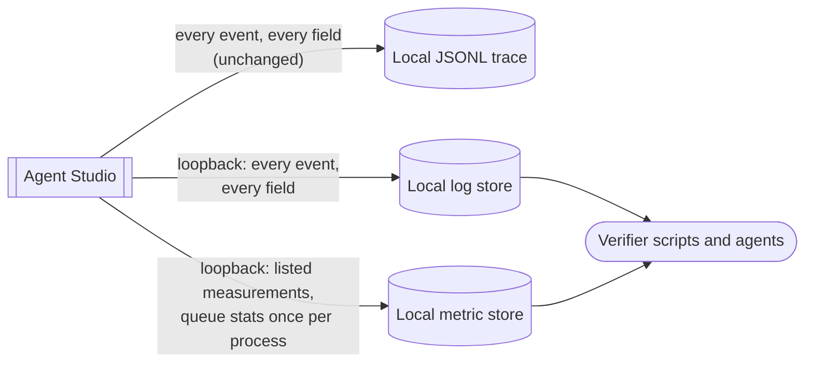

# Local telemetry without the field filter — Specification

Requirements: [requirements](2026-10-12-otlp-export-without-field-allowlist-requirements.md) (U1–U4) → this Specification → Program Design: [program design](2026-10-12-otlp-export-without-field-allowlist-program-design.md)

## Defined terms

| ID | Term | Identity rule | Relationships | Invariants | States |
| --- | --- | --- | --- | --- | --- |
| E1 | Recorded event | One call that records a trace event: an event name, attributes, resource, optional trace and span ids, and a time. Two calls are two events, even with identical content. | Produces one E2 when exported; may produce E3s. | Which events are recorded, and when, does not change. | recorded; dropped by the tag selection (unchanged) |
| E2 | Exported log record | The log record the local log store receives for one E1. | Exactly one per exported E1. | Carries every E1 attribute (E1 + E2 rule, R1). | exported; not exported because the endpoint is not loopback, or the tag is not selected |
| E3 | Metric sample | One value for one metric name and one label set, derived from a performance E1, or one queue-statistics value (E5). | Derived from an E1 attribute that is an E4, or from E5. | Exists only for an E4 or E5 (R4). | — |
| E4 | Measurement | A numeric attribute name the app records that is a real duration, count, size or occupancy. One name is one measurement, whatever event carries it. The list is derived from the current emitters in source, each entry with its emitter, not from a metric-store snapshot, so a measurement that is rare at runtime is not lost. | Belongs to the explicit list. Becomes E3 samples. Two existing derived instruments are also permitted: the admitted-event counter (`agentstudio_performance_events_total`) and the instruments derived from a listed duration, such as the elapsed maximum. | Flags (0/1 state), sequence numbers and bookkeeping values are not measurements. | listed |
| E5 | Queue statistics | The app's trace event queues are Bridge, RepoExplorer, AtomLib, Performance, Startup and TCC. Their statistics are reported as **process totals**: cumulative dropped records across all queues, current combined pending requests, and the peak combined backlog. There is one set per app process. | Reported as process-level E3s. | Never copied as labels or samples onto other events' metric series. An idle or retired queue cannot erase another queue's loss, and cumulative drops survive a queue's retirement. Each value is the latest at export time. | — |
| E6 | Local observability stack | The log and metric stores at a loopback address that the app exports to. | Receives E2 and E3. | Every configured export endpoint is a loopback address. Redirects are not checked (R2). | — |

## Requirements

| ID | Requirement | Over | From | Pass / fail |
| --- | --- | --- | --- | --- |
| R1 | When an E1 is exported, the encoded log record the app sends must carry every attribute of the E1 under the same name. Strings and string arrays keep their exact value. Numbers and booleans arrive as their text (`7`, `0.25`, `true`), because the log metadata the SDK encodes has no numeric or boolean form, and the local log store keeps every field as text. No allowlist of names or values may remove one. This holds at the app's export boundary; transformations made by the shared collector are outside it. | E1, E2 | U1, U3 | Fail if any attribute present in the JSONL record is missing or changed in the encoded export. Examples: `sidebar.surface=panes`, `sidebar.sort_order`, `git.admission_to_status.elapsed_ms`, and a string array. |
| R2 | The effective export endpoint for every signal (logs, metrics and traces) must be a loopback address. Effective means after every configuration source the exporter reads, including the per-signal `OTEL_EXPORTER_OTLP_{LOGS,METRICS,TRACES}_ENDPOINT` variables. A non-loopback endpoint is refused, and the app keeps writing JSONL, as today. The guarantee covers the configured endpoint only: swift-otel's exporters follow up to 20 HTTP redirects (AsyncHTTPClient `.singletonConfiguration`, `Configuration+BrowserLike.swift:36`) from a configuration the app cannot reach (`OTLPHTTPExporter.swift:156`), so a loopback endpoint that redirects elsewhere is not refused. The owner accepted that residual on 2026-10-21 (endpoint-only guarantee, option b). | E6 | U3 | Fail if any signal exports to a non-loopback endpoint set by any configuration source. |
| R3 | Atoms-tagged events must stay excluded from the wildcard tag selection unless explicitly opted in, as today. | E1 | U3 | Fail if `*` alone exports atoms events. |
| R4 | E3 samples must come only from E4 names on one explicit measurement list, the two permitted derived instruments, and E5. Flags, sequence numbers and unlisted numeric attributes must produce no metric samples. They stay in logs (R1). | E3, E4, E5 | U2, U3 | Fail if a metric series exists for a flag, a sequence number, or a numeric name not on the list; or if a source-backed measurement or the event counter is lost. |
| R5 | E3 labels must come only from the existing hand-picked label sets per event family. Sidebar `surface=panes` and grouping `activity` must be admitted as label values. | E3 | U2, U4 | Fail if a label outside the hand-picked sets appears, or if a Panes sidebar event produces no sidebar metrics. |
| R6 | E5 must be reported as process-level samples with no per-event label, and must not appear on any other event's metric series. Logs keep the copied queue fields on each event (R1). | E5, E3 | U3 | Fail if any non-queue event's metric series carries a queue statistic, or if queue statistics are missing at the process level. |
| R7 | After the change, the flag, sequence and per-event queue series are gone from the local metric store for the same explicit workload. Any net growth comes only from restored measurements whose labels are closed sets, today the Panes surface and the activity group that main was dropping. The report itemizes removed noise and each restored cohort with its series count, and gives the net count. A forecast does not substitute for the measured result. (Amended 2026-10-23: the owner adopted a small always-on core with opt-in detail, designed separately; restored coverage is not slop.) | E3 | U2 | Fail if a removed category is still present, if any growth falls outside the itemized restored cohorts, if a restored label is not a closed set, or if no measured count is reported. |
| R8 | Every documentation passage that states the old export filter must describe the new behavior in the same change. That covers the observability doc's OTLP projection section, its JSONL-only identifier rule (~line 99) and its "only allowlisted fields" safety check (~line 227), plus the CLAUDE.md sentence that says OTLP output is source-scrubbed. The rewritten CLAUDE.md sentence must keep the R10 rule. | — | U3, U5 | Fail if any passage still describes the field filter or JSONL-only identifiers, or if the CLAUDE.md sentence no longer says message text is never recorded in telemetry. |
| R9 | Verifier scripts that read the local stack must still pass. Only the negatives that exist solely because of the retired export filter are removed: ID or path absence. Kept: secret and token assertions, and independent taxonomy, ordering and completeness checks, including Bridge's own ingress validation. Secret checks are field-name checks; nothing here claims to detect secrets inside arbitrary values. | E2, E3 | U3 | Fail if a verifier fails because of this change, or if a secret, token, taxonomy, ordering or completeness check was removed. |
| R10 | Agent message text must never be an E1 attribute value, so it reaches neither the JSONL trace nor any E2. Removing the field filter must not change this. | E1, E2 | U5 | Fail if the body of a pane message sent during a real debug launch appears in any JSONL record or in the local log store. |

If the local stack is unreachable, the app behaves as today: export failure is fail-open, and JSONL still writes. Which events are recorded, and when, does not change.

## Proof

| ID | Proves | Evidence |
| --- | --- | --- |
| V1 | R1 | Automated, at the encoded boundary: representative events from every family, including Panes sidebar, sort order, git timings and Bridge, go through the real sink and exporter to a loopback receiver. The decoded log request carries every recorded attribute under its name, strings and arrays exactly, numbers and booleans as their text. Projection equality alone does not pass V1. |
| V2 | R2, R3 | The existing configuration tests (loopback accept and remote refuse, for every signal; atoms opt-in) stay and pass. New: a remote value in each per-signal endpoint variable refuses export (JSONL only), a loopback value is allowed, and one real-receiver test shows the exporter honors a per-signal variable over the shared one, so the guard is checking the input that decides. Redirects are outside R2 (owner decision, 2026-10-21), so no redirect test is required. |
| V3 | R4, R5, R6 | Automated: metric samples appear only for listed measurements and the permitted derived instruments. The event counter and source-backed measurements (for example IPC detail duration and reply bytes) are kept. Flags, sequences and unlisted numbers produce none. The Panes and activity labels are admitted, and a label value outside the existing picked set produces no new label value while the log keeps it. Queue totals appear only as process-level series, and are exercised across several queues with loss, a retired queue, and backlog returning to zero, through the real metrics provider (not default no-op gauges), including queue changes made before the provider exists. |
| V4 | R1, R7 | A real debug launch exporting to the local stack, running the same explicit workload before and after. Report removed noise, restored measurements and the net series count. Query the log store for fields that used to be dropped and are expected to survive the collector. |
| V5 | R9 | Run the verifier scripts that read the local stack against the real debug launch. Their secret, token, taxonomy, ordering and completeness checks are still there, and the queries that depend on the event counter still pass. |
| V6 | R8 | A search of `docs/` and `CLAUDE.md` for statements of the old filter (allowlisted, JSONL-only, source-scrubbed), then a review of every hit. |
| V7 | R10 | Marker-scoped real launch, before and after the change. Pane messages are sent whose bodies carry a distinct sentinel, and their admission and readback succeed. After a completed export window, every JSONL record and every exported log field are searched for the sentinel. Expect zero hits. Each sink has a working positive control: in JSONL, a recorded pane id; in exported logs, a field the baseline filter keeps (not a raw pane id, which the baseline removes). Baseline: 0 hits on main b37828fba on 2026-10-12 (2,852 JSONL records, 3,177 log records). |
