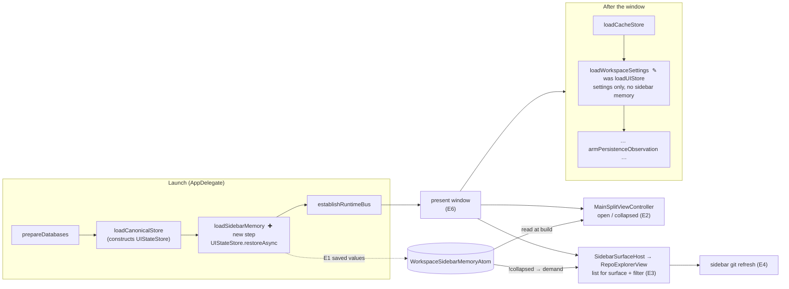
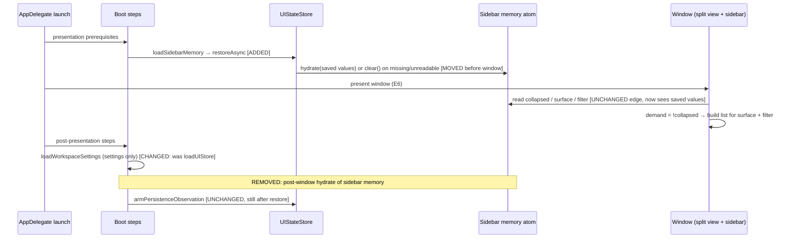

# Sidebar opens as you left it — Program Design

Requirements: [requirements](2026-10-12-sidebar-memory-before-presentation-requirements.md) (U1–U5) → Specification: [specification](2026-10-12-sidebar-memory-before-presentation.md) (E1–E6, R1–R9, V1–V6) → this Program Design.

## How it works

Every part of the sidebar already reads the saved sidebar memory (E1) when it is built, and watches it afterwards:

- the split view decides open or collapsed once, in `viewDidLoad`;
- the sidebar host turns "collapsed" into "don't build the list";
- the filter box copies the saved filter text once, when it appears.

They are wrong today for one reason: E1 is loaded after they are built. The design moves only the loading of E1 to before the window is built. The settings load stays after the window, unchanged. No sidebar code changes. Nothing new is added: no atom, store, event or coordinator.

`✚` marks an added step and `✎` a changed one. Nothing else in the flow changes.

## Where each entity lives

| E | Semantic owner | Home | Schema / type home | Shape at each boundary | Disposition | Convention |
| --- | --- | --- | --- | --- | --- | --- |
| E1 Saved sidebar memory | `UIStateStore` restores and persists it. `WorkspaceSidebarState` holds the live value. | `Core/State/MainActor/Persistence/UIStateStore.swift` (existing, unchanged); live value in `Core/State/MainActor/Atoms/WorkspaceSidebarState.swift` (existing, unchanged) | Main-window UI-state record in `local_window_state` (existing columns); `WorkspaceSidebarMemoryAtom` fields (existing) | SQLite → `LocalSQLiteRestoreOutcome` `.loaded(state?)` or `.unavailable(error)` → `WorkspaceSidebarState.hydrate(filterText:isFilterVisible:sidebarCollapsed:sidebarSurface:…)` (all existing) | persisted | Swift enums and records; repo `CLAUDE.md` atom rules |
| E2 Sidebar visibility | `MainSplitViewController` (native `NSSplitViewItem.isCollapsed`). The atom's `sidebarCollapsed` is its saved mirror. | `App/Windows/MainSplitViewController.swift` (existing, unchanged) | `Bool sidebarCollapsed` (existing) | read once in `viewDidLoad`; native → atom in `saveSidebarState` (existing) | persisted through E1, runtime native | — |
| E3 Sidebar list | `RepoExplorerProjectionAdapter` builds it on demand; `RepoExplorerTableMaterializer` draws rows | `Features/RepoExplorer` (existing, unchanged) | `isProjectionDemanded: Bool` from `SidebarSurfaceHost` (existing); projection request snapshot with surface and query (existing) | `SidebarSurfaceHost` → `RepoExplorerView.onChange/.task` → `updateDemand(isVisible:query:)` (existing) | derived | — |
| E4 Sidebar git refresh | repository fact demand fed by the sidebar's visible-worktree snapshot | `App/Coordination/WorkspaceSurfaceCoordinator+RepositoryFactDemand.swift` (existing, unchanged) | visible worktree snapshot (existing) | sidebar viewport publication → visible worktrees (existing) | derived | — |
| E5 Launch-to-usable time | `ApplicationLifecycleMonitor.publishFirstInteractiveFrame` → `recordStartupUsable` | `App/Lifecycle/ApplicationLifecycleMonitor.swift` (existing, unchanged) | `performance.startup.usable` record: `agentstudio.performance.elapsed_ms` (launch→usable), `startup.layout_settle_to_usable_elapsed_ms`, `startup.source` (existing) | app → JSONL/OTLP trace (existing) | measured | — |
| E6 First usable window | `AppDelegate.presentWindowAfterWorkspaceComposition` | `App/Boot/AppDelegate.swift` (existing, unchanged) | — | — | runtime | — |

The only modified code is the boot step list and its dispatch: `App/Boot/WorkspaceBootSequence.swift` and `App/Boot/AppDelegate+WorkspaceBoot.swift`. They gain `loadSidebarMemory`, and `loadUIStore` becomes `loadWorkspaceSettings`. The boot-order lines in `docs/architecture/structure/component_architecture.md` and `docs/architecture/state/workspace_data_architecture.md` change with them.

## Launch path, before and after

Here is how the edges change:

- **Before**, at `WorkspaceBootSequence.swift:49-65`, `AppDelegate.swift:309-320` and `AppDelegate+WorkspaceBoot.swift:340-342`: the window is built from defaults first, and the post-window `loadUIStore` then hydrates E1 into the atom. The split view never looks again, so the list's demand turns off.
- **After:** the hydrate runs before the window, and nothing hydrates E1 after it.
- **Kept on purpose:**
  - the split view reads E1 only when it is built;
  - `saveSidebarState` mirrors native → atom;
  - persistence stays armed only after restore.

## The invalid state, and how it is kept out

| Sidebar visible (E2) | List demand (E3) | Legal? | How it is kept out |
| --- | --- | --- | --- |
| open | building | yes | — |
| collapsed | off | yes | — |
| open | off | **no** (today's bug) | E1 is hydrated before any window or view exists. After launch, the only writers of the collapsed value are the split view's collapse, expand and resize paths, which set the native state and then mirror it to the atom. Enforcement: an automated boot-order test plus the restore-to-window integration seam (V2). |
| collapsed | building | no | Same as above. |

`WorkspaceSidebarState.hydrate` stays reachable only through `UIStateStore.restoreAsync`, which only the pre-window boot step calls.

## Failure and timing

| Case | What happens | Owner |
| --- | --- | --- |
| E1 absent (first launch) | `restoreAsync` gets `.loaded(nil)` and calls `clear()`. Defaults apply before the window: open, Repos, empty filter. | `UIStateStore` (existing) |
| E1 unreadable | `.unavailable` → `clear()` to defaults, plus a persistence-recovery report, as today but before the window. | `UIStateStore` (existing) |
| Datastore slow or stuck | The window already waits on the same datastore for `loadCanonicalStore`. This adds one small read to that same dependency, with no new timeout or fallback. | existing boot |
| Quit during startup | Unchanged and out of scope. Hydration finishing earlier only shortens the window in which defaults could be flushed. | — |

Concurrency: the hydrate runs on the MainActor before any window, view or persistence observer exists, so nothing can interleave with it. After launch, ordering is unchanged.

## Startup time

- **Cost:** one main-window row read moves in front of the window. Its earlier position in the post-window `loadUIStore` step (settings plus UI state together) measured 20–206 ms on the owner's 0.0.105–0.0.111 launches, queued behind cache loads. Alone and earlier it should be shorter, but that has not been measured yet.
- **Proof (R9):** compare E5 over repeated launches of `main` and of this change, on the same Mac and workspace. Read E5 from the existing `performance.startup.usable` launch-to-usable value; the `workspace.boot.step` timestamps show the new step's own duration.

## Alternatives considered

| Option | What changes | Gain | Cost | Verdict |
| --- | --- | --- | --- | --- |
| **Split the step (selected)** | Only E1 restores before the window; settings stay after | Smallest pre-window cost; no other sidebar code changes | A new step name in boot traces | Selected. Falsifier: E5 regresses beyond the baseline spread. |
| Move all of `loadUIStore` before the window | Settings and E1 both restore before the window | Repository sort is also right on first paint | A second read before the window; contradicts the Specification, which keeps settings timing | Rejected |
| Read E1 inside the canonical composition load | Sidebar fields come from the `local_window_state` read already done for width | No extra read | Two owners for one row's restore, against one store per persistence boundary; a bigger change | Kept as the revisit path if E5 regresses |

## How each requirement works and how it is proven

| U | R | E | Owner | Interface | Shape and home | State | Failure | Proof |
| --- | --- | --- | --- | --- | --- | --- | --- | --- |
| U1 | R1: saved open or collapsed shown at E6; no repositories → collapsed | E1, E2, E6 | `MainSplitViewController` | `viewDidLoad` collapse decision (existing) | `Bool sidebarCollapsed`, `WorkspaceSidebarMemoryAtom` | atom hydrated before construction | missing or unreadable → defaults (R8) | V2 restore-to-window integration seam; V1 real launch matrix |
| U1 | R2: saved surface and filter shown at E6; list built for them | E1, E3, E6 | `RepoExplorerProjectionAdapter` | `.task` → `updateDemand(isVisible:query:)`; input capture reads the surface (existing) | `SidebarSurface`, `filterText` in `WorkspaceSidebarMemoryAtom` | first projection uses hydrated values | defaults on failure | V1 real launch matrix (filter box text, selected surface, row content) |
| U2 | R3: list current after launch without interaction | E2, E3 | `RepoExplorerProjectionAdapter` + `RepoExplorerTableMaterializer` | demand true from the start | `isProjectionDemanded` | never suspended at launch | — | V1 (all visible rows drawn before any interaction); V2 (demand and bindings) |
| U2 | R4: later changes update the list all session | E2, E3 | `RepoExplorerProjectionAdapter` observation tokens | installed when demanded (existing) | invalidation tokens (existing) | demanded → observing | — | V3 live-update check |
| U2 | R5: sidebar git refresh runs while open | E2, E4 | repository fact demand | sidebar visible-worktree snapshot (existing) | visible worktree snapshot | published while demanded | — | V3 (sidebar-tier git status records in the app log) |
| U1, U2 | R6: visible state and acted-on state always agree | E2, E3, E4 | `MainSplitViewController` (sole collapsed writer after launch) | collapse/expand/`saveSidebarState` (existing) | `Bool sidebarCollapsed` | illegal combinations unreachable (table above) | — | V2 plus the boot-order test; V1 log check (no hidden readback while open) |
| U1 | R7: saved value matches what is seen | E1, E2 | `UIStateStore` persistence (armed after restore) | `startObserving` / autosave (existing) | `local_window_state` UI columns (existing) | armed after restore | — | V4 saved-record readback vs visible state |
| U1, U2 | R8: missing or unreadable → defaults, never blank | E1, E2, E3, E6 | `UIStateStore.restoreAsync` | `.loaded(nil)` / `.unavailable` → `clear()` (existing) | `LocalSQLiteRestoreOutcome` | defaults before E6 | recovery report on unreadable | V5 first-launch and unreadable-record checks |
| U3 | R9: no startup regression beyond the baseline spread; numbers reported | E5 | `ApplicationLifecycleMonitor` | `recordStartupUsable` (existing) | `performance.startup.usable` record | measured per launch | — | V6 repeated-launch measurement, before and after |

Accepted requirements coverage:

- **Obligations:** R1–R9 each have a row above, all `covered`.
- **Entities:** E1–E6 are each bound in the table above.
- **Requirements rows:** U4 ("prove it where it failed") → V2. U5 is observational evidence only.
- **Proof obligations:** V1–V6 are each cited in at least one trace row.
- **Non-goals:** unchanged.

## Proof seams

- **V2, restore-to-window integration.** Seed a saved record (collapsed, Panes, filter) in a test datastore. Run the real presentation-prerequisite step list with the real `UIStateStore`. Then build the window and sidebar and read:
  - native collapsed;
  - the demand the sidebar host passes;
  - the filter the view copies;
  - whether visible cells are bound.

  The seam must use `WorkspaceBootSequence`'s real step list, not a hand-written order, so the test fails on today's code. Real: SQLite datastore, `UIStateStore`, boot step list and split view. Test stand-in: the window host, plus any heavy runtime service unrelated to the sidebar.
- **V1, V3, V4 and V5, real app.** A debug build with its own identity. Saved state is set through the app (IPC `toggleSidebar` and the surface and filter commands), never by editing data. The app is stopped by PID and relaunched. Checks: a screenshot before any interaction, the app's own sidebar projection readbacks (`demand_state`, `presentation_state`), sidebar-tier git status records, and a read-only look at the saved record.
- **V6, startup time.** Repeated launches of each build from a stopped state. Read the `performance.startup.usable` launch-to-usable value per launch. Report the median and range per build.
