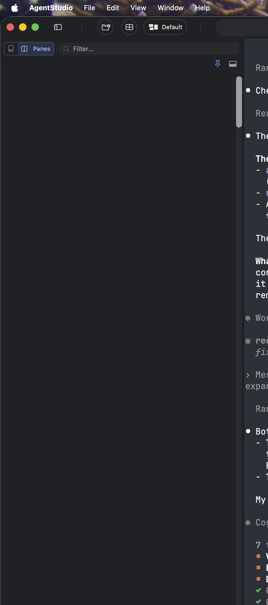
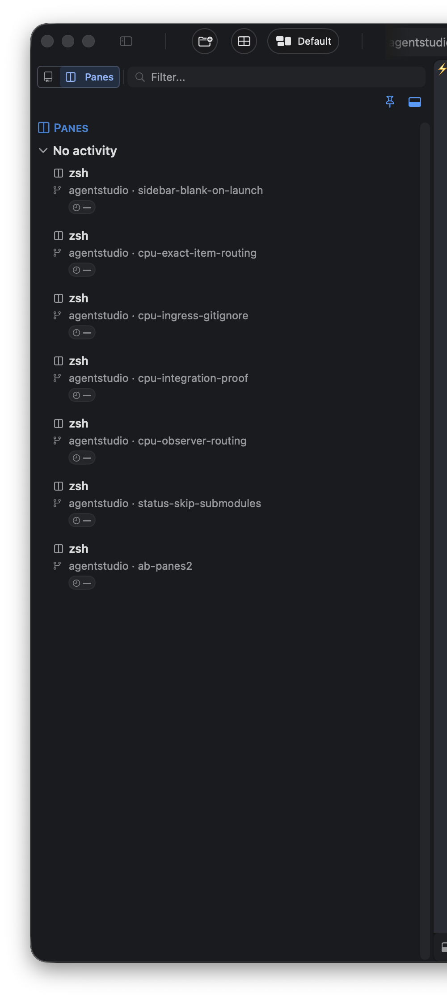

# Sidebar opens as you left it — Requirements

Specification: [2026-10-12-sidebar-memory-before-presentation.md](2026-10-12-sidebar-memory-before-presentation.md)

## Who is affected and what hurts

The person affected is the Agent Studio user, the owner, who runs many agents across worktrees. When they open the app, they use the sidebar to find panes and worktrees. Nobody else is affected: the sidebar is local to this Mac.

Today, about half of all launches open with a broken sidebar. The window shows the sidebar open, but the list is blank. A scroll brings rows back, but they are the Repos list frozen from launch, even when Panes is selected. The list never updates for the rest of the session. Git status for worktrees shown in the sidebar stops refreshing too. Collapsing and re-expanding the sidebar is the only way out.

| Today: blank on launch | Wanted: rows on launch |
| --- | --- |
|  |  |
| The owner's production v0.0.111 after a restart. Saved state: sidebar collapsed, Panes, filter `pstack`. | A debug launch of the same code (c390bf060) whose saved state was "open". This is the expected look after every launch. |

Evidence: the owner's live app, production logs, and a reproduction. Six of the 13 production launches retained since 2026-09-27 hit this, across 0.0.104, 0.0.109, 0.0.110 and 0.0.111. Recovery took between 8 minutes and 6 hours, and one 15-hour session never recovered. With "collapsed" stored, 2 of 2 reproduction launches came up blank. With "open" stored, 1 of 1 rendered.

## What the owner asked for

| ID | Need, in the owner's words | Why it matters | Authority | Priority |
| --- | --- | --- | --- | --- |
| U1 | Choice "a": load the saved sidebar state before the window appears, so the window opens exactly as you left it. That means collapsed or open, Repos or Panes, and the filter text. | The window must never start in a state that disagrees with what is saved. | authorized: owner, 2026-10-12, picked from the A/B/C brief | required (owner) |
| U2 | "we need the data to refresh right" | Loading the saved state is not enough. The list must show current data for that state and keep updating. | authorized: owner, 2026-10-12 | required (owner) |
| U3 | "how's the startup latency by this, let's ensure" | Loading earlier must not make the app slower to open. The effect must be measured. | authorized: owner, 2026-10-12 | required (owner) |
| U4 | "this is an old problem … take it seriously … inventory why it failed" | Earlier fixes (#406) and every test missed this, because none of them loaded saved state into a real window. The fix must be proven where it failed before. | authorized: owner, 2026-10-12 | required (owner) |
| U5 | The broken launch described above (6 of 13 launches; blank, stale, frozen; sidebar git refresh stopped) | This is the evidence of the current pain, not a request. | observational | — |

## Boundary

- **Goal:** after every launch, the sidebar matches the saved state and shows current, updating data, without the user scrolling or toggling.
- **Reuse:** the saved sidebar record that exists today, the existing sidebar list and its refresh, and the sidebar width, which is already restored before the window appears.
- **Missing:** the saved sidebar state reaches the window before anything reads it, and the list builds for that state.
- **Allowed to change:** startup ordering, and how the window and sidebar read the saved sidebar state.
- **Protected:**
  - the saved data format, which is not changed and not migrated;
  - CPU and refresh cost, with no extra refresh work added;
  - startup time, which must not get worse (U3).
- **Not in this change** (each is tracked separately):
  - sidebar width drift (450 shown versus 250 saved);
  - quitting during startup saving defaults over the saved state;
  - other startup findings: early git facts and replay, a failed boot flush, the view stop on disappear, and the #406 rebind gap;
  - telemetry and OTLP changes;
  - which settings are saved.
- **Acceptable complexity:** reorder and reuse the existing owners. No new atoms, stores, coordinators or bus events without asking the owner first. That is a standing owner rule.
- **Acceptable evidence:**
  - a real launch from a stored "collapsed, Panes, filter" state;
  - a measured startup-time comparison;
  - an automated test that loads saved state into the real window path.
