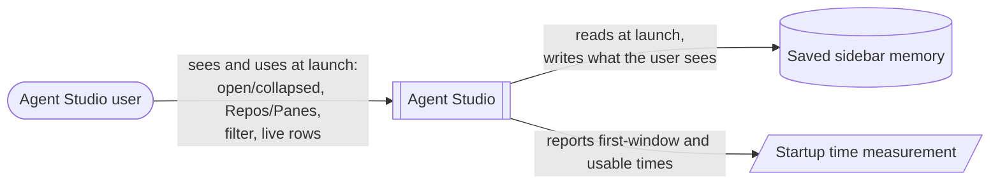
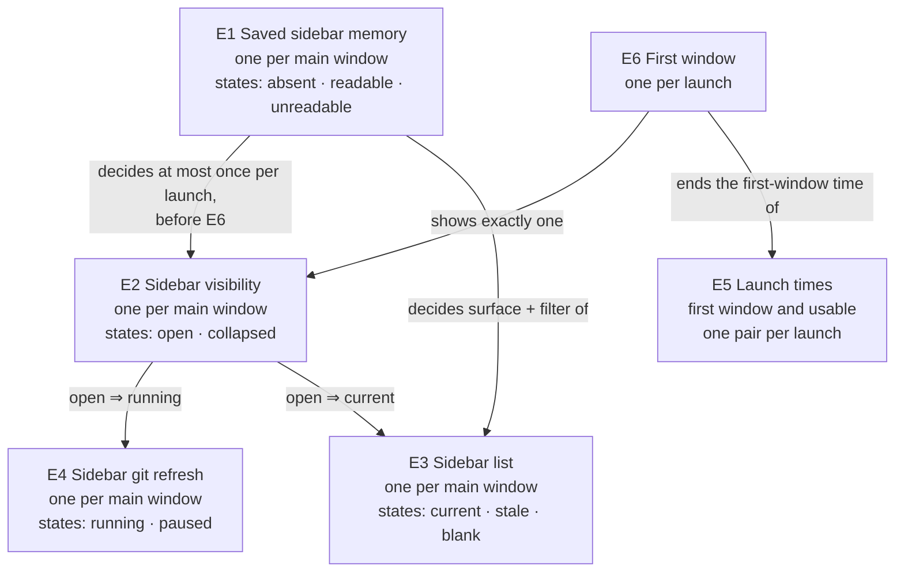

# Sidebar opens as you left it — Specification

Requirements: [2026-10-12-sidebar-memory-before-presentation-requirements.md](2026-10-12-sidebar-memory-before-presentation-requirements.md) (U1–U5) → this Specification → Program Design: [2026-10-12-sidebar-memory-before-presentation-program-design.md](2026-10-12-sidebar-memory-before-presentation-program-design.md)

## The model in one picture

Agent Studio is one opaque system here. The obligations below are about what the user sees and what is saved and measured, not about how the app is built inside.

## Defined terms

| ID | Term | Identity rule | Relationships | Invariants | States |
| --- | --- | --- | --- | --- | --- |
| E1 | Saved sidebar memory | One record per main window per workspace. It holds the sidebar choices the user makes: collapsed or open, Repos or Panes surface, filter text, and the Repos grouping and show-pinned and show-drawers choices. The latest written copy is the one that counts. Sidebar width is **not** part of E1; it is already restored before the window appears. | Belongs to one main window. Decides E2 and the surface and filter of E3 at launch. | Its format is unchanged by this work. | absent (first launch), readable, unreadable |
| E2 | Sidebar visibility | Whether the sidebar is shown open or collapsed in the main window. There is one per main window, and "visible" means what the user sees on screen, not an internal flag. | Shown by E6 at launch. Drives E3 and E4. | What the user sees and what the app acts on are the same at every moment after E6. | open, collapsed |
| E3 | Sidebar list | The rows the sidebar shows for the selected surface (Repos or Panes) and filter text. There is one per main window. Two lists are the same list when they are for the same window, whatever their contents. | Belongs to one window. Its surface and filter come from E1 at launch and from the user afterwards. | While E2 is open, E3 is never blank because of the saved state or launch order. | **current**: rows drawn, matching the data as of the last change. **stale**: rows drawn from older data, or for a surface or filter other than the selected one. **blank**: the list has rows but none are drawn. |
| E4 | Sidebar git refresh | The `visible_sidebar` git status tier for the repository worktrees, as distinct from the refresh for the active pane or for background worktrees. There is one per main window. | Runs while the window is presented and E2 is open (the app's "sidebar attended" condition). | Running while the window is presented and E2 is open. Paused while E2 is collapsed. | running, paused |
| E5 | Launch times | Two values per launch, both measured from the same launch's `app.process.start` record. **First-window time** runs to E6. **Usable time** runs to the existing `performance.startup.usable` record, which can come later than E6. | First-window time ends at E6. | The two are reported separately and never substituted for each other. | — |
| E6 | First window | The first time the main window is presented to the user in a launch. | Shows E2 and E3. | — | — |

## Requirements

| ID | Requirement | Over | From | Pass / fail |
| --- | --- | --- | --- | --- |
| R1 | When the app launches and E1 is readable, E6 must show E2 as saved: collapsed if saved collapsed, open if saved open. One exception, which is today's behavior and is kept: when the workspace has no repositories, E6 shows the sidebar collapsed. | E1, E2, E6 | U1 | Fail if the first window shows open while saved collapsed, or the reverse. |
| R2 | When the app launches and E1 is readable, E6 must show the saved surface (Repos or Panes) and the saved filter text in the filter box. E3 must be built for that surface and filter. | E1, E3, E6 | U1 | Fail if the first window shows Repos while saved Panes, an empty box while a filter is saved, or rows built for a different surface or filter. |
| R3 | While E2 is open, E3 must reach **current** after launch without any scroll, click or toggle. | E2, E3 | U2 | Fail if visible rows are blank, or show another surface's or filter's rows, once launch has settled. |
| R4 | While E2 is open, every later change to panes, worktrees, repositories, or the user's surface, filter and grouping choices must move E3 back to **current**, for the whole session. | E2, E3 | U2 | Fail if a change made while open never appears in the list. |
| R5 | While E2 is open and E3 has rows, E4 must be **running**. | E2, E4 | U2 | Fail if worktrees shown in an open sidebar get no git status refresh. |
| R6 | At every moment after E6, the state the user sees for E2 and the state the app acts on must agree. An open sidebar is never treated as collapsed, and the reverse. | E2, E3, E4 | U1, U2 | Fail if the sidebar is visibly open while its list or git refresh behaves as collapsed. |
| R7 | E1 written after launch must match what the user sees. The app must not save "collapsed" while the sidebar is open, or the reverse. | E1, E2 | U1 | Fail if the saved collapsed value differs from the visible sidebar after a save. |
| R8 | If E1 is absent or unreadable, then E6 must open with the defaults, and R3–R6 must still hold. The defaults are: Repos, empty filter, and open, except collapsed when the workspace has no repositories (today's behavior). A missing or unreadable record must never produce a blank list or stop the app from opening. | E1, E2, E3, E6 | U1, U2 | Fail if a first launch, or a launch with an unreadable record, shows a blank or frozen list or does not open. |
| R9 | Neither E5 value may be worse than it is today, beyond the unchanged app's own launch-to-launch spread on the same Mac and workspace. Both before and after values must be reported to the owner, who decides if any measured slowdown is acceptable. | E5 | U3 | Fail if either after-change value lies outside the before-change spread with no owner acceptance. If a value cannot be bounded tightly enough to decide, R9 is reported as unverified, not passed. |

The behaviors below are not changed and are not promised beyond today:

- **Width.** Sidebar width keeps its current behavior.
- **Order before the first window.** Only E1 is applied before E6. No E1 choice may be applied after E6. Other saved state still arrives after E6, as it does today, and may still settle after the window appears: sidebar group expansion, repository caches, repository sort order and editor choice.
- **Startup must not wait on disk errors.** An unreadable E1 falls back to defaults at once.
- **Early quits are unchanged.** Quitting before launch completes behaves as today.

## Proof

| ID | Proves | Evidence | Where it must be observed |
| --- | --- | --- | --- |
| V1 | R1, R2, R3, R6 | A real launch matrix with the saved record set through the app, never by editing data. It covers collapsed and open, Panes and Repos, and empty and non-empty filter. Each launch records a screenshot before any interaction, the visible collapsed state, the selected surface, the filter box text, and whether every visible row is drawn. | A debug build of the change, with its own identity, launched from a stopped state. |
| V2 | R1, R2, R3, R6, U4 | Automated tests that load a saved record through the app's real launch order into the real window and sidebar, in two cases. Case 1 is "collapsed, Panes, filter", the regression. Case 2 is "open, Panes, non-empty filter", with known rows that match the filter and known rows that do not. Neither case sets the sidebar's state or its demand by hand. Each reads the visible collapsed state, the selected surface and filter, which rows are listed, and which visible cells are actually bound. Case 1 must fail on today's code. | Swift test suite, red before the change and green after. |
| V3 | R4, R5 | Live-update check: after launch with the sidebar open, open a new pane or switch branch. The list shows it. A `visible_sidebar` worktree that is not the active pane's worktree gets a git refresh, with a refresh-completion record for that worktree, and its displayed status is current. | Debug build, plus the app's own logs. |
| V4 | R7 | Readback of the saved record after launch, and after one user toggle, compared with the visible sidebar. | The debug identity's saved data, read without modifying it. |
| V5 | R8 | A first launch with no saved record, a launch whose record cannot be read, and a workspace with no repositories. In each, the window opens, the defaults apply, rows are drawn where there are rows, and the visible collapsed state agrees with the state the app acts on. | Debug build, plus an automated test for the unreadable case. |
| V6 | R9 | Both E5 values over repeated launches of the unchanged app and the changed app, on the same Mac and workspace. Report per-launch values, and each set's median and range. Measurement uncertainty is reported, and never counted as baseline spread or as a pass. | Existing timestamped records: `app.process.start`, the `workspace.boot.step` records that bracket presentation, and `performance.startup.usable`. |

## What is out of scope

- **Sidebar width.** The width drift is tracked separately.
- **Quitting during startup.** The risk that this saves defaults over E1 is tracked separately.
- **Other startup findings.** These are tracked as separate items: early git facts and replay, the failed boot flush, the view stop on disappear, and the #406 rebind gap.
- **Telemetry and OTLP changes.**
- **Saved state outside E1 keeps its timing.** This covers group expansion, repository caches, repository sort order and editor choice.
- **No new saved fields and no format migration.**
