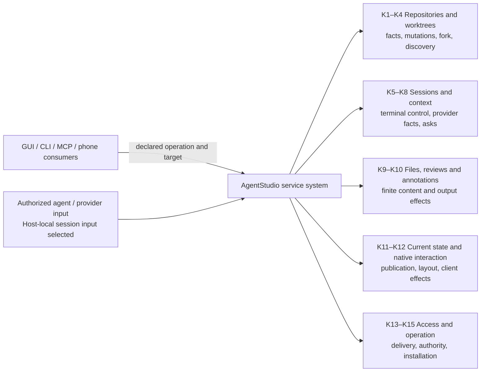

# Capability and interface contracts

This appendix belongs to the [observable Specification](2026-10-15-agentstudio-daemon.md), not a second Requirements source. The [Requirements](user-requirements.md) authorize the boundary; the [domain appendix](domain-entities.md) extends E1–E6 through E26. The [initial profile](initial-profile.md) and R1–R17/C1–C6/V1–V8 apply; exact scope and realization gaps remain explicit.

The surface survey establishes what exists today. It does not by itself select every SDK method as a public operation or settle new shared-state policy. The rows below distinguish the requested outcome, current observable semantics that an extraction must account for, and exact decisions still needed. For a selected Host capability, R4 requires its complete result/failure boundary on both platforms. Native client effects remain a distinct class. A proposal or unresolved slot is not a default an implementer may choose.

## Capability map

The reader question is which kinds of outcome a consumer requests. The system remains opaque; this picture assigns no crates, actors, databases or internal bus.

[Full-size rendered diagram](assets/capability-map.png).

### Complete surveyed-family disposition

This accounts for all eighteen surface families in the survey. Host work means the backend responsibility selected by S15, including Mac-local work. Exact public method exposure and platform profiles remain separate contract choices; the survey does not promote every SDK helper to an RPC. Cross-cutting rows qualify the other rows rather than adding another application service.

| Survey family | Observable home here | Boundary and exact scope status |
| --- | --- | --- |
| CLI worktree commands | K1/K4/K13 | Host filesystem/Git effects on the attached machine under R12; frontend entry R1 and Host-local session CLI work remain distinct. Daemon-absent branch availability remains G1/G12. |
| CLI package install/uninstall | K2/K15 | CLI installation effects on the attached machine/root under R12; standalone availability, resource pairing and native client effects remain G1/G12. |
| CLI provider hooks | K7/K14 | U15/R9 require Host-local authorized session input independent of Mac availability; exact admission G8/G12. |
| CLI pane verbs | K8/K13/K14 | Retained context, writer ordering, asks and notices; Host-session context under S14; cross-client presentation and retained settlement G8/G9. |
| RPC framing/descriptors | K13 | Shared external contract; no serializer or parallel implementation selected. |
| RPC serving/authority | K13/K14 | Local and network admission distinct; authenticated routing does not imply a remote trust policy. |
| Workspace/layout/command queries | K6/K12 | Client target and interaction contracts; selected shared tabs/layout under IP11; exact shared-layout detail G4/G9. |
| Sessions/pane context | K7/K8 | Domain admission and retained state independent of an attached view under U15; exact recovery G3/G6/G8. |
| Repository inventory | K3 | Discovery/observation versus canonical membership; target inventory scope G9. |
| Git/remote/Forge refresh | K1/K3/K11 | Host work-environment facts; Host refresh coverage and cross-client demand/currentness policy G9. |
| Native worktree creation | K1/K4 | Existing application policy differs from CLI/SDK mechanics; do not flatten those entry contracts. |
| Git package | K1/K4 | Forty-four SDK operations accounted for in the linked K1/K4 contracts; public subset remains G1. |
| Terminal | K5 | Session, attachment, control and fact lifetimes; controller/focus G4. |
| Bridge File/Review | K9 | Product construction/currentness separate from native render/install. |
| Annotations/output | K10/K12 | Retained annotations and immutable output attempts; destination locality explicit. |
| Native OS ingress/effects | K12 | Client platform effects, including chooser, lifecycle, editor/browser/Finder/clipboard. No Mac UI counterpart is required on Linux. |
| Observability/configuration | K11/K15 | Identity/channel/root, failure and privacy boundaries; distributed policy G8/G12. |
| Bridge development HTTP host | K9/K15 | Existing debug-only proof/composition surface. It is not a selected production daemon, remote server or additional service role. |

## Shared interpretation of an operation

For each selected public operation, its contract names the consumer, kind-qualified target and executing machine, input constraints, required authority, observable effect/result, refusal, partial/unknown effect, cancellation and pairing. These slots implement R4/U6/U9; none selects a generic retry or journal mechanism.

An E4 request/correlation identity identifies a submission. Transport admission, operation acceptance, committed domain state, external effect, retained receipt, client receipt and visible presentation are separate boundaries. A missing response cannot be converted to “no effect.” Semantic validation is separate from parsing. A result must preserve operation-specific distinctions rather than collapse them into a Boolean or an untyped error string.

Readback can establish present state. It attributes a previous attempt only where an operation-specific identity/effect contract establishes that link. Cancellation must state which work stopped, which work was joined, and which effects/residue remain; disconnect alone is neither cancellation nor rollback. The exact retained reconciliation and duplicate policy remains G8 per family, not a system-wide exactly-once promise.

## Contract homes and design sequence

Each K contract has exactly one home below. The shared interpretation above and coverage below apply to every slice. The [multi-design entry](designs/README.md) explains their inputs and sequence; these are design boundaries, not selected crates or separate services.

| Design | Observable contract home | Owned K identities |
| --- | --- | --- |
| DS01 | [Service contracts and protocol](designs/01-service-contracts/specification.md) | K13 |
| DS02 | [Data ownership, storage and replication](designs/02-data-ownership-replication/specification.md) | K11 |
| DS03 | [Authority, leases and central control plane](designs/03-authority-control-plane/specification.md) | K14 |
| DS04 | [Terminal sessions, attachments and facts](designs/04-terminal-runtime/specification.md) | K5 |
| DS05 | [Git operations, discovery and observations](designs/05-git-discovery/specification.md) | K1, K3 |
| DS06 | [Worktree fork and platform counterpart](designs/06-worktree-fork/specification.md) | K4 |
| DS07 | [Agents, provider input and retained context](designs/07-agents-context/specification.md) | K7, K8 |
| DS08 | [Files, reviews, annotations and output](designs/08-files-review-output/specification.md) | K9, K10 |
| DS09 | [Gateway, multi-host routing and CLI adapters](designs/09-gateway-cli/specification.md) | K2 |
| DS10 | [Swift clients, commands and native interaction](designs/10-swift-client/specification.md) | K6, K12 |
| DS11 | [Rust standards, operation and integrated design](designs/11-operations-integration/specification.md) | K15 |

## Capability-to-proof coverage and remaining choices

| Contract family | Requirement and entity trace | Smallest complete evidence class | Unsettled product meaning |
| --- | --- | --- | --- |
| K1/K4 Git/worktrees | U4/U5/U6/U11 → E7/E8/E22 → R2/R4 → C2/V2 | Real Git/ref/index/filesystem and controlled partial/race/cancel observations on both platforms | G1/G7/G8: supported operation/profile/receipt; no Linux counterpart waiver |
| K2 CLI | U2/U4/U17 → E4/E21/E23 → R1/R12 → C1/V1 | Actual invocation, route and named-machine effect | G1/G12: standalone availability and installation/resource profile |
| K3/K11 inventory/state | U4/U9/U13/U15/U16/U18/U22 → E7/E8/E19/E22/E25/E26 → R15–R17 → C2/C3/C5/C6/V2/V3/V4/V7/V8 | Current inventory plus actual source/currentness/membership and native publication, including absent clients; copied state is not an effect receipt | G3/G6/G8/G9: source truth, audience, sharing, coverage, history |
| K5 terminal | U14/U15/U16 → E1/E2/E3/E16/E19/E22 → R5–R7 → C3/V3/V4 | Real process, attachment, independent fact and native presentation evidence | G3/G4/G6/G8: recovery, controllers, ordered restoration, input effect |
| K6/K12 commands/native | U4/U6/U13/U22 → E4/E16/E25/E26 → R17 → C1/C6/V1/V8 | Supported command plus actual client-native target/effect/refusal | G1/G4/G9: selected surfaces and client/shared state |
| K7/K8 agents/context | U4/U9/U15 → E9/E10/E11/E17/E18 → R9/C3/V3 | Actual admission and retained transactional outcomes without Swift; Gateway-unreachable cases as K7 specifies | S14 resolves Host-local input; G3/G6/G8/G9 retention/authority and scope |
| K9/K10 review/output | U4/U9/U13 → E12–E15/E20/E22 → C2/V2 plus native effect | Actual source/revision/content/transaction and destination effect/finalization | G1/G7/G8/G9/G12: profile, retention and destination locality |
| K13 protocol | U1/U2/U3/U12/U16/U17/U18/U19 → E3/E4/E19/E20/E23/E24 → R1/R3/R7/R11–R13 → C1/C4/V1/V4/V6 | Whole-route independent clients and Hosts, real Swift/socket schema interoperability, bounded traffic and loss/failure; matched performance observations | G2/G8/G10/G12: supported profile, bounds, pairing |
| K14 authority | U9/U15/U17/U20/U21 → E10/E17/E18/E23/E24 → R9/R14 → C1/C3/C4/V1/V3/V5 | Allowed/refused/revoked-at-effect interactions; central lease authority, separate Gateway client role and no current writer-transfer capability | G8/G12/G13: credential/revocation and current lease profile |
| K15 engineering/operation | U6–U12 → E21/E22 → R8 → C4/V5 | Compiled/linted artifacts, real installation/lifetime and privacy outcomes | G11/G12: dependency safety, custody, release pairing |

The individual G rows in the spine remain the exact decision homes. The operational catalogue is complete as a survey disposition; final capability selection, public schemas and the remaining product policies are not settled by these tables. Crate/bus/storage/adapter design must consume that distinction rather than infer new promises from implementation mechanisms.
