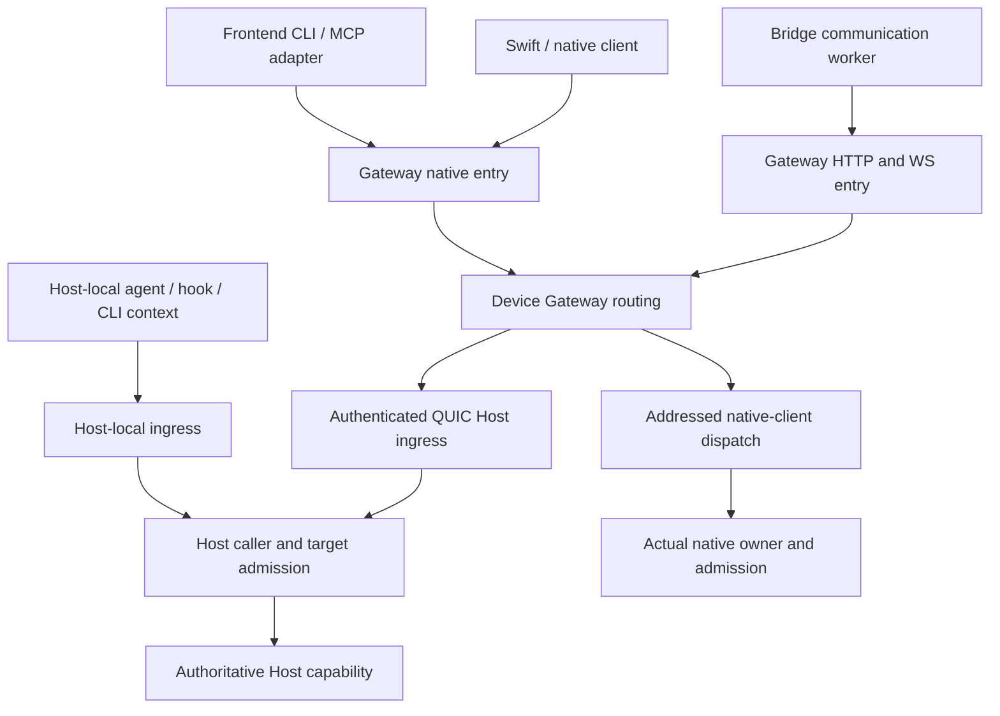
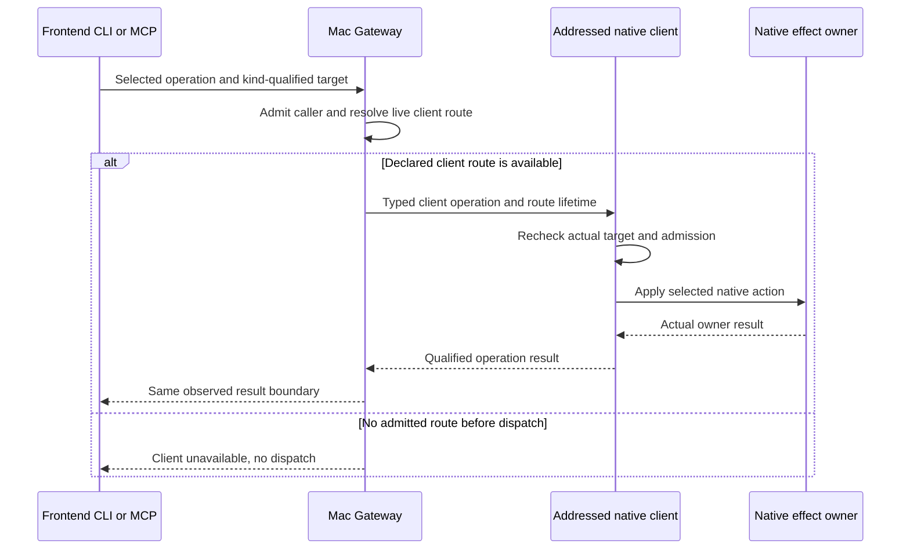

# Communication: what crosses each boundary

S28 requires the Gateway role on macOS and iOS; S32 now selects the physical split: native control through Mac UDS or embedded iOS FFI, and Bridge content/update delivery directly through loopback HTTP/WebSocket. The [bounded transport design](../../increments/00-qualification/bridge-gateway-transport/index.md) owns that realization and its T1–T3 proof. Safe iOS binding/startup, runtime ownership and actual suspension/reconnect remain unqualified; Host execution stays independent.
Frontend service attempts enter the device Gateway through their declared adapter. Host-directed work continues Gateway → addressed Host; selected client-native work reaches its actual native owner through Gateway dispatch. Host-local agent input and machine-scoped worktree CLI retain their separate local Host entry. Targeting, permission, versioning, admission, outcome identity, cancellation, backpressure and recovery remain application contracts.

This is a technical explanation of the selected transport direction and current evidence. Quinn is the remote carrier; no remote RPC codec, public method names or complete permission profile is selected here. [DS01](specification.md) remains the observable contract home, with R18–R23 in the bounded transport slice.

## One operation implementation, distinct adapters

CLI formatting, MCP schemas and Swift display are different frontends to an operation. They must not each implement repository discovery, session admission or annotation mutation. The internal protocol is not automatically MCP. The Host's local input does not depend on a round-trip through a Mac.

`host_network_ingress` and `host_local_ingress` translate their actual caller provenance into the same Host operation owner after admission. They consume the selected wire/operation contracts; a local socket or payload name is not trusted scope. The client-native branch concerns selected K6/K12 effects whose actual owner is a native client. It is not a frontend bypass for Host work.

## Client-native operations reach their actual owner

For a selected client-native operation, the proposed runtime route is frontend → Gateway → addressed native client → existing native owner. The native app registers its supported client-operation route on its admitted Gateway connection. Gateway `gateway_client_dispatch` resolves the declared E6/E16 target against that live connection/lifetime, admits the caller and dispatches the typed operation. It does not choose the first connected app or turn a Host path into a local target. Registration/admission, supported membership and exact credentials remain G1/G8/G12 contracts, not assumed trust in a registration payload.

This uses the existing bidirectional client connection; it adds no native listening daemon or general remote script/command server. The selected operation shapes derive from the one schema authority. Existing `AppCommand`/IPC exposure metadata remains the catalog: neither a new bus command enum nor automatic MCP exposure is introduced. Actual native adapters retain their owning target/authority check. For example, current [pane focus](../../../../../Sources/AgentStudio/App/IPCComposition/AgentStudioIPCLayoutAdapter.swift:37) checks window/handle/current pane before calling its native focus owner. [Command execution](../../../../../Sources/AgentStudio/App/IPCComposition/AgentStudioIPCCommandAdapter.swift:117) retains its existing typed dispatch/result boundaries.

Reuse those actual catalogs/effect owners, not the entire current MainActor snapshot path. Decode, contract and perform non-native admission off MainActor; actual native application may make the thin current-target/lifetime check at its owning UI boundary. Bulk projection, I/O and domain decisions do not move onto MainActor with dispatch.

[Standalone rendered diagram](assets/communication-2.svg)

Before dispatch, unavailable client/unsupported exposure/invalid target/authority refusal can establish that this route did not invoke an effect. After dispatch, native stale-target/refusal, known application, operation-specific failure and an unestablished outcome remain different results. A disconnected client is not proof that a sent focus, file write or command failed. Do not reroute it to a replacement client or automatically repeat the effect to obtain a reply.

Local interactive UI still uses its existing native owner; Host business operations still use Gateway→Host. A combined native command can await a Host operation through that route and then apply a native result. Preserve both boundaries if Host work completes before presentation fails. Gateway connection readers and the bounded routing owner must keep processing while a dispatched client call awaits its result: a native command may itself issue a Host request. No routing lock or owner loop may await that result while blocking the nested request it needs. The admitted attempt task owns the outbound wait and correlation state under the selected resource/deadline contract.

The same route is reusable by an explicitly selected Host-originated native capability, but that adds origin/delegation, destination binding and result-custody obligations under G8/G12. It is not inferred from availability of UI control. The [annotation comparison](../08-files-review-output/annotation-output-lifecycle-design.md#responsibilities-and-the-crux) accounts for that reuse without silently selecting Host-initiated effects or their public exposure.

## Traffic classes and their correctness

| Traffic | Payload meaning | Correctness / proposed isolation |
| --- | --- | --- |
| Control request/reply | Typed operation, target, correlation and actual result | Reliable delivery plus explicit schema/permission/effect contracts; separate from bulk output |
| Ordered domain changes | Admitted transitions with source order/coverage | Preserve the chosen order and gap/resume meaning; do not use a latest-only channel for every fact |
| Replaceable observations | Latest state at a declared source/revision/coverage | Coalescing is eligible when intermediate values are not promised; equality does not prove continuity |
| Terminal bytes | Stateful VT output and ordered input/control | Reliable continuation; no silent arbitrary byte dropping or automatic replay of uncertain input |
| Finite content | File/review package/range with length/digest/currentness | Bounded transfer and explicit completion/refusal/invalidated state; hash success is not native application |
| SQL replication | Selected committed schema/row changes and per-copy position | Faithful apply/transaction/schema/cursor semantics under the reused mechanism; not a row-per-keystroke terminal bus |

One physical connection may carry several independently controlled streams. A shared connection does not imply one unbounded queue, one global ordering rule, one lifetime or a latency reservation. Separate network streams help isolate traffic, but share connection congestion/window/resource constraints.

## Native and browser boundaries

On Mac, the native app and Gateway are separate processes. Swift can encode/decode the UDS shapes directly; that socket boundary requires no Rust/Swift FFI. On iOS, S32 selects embedded runtime entry/control through FFI, whose exact safety-compliant realization is still open. Browser content is a third boundary: its worker uses direct HTTP/WS and does not send every content chunk through Swift. Use one authoritative operation schema with boundary-specific representations, and exercise the actual producer against the actual consumer.

The current Swift app protocol uses NDJSON/JSON-RPC, descriptors and typed validation. That source baseline supplies useful shapes and error distinctions; the extraction does not automatically adopt all current limits or turn every enum name into a public Host method. Current discovery selects a local socket from explicit input/environment/metadata; it does not carry an attached-Host identity by itself.

The selected socket contract must answer: frame prefix/delimiter, maximum encoded/decoded sizes, fragmented/coalesced input, invalid UTF-8/semantic values, integer widths, absent versus null fields, enum variants, timestamp/path representation, version/channel compatibility, interrupted messages, subscription gap and slow-reader outcomes. Unix socket bytes do not establish these answers.

The Mac proof uses a Swift process and a separate Rust Gateway process communicating over Unix sockets in both directions, covering every selected request/result/event/frame/error variant and refusal. The iOS counterpart must exercise its actual native binding and embedded runtime; the browser route must exercise actual WebView fetch/WS. A Mac socket pair or Rust-only Serde roundtrip proves neither of those boundaries. Gateway↔Host network compatibility is additional proof.

The [socket qualification procedure](experiments/swift-socket-compatibility.md#trace-the-actual-representation-before-choosing-a-numeric-case) now traces concrete current representations: pane-context safe-integer guards, Decimal schema normalization, generic transport values, cached byte-preserving replies and receiver-specific null behavior. Use that source walk to choose meaningful wire cases. A Swift property type or successful sender-side encoding does not by itself prove the receiver's contract.

## Selected remote carrier and earlier RPC candidates

S32 selects upstream Quinn QUIC with authenticated paired/pinned peers. The table preserves the earlier pinned RPC/codec comparison; it does not reopen that carrier choice or claim a current version or benchmark winner.

| Candidate | Source-supported fit | What AgentStudio still must supply |
| --- | --- | --- |
| Quinn/QUIC — selected carrier | Reliable independent streams and datagrams; stream priority API | Actual mutual peer verification, reachability, schemas, resource limits, stream/attachment binding, cancellation and effect outcomes |
| tarpc + Serde transport | Typed unary Rust service/client, correlation, cancellation/deadline machinery and Unix serde transport | QUIC adaptation, application authorization/versioning, domain results, separate event/terminal protocols and real proof |
| MessagePack via tokio-serde | Binary Serde codec; inspected default struct encoding is positional arrays | Explicit evolution/refusal contract, semantic validation, limits and evidence; it is not compression |
| quic-rpc | Rust-to-Rust unary/streaming interaction patterns | Exact carrier/dependency/API fit, UDS strategy, versioning/deadline/authority and resource policy |
| Protobuf/tonic | Explicit schemas, generated types and unary/streaming operations | HTTP/2/tooling/lifecycle cost, local adapter and application semantics; no speed ranking follows |
| JSON-RPC control + binary lanes | Existing app vocabulary and readable control, with terminal/content bytes separate | Typed cross-language authority, framing, streaming/resource/version profiles and remote transport |

Tarpc's cancellation aborts its top-level handler, not arbitrary spawned effects, and cannot undo commits. Its inspected deadline wire shape carries remaining duration reconstructed on the receiver's monotonic clock; it is not a shared absolute deadline accounting for every hop. MessagePack's positional arrays make field order meaningful. The inspected quic-rpc dependency is an iroh-quinn alias, not proof it directly composes with the initially proposed upstream Quinn version.

UniFFI is a same-process binding candidate, not a socket requirement. The [actual compiler/source check](../../increments/00-qualification/bridge-gateway-transport/native-binding-safety.md) found unsafe generated wrappers despite a green lint; that candidate does not satisfy the current first-party generated-code ban. No waiver is inferred. `rmcp` remains an external integration adapter candidate with intentional exposed tools rather than every privileged internal operation.

Full pinned API/source discussion: [typed API/lifetime/library investigation](../../../../../tmp/practices-research/2026-10-15-daemon-extraction-survey/typed-api-lifetimes-addendum.md), [transport/engineering evidence](../../research/evidence/2026-10-15-daemon-extraction-survey/capability-transport-engineering-evidence.md), [cross-lane evidence](../../research/evidence/2026-10-15-daemon-extraction-survey/second-pass-evidence.md).

## One session attachment, in technical terms

1. Client submits an attach attempt naming the intended Host/session and selected view/control request. Payload names do not authenticate the caller.
2. Gateway routes to that Host and preserves origin/attempt context. It does not resolve an unqualified path against whichever Host happens to be healthy.
3. Host admits the attachment under the actual scope, execution incarnation and controller policy; it obtains the backend connection/state through its ZMX adapter.
4. Host returns a binding between the admitted attachment and its terminal stream, with the selected restoration/continuation guarantee. Ticket IDs or stream numbers cannot substitute for that authority check.
5. Terminal output flows to the real Ghostty surface through the chosen PTY-facing client relay. User input/query responses/control return on the declared path. C callback pointer lifetime, buffer batching and MainActor publication are separate integration concerns.
6. On link loss, Host session execution remains independent. Reconnecting creates a new communication channel; attachment reuse, snapshot/resume and desired subscriptions obey their selected contracts. No uncertain input is blindly resent.

ZMX already has a private binary IPC protocol, so the Host adapter should be evaluated against it rather than introducing another Host terminal emulator or PTY by assumption. Its tag/header/capture/leader behavior remains behind that adapter and exact backend pin. The public AgentStudio protocol is a separate contract, not those private tag numbers copied into clients.

## The typed bus is several semantics, not one broadcast enum

Use a command to request an effect from the owner. Publish a fact only after the source has admitted the fact under its domain rules. Use replaceable-state delivery only for a selected latest-state contract. Binary terminal/content lanes remain distinct.

Candidate Tokio channel primitives are implementation tools, not guarantees: an `mpsc` owner loop can serialize one resource; `watch` can represent a latest state; `broadcast` can report subscriber lag; a bounded queue still needs its overflow and retained-byte accounting. None implies durable history, whole-system memory bounds or exactly-once execution. The design must say which producer keeps draining, which subscriber can be detached/resynchronized, and which task owns cancellation and shutdown.

The Swift boundary receives prepared typed values/deltas whose meanings are already contracted. It decodes and derives off MainActor, then assigns changed semantic values through a thin publication adapter. Moving every raw callback to one Rust broadcast bus and waking Swift for each item would not satisfy the intended boundary.

## What must survive transport replacement

Logical protocol session, connection, execution session, subscription and attachment keep separate identities. A new WebSocket or QUIC connection must not create another execution session merely because it reconnects. A transport adapter can change how bytes arrive while keeping the selected session handshake/resume/request/answer semantics at their own layer.

The owner-supplied fleet-sync design separates protocol, session, WebSocket adapter, writer, lease, receiver and service host. That is reusable prior art, not proof a different application protocol or QUIC adapter is implemented. Its database replication session is not the ZMX execution session. AgentStudio must decide which of those shared semantics apply to metadata, versus its separate operation/terminal contracts.

## Performance: what to measure before a choice

Measure local IPC RTT, persistent remote RPC RTT, fresh CLI-process cost, input-to-parser state, input-to-visible pixels/presentation, throughput, queue age, CPU/allocation/retained bytes, and reconnect-to-correct-state separately. Add Git/review/content and competing terminal load. Compare compression wire-byte savings with CPU and latency cost on the same payload/results. A compressed blob or a lower serializer microbenchmark is not a faster visible terminal.

E5's matched native/current-versus-new terminal observer is still a prerequisite gap. Network route type (direct versus relay where applicable) must be observed, not guessed. Owner workload/tolerance selection is needed for an actual product pass/fail; exploratory observations may report costs without pretending an unchosen SLO exists.

The exact protocol/framework selection is held by those feasibility/semantic/resource findings and DS01/DS03 contracts. No benchmark, codec migration or network prototype was run in writing this chapter.
