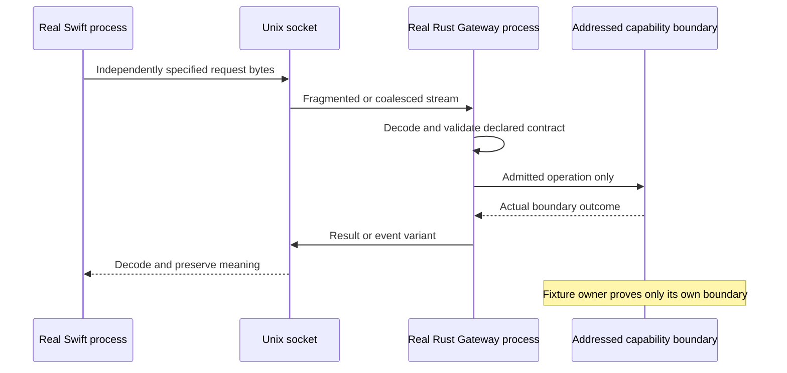

# Swift and Rust socket compatibility qualification

This refines E2/A13 and I0 for U19/R13: prove that independently built Swift and Rust processes agree on the selected local socket contract. It is an unexecuted qualification procedure, not a seventh experiment family, codec selection, supported-version promise or authorization to implement. The [DS01 Specification](../specification.md), [shared Requirements](../../../user-requirements.md) and [primary experiment map](../../../experiments/primary-experiments.md) govern it.

The question is broader than whether generated types compile. A message must survive the real byte stream, decode to the intended variant and values, pass the correct semantic/authority boundary, and produce only the outcome that boundary can establish. Rust–Swift FFI is not needed to test the selected separate-process socket interface.

## Three proof boundaries

| Level | Real path | Eligible result |
| --- | --- | --- |
| Shape and encoding | Independent expected values/bytes versus each compiled producer and consumer | Selected discriminants, field representation and rejection semantics; no socket or domain-effect claim |
| Local interoperability | Actual Swift process ↔ Unix socket ↔ actual Rust Gateway transport/admission; selected owner stand-in only when explicitly labelled | Exercised local framing, schema, correlation, admission and delivery outcomes; no remote Host/native completion claim |
| Product integration | Actual app/client → Gateway → addressed real Host capability, with independent domain/native observation | Only the exercised operation, pairing and effect. The Gateway↔Host protocol and native terminal leg remain separate proof obligations |

Run both actual production directions: Swift requests consumed by Rust, and Rust replies/events consumed by Swift. An artificial Rust frontend or Swift server can isolate a codec, but is a component fixture, not proof that the production roles are wired. Gateway-originated requests, terminal streams and subscriptions are exercised only where the selected contract contains them; no extra interaction pattern is invented for symmetry.

## Freeze the candidate before running

Record the single authoritative schema identity and each generated/validated derivative, exact Swift/Rust artifacts, their protocol/channel capabilities, admitted target kinds, operation variants, field domains and declared resource bounds. Record each selected version pair independently. One Gateway may address Hosts at different supported versions; a global negotiated version cannot silently replace those per-connection facts.

The profile must say what missing fields, explicit null, unknown fields/variants, unsupported methods and incompatible pairs mean. No default compatibility shim, field coercion or version downgrade is selected here. An unanswered cell is a contract gap; do not let whichever decoder happens to accept it become the policy.

“Complete coverage” means every selected method and request/result/error/event/frame variant, each declared semantic rejection and the relevant framing/interruption classes has an executable case tied to the authoritative contract. It does not mean enumeration of every possible byte string. Use independently specified boundary cases and generated/property cases for value domains; two self-roundtrips of the same generated implementation are insufficient. An uncovered selected variant remains visibly uncovered rather than counted as passed.

## Discriminating cases

| Case | Stimulus and independently checked result |
| --- | --- |
| Selected variants | At least one meaningful case per selected variant in each production direction, using non-default field values where that variant carries data. Check semantic values and discriminants independently; a structurally valid object of the wrong variant fails. |
| Presence and null | Required missing, optional missing, explicit null and explicit default values under the selected field policy. A nullable result is distinct from no result; result/error mutual exclusion follows the actual selected envelope. |
| Numbers and identities | Signed/unsigned/domain extrema, invalid range/fraction/type, exact counters/positions where selected, and distinct Host/session/attachment/request identities. If values beyond exact binary64 integer range are permitted, include independently expected values on both sides of that range; do not round before comparison. |
| Text and bytes | Empty versus nonempty text, multibyte splits, embedded control characters, arbitrary binary terminal/content payloads and the selected path/name domain. A terminal byte buffer is not repaired as UTF-8. Unsupported names produce the declared refusal rather than a lossy pathname targeting another file. |
| Framing | Every split position of small independently specified frames, representative boundary splits for maximum frames, several frames in one write, incomplete headers/payloads and connection closure mid-frame. Socket reads are not message boundaries. Score only the selected framing's delimiter/length rules. |
| Bounds | Each declared request/reply/event/stream bound just below, at and above the boundary, including encoded-byte size versus value length. Exercise frame validity separately from writer/queue admission. Reaching a declared envelope is a result, not permission to raise it after failure. |
| Invalid or unsupported input | Malformed encoding, unknown discriminants, invalid envelope/version/capability and selected semantic-invalid values. Observe refusal at the intended boundary and independently establish no unintended owner invocation/effect. Parsing success is not admission. |
| Correlation and interleaving | Several in-flight requests with deliberately reordered replies, intervening events, equal local resource labels on different Hosts and independent stream closure. Attribute each result to the right attempt and Host; an unrelated successful reply cannot settle a lost one. |
| Interruption and uncertainty | Break client↔Gateway before submission, after owner admission and after an observed effect but before result delivery. Keep proved non-submission, refusal, known effect and unknown effect distinct. Do not automatically resend terminal input or another unsafe operation to obtain a cleaner result. |
| Pairing | Exercise every declared supported build/version/channel pair, plus each named incompatible-pair refusal. Observe the refusal before the selected incompatible operation is invoked; connecting or authenticating alone is not compatibility. |
| Lifecycle and resource closure | Slow a consumer under the declared bounded-delivery policy; cancel/close a subscription separately from execution; complete and join all fixture-owned tasks, processes and sockets. Local queueing, remote acceptance and continuing execution remain separate observations. |

For the invalid-input negative claim, bound the operation by a correlated admission/refusal/closure observation and inspect the addressed owner's independently recorded invocations/effects. “Nothing happened for a while” is not proof. Cases use exact events/state transitions or controlled time where time is the subject; no polling or wall-clock correctness deadline is introduced.

## Current source risks to preserve in the comparison

At AgentStudio `624300332f5e50f7bb8cbb9fc786d5e5b4a3d462`, the [NDJSON encoder/decoder](../../../../../../Sources/AgentStudioIPCTransport/NDJSONFrameDecoder.swift:24) has distinct encoding and stream-decoding paths, handles fragmented/coalesced input and applies an encoded-byte bound. The [frame policy](../../../../../../Sources/AgentStudioIPCTransport/IPCFramePolicy.swift:15) has separate request and response limits. These are baseline facts, not target constants or selection of NDJSON.

The [generic JSON value](../../../../../../Sources/AgentStudioIPCTransport/JSONRPCCodec.swift:3) represents numbers as `Double`; request [identifier conversion](../../../../../../Sources/AgentStudioIPCTransport/JSONRPCCodec.swift:364) follows that generic parse before checking integer conversion. [Response decoding](../../../../../../Sources/AgentStudioIPCTransport/JSONRPCCodec.swift:199) uses optional-field decoding before result/error validation. These concrete representation paths motivate exact-number and presence/null cases. Their declarations alone do not establish runtime rounding, intended null policy or a defect in every typed application path. No existing JSON convention is silently adopted for the new protocol.

### Trace the actual representation before choosing a numeric case

The current pane-context wire contracts deliberately bound their `UInt64` values to `0...9_007_199_254_740_991`. Their custom encoder/decoder rejects values beyond that bound, and their schema uses the same unsigned-integer range. A `UInt64` property therefore does not imply full-width unsigned integers on this JSON wire. The guard applies to the named pane contracts; other numeric contracts need their own trace. Sources: [declared scalar bounds](../../../../../../Sources/AgentStudioProgrammaticControl/IPCSchemaProviding.swift:16), [pane coding guards](../../../../../../Sources/AgentStudioProgrammaticControl/IPCPaneNumericEncodingError.swift:10), [ordered-write/claim contracts](../../../../../../Sources/AgentStudioProgrammaticControl/IPCPaneOrderedWriteContracts.swift:3), [changes contracts](../../../../../../Sources/AgentStudioProgrammaticControl/IPCPaneMessageChangesContracts.swift:3).

The schema and transport also use different intermediate representations. [Schema normalization](../../../../../../Sources/AgentStudioProgrammaticControl/IPCJSONSchema+PreparedNormalization.swift:23) decodes a [Decimal-based value](../../../../../../Sources/AgentStudioProgrammaticControl/IPCSchemaValue.swift:5), checks integer bounds, unknown fields and declared alternatives, then checks typed encoding. The current [CLI frame builder](../../../../../../Sources/AgentStudioIPCClientCore/AgentStudioIPCClientCore.swift:23) subsequently puts validated parameters through transport `JSONValue`. At the server, [request parsing](../../../../../../Sources/AgentStudioAppIPC/AgentStudioAppIPCConnectionReader.swift:35) also precedes [typed method validation](../../../../../../Sources/AgentStudioAppIPC/AppIPCTypedMethodRegistration.swift:205). A later validator sees that intermediate representation; it cannot recover numeric spelling already changed earlier. No particular rounding or admission outcome was executed here.

Use the following source-grounded corpus alongside the general cases. These are current-reference qualifications, not selection of the future codec, range, field names or error policy.

| Current reference | Discriminating case and observation |
| --- | --- |
| Pane epoch/counter, changes positions and context revision have safe-integer guards | Exercise `0`, `1` and `9_007_199_254_740_991` at the typed/schema boundary, and the first value above the bound as a refusal. At the service boundary, separately satisfy current binding/epoch/authority so another refusal cannot stand in for numeric validation. If the target instead selects full-width exact integers, it needs its independently specified larger-value cases |
| A raw request reaches transport parsing before method schema validation | Include independently authored integer and fractional numeric tokens close to the boundary. Retain the original bytes, for example a counter token `9007199254740990.5`, rather than constructing that negative case as a `Double` first. Observe the selected integer-field refusal and no owner mutation. This is a proposed discriminator, not a reproduced current acceptance defect |
| Optional object fields permit absence/null, while typed encoding can omit null | For a selected optional field, compare missing, explicit null and a meaningful value against the operation's declared semantics. Do not impose the same rule on top-level result or parameter envelopes. [Presence declaration](../../../../../../Sources/AgentStudioProgrammaticControl/IPCSchemaProviding.swift:30), [typed-field preservation](../../../../../../Sources/AgentStudioProgrammaticControl/IPCJSONSchema+TypedEncoding.swift:34) |
| Missing parameters become an empty object at current method invocation; explicit null remains a value | Exercise missing `params`, `params: null` and `params: {}` separately against the actual method schema. An envelope parse and typed parameter admission are different observations. [Server invocation](../../../../../../Sources/AgentStudioAppIPC/AgentStudioAppIPCServer.swift:379) |
| Current object schemas reject unknown fields and union schemas select exactly one alternative | Include unknown fields, missing required fields, unknown tags and a known tag with the wrong payload. Observe the schema/admission result and unchanged owner; a DTO decoder that discards a field cannot supply that observation. [Object validation](../../../../../../Sources/AgentStudioProgrammaticControl/IPCJSONSchema.swift:318), [union validation](../../../../../../Sources/AgentStudioProgrammaticControl/IPCJSONSchema.swift:234) |

An invalid case rejected by its sending typed constructor has not tested the receiver. Use a raw-byte producer at the admitted framing boundary where the case requires a wire-invalid value; keep authentication/target prerequisites valid and record the intended rejection stage. Its fixture identity and closure still follow the three proof boundaries above. The [request representation packet](../../../research/evidence/2026-10-17-daemon-capability-placement/wire-request-representation.json) records the exact bounded source walk and exclusions.

Existing test bodies provide useful starting references: [pane numeric/tagged contracts](../../../../../../Tests/AgentStudioProgrammaticControlTests/IPCPaneContextWireContractTests.swift:74), [actual Swift server/socket invalid-counter refusal](../../../../../../Tests/AgentStudioAppIPCTests/AgentStudioAppIPCPaneContextAdmissionTests.swift:277) and [original-wire unknown catalog fields](../../../../../../Tests/AgentStudioProgrammaticControlTests/IPCMethodCatalogDecoderTests.swift:20). Their source was inspected; no tests ran in this research. The socket counter fixture constructs `Double` values, so its presence does not prove the original fractional-token case. None proves Swift/Rust interoperability.

### Replies, events and nulls need their actual consumer path

| Current path | Representation and qualification consequence |
| --- | --- |
| Ordinary typed reply, including claim/changes/context | Handler result is schema/typed-encoded, then converted to `JSONValue` for ordinary framing. The CLI decodes that generic value and re-encodes it before descriptor normalization. Check semantic values at the actual receiver; this path does not promise original JSON bytes. [Registration](../../../../../../Sources/AgentStudioAppIPC/AppIPCTypedMethodRegistration.swift:195), [client normalization](../../../../../../Sources/AgentStudioIPCClientCore/AgentStudioIPCClientCore.swift:247) |
| Cached command/capability reply and explicit discovery | Cached result bytes reach `.encoded` framing; explicit discovery extracts the received result span for the owning decoder. This is a counterexample to treating every response as a generic number tree. Its owning schema still sets the value domain; a byte-preserving route does not grant larger numbers. [Writer](../../../../../../Sources/AgentStudioAppIPC/AgentStudioAppIPCConnectionWriter.swift:56), [framing](../../../../../../Sources/AgentStudioIPCTransport/JSONRPCCodec+EncodedResult.swift:4), [discovery extraction](../../../../../../Sources/AgentStudioIPCTransport/JSONRPCCodec+DiscoveryResult.swift:12) |
| Event notification | Broker encoding uses the generic value path. The current CLI parses for envelope validation but forwards the original received frame string. Test both boundaries; forwarding alone does not prove the typed producer preserved a value. Event/subscription IDs are not a generic ordered sequence. Declared terminal event payloads do not establish a live terminal producer. [Broker encoding](../../../../../../Sources/AgentStudioAppIPC/IPCEventBroker.swift:154), [CLI forwarding](../../../../../../Sources/AgentStudioIPCClientCore/AgentStudioIPCClientCore.swift:101), [subscription shape](../../../../../../Sources/AgentStudioProgrammaticControl/IPCEventContracts.swift:20) |
| Stale ordered-write result versus RPC error | A typed successful RPC result can carry `stale(lastAccepted)` with guarded counters; it differs from an RPC error with optional staleness detail. The searched current error producers supply `writerReplaced`, and the CLI's finite remote-failure projection does not retain arbitrary raw detail. Exercise the selected result/error variant and its actual consumer effect rather than treating all stale outcomes alike. [Result/error trace](../../../research/evidence/2026-10-17-daemon-capability-placement/wire-response-representation.md) |

Both current response readers treat a sole `result: null` as no result and reject that success envelope; nested nullable fields have their own behavior. The encoder API can construct a null-valued success, so testing only construction or encoding misses this consumer distinction. This is source-observed decoder behavior and a source fixture, not a demonstrated production-method incident or the future protocol's selected policy. Sources: [ordinary reader](../../../../../../Sources/AgentStudioIPCTransport/JSONRPCCodec.swift:199), [discovery header](../../../../../../Sources/AgentStudioIPCTransport/JSONRPCCodec+DiscoveryResult.swift:47), [existing envelope fixture](../../../../../../Tests/AgentStudioIPCTransportTests/JSONRPCDiscoveryResultTests.swift:35).

Freeze whether result/error exclusivity is based on key presence or non-null values, and keep that separate from optional payload fields. Test missing result/error, null result, both non-null, and one non-null side with the other explicitly null under that chosen contract. The [response representation packet](../../../research/evidence/2026-10-17-daemon-capability-placement/wire-response-representation.json) records eight current paths, representative field groups, eight presence cases and exact coverage gaps; it is not a complete current-method census or executed compatibility verdict.

Current transport source does not contain the new Rust Gateway/Host route. This qualification therefore needs the separately admitted implementation/fixture artifacts and selected profiles before execution. First-party Rust still follows Tokio, Router-derived types/lints/naming and the unsafe prohibition; a generated or test-only adapter is not an exception.

## Result and consequence

For each declared pair, record schema/artifact identity, case and selected policy, actual bytes/chunks or a bounded digest plus retained witness, independent expected values, decoder/admission result, addressed-owner observation and fixture closure. Distinguish correct, mismatched, refused as specified, unobservable and outside declared coverage. A missing required observation or unfinished owner task cannot become a passing interoperability result.

A pass qualifies that exact local profile for the next integration layer. A mismatch identifies the schema/generator/codec/framing/admission boundary to correct; it does not by itself justify FFI, a transport replacement or a compatibility layer. Real network Host compatibility, actual terminal restoration/continuation, native effects, measured performance and every untested pair remain unproved. No test, build or experiment ran when this procedure was authored.
