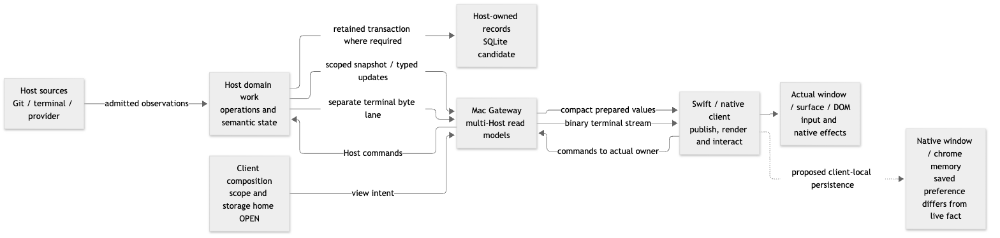

# AgentStudio data ownership, storage and materialization survey

The unit of extraction is a piece of truth and its mutation contract, not a SQLite file, table name, Swift actor or bus. A Host owns its machine’s backend work without a Mac being present. A Gateway combines several Hosts for clients. This does not make every stored value Host-owned or every update a durable event.

This is a Lead **placement proposal**, now compared with the Advisor's separately written picture, not an adopted Program Design, schema or migration. Source baseline: 624300332f5e50f7bb8cbb9fc786d5e5b4a3d462. No private database, runtime or migration was inspected/executed. The [current requirements](../../../user-requirements.md) still have open decisions. Their generic direct-to-local-Host Mac CLI clause has an independently identified authority gap (N1); this study relies on the confirmed attached-machine target and authorized Host-local agent inputs, not that disputed route.

The initial independent pictures are preserved for comparison. The live catalog below now distinguishes **client-owned meaning** from its **unselected physical home**. Device-following arrangements, separate arrangements per Gateway and synchronized shared arrangements have different storage consequences; none is selected by silence.

## Current inventory

The final first-party logical schema reconstructs to **86 tables and 597 named columns**: Core 28/137, Local 53/437, CLI 3/15, and in-memory search 2/8. Local has 29 boot-required and 24 later optional/full-profile tables. This is source-supported schema, not a claim about installed user databases.

[The complete catalog](data-catalog.json) records every table/column, creation profile, constraints where transcribed, schema/access anchors and current meaning/flow. A separate proposal assigns every column a candidate owner, inheriting the table default unless a mixed field group has an explicit override. SQL declarations are not the public wire schema.

Core mixes client composition with process custody and machine topology. Local contains retained evidence, asks, drafts, output attempts, verifiers, UX history, recovery state and disposable caches. Search is SQLite but ephemeral. CLI stores producer-side attempted-work state that differs from server-accepted state.

Historical/transient migration tables, GRDB bookkeeping and SQLite-generated sequence/FTS internals are accounted for separately. They are not additional product domains or new owners.

SQLite is not the whole storage boundary. The catalog also records Git files, ZMX/backend resources, configuration, web history, replay/task state, review products, native surfaces and effects. Two additional distinctions matter:

- Webview panes use a shared [persistent WebKit website store](../../../../../../Sources/AgentStudio/Features/Webview/WebviewPaneController.swift:35). Cookies and website data belong to that native client profile; a persisted pane URL does not carry its browser login/session. A Gateway view must not imply browser credentials moved with it.
- [Surface checkpoint save/load methods](../../../../../../Sources/AgentStudio/Features/Terminal/Ghostty/SurfaceManager.swift:664) exist, but the bounded `Sources` call-site search found only their declarations. A pathname, Codable snapshot and unwired method are not an active recovery contract. This source state does not establish complete screen or process recovery.

The catalog separately includes command-bar recents in UserDefaults, process endpoint metadata/socket discovery, debug credential escrow, installed provider integration files and diagnostic logs. Discovery metadata is not authentication authority; diagnostic output is not workflow history. Provider integration files belong to the addressed provider environment, not workspace SQL. Only their source contracts were read; no installed configuration, credential or user log contents were inspected.

## Proposed responsibility split

| Realm | Proposed authority/materialization | Reason and cost |
| --- | --- | --- |
| Each Host | Machine-qualified repository/watch/membership facts; execution/cleanup; provider evidence/bindings; context/ask settlement/writer fences; annotation workflow | Continues without any Mac and keeps real transaction predicates together. SQLite is a strong candidate for retained metadata. Git files and ZMX live terminal state remain different resources. |
| Mac Gateway | Attached-Host connections/admission; current Host replicas and combined/search/sidebar projections. Durable portable client composition remains an option, not a selected responsibility | Keeps shared processing in Rust and cross-Host composition outside any one Host. Gateway-owned composition would be scoped to that Gateway unless a separate transfer/sync contract is selected. A replica cannot authorize Host work. |
| Swift/native client | Actual window/surface/DOM, input/focus/accessibility and immediate editor/selection state; compact observed display values. Refined proposal also keeps native window/chrome memory and native editor preference client-local | Native effects happen on the client. MainActor publishes compact changed values; it does not perform Host SQL/Git or high-rate derivation. A saved preference differs from the current native fact. |
| Client composition, home open | Workspace/tabs/splits, saved active choices, Undo and navigation references qualified by Host | These describe how a client combines work, not execution custody. A phone's arrangement can follow the phone or belong to the chosen Gateway; sharing across devices needs another explicit contract. |
| Attached-machine CLI | Producer identity, allocated/pending claims and consumed output position where required | Attempted work differs from accepted work. Do not move these counters into a Mac-global namespace or remove them as duplicate state. Local RPC does not choose offline queue/retry semantics. |

My initial proposal put durable client composition and most UX memory in the Gateway. The Advisor proposed keeping them in Swift. The refined recommendation keeps native memory with the native client, while leaving the portable composition home open until its mobility/sharing behavior is settled. A device-local composition can be implemented in Rust or Swift; language and logical scope are separate choices. Keeping a phone's only durable copy on a Mac does not make it follow the phone to another Gateway. No shared database or synchronization service is selected.

[Full-size data-flow view](assets/proposed-data-homes.png).

The image separates durable records, typed updates and the binary terminal lane. SQLite and the composition home are candidates; native memory and retained client intent have different responsibilities.

## Commands, facts, current state and history

| Kind | Meaning and proposed route | Storage/recovery distinction |
| --- | --- | --- |
| Command | Operation at its owner: frontend → Gateway → addressed Host; authorized in-session agent/hook/context input → its Host | Validate target/authority at the owner. Reply, committed effect and visible UI differ. Ordinary Mac CLI targeting its local Host has an open route decision; the target is settled. Mutations are not arbitrary bus events. |
| Ordered domain fact | Semantic transition from an authoritative owner, scoped to subject/source lifetime | Preserve required order. Retention/replay is separate; a reliable socket is not history. |
| Replaceable current state | Latest admitted title/status/cache or prepared read model | Contract/equality-suppress only where semantics allow. A snapshot/currentness contract can be sufficient without saving every transition. |
| Durable workflow record | Ask settlement, saved annotation revision, binding evidence, output attempt or writer watermark | Preserve the real atomic check/write group. Purpose-specific tables are not a universal event journal. |
| Terminal bytes | Stateful VT and input/control for an attachment | Separate from RPC/fact fanout and SQL metadata. Arbitrary byte loss is invalid; reconnect needs the E1 snapshot/live proof. |
| Native materialization | Swift/Bridge applies prepared state to actual controls/surface/DOM | Delivered bytes/hash/command acceptance does not prove pixels, focus or user receipt. |

There is no default inbox → event log → outbox for everything. The current pane_event table contains mutable notices and change bookkeeping; annotation_output_event records finalization; runtime replay is bounded memory. Select missed-history/delivery outcomes first, then decide whether retained history/cursors or a transactional outbox is necessary.

## Existing materialization paths

| Family | Current source → mutation/materialization → consumer | Distributed consequence |
| --- | --- | --- |
| Terminal title/CWD | Copied native callback → source admission/runtime fact → reducer/pane graph → later snapshot SQL; keyed sidebar capture | Host facts must exist without a renderer. Live facts and saved display snapshots have different currentness. |
| Provider/session status | Hook → FIFO → evidence/binding transaction → status reduction/latest mailbox → UI atom | Host retains domain evidence; clients consume a projection. Recorded-only/ignored is not active status or process survival. |
| Agent context/asks | Scope/binding/order checks in SQL → intent/settlement/current rows → callbacks/latest display | Keep binding predicates with writes. Display calculation currently also expires/hides records; it is not automatically a pure Gateway query. |
| Repository activity | Filesystem/projector coverage → activity+volume cursor transaction → authority-qualified projection | A stored cursor is not restart continuity. Gateway must label last-known versus currently authoritative coverage. |
| Annotation/output | Source/revision/draft mutation → projection/content; prepare → external effect → finalization | Preserve saved/draft/lease and exact membership meanings. SQL cannot make remote clipboard/file effects atomic. |
| Workspace/Undo | Composition plus Undo/custody transaction → publication → native mount; Local save separately | Split view Undo from Host execution. Detach rules prohibit copying terminate-after-last-owner behavior unchanged. |
| Sidebar/search | Captured keyed facts/context/currentness → off-main grouping/ranking/index → guarded native apply | Fits prepared Gateway views; client catalog/availability/selection remain inputs. Index is not source truth. |
| CLI notices/order | Producer allocation/optional append → submission/intake → accepted state/cursor → cleanup | Allocated is not accepted. Handled can include refused/malformed rows. Current offline queue is notice-only. |

## Real transaction boundaries

- Core composition, applicable Undo/member/session-owner changes share one write. Global topology/facet reconciliation is another transaction; native mounting is later.
- Ordinary Core save can succeed before Local save fails. Separate files/pools are not one atomic save.
- A Sessions mutation commits operation revision, binding/source/evidence and question children together.
- PaneContext checks current Sessions binding synchronously inside its SQL write. A network preflight would weaken that fence. Sessions-ended updates occur afterward in another transaction.
- Accepted notice and intake cursor commit in Local; no transaction spans reading the CLI file and committing Local.
- Annotation draft/save, prepared membership and finalization each have their own atomic group. Native output is outside SQL.
- Several activity/metadata/topology/cache paths publish or perform effects before later persistence. Visible state is not universally durable state.

## Complete table placement proposal

Every current logical table appears below. This proposes ownership, not a file-copy migration. The catalog carries full columns, current meaning/access and remaining contracts.

### core.sqlite

| Current table / field count | Proposed home and reason |
| --- | --- |
| `workspace` (4) [source](../../../../../../Sources/AgentStudio/Core/State/MainActor/Persistence/WorkspaceCoreMigrations.swift:126) | **Client composition; persistent home open**. Client composition can span Hosts and references continuing sessions; neither one Host nor native rendering owns the other domains. Physical persistence follows the unresolved device/Gateway/shared scope. |
| `app_workspace_selection` (3) [source](../../../../../../Sources/AgentStudio/Core/State/MainActor/Persistence/WorkspaceCoreMigrations.swift:126) | **Client composition; persistent home open**. Client composition can span Hosts and references continuing sessions; neither one Host nor native rendering owns the other domains. Physical persistence follows the unresolved device/Gateway/shared scope. |
| `watched_path` (4) [source](../../../../../../Sources/AgentStudio/Core/State/MainActor/Persistence/WorkspaceCoreMigrations+GlobalTopology.swift:2) | **Host backend**. Machine-qualified repository/watch intent, membership, project metadata and physical observation/absence belong with that machine’s work and CLI. |
| `repo` (7) [source](../../../../../../Sources/AgentStudio/Core/State/MainActor/Persistence/WorkspaceCoreMigrations+GlobalTopology.swift:2) | **Host backend**. Machine-qualified repository/watch intent, membership, project metadata and physical observation/absence belong with that machine’s work and CLI. |
| `worktree` (7) [source](../../../../../../Sources/AgentStudio/Core/State/MainActor/Persistence/WorkspaceCoreMigrations+GlobalTopology.swift:2) | **Host backend**. Machine-qualified repository/watch intent, membership, project metadata and physical observation/absence belong with that machine’s work and CLI. |
| `repo_tag` (2) [source](../../../../../../Sources/AgentStudio/Core/State/MainActor/Persistence/WorkspaceCoreMigrations+GlobalTopology.swift:2) | **Host backend**. Machine-qualified repository/watch intent, membership, project metadata and physical observation/absence belong with that machine’s work and CLI. |
| `unavailable_repo` (6) [source](../../../../../../Sources/AgentStudio/Core/State/MainActor/Persistence/WorkspaceCoreMigrations+RepositoryAbsence.swift:4) | **Host backend**. Machine-qualified repository/watch intent, membership, project metadata and physical observation/absence belong with that machine’s work and CLI. |
| `unavailable_worktree` (6) [source](../../../../../../Sources/AgentStudio/Core/State/MainActor/Persistence/WorkspaceCoreMigrations+RepositoryAbsence.swift:4) | **Host backend**. Machine-qualified repository/watch intent, membership, project metadata and physical observation/absence belong with that machine’s work and CLI. |
| `pane` (20) [source](../../../../../../Sources/AgentStudio/Core/State/MainActor/Persistence/WorkspaceCoreMigrations.swift:254) | **Split existing container**. Current Pane combines client view/hierarchy with Host execution launch, title/CWD facts and topology associations. Preserve separate session and attachment/view identities. |
| `pane_content_terminal` (4) [source](../../../../../../Sources/AgentStudio/Core/State/MainActor/Persistence/WorkspaceCoreMigrations+SessionOwnership.swift:2) | **Split Host execution from client attachment reference**. Provider/lifetime/backend session identity describes execution; pane_id is a client view key. A view disappearing does not end Host execution. |
| `pane_content_webview` (4) [source](../../../../../../Sources/AgentStudio/Core/State/MainActor/Persistence/WorkspaceCoreMigrations.swift:370) | **Client navigation intent; Swift native view**. Saved URL/navigation intent is client presentation; WebKit/network/DOM/pixels are a separate native lifetime. |
| `pane_content_code_viewer` (3) [source](../../../../../../Sources/AgentStudio/Core/State/MainActor/Persistence/WorkspaceCoreMigrations.swift:370) | **Split Host source from Gateway/client presentation**. File/review resources need their source Host and revision; scroll, panel choice and native rendering are client state. A payload JSON column is not one distributed domain. |
| `pane_content_payload` (3) [source](../../../../../../Sources/AgentStudio/Core/State/MainActor/Persistence/WorkspaceCoreMigrations.swift:370) | **Split Host source from Gateway/client presentation**. File/review resources need their source Host and revision; scroll, panel choice and native rendering are client state. A payload JSON column is not one distributed domain. |
| `drawer` (2) [source](../../../../../../Sources/AgentStudio/Core/State/MainActor/Persistence/WorkspaceCoreMigrations.swift:370) | **Client composition; persistent home open**. Client composition can span Hosts and references continuing sessions; neither one Host nor native rendering owns the other domains. Physical persistence follows the unresolved device/Gateway/shared scope. |
| `drawer_pane` (3) [source](../../../../../../Sources/AgentStudio/Core/State/MainActor/Persistence/WorkspaceCoreMigrations.swift:370) | **Client composition; persistent home open**. Client composition can span Hosts and references continuing sessions; neither one Host nor native rendering owns the other domains. Physical persistence follows the unresolved device/Gateway/shared scope. |
| `tab_shell` (5) [source](../../../../../../Sources/AgentStudio/Core/State/MainActor/Persistence/WorkspaceCoreMigrations.swift:518) | **Client composition; persistent home open**. Client composition can span Hosts and references continuing sessions; neither one Host nor native rendering owns the other domains. Physical persistence follows the unresolved device/Gateway/shared scope. |
| `tab_pane` (3) [source](../../../../../../Sources/AgentStudio/Core/State/MainActor/Persistence/WorkspaceCoreMigrations.swift:518) | **Client composition; persistent home open**. Client composition can span Hosts and references continuing sessions; neither one Host nor native rendering owns the other domains. Physical persistence follows the unresolved device/Gateway/shared scope. |
| `tab_arrangement` (5) [source](../../../../../../Sources/AgentStudio/Core/State/MainActor/Persistence/WorkspaceCoreMigrations.swift:518) | **Client composition; persistent home open**. Client composition can span Hosts and references continuing sessions; neither one Host nor native rendering owns the other domains. Physical persistence follows the unresolved device/Gateway/shared scope. |
| `arrangement_layout_pane` (4) [source](../../../../../../Sources/AgentStudio/Core/State/MainActor/Persistence/WorkspaceCoreMigrations.swift:573) | **Client composition; persistent home open**. Client composition can span Hosts and references continuing sessions; neither one Host nor native rendering owns the other domains. Physical persistence follows the unresolved device/Gateway/shared scope. |
| `arrangement_layout_divider` (3) [source](../../../../../../Sources/AgentStudio/Core/State/MainActor/Persistence/WorkspaceCoreMigrations.swift:609) | **Client composition; persistent home open**. Client composition can span Hosts and references continuing sessions; neither one Host nor native rendering owns the other domains. Physical persistence follows the unresolved device/Gateway/shared scope. |
| `arrangement_minimized_pane` (2) [source](../../../../../../Sources/AgentStudio/Core/State/MainActor/Persistence/WorkspaceCoreMigrations.swift:609) | **Client composition; persistent home open**. Client composition can span Hosts and references continuing sessions; neither one Host nor native rendering owns the other domains. Physical persistence follows the unresolved device/Gateway/shared scope. |
| `arrangement_drawer_view` (3) [source](../../../../../../Sources/AgentStudio/Core/State/MainActor/Persistence/WorkspaceCoreMigrations.swift:665) | **Client composition; persistent home open**. Client composition can span Hosts and references continuing sessions; neither one Host nor native rendering owns the other domains. Physical persistence follows the unresolved device/Gateway/shared scope. |
| `drawer_view_layout_pane` (6) [source](../../../../../../Sources/AgentStudio/Core/State/MainActor/Persistence/WorkspaceCoreMigrations.swift:665) | **Client composition; persistent home open**. Client composition can span Hosts and references continuing sessions; neither one Host nor native rendering owns the other domains. Physical persistence follows the unresolved device/Gateway/shared scope. |
| `drawer_view_layout_divider` (5) [source](../../../../../../Sources/AgentStudio/Core/State/MainActor/Persistence/WorkspaceCoreMigrations.swift:750) | **Client composition; persistent home open**. Client composition can span Hosts and references continuing sessions; neither one Host nor native rendering owns the other domains. Physical persistence follows the unresolved device/Gateway/shared scope. |
| `drawer_view_minimized_pane` (3) [source](../../../../../../Sources/AgentStudio/Core/State/MainActor/Persistence/WorkspaceCoreMigrations.swift:750) | **Client composition; persistent home open**. Client composition can span Hosts and references continuing sessions; neither one Host nor native rendering owns the other domains. Physical persistence follows the unresolved device/Gateway/shared scope. |
| `workspace_terminal_session_ownership` (6) [source](../../../../../../Sources/AgentStudio/Core/State/MainActor/Persistence/WorkspaceCoreMigrations+SessionOwnership.swift:2) | **Host backend**. Only the executing Host can establish process incarnation, explicit termination and cleanup. Current last-pane/Undo ownership rules must be replaced by selected detach semantics. |
| `workspace_undo_close` (11) [source](../../../../../../Sources/AgentStudio/Core/State/MainActor/Persistence/WorkspaceCoreMigrations+SessionOwnership.swift:2) | **Client composition; persistent home open**. Client composition can span Hosts and references continuing sessions; neither one Host nor native rendering owns the other domains. Physical persistence follows the unresolved device/Gateway/shared scope. Undo expiry must not terminate a detached Host session. Boot/uptime fields are valid only in their originating clock domain. |
| `workspace_undo_close_member` (3) [source](../../../../../../Sources/AgentStudio/Core/State/MainActor/Persistence/WorkspaceCoreMigrations+SessionOwnership.swift:2) | **Client composition; persistent home open**. Client composition can span Hosts and references continuing sessions; neither one Host nor native rendering owns the other domains. Physical persistence follows the unresolved device/Gateway/shared scope. Undo expiry must not terminate a detached Host session. Boot/uptime fields are valid only in their originating clock domain. |

### local.sqlite

| Current table / field count | Proposed home and reason |
| --- | --- |
| `sessions_conversation` (5) [source](../../../../../../Sources/AgentStudio/Core/State/MainActor/Persistence/WorkspaceLocalMigrations+Sessions.swift:55) | **Host backend**. Session-local provider evidence, context intent/settlement and writer fences must work without any Mac Gateway. Keep actual transaction predicates with this owner. |
| `sessions_operation` (12) [source](../../../../../../Sources/AgentStudio/Core/State/MainActor/Persistence/WorkspaceLocalMigrations+Sessions.swift:69) | **Host backend**. Session-local provider evidence, context intent/settlement and writer fences must work without any Mac Gateway. Keep actual transaction predicates with this owner. |
| `sessions_pane_binding` (12) [source](../../../../../../Sources/AgentStudio/Core/State/MainActor/Persistence/WorkspaceLocalMigrations+Sessions.swift:99) | **Host backend**. Session-local provider evidence, context intent/settlement and writer fences must work without any Mac Gateway. Keep actual transaction predicates with this owner. |
| `sessions_source` (13) [source](../../../../../../Sources/AgentStudio/Core/State/MainActor/Persistence/WorkspaceLocalMigrations+Sessions.swift:128) | **Host backend**. Session-local provider evidence, context intent/settlement and writer fences must work without any Mac Gateway. Keep actual transaction predicates with this owner. |
| `sessions_evidence` (21) [source](../../../../../../Sources/AgentStudio/Core/State/MainActor/Persistence/WorkspaceLocalMigrations+SessionsCleanup.swift:52) | **Host backend**. Session-local provider evidence, context intent/settlement and writer fences must work without any Mac Gateway. Keep actual transaction predicates with this owner. |
| `sessions_provider_question` (5) [source](../../../../../../Sources/AgentStudio/Core/State/MainActor/Persistence/WorkspaceLocalMigrations+Sessions.swift:26) | **Host backend**. Session-local provider evidence, context intent/settlement and writer fences must work without any Mac Gateway. Keep actual transaction predicates with this owner. |
| `sessions_provider_question_option` (5) [source](../../../../../../Sources/AgentStudio/Core/State/MainActor/Persistence/WorkspaceLocalMigrations+Sessions.swift:36) | **Host backend**. Session-local provider evidence, context intent/settlement and writer fences must work without any Mac Gateway. Keep actual transaction predicates with this owner. |
| `pane_state` (21) [source](../../../../../../Sources/AgentStudio/Core/State/MainActor/Persistence/WorkspaceLocalMigrations+PaneContext.swift:27) | **Host backend**. Session-local provider evidence, context intent/settlement and writer fences must work without any Mac Gateway. Keep actual transaction predicates with this owner. |
| `pane_state_action` (10) [source](../../../../../../Sources/AgentStudio/Core/State/MainActor/Persistence/WorkspaceLocalMigrations+PaneContext.swift:175) | **Host backend**. Session-local provider evidence, context intent/settlement and writer fences must work without any Mac Gateway. Keep actual transaction predicates with this owner. |
| `pane_request` (31) [source](../../../../../../Sources/AgentStudio/Core/State/MainActor/Persistence/WorkspaceLocalMigrations+PaneContext.swift:45) | **Host backend**. Session-local provider evidence, context intent/settlement and writer fences must work without any Mac Gateway. Keep actual transaction predicates with this owner. |
| `pane_event` (20) [source](../../../../../../Sources/AgentStudio/Core/State/MainActor/Persistence/WorkspaceLocalMigrations+PaneContext.swift:64) | **Host backend**. Retained mutable notices and answer/change bookkeeping are Host workflow state; the table name does not make it an append-only event log. |
| `pane_request_action` (10) [source](../../../../../../Sources/AgentStudio/Core/State/MainActor/Persistence/WorkspaceLocalMigrations+PaneContext.swift:175) | **Host backend**. Session-local provider evidence, context intent/settlement and writer fences must work without any Mac Gateway. Keep actual transaction predicates with this owner. |
| `pane_event_action` (10) [source](../../../../../../Sources/AgentStudio/Core/State/MainActor/Persistence/WorkspaceLocalMigrations+PaneContext.swift:175) | **Host backend**. Session-local provider evidence, context intent/settlement and writer fences must work without any Mac Gateway. Keep actual transaction predicates with this owner. |
| `pane_request_choice` (4) [source](../../../../../../Sources/AgentStudio/Core/State/MainActor/Persistence/WorkspaceLocalMigrations+PaneContext.swift:86) | **Host backend**. Session-local provider evidence, context intent/settlement and writer fences must work without any Mac Gateway. Keep actual transaction predicates with this owner. |
| `pane_request_property` (12) [source](../../../../../../Sources/AgentStudio/Core/State/MainActor/Persistence/WorkspaceLocalMigrations+PaneContext.swift:94) | **Host backend**. Session-local provider evidence, context intent/settlement and writer fences must work without any Mac Gateway. Keep actual transaction predicates with this owner. |
| `pane_request_required` (3) [source](../../../../../../Sources/AgentStudio/Core/State/MainActor/Persistence/WorkspaceLocalMigrations+PaneContext.swift:105) | **Host backend**. Session-local provider evidence, context intent/settlement and writer fences must work without any Mac Gateway. Keep actual transaction predicates with this owner. |
| `pane_request_property_choice` (4) [source](../../../../../../Sources/AgentStudio/Core/State/MainActor/Persistence/WorkspaceLocalMigrations+PaneContext.swift:113) | **Host backend**. Session-local provider evidence, context intent/settlement and writer fences must work without any Mac Gateway. Keep actual transaction predicates with this owner. |
| `pane_request_answer_value` (6) [source](../../../../../../Sources/AgentStudio/Core/State/MainActor/Persistence/WorkspaceLocalMigrations+PaneContext.swift:126) | **Host backend**. Session-local provider evidence, context intent/settlement and writer fences must work without any Mac Gateway. Keep actual transaction predicates with this owner. |
| `pane_write_order` (5) [source](../../../../../../Sources/AgentStudio/Core/State/MainActor/Persistence/WorkspaceLocalMigrations+PaneContext.swift:138) | **Host backend**. Session-local provider evidence, context intent/settlement and writer fences must work without any Mac Gateway. Keep actual transaction predicates with this owner. |
| `pane_epoch_claim` (6) [source](../../../../../../Sources/AgentStudio/Core/State/MainActor/Persistence/WorkspaceLocalMigrations+PaneContext.swift:146) | **Host backend**. Session-local provider evidence, context intent/settlement and writer fences must work without any Mac Gateway. Keep actual transaction predicates with this owner. |
| `pane_answer_position` (4) [source](../../../../../../Sources/AgentStudio/Core/State/MainActor/Persistence/WorkspaceLocalMigrations+PaneContext.swift:156) | **Host backend**. Session-local provider evidence, context intent/settlement and writer fences must work without any Mac Gateway. Keep actual transaction predicates with this owner. |
| `pane_retirement` (3) [source](../../../../../../Sources/AgentStudio/Core/State/MainActor/Persistence/WorkspaceLocalMigrations+PaneContext.swift:168) | **Host backend**. Session-local provider evidence, context intent/settlement and writer fences must work without any Mac Gateway. Keep actual transaction predicates with this owner. |
| `local_ipc_credential` (5) [source](../../../../../../Sources/AgentStudio/Core/State/MainActor/Persistence/WorkspaceLocalMigrations+IPCCredentials.swift:122) | **Split by actual authority boundary**. Session-scoped agent authority belongs at its Host. Gateway/frontend admission is a different boundary; do not copy pane-presence authority unchanged. |
| `pane_context_cli_outbox_cursor` (2) [source](../../../../../../Sources/AgentStudio/Core/State/MainActor/Persistence/WorkspaceLocalMigrations+CLIOutbox.swift:8) | **Reevaluate with legacy CLI handoff**. Cursor belongs to the current notice-import mechanism. Host-local RPC removes the Mac-reachability reason, but offline delivery outcomes must be selected before removing state. |
| `local_workspace_cursor` (3) [source](../../../../../../Sources/AgentStudio/Core/State/MainActor/Persistence/WorkspaceLocalMigrations.swift:310) | **Client navigation/preferences; scope and home open**. Saved client navigation/preferences are distinct from Host work. Client-device scope, Gateway scope and synchronized sharing are different contracts; physical home remains open. |
| `local_tab_cursor` (4) [source](../../../../../../Sources/AgentStudio/Core/State/MainActor/Persistence/WorkspaceLocalMigrations.swift:310) | **Client navigation/preferences; scope and home open**. Saved client navigation/preferences are distinct from Host work. Client-device scope, Gateway scope and synchronized sharing are different contracts; physical home remains open. |
| `local_arrangement_cursor` (4) [source](../../../../../../Sources/AgentStudio/Core/State/MainActor/Persistence/WorkspaceLocalMigrations.swift:310) | **Client navigation/preferences; scope and home open**. Saved client navigation/preferences are distinct from Host work. Client-device scope, Gateway scope and synchronized sharing are different contracts; physical home remains open. |
| `local_drawer_cursor` (4) [source](../../../../../../Sources/AgentStudio/Core/State/MainActor/Persistence/WorkspaceLocalMigrations.swift:310) | **Client navigation/preferences; scope and home open**. Saved client navigation/preferences are distinct from Host work. Client-device scope, Gateway scope and synchronized sharing are different contracts; physical home remains open. |
| `local_arrangement_drawer_cursor` (5) [source](../../../../../../Sources/AgentStudio/Core/State/MainActor/Persistence/WorkspaceLocalMigrations.swift:310) | **Client navigation/preferences; scope and home open**. Saved client navigation/preferences are distinct from Host work. Client-device scope, Gateway scope and synchronized sharing are different contracts; physical home remains open. |
| `local_drawer_presentation` (5) [source](../../../../../../Sources/AgentStudio/Core/State/MainActor/Persistence/WorkspaceLocalMigrations+DrawerPresentation.swift:10) | **Swift/native client (refined proposal)**. Native window/chrome memory or native editor choice belongs beside the client applying it. Relevant filter/grouping values may be inputs to Rust projections; that copy is not another preference authority. |
| `local_window_state` (16) [source](../../../../../../Sources/AgentStudio/Core/State/MainActor/Persistence/WorkspaceLocalMigrations.swift:366) | **Swift/native client (refined proposal)**. Native window/chrome memory or native editor choice belongs beside the client applying it. Relevant filter/grouping values may be inputs to Rust projections; that copy is not another preference authority. |
| `local_window_sidebar_collapsed_group` (2) [source](../../../../../../Sources/AgentStudio/Core/State/MainActor/Persistence/WorkspaceLocalMigrations.swift:36) | **Swift/native client (refined proposal)**. Native window/chrome memory or native editor choice belongs beside the client applying it. Relevant filter/grouping values may be inputs to Rust projections; that copy is not another preference authority. |
| `local_editor_preferences` (3) [source](../../../../../../Sources/AgentStudio/Core/State/MainActor/Persistence/WorkspaceLocalMigrations.swift:488) | **Swift/native client (refined proposal)**. Native window/chrome memory or native editor choice belongs beside the client applying it. Relevant filter/grouping values may be inputs to Rust projections; that copy is not another preference authority. |
| `local_repo_explorer_preferences` (6) [source](../../../../../../Sources/AgentStudio/Core/State/MainActor/Persistence/WorkspaceLocalMigrations+PerScreenSidebar.swift:4) | **Client navigation/preferences; scope and home open**. Saved client navigation/preferences are distinct from Host work. Client-device scope, Gateway scope and synchronized sharing are different contracts; physical home remains open. |
| `local_inbox_notification_preferences` (9) [source](../../../../../../Sources/AgentStudio/Core/State/MainActor/Persistence/WorkspaceLocalMigrations.swift:488) | **No target feature selected**. Retained dormant Inbox schema is not an active capability to resurrect. Preserve existing data until an explicit data-safe removal/retention decision. |
| `local_entity_recency` (4) [source](../../../../../../Sources/AgentStudio/Core/State/MainActor/Persistence/WorkspaceLocalMigrations.swift:36) | **Client navigation/preferences; scope and home open**. Saved client navigation/preferences are distinct from Host work. Client-device scope, Gateway scope and synchronized sharing are different contracts; physical home remains open. |
| `local_workspace_entity_recency` (5) [source](../../../../../../Sources/AgentStudio/Core/State/MainActor/Persistence/WorkspaceLocalMigrations.swift:36) | **Client navigation/preferences; scope and home open**. Saved client navigation/preferences are distinct from Host work. Client-device scope, Gateway scope and synchronized sharing are different contracts; physical home remains open. |
| `cache_metadata` (3) [source](../../../../../../Sources/AgentStudio/Core/State/MainActor/Persistence/WorkspaceLocalMigrations.swift:516) | **Host-derived observations; replaceable Gateway replica**. Git/Forge source observations are Host work; consumers may cache published subsets. This is neither a second repository writer nor a durable event history. |
| `cache_repo_enrichment` (10) [source](../../../../../../Sources/AgentStudio/Core/State/MainActor/Persistence/WorkspaceLocalMigrations.swift:516) | **Host-derived observations; replaceable Gateway replica**. Git/Forge source observations are Host work; consumers may cache published subsets. This is neither a second repository writer nor a durable event history. |
| `cache_worktree_enrichment` (6) [source](../../../../../../Sources/AgentStudio/Core/State/MainActor/Persistence/WorkspaceLocalMigrations.swift:516) | **Host-derived observations; replaceable Gateway replica**. Git/Forge source observations are Host work; consumers may cache published subsets. This is neither a second repository writer nor a durable event history. |
| `local_repository_activity` (7) [source](../../../../../../Sources/AgentStudio/Core/State/MainActor/Persistence/WorkspaceLocalMigrations.swift:169) | **Host backend**. Filesystem/volume/source-generation coverage is local to that Host. Stored cursor or timestamp does not restore current continuity after restart. |
| `local_repository_activity_cursor` (3) [source](../../../../../../Sources/AgentStudio/Core/State/MainActor/Persistence/WorkspaceLocalMigrations.swift:169) | **Host backend**. Filesystem/volume/source-generation coverage is local to that Host. Stored cursor or timestamp does not restore current continuity after restart. |
| `local_pane_activity` (3) [source](../../../../../../Sources/AgentStudio/Core/State/MainActor/Persistence/WorkspaceLocalMigrations+PaneActivity.swift:4) | **Split Host activity from client attention**. Current row is a latest timestamp/source materialization. Execution/hook activity belongs to Host; native/client-view activity and recency are separate inputs. |
| `annotation_session` (11) [source](../../../../../../Sources/AgentStudio/Core/State/MainActor/Persistence/WorkspaceLocalMigrations.swift:558) | **Host annotation workflow**. Saved revisions, persisted draft/edit fences, source association, exact output membership and workflow receipts require a coherent owner alongside the addressed source. |
| `annotation_thread` (10) [source](../../../../../../Sources/AgentStudio/Core/State/MainActor/Persistence/WorkspaceLocalMigrations.swift:558) | **Host annotation workflow**. Saved revisions, persisted draft/edit fences, source association, exact output membership and workflow receipts require a coherent owner alongside the addressed source. |
| `annotation_message` (13) [source](../../../../../../Sources/AgentStudio/Core/State/MainActor/Persistence/WorkspaceLocalMigrations.swift:558) | **Host annotation workflow**. Saved revisions, persisted draft/edit fences, source association, exact output membership and workflow receipts require a coherent owner alongside the addressed source. |
| `annotation_message_draft` (6) [source](../../../../../../Sources/AgentStudio/Core/State/MainActor/Persistence/WorkspaceLocalMigrations.swift:558) | **Host annotation workflow**. Saved revisions, persisted draft/edit fences, source association, exact output membership and workflow receipts require a coherent owner alongside the addressed source. |
| `annotation_output_attempt` (14) [source](../../../../../../Sources/AgentStudio/Core/State/MainActor/Persistence/WorkspaceLocalMigrations.swift:558) | **Host annotation workflow**. Saved revisions, persisted draft/edit fences, source association, exact output membership and workflow receipts require a coherent owner alongside the addressed source. |
| `annotation_output_attempt_message` (4) [source](../../../../../../Sources/AgentStudio/Core/State/MainActor/Persistence/WorkspaceLocalMigrations.swift:558) | **Host annotation workflow**. Saved revisions, persisted draft/edit fences, source association, exact output membership and workflow receipts require a coherent owner alongside the addressed source. |
| `annotation_output_event` (4) [source](../../../../../../Sources/AgentStudio/Core/State/MainActor/Persistence/WorkspaceLocalMigrations.swift:558) | **Host annotation workflow**. Recorded output finalization belongs to the annotation workflow. It does not prove external bytes remain present, user saw them, or every effect has been audited. |
| `local_recovery_provenance` (6) [source](../../../../../../Sources/AgentStudio/Core/State/MainActor/Persistence/WorkspaceLocalMigrations.swift:558) | **The owner of the recovered store**. Recovery acknowledgement gates the affected data authority. A Host-history reset and a Gateway UI-cache reset have different consequences; do not share one global flag. |
| `local_notification_inbox_item` (36) [source](../../../../../../Sources/AgentStudio/Core/State/MainActor/Persistence/WorkspaceLocalMigrations.swift:405) | **No target feature selected**. Retained dormant Inbox schema is not an active capability to resurrect. Preserve existing data until an explicit data-safe removal/retention decision. |
| `local_notification_inbox_collapsed_group` (2) [source](../../../../../../Sources/AgentStudio/Core/State/MainActor/Persistence/WorkspaceLocalMigrations.swift:405) | **No target feature selected**. Retained dormant Inbox schema is not an active capability to resurrect. Preserve existing data until an explicit data-safe removal/retention decision. |

### ipc/cli.sqlite

| Current table / field count | Proposed home and reason |
| --- | --- |
| `cli_store_identity` (2) [source](../../../../../../Sources/AgentStudioCLIStore/CLIStoreMigrator.swift:55) | **Producer-local, attached-machine CLI**. Incarnation/channel namespaces the current producer store. It is not Host identity, device identity or a global operation log. |
| `cli_outbox` (6) [source](../../../../../../Sources/AgentStudioCLIStore/CLIStoreMigrator.swift:74) | **Reevaluate producer-local offline notice mechanism**. Only eligible never-submitted notices are queued today. Do not generalize to hooks/asks or carry a Mac-availability workaround into Host-local input by default. |
| `cli_state` (7) [source](../../../../../../Sources/AgentStudioCLIStore/CLIStoreMigrator.swift:91) | **Producer-local state + Host admission fences**. Counter allocation/pending claims/printed-answer position describe attempted producer work; Host watermarks describe accepted work. They are not duplicate truth. |

### in-memory search

| Current table / field count | Proposed home and reason |
| --- | --- |
| `search_document` (6) [source](../../../../../../Sources/AgentStudio/Core/Search/SearchService.swift:234) | **Gateway per-client derived search view**. Search indexes current visible command/entity documents; the index is rebuildable and not authority for commands, Host resources or selection. |
| `search_document_fts` (2) [source](../../../../../../Sources/AgentStudio/Core/Search/SearchService.swift:234) | **Gateway per-client derived search view**. Search indexes current visible command/entity documents; the index is rebuildable and not authority for commands, Host resources or selection. |

## Nested values and field groups

The catalog expands **35 persisted/runtime value containers**, beyond the 597 top-level SQL columns. Twenty cover Undo/Pane/backend/content/layout values; fifteen cover annotation source/origin/output, enrichment and projection validity. These are current-source fields and validation boundaries, not automatically portable wire contracts.

| Container | Difference that matters for placement |
| --- | --- |
| Undo v1 / embedded PaneContent v3 | Different version/discriminator rules. Undo includes selection/expansion/layout and broad context facets, while ordinary pane SQL retains fewer facets. SQL member/session custody is separate from the captured display values. |
| Pane / metadata / backend | Five outer Pane fields; ten metadata keys; local/docker/gondolin/remote backend descriptors. A declared remote variant is not proof of working remote connectivity or Host identity. |
| Bridge source/comparison target | Symbolic branch/ref and basis versus exact 40/64-hex commit identity and resolved observation. Source query intent differs from a current diff, retained file bytes and rendered output. |
| Annotation fingerprint / thread origin | Accepted continuity evidence versus current source material and derived exact/relocated/outdated/unavailable placement. Located/wholeFile/session stored variants do not all have current output/projection support. |
| Annotation batch / attempt | Prepared exact bytes/membership are historical. New batch ID initially equals attempt ID; explicit repeat copies original bytes/batch with a new attempt ID and lineage. Do not merge those identities during routing or deduplication. |
| Draft / edit registry | A persisted token/body/revision is not a live edit-owner generation. Proposed Host workflow retains the SQL fence and separately owns current edit admission. Client unflushed text is another value. |
| Enrichment / cache projection | Repo unavailable status is normalized on production save; worktree JSON omits the live Git snapshot. Equality-save projections omit fields that serialized payloads retain. |
| Projection capture / reservation | Domain revision/source generation, demand epoch, snapshot, worker instance, descriptor and page cursor have separate validity scopes. Valid bytes/hash do not prove current source, edit authority or visible rendering. |

## Materialization and event contract inventory

For each selected domain, Program Design must name the authoritative value, the exact transaction/effect completion, the emitted fact or invalidation, snapshot/read model, observer scope/currentness and loss/recovery behavior. It must also name what is intentionally ephemeral. It cannot infer these guarantees from a generic bus primitive.

| Proposed exchange | What the receiver may rely on | What remains separate |
| --- | --- | --- |
| Host current snapshot / typed updates | Subject and Host scope; declared semantic revision/source lifetime and coverage | Full missed transition history, global cross-Host order and automatic effect replay |
| Gateway prepared client view | Projection of declared Host snapshots plus that client’s view intent | Authority to mutate a Host; another client’s focus/layout; current native pixels |
| Operation result | Operation-specific accepted/committed/refused/partial/unknown boundary | Network delivery, child consumption, external effect finalization and user receipt |
| Subscription | Declared logical interest and current delivery instance | Session lifetime, durable catch-up and persistence policy |
| Terminal attachment | Viewer/control association to a continuing Host session | Process identity, provider conversation and connection identity |

One concrete journey: an agent on Linux1 reports an ask to its Host; that Host checks session binding and commits intent/form state. Gateways expose the resulting current ask to their clients. A person answers through one Gateway; the Host arbitrates and records the terminal settlement. Other clients receive its updated state. An unanswered socket or lost publication does not prove no ask or no answer. Whether every intermediate change must replay, and how long asks/receipts remain, is a separate contract. No inbox/outbox implementation is chosen by this journey.

### What gets materialized, and where

| Value | Retained or materialized candidate | Event role and recovery limit |
| --- | --- | --- |
| Repository membership and Git observations | Host owns machine membership and Git work. Gateway prepares combined rows; native client displays them | A refresh/invalidation can be sufficient for current status. It does not preserve every intermediate HEAD, file or PR change. Restored cache values need currentness/source coverage. |
| Provider evidence, binding and an open ask | Host stores admitted evidence and workflow state together with required binding predicates | A published update announces a committed outcome. Loss after commit and before publication requires an explicit recoverable read/catch-up contract; a reliable live socket cannot close that interval. |
| Answer settlement | Host arbitrates against the current ask and writer/session generation; clients materialize the resulting answer/status | Two Gateways may race. Exactly one admitted settlement, duplicate behavior and an uncertain reply must be specified at the Host operation boundary. A client delivery receipt is not settlement. |
| Terminal screen and stream | ZMX/backend owns live terminal execution/state; Host adapts it; Gateway forwards; native renderer materializes it | SQL metadata is not a complete VT checkpoint. Screen restoration, continuous parser state and ordered snapshot/live handoff are E1 proof subjects. No full transcript store is selected. |
| Annotation output | Host retains exact bytes, selected saved revisions and attempt/finalization state; the declared destination machine performs the file/clipboard effect | The output event is a recorded workflow result. Effect success followed by failed Host finalization must remain partial/unknown; never turn reconnect into automatic clipboard/file replay. A client destination path must retain its client/machine context and must not be opened as a Host-local path. |
| Workspace composition and Undo | Client-owned intent referencing Host-qualified resources; physical home depends on the open mobility/sharing contract | Saved structure is not current native mounting or process custody. Undo restore reattaches to execution; expiry does not terminate it. Clock-relative fields must be interpreted by their originating owner. |
| Native window, chrome and editor choice | Proposed native-client persistence plus actual native runtime state | A compact preference change may feed a Rust projection. Drag/resize/focus samples need no durable global event history by default. Saving a frame is distinct from successfully applying it to a display. |
| Search/sidebar | Rebuildable, scoped Gateway read model from Host snapshots and client intent, with guarded native apply | Index/projection validity needs Host/source revision and client-input identity. A cache hit or hash match alone grants no mutation, edit or selection authority. |

The bus therefore has several contracts rather than one mandatory log. Commands call a typed owner operation; ordered facts preserve required transitions; latest-state feeds can contract only when replacement is allowed; terminal bytes keep their own stream. Each subscription needs its own subject/currentness and loss disposition. A single per-Host sequence, retained change log, transactional outbox or operation receipt table is a candidate only where the selected outcome needs it.

### Source-backed changes that extraction cannot skip

1. Split execution session, provider conversation, client pane/view and attachment identities. Current pane-keyed context, credential, activity and binding records cannot retain GUI-presence checks as their lifetime owner.
2. Keep Sessions binding checks and dependent context writes in one authoritative transaction boundary, or explicitly redesign their atomic predicate. A separate network check followed by a write is weaker.
3. Replace last-pane/Undo retirement custody with the selected detach semantics. Client composition and its Undo record may reference a continuing Host session without owning termination.
4. Host-qualify every public resource reference and path. Current repository identity can be `common:<path>`; identical paths on two Hosts collide without enclosing Host identity. This does not require rewriting every Host-private key.
5. Separate machine-relative boot/uptime/volume state from portable values. Repository absence timing and FSEvents cursors belong to the source machine; client Undo deadlines belong to the clock owner evaluating them. Linux must have a separately specified observation/coverage counterpart, not a copied FSEvents cursor.
6. Preserve attempted-work versus accepted-work state, including pending CLI claims and output attempts. Replacing transport does not erase an ambiguous result or make cross-process counters dispensable.
7. Prepare required Host admission/storage independently of the current interactive-frame startup gate. Treat restored rows as retained evidence, not proof that a source is presently running or covered.
8. Define each store's recovery and each operation's retained history. Client closure, Gateway restart, Host restart, process crash, reboot and storage corruption are different failure cases. The current source and no-client requirement do not choose one universal durability promise.

Current pane/context keys are evidence, not target session IDs. Host-local context must resolve to its execution/binding scope; explicit client-view actions retain a separate target. Reusing a pane UUID, view-membership check or retirement purge unchanged would reintroduce the app dependency. Similarly, private local IDs can stay private within a Host store, while every cross-Host reference preserves its Host context; this does not require adding a Host column to every SQL row.

## Recovery, identity and distribution questions

- **Client composition scope:** device-following arrangements, separate arrangements per Gateway, or synchronized shared workspace/layout. A phone switching Gateways is the discriminating case. Scope constrains placement but does not alone select Swift versus Rust; shared Host sessions work under every option.
- **Restart/history:** select what survives Host/Gateway/app restart and which intermediate transitions remain inspectable. Client absence does not select crash/reboot recovery.
- **Authority:** Host-qualified resources, non-session local operator scope, pairing, edit/writer scope and native-effect consent. A cached replica, schema validity or process location is not permission.
- **Retention/corruption:** asks, evidence, drafts, exact output and recovery witnesses are not disposable caches. Current core refusal, local quarantine/default and CLI refusal are different policies; do not apply one blindly to every future store.
- **Database topology:** use one owning writer per real persistence boundary. Neither cross-machine SQLite sharing nor automatic replication of every table is proposed. A cross-domain predicate must stay with its authoritative owner or be explicitly redesigned.
- **Resource cost:** measure per-Host work, Gateway aggregation/search, slow subscribers, snapshot/refill and native publication. Persistent projection caches and durable event delivery need an actual outcome/cost justification.

Relevant unexecuted discriminators: two Hosts with equal local names/IDs; two Gateways answering one ask; loss after commit before publication; Gateway restart with stale replicas; Host-local work with all Macs absent; native effect followed by failed finalization; and real Swift↔UDS↔Rust interoperability. These fit the [existing experiment map](../../../experiments/primary-experiments.md): E2 owner/effect/transaction boundaries, E3 scoped fanout and recovery, E5 route/publication cost, E6 phone lifecycle and composition mobility, with E1 still required for terminal snapshot/live correctness. All remain proposals. The complete source inventory is not runtime, migration, durability or cross-machine proof. No target schema, database file split, codec, migration or delivery mechanism has been selected.

## Cleanup opportunities, not selected removals

- Retired/transient migrations and dormant Inbox schema are not future capabilities to recreate automatically. Retained user data still needs an explicit disposition.
- Legacy Sessions fields/kinds, pane checkout_ref and fixed/no-op pane-sort preference columns need active-writer/read/historical-data checks before target schema selection. They are not authoritative current behavior merely because a column exists.
- Cache scalar/JSON duplication and CLI notice-import machinery are candidates for simplification once required query, recovery and service-absent outcomes are fixed. No removal is selected here.
- Current optional agent schema creation waits on interactive-frame IPC startup. A Host must prepare the required admission/storage capabilities without that UI dependency. The source profile remains recorded separately from target startup design.

These are design candidates only. No table, field, legacy file, event case, atom, store or runtime behavior has been removed or changed.

## Result of the independent comparison

The Advisor's corrected total agrees with **86 current logical tables**. We converge on Host-owned backend/workflow records, replaceable Gateway Host views, preserving producer-local CLI ordering state, Host annotation output finalization and explicit data disposition before dormant Inbox removal. Source review supports these proposals; it is not owner adoption or runtime proof.

The unresolved difference is the durable client model. The initial Lead picture favored Gateway persistence; the Advisor favored Swift. The refined picture separates native memory, portable composition, and sharing/mobility. The owner brief asks how a phone's arrangement behaves when it changes Gateways. No response has been inferred.

SQLite is the leading Host metadata-storage proposal because the current workflows need coherent multi-row checks/writes. It is not mathematically the only possible persistence design, and no-client continuity alone does not select a crash/reboot retention promise. The target schema and Rust storage realization remain downstream work. Historical no-trigger guidance and the current Rust SQLx rules need a separately explicit applicability disposition before copying or redesigning existing SQL behavior.

The reducer follow-up confirms three current-schema distinctions already represented in the catalog: Inbox retains SQL read/write code despite retired boot composition; pane topology facets are plain ID references, not final foreign keys; and the final Sessions evidence schema omits two historical columns. Recency identity is now more precise: [StableKey](../../../../../../Sources/AgentStudio/Core/Models/StableKey.swift:4) resolves symlinks, hashes the canonical path and keeps the first eight SHA-256 bytes as sixteen hex characters. [Application recency](../../../../../../Sources/AgentStudio/Core/Models/EntityRecency.swift:7) adds entity kind, but still needs Host context across machines. Workspace pane recency is a different identity. None of these facts selects deletion or a new persistence mechanism.

## Turso change-capture replication option

The supplied `agent-fleet-sync` plan is now the shared-mechanism research baseline, including its lease code. The [data/replication decision tree](data-replication-decisions.md) maps AgentStudio's remaining unit, schema, registry placement, lease configuration, copy and effect decisions. It does not select Router's four-hour lease or transfer machine execution. The closed Advisor was not messaged. The [earlier option analysis](../../../research/evidence/2026-10-16-turso-replication-option/research-ledger.md) preserves primary Router/Turso source checks and the prior comparison; it does not override the supplied shared plan.

The strongest initial fit is **one authoritative Host writer with read-only metadata copies at its Gateways**. Host commands preserve the owner and transaction predicates above; committed changes feed replicas; Rust prepares views from those replicas and client intent. Connections, logical protocol sessions, terminal execution sessions and replica progress retain different identities. Changing the socket need not replace the session or terminate execution.

| Reusable idea | AgentStudio obligation or open question |
| --- | --- |
| Store adapter + transport adapter | The shared design provides generic consumer interfaces and separate session/transport crates. Consumer adoption still needs the actual shared release and real-path proof; the old board-shaped protocol alone is not that implementation. |
| Whole committed transactions and durable replica positions | Preserve multi-row predicates and expose a position-labelled current/last-known read. A storage change feed is not a semantic operation API or a terminal stream. |
| Source identity, duplicate/gap checks and resnapshot | Preserve Host/store incarnation and scope per recipient. Two Gateways need separate catch-up positions; one absent Mac must not silently gate Host work. Exact retention and recovery policy remains open. |
| Stable supported row identity | Composite and integer keys exist today; local_ipc_credential has a unique index without a PK. UUIDv7 application identities do not imply one UUID key for every row. A selected replication schema must state its key rules. |
| Shared writer lease/fencing | Part of the supplied library plan. AgentStudio still chooses the unit, registry/authoritative-copy placement, expiry/write-gate policy and exposed holder changes. SQL authority does not transfer processes, PTYs or worktree files. Router's four-hour expiry is not an AgentStudio default. |
| Selected replication schema/unit | Do not automatically copy every current table, credential verifier, producer cursor, native preference or cache. Copies must preserve the declared authority/data-exposure boundary and complete transaction meaning. |

Turso's capture configuration is per connection, and full row images have disk/bandwidth cost. Historical schema must remain available to decode older change records. Its captured SQL state supplies neither execution migration nor native browser/profile replication. The exact engine/driver version, selected schema and real transaction/catch-up/cost probes remain unverified.

This is not established as a drop-in replacement for today's GRDB databases. The upstream manual still lists no triggers, while current [terminal ownership/type guards](../../../../../../Sources/AgentStudio/Core/State/MainActor/Persistence/WorkspaceCoreMigrations+SessionOwnership.swift:41) use them. A new Host schema can realize the selected rules differently, but must preserve their atomic meaning and prove the selected engine/driver path. Engine compatibility and replicated-state correctness are separate gates.

Current owner constraints U20/U21/R14: the central control plane owns lease-registry authority; the Gateway assumes ready, connected machines and does not issue writer leases. Database-writer transfer is out of scope; building the authority server comes later. Keep authority integration separately composable through an appropriate crate/module while reusing shared rules. Central registry ownership does not move Host-owned rows or every replication copy to central. Client-arrangement scope and the exact lease-unavailable profile remain unresolved; database replication does not decide them. The [updated decision map](data-replication-decisions.md) separates current binding/configuration work from future machine preparation/move/copy and excluded writer transfer.
