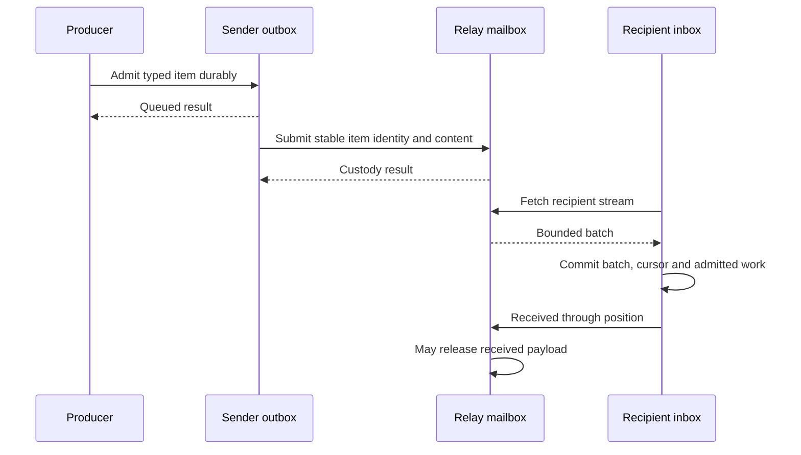
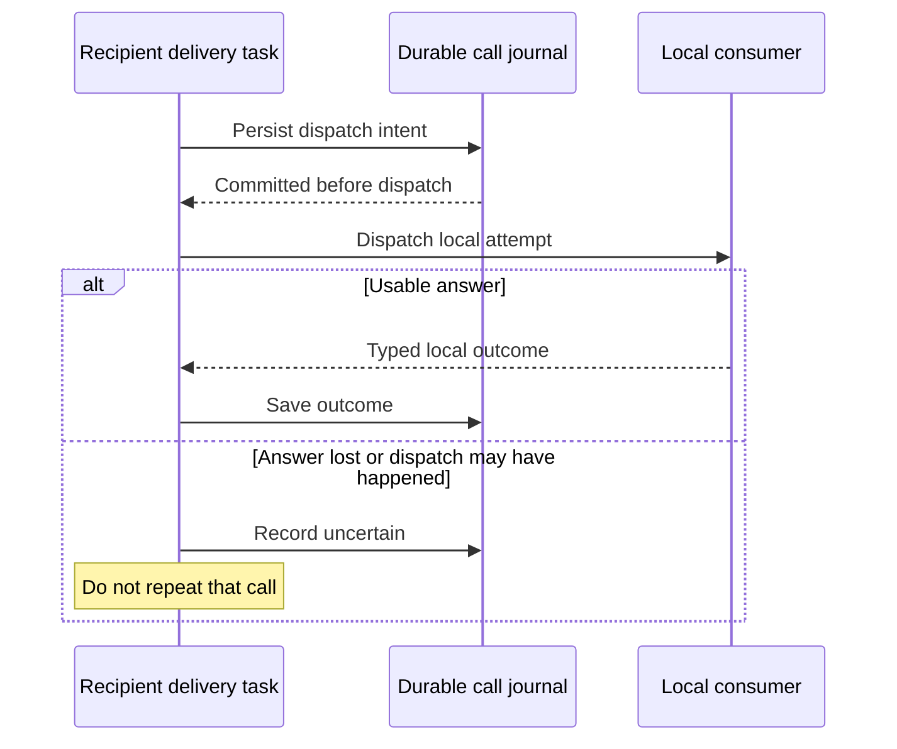

# Where durable delivery fits AgentStudio

**Fleet-sync's optional delivery lane preserves custody and explicit outcomes. AgentStudio still defines the operation, recipient, authority and meaning of acceptance.** Database replication, an ordinary command reply, terminal bytes and durable delivery remain separate contracts.

This is source evidence and consumer-fit analysis at library `53995d76150259464e7158c479c1e84bce7c51b3` and AgentStudio `624300332f5e50f7bb8cbb9fc786d5e5b4a3d462`. It selects no new queue, receipt table, public method or delivery policy. The [four-lane architecture](fleet-sync-consumer-fit.md#four-kinds-of-traffic-have-different-jobs) and [current notice transaction](transaction-boundaries.md#a-concrete-case-accepting-a-queued-notice) remain the basis.

## Custody, recipient storage and local effect

The engine's outbox, relay mailbox and recipient inbox are responsibilities, not three additional daemon processes. Its task configuration names an owner peer and relay peer; AgentStudio has not selected the relay's deployment home. Central writer-lease authority does not automatically own mailboxes. Host-local authorized agent input must retain its direct Host boundary without making a Mac Gateway or a new relay a prerequisite.

This is the normal accepted-item custody path. Receipt and local work proceed independently after the inbox transaction; the diagram does not promise which completes first. The recipient receipt releases relay custody, without waiting for a person, shell or native effect. Later reporting/publication has its own durable work. A later lower-rank custody status does not replace an already terminal result.

Primary sources: [receipt task](https://github.com/agent-collaboration/agent-fleet-sync/blob/53995d76150259464e7158c479c1e84bce7c51b3/crates/fleet-sync-delivery/src/receive_task.rs), [mailbox receipt rules](https://github.com/agent-collaboration/agent-fleet-sync/blob/53995d76150259464e7158c479c1e84bce7c51b3/crates/fleet-sync-delivery/src/mailbox_custody.rs), [local delivery task](https://github.com/agent-collaboration/agent-fleet-sync/blob/53995d76150259464e7158c479c1e84bce7c51b3/crates/fleet-sync-delivery/src/deliver_task.rs), and [status variants/ranks](https://github.com/agent-collaboration/agent-fleet-sync/blob/53995d76150259464e7158c479c1e84bce7c51b3/crates/fleet-sync-protocol/src/delivery_outcome.rs).

## The local dispatch deliberately preserves uncertainty

`DeliverCall` sets `DEDUPLICATES = false`. Durable steps persists its dispatch intent before calling the host. If the answer is lost, or a resumed dispatch may already have reached its destination, the call becomes `Uncertain` rather than being sent again. The delivery task records that as a terminal recipient outcome. A crash before the external action actually ran can therefore still leave an uncertain result; the engine conservatively preserves what it cannot know.

A known-not-sent call may retry. A definite `Held` answer can create a later distinct attempt. Those differ from repeating a possibly executed call. Replacing an uncertain item with a fresh identity would be another requested operation, not a proof that retry is safe.

The host must also adapt local answers through `DeliverCall::validated_answer`: an invalid/oversized acceptance becomes `Uncertain`, because invalid return data cannot undo a prior effect. `Delivered { acceptance }` means exactly the consumer-defined acceptance, not automatically a person reading, a child consuming input or command completion.

Primary sources: [local call contract](https://github.com/agent-collaboration/agent-fleet-sync/blob/53995d76150259464e7158c479c1e84bce7c51b3/crates/fleet-sync-delivery/src/delivery_calls.rs), [persist-before-dispatch and resume rules](https://github.com/agent-collaboration/agent-fleet-sync/blob/53995d76150259464e7158c479c1e84bce7c51b3/crates/durable-steps/src/call_execution.rs), and [consumer outcomes](https://github.com/agent-collaboration/agent-fleet-sync/blob/53995d76150259464e7158c479c1e84bce7c51b3/crates/fleet-sync-delivery/src/delivery_contract.rs).

This differs from the replication receiver's after-commit follow-up contract, whose delivery may repeat with the same call identity. Both use durable machinery; they have different effect promises. A consumer must not apply one callback's retry rule to the other. [Receiver host contract](https://github.com/agent-collaboration/agent-fleet-sync/blob/53995d76150259464e7158c479c1e84bce7c51b3/crates/fleet-sync-receiver/README.md).

## What the AgentStudio consumer would supply

| Boundary | Consumer work still needed |
| --- | --- |
| Typed content | Concrete body, sender, recipient address and acceptance types, with their schema/version and configured size limits |
| Release | `release_gate` decides release or hold in the supplied transaction; it does not replace the destination's current scope/binding validation |
| Local effect | `deliver_locally` returns held, delivered, uncertain, expired, dropped or refused with the selected meaning; the host validates its answer |
| Cancellation | `may_cancel` checks the requester against the retained header; prevented and too-late outcomes remain distinct |
| Hosting and trust | Authenticated peer routing, application principal/delegation, recipient resource/binding, storage/clock/wake lifecycle and mailbox placement |
| Resource policy | Chosen queue/body/receipt/publication retention and explicit full/expired/unavailable handling; no AgentStudio duration is inherited automatically |

The shared `DeliveryTypes` defines sender/address/acceptance as consumer types. Its content digest validates identity/content consistency; that digest is not a credential or authorization grant. A transport peer, a Host resource, a provider binding, a human principal and a delivery item keep their different meanings. The public trait has release, local-delivery and cancellation hooks; it does not supply all AgentStudio authorization policy by naming a sender field.

Primary interfaces: [delivery item/types](https://github.com/agent-collaboration/agent-fleet-sync/blob/53995d76150259464e7158c479c1e84bce7c51b3/crates/fleet-sync-protocol/src/delivery_item.rs) and [delivery consumer/task configuration](https://github.com/agent-collaboration/agent-fleet-sync/blob/53995d76150259464e7158c479c1e84bce7c51b3/crates/fleet-sync-delivery/src/delivery_contract.rs). These are library roles and required consumer meanings, not a finalized AgentStudio crate graph or payload schema.

Cancellation and expiry need precise product meaning. The recipient can prevent pending/held work; cancellation during an attempting call waits for its outcome, and delivered/uncertain work can be too late to prevent. This is not compensation for an effect. Expiry is checked at defined steps; a successful check can be journaled before later dispatch. The library therefore does not itself establish a universal promise that no action starts or finishes after the item's deadline. AgentStudio must define and enforce any stronger target/binding/deadline rule at the actual operation boundary. [Cancellation rules](https://github.com/agent-collaboration/agent-fleet-sync/blob/53995d76150259464e7158c479c1e84bce7c51b3/crates/fleet-sync-delivery/src/inbox_cancellation.rs) and [delivery checks/attempt completion](https://github.com/agent-collaboration/agent-fleet-sync/blob/53995d76150259464e7158c479c1e84bce7c51b3/crates/fleet-sync-delivery/src/inbox_delivery.rs) delimit these claims.

## Today's CLI queue is a narrower source contract

The current offline handler accepts only a bounded `pane.message.send` request with notice shape, notice-only descriptor eligibility and matching pane/store context. Its caller reaches that handler only for selected pre-submission failure dispositions. A successful append prints `notify queued`; that establishes the producer-side SQLite acceptance, not Host admission or display.

After submission, a missing, malformed, mismatched or invalid typed reply can be `deliveryUncertain`; the CLI prints `outcomeUnknown` and exits unsuccessfully rather than queueing the operation. Ordinary remote refusals also do not become offline notices. The [notice handler](../../../../../../Sources/AgentStudioIPCClientCore/OfflineOutbox/PaneNotificationOfflineHandler.swift:7), [caller/fallback](../../../../../../Sources/AgentStudioIPCClientCore/AgentStudioIPCClientCommandLineRunner.swift:211), and [post-submission classification](../../../../../../Sources/AgentStudioIPCClientCore/AgentStudioIPCClientCore.swift:282) own these source boundaries.

The frame boundary matters: a failed write classified not-submitted may have emitted a prefix. The current protocol forbids embedded line breaks and terminates each request with one final newline; a prefix is not a complete submitted request. This is source-specific framing evidence, not a general claim that every transport error means zero bytes were sent. The future socket/network contract needs the same honest distinction in its own framing.

Endpoint discovery is another separate boundary. The absence of endpoint configuration can fail before the offline catcher; a resolvable but unreachable endpoint can reach it. The eligibility switch alone does not prove every missing-app path queues. This analysis selects no repair or new fallback for that baseline behavior.

The [agents/context contract](../../07-agents-context/specification.md) keeps current asks/hooks outside this notice queue. Hook exit zero is fail-open reporting, not admission proof. A blocking ask's retained settlement is distinct from delivery of its reply. The [terminal contract](../../04-terminal-runtime/specification.md) keeps input as ordered, stateful terminal traffic; queue custody cannot establish shell execution or justify resending uncertain keystrokes.

## Fit by workflow

| AgentStudio workflow | Architectural consequence |
| --- | --- |
| Authorized input originating in a Host session | Preserve Host-local admission and execution/binding fences. A Mac-reachability queue cannot become its required path |
| A selected durable cross-machine notice or agent intent | Candidate for the shared delivery lane only after acceptance, target validity, authority, expiry and unknown-result handling are defined |
| Ordinary frontend/CLI capability request | Keep its typed operation outcome. A disconnected call is not automatically admitted to a durable workflow |
| Terminal input/output and resize | Keep the terminal attachment/stream contract; item delivery is not a terminal byte protocol |
| Git/worktree mutation | Preserve its actual partial/unknown effects and operation-specific reconciliation; delivery custody does not make a repeated mutation safe |
| Annotation clipboard/file output | Preserve prepare → external effect → finalization and its partial success; replaying copied rows is not a repeat request |
| Retained metadata and prepared UI reads | Use the selected replication/observation contract; a changed row does not automatically need a mailbox item |

The [current output transaction walkthrough](transaction-boundaries.md#output-has-two-commits-with-an-effect-between-them) and [copy-read contract](replica-read-contract.md) give those adjacent boundaries. The offline metadata A/B choice concerns displaying copied rows, separately from queueing commands; it remains pending.

## Discriminating proof still required

Real adoption needs recipient batch/cursor/work atomicity, relay receipt before/after local outcomes, duplicate item with equal versus changed content, lost submit answer, crash around local dispatch, malformed acceptance, hold/release, cancellation race, quota/expiry and target-generation changes. The actual AgentStudio consumer must demonstrate its declared acceptance and effect boundary. Source review and green shared-library checks do not establish these consumer interactions.

No AgentStudio durable delivery, app/CLI/socket invocation, SQL/replication experiment or new offline behavior was implemented or run here.
