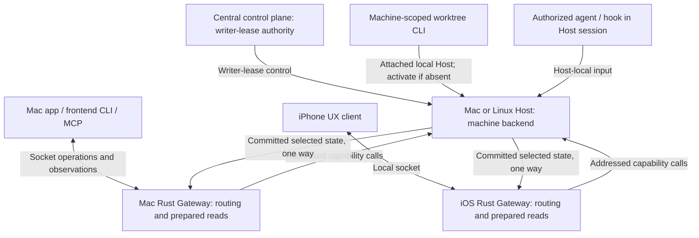
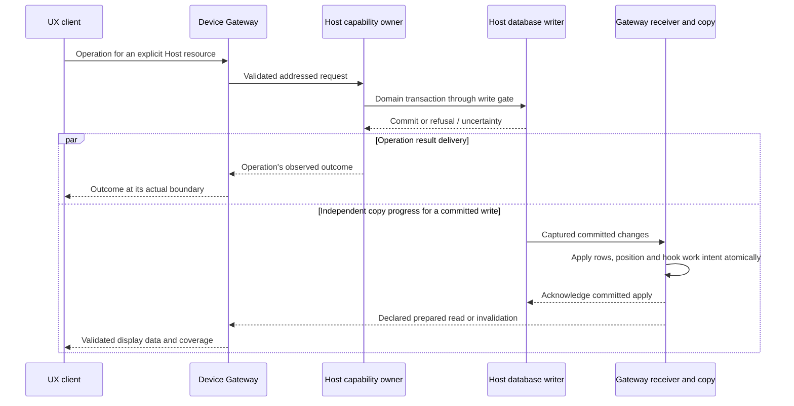

# How agent-fleet-sync fits AgentStudio

`agent-fleet-sync` is a reusable engine for one writer's database, read-only copies and optional durable peer delivery. For the proposed AgentStudio integration, each selected Host database has one lease-holding writer on its Host; Gateways receive selected copies and prepare client reads. S28 requires a Rust Gateway on macOS and iOS, with mobile storage/runtime qualification still open. **Commands still go to the addressed Host. A Gateway copy is not a second backend.**

This updates the earlier design-only library picture using the owner's new brief summary and the six open PRs, whose current source was inspected on 2026-10-17. It is a candidate consumer architecture, not a dependency adoption, schema migration or AgentStudio runtime result. The named one-page file has not yet been located; its pasted summary is the supplied source. [Current source and PRs](#current-library-source-and-prs) distinguish checked implementation from remaining consumer decisions.

## The service picture stays the same

The picture shows one Host for readability. Each Gateway can have several Hosts, and a Host can have several Gateways, including a Mac and iPhone concurrently. Every operation, copy and prepared read retains its source Host/database identity. IP3 selects worktree machine CLI → attached local Host daemon with local activation when absent; authorized session work remains local and UX/frontend CLI remains through Gateway. The phone uses its own iOS Gateway and requires no Mac relay. This is the selected topology, not evidence of a running iOS service or qualified mobile database dependency.

The Host owns Git/worktrees, execution sessions, provider/context workflows and their actual machine effects. The Gateway routes requests, maintains selected connections/copies, combines explicitly scoped read models and serves clients. Swift hosts native UI, Ghostty, input and declared native effects; off-main work prepares values before thin MainActor publication. The future central server owns lease decisions, not the Host's application rows or every terminal keystroke. No additional always-running application service is selected merely because the library contains a service-host crate.

The [typed input-processing proposal](typed-input-processing.md) maps incoming source families to their admission/reduction/publication contracts. It evaluates explicit typed owners with selective fanout against a central bus or general dataflow engine, without selecting a target API or treating debounce as safe for every input.

### Host data acquisition and Gateway materialized views

The Host is an active backend. Each capability's design must explain how it obtains the data it needs: its request, hook, process observation, watcher or refresh trigger; the actual machine/provider source; admission and currentness; reduction; and the coherent state/effect boundary. The Host's selected operational records must support those transactions and the chosen replication contract. This does not make every raw sample, terminal byte, Git file or runtime cache a replicated SQL row. The [transaction analysis](transaction-boundaries.md) and [schema prerequisites](schema-prerequisites.md) constrain the selected records rather than selecting all existing tables.

The Gateway serves prepared client views from the selected copied facts and explicitly scoped client inputs. A faithful copy and a materialized view are different representations: a view can filter, join, group or derive presentation values. Clients depend on the declared view/update contract, not direct access to Host tables. Whether each projection is held in memory, a local table or an index follows its selected lifetime and rebuild contract; “materialized” alone does not choose SQLite. Applied-copy progress and ready-to-serve projection progress must remain distinguishable. Commands still reach the Host owner, and terminal/content bytes keep their separate lanes.

The owner's [latest scope clarification](../../../research/owner-inputs/owner-capability-mapping-clarifications.json) asks for this whole path for AgentStudio's functions. The [eighteen-family catalog](../../../capability-contracts.md#complete-surveyed-family-disposition) remains the coverage index, and its eleven domain folders own the corresponding contracts. A list of RPC names, SQL tables or bus variants is insufficient to establish complete capability placement. Per-capability source, processing, state, copy, projection, client effect and failure paths still need their concrete design; this working picture does not declare them complete or turn every code helper into a remote method.

## Four kinds of traffic have different jobs

| Traffic | Route and meaning | What it cannot establish |
| --- | --- | --- |
| Capability operation | Frontend → Gateway → addressed Host owner; an authorized Host-local input enters its own Host | A copy update cannot authorize the operation or prove its external effect |
| Database replication | Host commit/capture → independent Gateway receivers → read-only rows → declared projections | A captured row change is not automatically a public domain event, terminal stream or human acknowledgement |
| Live terminal / finite content | The selected Gateway/Host terminal or content lane, with its own ordering, control, currentness and resource contract | Durable delivery and SQL catch-up do not restore a terminal parser or prove native rendering |
| Optional durable peer delivery | Consumer-owned outbox/mailbox/inbox workflow with declared recipients, release/admission and outcome meaning | Custody or a delivery receipt does not mean a human read it, a child consumed input, or an arbitrary effect happened exactly once |

These are logical lanes. Their physical connections/codecs remain a separate design choice. Existing WebSocket support in the library does not select Quinn, tarpc, MessagePack or the Swift socket schema. Shared replication sessions outlive connection loss; they are different resources from AgentStudio terminal execution sessions.

The [durable-delivery fit](durable-delivery-fit.md) traces custody, recipient storage and local effect outcomes. In particular, its local delivery callback uses a never-repeat-on-uncertainty contract; replication follow-ups have a different retry contract. Neither is a generic promise to replay every AgentStudio operation safely.

## One change, from user intent to displayed copy

Replication runs independently of the operation reply; the diagram does not promise which arrives first. If an operation completed but a copy still shows an older position, AgentStudio must apply its chosen read-after-write/currentness contract. It can neither erase the known effect nor call the stale copy current. The exact direct-source read, position wait or pending presentation policy remains consumer work.

[Reading a Gateway copy honestly](replica-read-contract.md) separates applied position, source coverage, connectivity and command outcome, and presents the open last-known-versus-unavailable offline metadata choice.

The receiver hook can update receiver-local SQL or admit durable follow-up work in the apply transaction. Actual external follow-up runs after commit and may repeat with the same call identity. Rebuilding a sidebar/search projection is different from repeating a clipboard write or agent command. AgentStudio selects a bounded hook and operation-specific handling; replication does not authorize business effects from reappearing rows.

The [current transaction walkthrough](transaction-boundaries.md) shows why unit selection comes before table copying: a private intake cursor can share the accepted message's writer transaction, while output preparation and finalization surround a separate external effect. Existing Core and Local saves are already separate commits. The target must preserve the selected meaning rather than infer atomicity from one actor or one copied database.

## What changes in our earlier notes

| Earlier open or outdated statement | Updated basis and architectural consequence |
| --- | --- |
| The shared implementation is only a plan | Six implementation PRs now exist. Their observed CI is green and they are unmerged. AgentStudio can study real APIs; this does not prove its integration or a released dependency. |
| Any declared integer/composite/text key may qualify | Replicated key components must be explicitly non-null TEXT containing canonical UUIDv7 values. Composite keys are not categorically prohibited, but every component must meet that rule. Current legacy integer/provider/path/order keys cannot be presumed admissible. |
| A changed key becomes delete-old plus upsert-new | The current writer refuses assignment to a replicated primary-key column, including self-assignment, and captured key changes are rejected. Stable identity is a binding library constraint; migration/identity design must account for it. |
| Slow copies might become part of each write's commit condition | Ordinary Gateway acknowledgement is not required to commit the Host's application transaction. Sender work is per-copy; bounded retention can mark a lagging follower as needing a snapshot. AgentStudio must still choose finite resource policy and honest unavailable/stale reads. |
| A receiver acknowledgement might wait for external follow-up | The documented receiver host commits applied rows/position and admitted follow-up intent before answering. Follow-up delivery and its effect are separate, repeatable observations. AgentStudio must implement that host contract correctly. |

The inventory of 86 existing tables and 597 columns remains source evidence. It is not an export list or a promise that those tables fit this engine. The newer five-form census finds 68 known declaration conflicts if selected unchanged and 18 without a known conflict in those checks. A bounded key/writer trace of those 18 then finds eight with source counterexamples and ten still unproved; no table has runtime admission evidence. The former nineteen-table count covered a narrower historical profile. [Schema prerequisites](schema-prerequisites.md) explain both checks and their limits. Adding a surrogate key, changing foreign keys or moving trigger-enforced invariants is design and migration work, not a mechanical ID rewrite.

“Copies never block the writer” means a slow/disconnected read-serving Gateway is not a synchronous remote prerequisite for each application commit. It does not mean unlimited backlog, zero local storage contention, permission to ignore lease expiry, or recovery from a full disk. The inspected sender also distinguishes an `Authoritative` copy whose acknowledged floor is protected. **No Gateway is assigned that role by this design.** Its relationship to the central registry/recovery scope must be explicit before adopting that role; do not treat all copies as interchangeable.

## The actual crate boundaries

These names come from the inspected PR tip. They are reusable library responsibilities, not one daemon per crate.

| Crate group | Library responsibility | AgentStudio consumer responsibility |
| --- | --- | --- |
| `fleet-sync-protocol` | Typed identities, frames, replication, lease and delivery payloads; generic consumer payload family | Domain payloads, versions, supported exposure and real Swift-facing schema |
| `fleet-sync-session` | Logical session/correlation and persisted client cursor; connection-independent rules | Durable session store, identity/authentication, reconnect pumping and operation-specific resend decision |
| `fleet-sync-transport-websocket` | Concrete WebSocket connection adapter | Reachability/admission and selected deployment; another transport remains an adapter project |
| `fleet-sync-writer` | Declared schema, guarded captured writes, per-copy sending/retention and seeding | Migrations, selected tables, domain transactions, copy roles, annotation/bookkeeping and retention policy |
| `fleet-sync-receiver` | Transactional copy apply/snapshot and receiver hooks | Host transaction/commit discipline, permitted read scope and bounded hook/follow-up behavior |
| `fleet-sync-lease` | Registry/holder rules and explicit holder-change machinery | Central authority hosting/binding and policy; no current AgentStudio writer-transfer surface |
| `fleet-sync-tokio-runner`, `fleet-sync-service` | Native Tokio hosting, task/session/connection and service integration | Compose into the existing Host/Gateway roles, supply credentials, consumer gates and artifact lifecycle; choose no extra service by name alone |
| `fleet-sync-delivery`, `durable-steps`, `runtime-primitives` | Optional durable peer custody and journaled work, clocks/IDs/wakes | Selected item/acceptance types, recipients, release/cancel rules, local effect and retention semantics |
| Owned SQLx drivers and `fleet-sync-query-gen` | Native Turso/DO driver and query tooling | Selected supported target/schema builds and application proof; Cloudflare hosting is not required by AgentStudio's current topology |

For example, the writer's `ReplicatedSchema` supplies migrations, local migrations and declared replicated tables. `ReceiverHook` supplies in-transaction apply/snapshot work and follow-up behavior. Durable delivery's `DeliveryConsumer` supplies a release gate, local delivery outcome and cancellation authority. These are Rust traits with concrete consumer types; the shared library does not import AgentStudio's tables or atom types. Exact crate composition belongs to the complete Program Design.

## Decisions still owned by AgentStudio

1. **Database units and exact membership:** preserve real context/intake and annotation-finalization transactions; separate client arrangements, private authority and rebuildable projections by meaning and permitted audience.
2. **Target schema and installed-data cutover:** stable UUIDv7 keys/foreign-key closure, trigger invariant realization, legacy identity mapping and supported migrations. Do not rewrite all current tables merely because some will be replicated.
3. **Retention and read behavior:** source delivery backlog, copy refill, retained product history, read freshness and read-after-write are different promises. Choose bounded policy and show incomplete/superseded/unestablished coverage honestly.
4. **Authority integration:** central lease authority is already selected. Its binding to each database, initial grant/renewal/expiry, credential custody and any authoritative-copy role remain to design. The brief's generic registry-placement choice does not reopen that owner selection.
5. **Optional durable delivery:** which workflows need durable custody, what acceptance means, recipient/effect machine, cancellation/expiry and operation-specific duplicate/unknown outcomes. Do not put every UI request or terminal byte into an outbox.
6. **Unexpected holder change:** writer transfer remains excluded. The library's explicit holder-change APIs are not an AgentStudio transfer feature. If external authority reports a new holder/epoch, copies and requests need a declared refusal/stale/refill/rebind contract; no follower auto-promotion, silent merge or destructive reset is inferred here.

IP2 selects a single terminal controller with viewers, IP3 selects worktree machine CLI → attached local Host with local activation when absent, and IP4 selects pause/refusal of invalid-authority gated writes without a new spool. Their exact handoff, admission and gate coverage remain consumer contracts. This library narrows implementation choices; it cannot decide those user-visible meanings.

## Current library source and PRs

Observed stack on 2026-10-17: [#1 foundation](https://github.com/agent-collaboration/agent-fleet-sync/pull/1) → [#2 durable steps](https://github.com/agent-collaboration/agent-fleet-sync/pull/2) → [#4 protocol/session/WebSocket](https://github.com/agent-collaboration/agent-fleet-sync/pull/4) → [#5 replication/registry rules](https://github.com/agent-collaboration/agent-fleet-sync/pull/5) → [#6 writer/runner/service](https://github.com/agent-collaboration/agent-fleet-sync/pull/6) → [#7 durable delivery](https://github.com/agent-collaboration/agent-fleet-sync/pull/7). All were OPEN with `mergedAt: null` and successful returned checks. “Reviewed” is supplied by the owner; this inspection did not reproduce the independent reviews, and PR #7 exposed no GitHub review records. Green library CI is not AgentStudio acceptance.

Inspected tip: `53995d76150259464e7158c479c1e84bce7c51b3`. Load-bearing primary anchors: [schema/key rules](https://github.com/agent-collaboration/agent-fleet-sync/blob/53995d76150259464e7158c479c1e84bce7c51b3/crates/fleet-sync-protocol/src/replicated_key.rs), [writer schema inspection](https://github.com/agent-collaboration/agent-fleet-sync/blob/53995d76150259464e7158c479c1e84bce7c51b3/crates/fleet-sync-writer/src/schema_inspection.rs), [captured immutable-key check](https://github.com/agent-collaboration/agent-fleet-sync/blob/53995d76150259464e7158c479c1e84bce7c51b3/crates/fleet-sync-writer/src/capture_normalization.rs), [per-copy sending](https://github.com/agent-collaboration/agent-fleet-sync/blob/53995d76150259464e7158c479c1e84bce7c51b3/crates/fleet-sync-writer/src/replication_sender.rs), [retention](https://github.com/agent-collaboration/agent-fleet-sync/blob/53995d76150259464e7158c479c1e84bce7c51b3/crates/fleet-sync-writer/src/sender_retention.rs), [receiver host contract](https://github.com/agent-collaboration/agent-fleet-sync/blob/53995d76150259464e7158c479c1e84bce7c51b3/crates/fleet-sync-receiver/README.md), [session contract](https://github.com/agent-collaboration/agent-fleet-sync/blob/53995d76150259464e7158c479c1e84bce7c51b3/crates/fleet-sync-session/README.md), and [delivery consumer contract](https://github.com/agent-collaboration/agent-fleet-sync/blob/53995d76150259464e7158c479c1e84bce7c51b3/crates/fleet-sync-delivery/src/delivery_contract.rs).

No AgentStudio Host/Gateway replication, schema migration, durable delivery, terminal restoration or performance experiment has run here. Adoption still needs real selected-schema writes/capture/apply/read, independent slow copies and refill, lost acknowledgements, apply/follow-up interruption, lease clocks and the actual Swift/service integration. The library's source and CI reduce uncertainty; they do not erase these integration gates.
