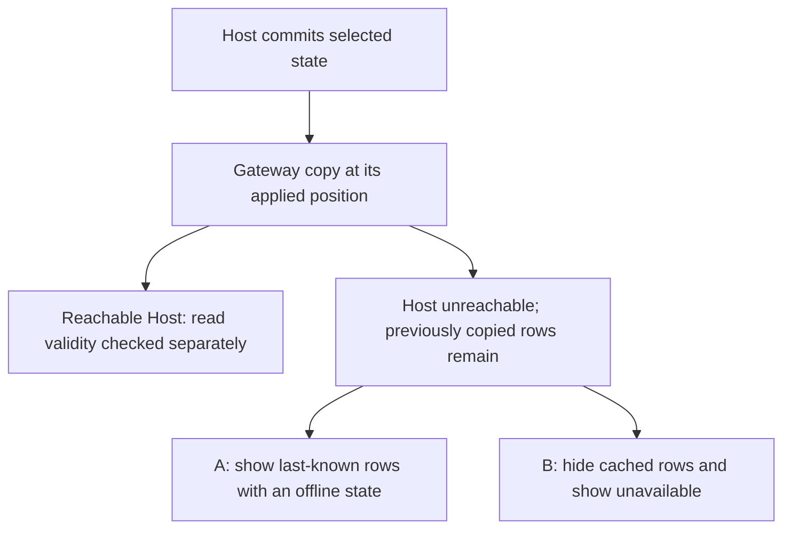

# Reading a Gateway copy honestly

**A copy position proves which database commits were applied. It does not prove that the Host is reachable, a filesystem observation is still current, or a user command's external effect completed.** AgentStudio needs those meanings separately before its Swift client can label a value current.

This is a source-grounded explanation and an open consumer decision for [DS02](../README.md), not an adopted read API or offline policy. It consumes the existing [E22 observation meaning](../../../domain-entities.md) and [R16 validity obligation](../../../2026-10-15-agentstudio-daemon.md): known incomplete/superseded or unestablished coverage cannot be presented as complete current coverage. Exact freshness, retained history and refusal profiles remain open.

## What the inspected library gives us

| Library evidence | What it establishes | What AgentStudio cannot infer |
| --- | --- | --- |
| `ReplicationPosition { epoch, sequence }` | Ordering within the addressed database's writer history | Global order across Hosts/databases; current filesystem coverage; operation or terminal identity |
| `CopyStatus` with database, role, fence, holder, start, applied position and schema | Stored copy authority/history and applied schema/position | A live source connection, an observed current writer head or every resource's freshness |
| Following copy state | The receiver's published copy status | Caught up to an unseen Host tail; complete application observation coverage |
| Sender-side `needs_snapshot` | An ordinary follower has fallen outside the retained replay floor/policy | That an unreachable Gateway already knows this condition, or that a raw receiver row is current |
| Snapshot page cursor at an acknowledged position | The page's database/schema/position; a changed position yields `SnapshotRead::Moved` | An indefinitely frozen multi-page read or a coherent snapshot across several Hosts |

These claims use inspected library commit `53995d76150259464e7158c479c1e84bce7c51b3`. Primary sources: [position](https://github.com/agent-collaboration/agent-fleet-sync/blob/53995d76150259464e7158c479c1e84bce7c51b3/crates/fleet-sync-protocol/src/replication_position.rs), [copy status](https://github.com/agent-collaboration/agent-fleet-sync/blob/53995d76150259464e7158c479c1e84bce7c51b3/crates/fleet-sync-protocol/src/lifecycle_message.rs), [published status rules](https://github.com/agent-collaboration/agent-fleet-sync/blob/53995d76150259464e7158c479c1e84bce7c51b3/crates/fleet-sync-receiver/src/copy_lifecycle.rs), [snapshot reads](https://github.com/agent-collaboration/agent-fleet-sync/blob/53995d76150259464e7158c479c1e84bce7c51b3/crates/fleet-sync-receiver/src/snapshot_reads.rs), and [retention](https://github.com/agent-collaboration/agent-fleet-sync/blob/53995d76150259464e7158c479c1e84bce7c51b3/crates/fleet-sync-writer/src/sender_retention.rs).

The protocol's field is named `acked`; this table describes the committed applied position it represents. It is not a person acknowledgement. `needs_snapshot` is sender bookkeeping, whereas `Starting`, `Seeding`, `Following` and `Retired` are receiver records. They are not one interchangeable status enum. The snapshot-read path additionally permits a verified matching Starting install through its explicit marker check; that special read path is not proof that every application query may bypass readiness. [Receiver records](https://github.com/agent-collaboration/agent-fleet-sync/blob/53995d76150259464e7158c479c1e84bce7c51b3/crates/fleet-sync-receiver/src/copy_contract.rs) and [readable install gate](https://github.com/agent-collaboration/agent-fleet-sync/blob/53995d76150259464e7158c479c1e84bce7c51b3/crates/fleet-sync-receiver/src/snapshot_install.rs) own those distinctions.

## A successful command can precede its copied result

Suppose a user asks Host A to change a worktree. The Host reports the operation's observed result, while the Gateway still has an older database position. The operation reply and replication can arrive in either order. A successful reply cannot be erased by showing the older copy as if it were the new result.

The eventual contract needs to say which observation closes that interval. A domain operation may affect files/processes before metadata is refreshed, and may not write a selected replicated table at all. Therefore an application result cannot automatically be assigned a database position simply because the library has positions. Exact operation-to-state witnesses, source refresh/currentness and a pending presentation remain consumer design questions.

Conversely, a copy moving forward cannot prove the requested operation happened: unrelated commits also move its position. A disappeared request reply remains an operation-specific unknown outcome until the declared reconciliation establishes more. Terminal input must not be resent merely because a copy is old.

## Reads retain several independent meanings

| Dimension | Meaning to preserve in the selected read contract |
| --- | --- |
| Address | Host, database and declared resource/scope; equal paths on different Hosts stay distinct |
| Applied state | Which published rows/schema/position the query actually observed; do not pair rows with an unrelated later status read |
| Observation coverage | Source lifetime/generation, completeness and supersession under E22; database progress alone does not prove a watcher is continuous |
| Connectivity | Whether the addressed Host can currently be contacted; a read-only copy can remain readable after that changes |
| Authority and audience | The allowed data scope and current consumer permission; an ordinary follower is not another writer |
| Presentation | Declared current, last-known, incomplete or unavailable meaning; these are not raw internal receiver states |

For a multi-Host view, each contribution keeps its own source and validity. A single maximum sequence or latest timestamp cannot make all contributions current. Exact aggregate behavior and whether partial results stay visible remain application contracts.

This table names meanings, not final wire fields, booleans or a new global cursor. Concrete types and their schema home belong to the Program Design after the observable choices are settled. The [transaction walkthrough](transaction-boundaries.md) also explains why current context display code cannot run unchanged on a read-only copy.

## One open choice: a Host becomes unreachable

For metadata the Gateway remains authorized to display, two offline presentation profiles are credible. Neither changes the Host's mutation authority, creates offline command replay or declares cached rows current.

The picture describes the proposed distributed system, not a running AgentStudio implementation. Today's app reads its own local state; introducing a remote Host creates this new disconnect choice.

| Profile | Gain | Cost and who bears it |
| --- | --- | --- |
| A — Show authorized last-known metadata | Users can inspect previously known sessions/repositories while the Host is unavailable; disconnect does not look like deletion | Native/Gateway readers must preserve visible offline/currentness distinctions and the selected retention/access rules; users must distinguish history from a live observation |
| B — Hide cached metadata | The disconnected Host has one explicit unavailable presentation, without showing its stale rows | Users lose offline inspection and cannot use the copied view until reconnection; the UI still needs a separate unavailable Host entry |

**Recommendation: A.** It preserves useful inspection while keeping command authority at the Host. Choose B if the product should never expose a disconnected Host's previous metadata, even when its audience remains authorized. Permission revocation and cache retention still apply; choosing A would not authorize indefinite retention or expired-permission access.

If this choice is deferred, the offline presentation contract remains open. Source/type/transaction research can continue; the specification and final Swift read contract cannot silently choose a profile. Central lease expiry, terminal-session survival, terminal byte recovery and writer transfer are separate decisions.

## What a real proof must distinguish

- Command success with a delayed copy versus a lost command reply with uncertain effect.
- A readable published copy versus an unverified/partial install and a changed snapshot cursor position.
- A known replay gap needing refill versus a disconnected Gateway that has not yet learned the sender's condition.
- Equal row values with lost source continuity versus complete current coverage.
- Two Host contributions at different positions/coverage, with no cross-Host atomicity claim.
- A permitted last-known read versus permission loss or unavailable data under the eventually chosen profile.

No application read, fault, retention, replication, permission or native publication experiment has run here. This narrows the contract questions; it does not establish their runtime behavior.
