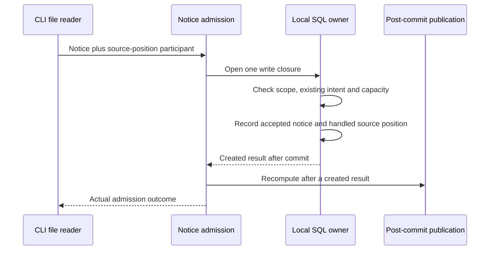
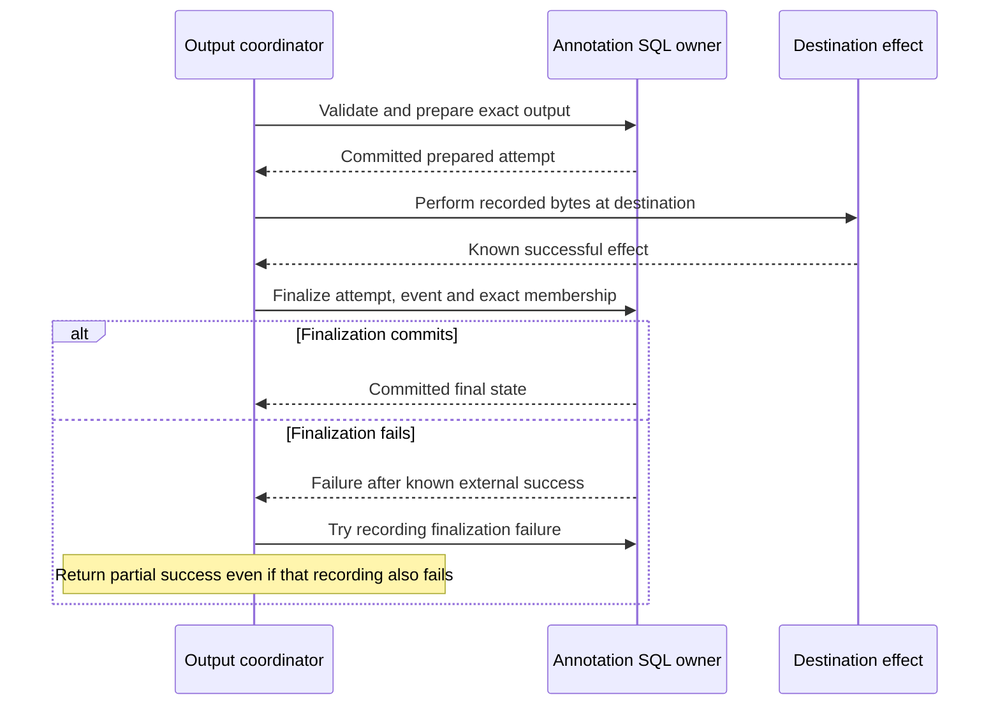

# Which current writes must stay together?

**Choose database units around the predicates that a write must preserve. Choose copied tables around their audience and meaning. Those are different cuts.** Private bookkeeping can belong to the same authoritative transaction as public state without belonging to the Gateway's copy.

This is current-source constraint evidence for [DS02](../README.md), not a selected database layout or migration. Product source is pinned at `624300332f5e50f7bb8cbb9fc786d5e5b4a3d462`; the shared-library observations use `53995d76150259464e7158c479c1e84bce7c51b3`. No installed database or real transaction experiment was inspected or run. Exact table membership, client composition scope and recovery promises remain open.

## A concrete case: accepting a queued notice

The current notice drain reads a producer-owned CLI file. It then passes a cursor participant into notice admission. On successful creation, the notice and handled source position commit through the same Local database write closure. An equal existing intent can also commit that participant; a conflicting intent cannot count as the same accepted message.

The diagram follows the created-notice branch. Malformed/refused entries use a separate cursor-only write so the drain can move past them; retryable failures leave the prefix for retry. **Handled is therefore not synonymous with accepted.** There is no transaction spanning the CLI file read and the Local write.

Primary paths: [drain and disposition handling](../../../../../../Sources/AgentStudio/App/PaneAgents/PaneCLIOutboxDrain.swift:88), [notice-only admission](../../../../../../Sources/AgentStudio/App/PaneAgents/PaneCLIOutboxDrain.swift:149), [message write closure](../../../../../../Sources/AgentStudio/Core/PaneContext/PaneContextService+Messages.swift:20), [cursor participant](../../../../../../Sources/AgentStudio/App/PaneAgents/CLIOutboxCursorCommitParticipant.swift:10).

The participant also conforms to the Sessions protocol, but a reusable seam is not proof of production wiring. The current [hook ingress](../../../../../../Sources/AgentStudio/App/IPCComposition/AgentStudioIPCSessionsAdapter.swift:60) calls `submitHook(hook)` without this participant. The scoped product call search found the notice drain as its sole constructor. This source model consequently claims notice/cursor atomicity, not a general hook outbox.

## Existing transaction cuts

| Current group | What must remain coherent | What is outside that commit |
| --- | --- | --- |
| Context admission and ordering | Request-specific scope/binding predicate, current intent/ask state and accepted ordering changes. The title/line/ask path must not replace an in-transaction binding check with an earlier network lookup | Publication and downstream work after the write; exact production source path matters |
| Notice intake | The accepted notice and its supplied handled-position participant; equal duplicate intent differs from conflict | Reading the producer file; refused/malformed cursor-only advancement; display publication |
| Annotation output | Prepared exact membership and edit fences; later finalization's attempt/event, handled revisions and session revision | The native clipboard/file effect between preparation and finalization |
| Repository activity | Activity/coverage and the volume watermark supplied in one commit | Filesystem observation and live coverage; copied watermarks do not establish another machine's observation continuity |
| Workspace composition and Undo | Workspace/graph validation and replacement, applicable Undo/custody updates inside the Core write | The ordinary save's later Local-state write; actual native mounting |

The [repository activity commit](../../../../../../Sources/AgentStudio/Core/State/MainActor/Persistence/WorkspaceLocalRepository+RepositoryLocalActivity.swift:11) applies all repository updates and cursor watermarks before returning its snapshot. Its cursor update is monotonic in the observed source ID. Splitting the public activity record from its private source checkpoint into independently committed stores would change this existing boundary. The checkpoint remains machine-source state, not a portable live-coverage certificate.

The [Core snapshot write](../../../../../../Sources/AgentStudio/Core/State/MainActor/Persistence/WorkspaceCoreRepository.swift:187) validates and replaces the graph and applies the applicable Undo change in one closure. In contrast, [ordinary bundle save](../../../../../../Sources/AgentStudio/Core/State/SQLite/WorkspaceSQLiteDatastoreActor.swift:149) commits Core before writing Local. A later Local failure is thrown after Core has succeeded. The Undo-change branch returns after Core. One coordinating Swift actor does not make both files atomic.

These are preservation constraints on future cuts. They do not require retaining every current table or preserving the current coupling between view Undo and execution custody. The selected detach/terminate contract already requires that coupling to be reconsidered.

## Output has two commits with an effect between them

The current preparation write validates session revision, exact saved-message membership and absence of conflicting drafts/prepared output, then records the exact snapshot/bytes and attempt membership. Finalization is another write: it records the output event, succeeds the attempt, marks only matching saved revisions handled and advances the session revision.

This follows the known-success effect branch. Other branches include cancellation, effect failure and effect-plus-cleanup failure. Recovery can classify prepared attempts as unknown; an explicit repeat creates a new attempt and deliberately performs the recorded bytes again. A receiver refill, equal row or lost reply is not that explicit repeat request.

Primary sources: [preparation and exact membership](../../../../../../Sources/AgentStudio/Features/Bridge/State/SQLite/WorktreeAnnotations/WorktreeAnnotationSQLiteRepository+Output.swift:76), [finalization](../../../../../../Sources/AgentStudio/Features/Bridge/State/SQLite/WorktreeAnnotations/WorktreeAnnotationSQLiteRepository+Output.swift:362), [revision-matching handled update](../../../../../../Sources/AgentStudio/Features/Bridge/State/SQLite/WorktreeAnnotations/WorktreeAnnotationSQLiteRepository+Output.swift:770), [effect and partial-success return](../../../../../../Sources/AgentStudio/Features/Bridge/Runtime/WorktreeAnnotations/WorktreeAnnotationOutputCoordinatorActor.swift:395). This is source-observed control flow, not a demonstrated clipboard/file operation.

## Some presentation work currently writes

The current context publication path is not a passive callback. After the admitted write returns, `publishAffectedSources` calls `computeDisplay`. That method reads a session summary, then opens a separate Local write closure to capture the display. The capture can expire lines, hide settled messages and advance source revisions before offering a value to its presentation mailbox. A copied read-only database cannot run that method unchanged as an ordinary query.

Likewise, a Sessions hook transaction and its later context-ending transaction are distinct. The latter marks matching lines stale and changes `notYetConfirmed` receipts to `unconfirmed`, then publishes afterward. A shared Local file makes these sequential writes possible; it does not combine every step into one atomic operation.

Primary paths: [publication and display computation](../../../../../../Sources/AgentStudio/Core/PaneContext/PaneContextService+Presentation.swift:91), [capture and maintenance calls](../../../../../../Sources/AgentStudio/Core/PaneContext/PaneContextStorage+MessageProjection.swift:17), [expiry and hiding writes](../../../../../../Sources/AgentStudio/Core/PaneContext/PaneContextService+Lifecycle.swift:255), [context-ending write](../../../../../../Sources/AgentStudio/Core/PaneContext/PaneContextService+Lifecycle.swift:153), [post-commit Sessions callback](../../../../../../Sources/AgentStudio/Features/Sessions/Runtime/SessionsIngestion+Status.swift:114).

The extraction must separate these authoritative mutations from pure copied-state projection. Their continuing Host-side behavior must satisfy the selected no-client contract; a connected Swift view cannot become the only trigger for required maintenance. Exact scheduling, retention, lease-gate coverage and the resulting read shape are still design work. This is a source constraint, not a new timer, event log or maintenance service.

## A private table does not require a separate SQL transaction

The inspected shared schema trait has both `replicated_tables()` and `local_migrations()`. Its ordinary statement guard permits consumer DML on non-reserved tables; the replicated-key check applies to the declared replicated layouts. Captured row normalization includes only matching replicated layouts. The source therefore supports studying private local tables beside selected replicated rows in the same writer database, without assuming those private rows are exported.

Primary library anchors: [schema trait](https://github.com/agent-collaboration/agent-fleet-sync/blob/53995d76150259464e7158c479c1e84bce7c51b3/crates/fleet-sync-writer/src/replicated_schema.rs), [statement admission](https://github.com/agent-collaboration/agent-fleet-sync/blob/53995d76150259464e7158c479c1e84bce7c51b3/crates/fleet-sync-writer/src/statement_guard.rs), [captured commit normalization](https://github.com/agent-collaboration/agent-fleet-sync/blob/53995d76150259464e7158c479c1e84bce7c51b3/crates/fleet-sync-writer/src/capture_stream.rs), [local migration ownership](https://github.com/agent-collaboration/agent-fleet-sync/blob/53995d76150259464e7158c479c1e84bce7c51b3/crates/fleet-sync-writer/src/migration_ownership.rs).

This is a source-supported feasibility direction, not a selected AgentStudio schema or successful integration. Local migrations cannot mutate replicated tables. The source transaction still needs its required private predicate/checkpoint, while a public read copy has only its declared data contract. A copy missing writer-private state cannot be advertised as sufficient to reconstruct the writer. No separate publication database, private-state recovery mechanism or writer-transfer feature is selected here.

## Two boundaries settled by the newer library

**The writer checks its gate again at commit.** Its current `WriteTransaction` checks at begin and guarded statement execution, then checks in `commit()`, validates pending keys and checks again immediately before calling SQL commit. Refusal takes the rollback path. The earlier note that only begin-time admission was known is superseded by this source. This does not prove an AgentStudio integration, an instantaneous database/clock boundary during the asynchronous commit call, or the product policy for an already-running process after lease expiry.

**Copy apply acknowledgement follows a committed apply.** The receiver's host contract requires applied rows/position, hook SQL and admitted follow-up intent committed before answering. External follow-up may repeat under the same call identity and retains its separate result. A native effect is not part of that acknowledgement.

Primary library sources: [write transaction](https://github.com/agent-collaboration/agent-fleet-sync/blob/53995d76150259464e7158c479c1e84bce7c51b3/crates/fleet-sync-writer/src/write_transaction.rs) and [receiver host contract](https://github.com/agent-collaboration/agent-fleet-sync/blob/53995d76150259464e7158c479c1e84bce7c51b3/crates/fleet-sync-receiver/README.md). AgentStudio's central-outage policy remains G13; neither source supplies an expired-lease exception, a pending-fact spool or process termination policy.

## Consequences for the proposed units

- Keep binding-dependent context work in one authoritative transaction domain unless a replacement predicate is explicitly designed and proved. A generic event bus or RPC preflight does not preserve that fence.
- Keep required intake/checkpoint state with its admitted effect; decide its replication audience separately. Do not advance an intake cursor merely because a request reached a Gateway.
- Preserve exact annotation preparation/finalization groups while naming the external effect and its partial/unknown outcomes separately.
- Evaluate project partitioning against these edges before assigning one database per project, pane or session. A current file boundary is neither a mandatory target cut nor evidence of cross-file atomicity.
- Use Gateway copies for declared reads and prepared views. Commands still reach the addressed Host owner; observation of changed rows does not authorize replaying a Git operation or native effect.

The [unit recommendations and decision map](data-replication-decisions.md#recommended-initial-unit-model), [key/schema constraints](schema-prerequisites.md) and [complete catalog](data-catalog.json) are complementary inputs. The current-source map narrows viable designs without selecting the remaining user-visible sharing, retention or recovery promises.
