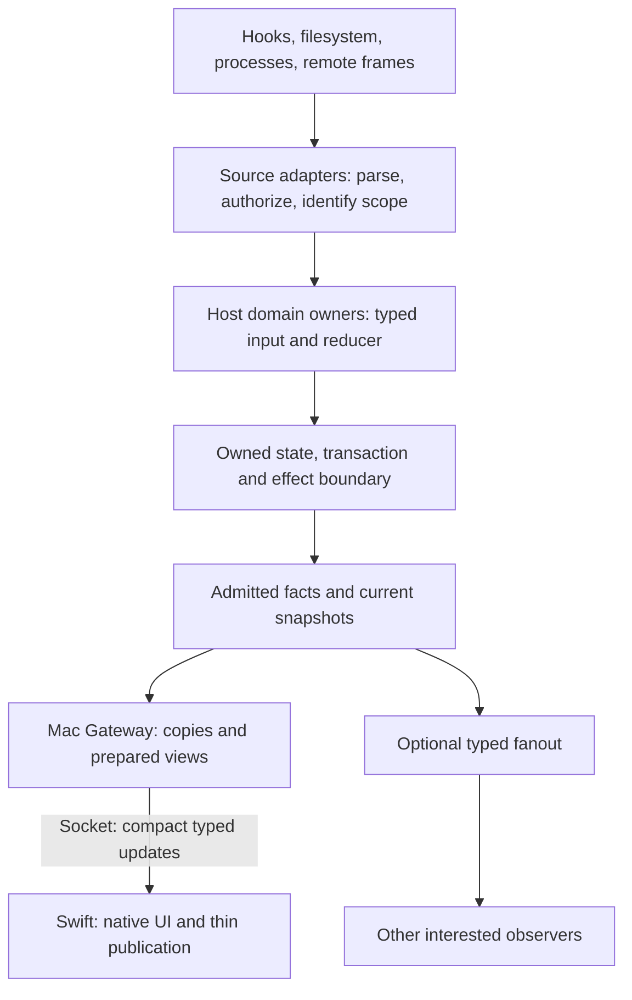

# Typed input processing: sources, reduction and publication

**The proposed core is typed input handled by an explicit domain owner. A bus distributes admitted facts where multiple observers need them.** This separates communication continuity, domain reduction, storage/effects and presentation scheduling instead of asking one event stream to supply every guarantee.

This is a discussion proposal and current-source constraint map, following the [owner's original question](../../../research/owner-inputs/owner-typed-ingress-question.json) about incoming sessions, reducers/debounced triggers and compile-time-safe transforms. It is not an adopted Program Design, crate graph, new event catalog or selected scheduler. The meaning of “sessions” remains to clarify: fleet-sync protocol sessions, provider Sessions or both. The architecture can support both while retaining their different identities. Existing [DS01](../../01-service-contracts/specification.md), [DS02](../specification.md), [DS07](../../07-agents-context/specification.md) and [DS10](../../10-swift-client/specification.md) own the observable contracts and open choices.

## The proposed ownership picture

The picture focuses on backend input. Terminal/content byte lanes and Swift-local native ingress remain separate. “Domain owners” means separately owned session/context, repository, annotation and other selected capabilities, not a single global reducer. Ordinary pure transforms can be direct calls inside an owner; a new task/channel is justified at an actual ownership or asynchronous boundary.

A domain transition may update in-memory state or a declared persistent transaction. Persisted outcome publication follows its commit; the picture does not put every sample in SQLite. Commands enter the owning capability directly. Side-effect execution and reconciliation stay explicit, including partial/unknown results. A notification that an effect happened is not the effect's execution mechanism.

The shared protocol session can carry remote frames, preserve logical correlation/cursors and outlive a connection. It does not define provider-binding validity, every resource's currentness or safe operation replay. A terminal execution session also survives on its own terms. Filesystem/process sources need their actual registration/process lifetime and coverage, without an invented remote session. [Fleet-sync session contract](https://github.com/agent-collaboration/agent-fleet-sync/blob/53995d76150259464e7158c479c1e84bce7c51b3/crates/fleet-sync-session/README.md).

## Input families retain different contracts

This is a family-level map of the surveyed surfaces, not a complete selected method list. The [capability catalog](../../../capability-contracts.md) retains the full surface disposition.

| Input family | Source/admission and proposed responsibility | Reduction/contraction boundary |
| --- | --- | --- |
| Frontend GUI/CLI/MCP capability requests | Typed method and addressed Host/resource; route to its Host or declared client-native effect owner | Explicit request/result; a mutation is not a debounce candidate or arbitrary bus event |
| Provider hooks and execution/binding evidence | Host-local qualified input independent of any Mac; preserve source/binding generation and current transaction predicate | Process required evidence in order. Later complete display status may coalesce by subject |
| Notices, asks, answers and withdrawal | Host context owner validates target, authority, current ask and writer/binding/order state | Preserve terminal settlement and request-specific duplicate/conflict meaning; display equality does not replace admission |
| Terminal input/output and control | Host backend/attachment owner and client renderer; controller/resize contract remains open | Preserve bytes/order and control boundaries. Batch bytes without throwing them away; no debounce or uncertain-input replay |
| Terminal title/CWD/activity observations | Current app's source-classified Ghostty lane is evidence; future required Host facts need a renderer-independent source | Exact controls retain barriers; replaceable metadata and aggregate samples contract only under their own semantics. Host source feasibility remains an experiment gap |
| Filesystem observations | Host source adapter owns registration/lifetime/path scope and overflow/coverage meaning; Linux counterpart still to define | Merge affected scope when licensed; coverage loss triggers the selected recovery disposition, not an ordinary clean/latest value |
| Git/Forge refresh results and invalidations | Host owns machine facts and computation; Gateway/client demand is a scheduling input | Per-scope refresh admission and bounded concurrency; preserve pending invalidation and reject stale origin/generation/scope before publication |
| Bridge/review/content controls | Current product/session capability checks lead to typed operations; target Host workflow and native destination remain distinct | Preserve comparison/source revision and exact output membership; content streams and clipboard/file effects are not generic state updates |
| Replicated rows and copy readiness | Receiver commits selected state/schema/position and permitted hook work under the shared contract | Apply declared transaction semantics before derived read invalidation; latest-value dropping cannot replace faithful replay |
| Protocol connection/session changes | Connection owner handles transport; logical session owns resume/correlation; operation owner handles an unknown result | A new connection does not terminate execution, create a new provider binding or authorize resend |
| App/window/focus/renderer/platform ingress | Swift keeps actual native lifecycle, local control and declared client effects | Native publication remains MainActor; only selected semantic demand/commands cross the socket. No Host round trip for every local sample |
| Deadlines and recovery eligibility | The owner of the affected state evaluates its clock/policy and emits the resulting transition | A deadline is not a quiet-period debounce. No universal timer, cadence or retention policy is selected |

Current decisive anchors include [Sessions FIFO](../../../../../../Sources/AgentStudio/Features/Sessions/Runtime/SessionsIngestion.swift:115), [transactional hook reduction](../../../../../../Sources/AgentStudio/Features/Sessions/State/SQLite/SessionsRepository.swift:8), [later keyed status mailbox](../../../../../../Sources/AgentStudio/Features/Sessions/Runtime/SessionStatusPublicationMailbox.swift:10), [Ghostty source classification](../../../../../../Sources/AgentStudio/Features/Terminal/Ghostty/GhosttyActionDisposition.swift:33), [actual translated-action admission](../../../../../../Sources/AgentStudio/Features/Terminal/Ghostty/GhosttyActionRouter+LocalActions.swift:48), [filesystem overflow ingress](../../../../../../Sources/AgentStudio/Core/RuntimeEventSystem/Filesystem/DarwinFSEventIngressBuffer.swift:52), [Git refresh admission](../../../../../../Sources/AgentStudio/Core/RuntimeEventSystem/Git/GitWorkingDirectoryProjector+Admission.swift:29), [Bridge control admission](../../../../../../Sources/AgentStudio/Features/Bridge/Transport/BridgeProductSchemeControlDispatcher.swift:20) and [native lifecycle ingress](../../../../../../Sources/AgentStudio/App/Lifecycle/ApplicationLifecycleMonitor.swift:77). These establish existing boundaries at product `624300332f5e50f7bb8cbb9fc786d5e5b4a3d462`; they do not prove the proposed Rust realization or Linux parity.

## Reduce required inputs; contract only what may be replaced

The current [selection rule](../../../../../architecture/state/demand_driven_derived_state_refresh.md#selection-rule) separates ordered facts, latest-state projections, sample bursts, expensive refresh and future eligibility. That distinction survives a language change.

A burst containing a new binding, an ask and an execution-ending observation cannot become only its final event through a generic debounce. Each admission/transition retains its required meaning. A complete display status derived afterward may replace an earlier display status if its contract permits that. An ask waiting for a person can still need to remain visible even when a separate process-status value changes.

That display status is not automatically all Host-owned. The [representative Sessions path](../../07-agents-context/research/session-status-ownership.md) shows that today's reducer also consumes a local viewed-after-completion input. The proposed split preserves authoritative binding/turn facts at the Host and makes the viewing scope explicit before preparing client status. Per-client versus shared-per-user viewing remains a product choice; no choice follows from calling both inputs events.

For invalidations, replacing “file A changed” with “file B changed” loses affected scope. A permitted merge retains both paths or intentionally widens to a complete refresh. A source-generation replacement also invalidates the old pending work; grouping only by a display label or connection ID is insufficient. Exact keys follow each resource's existing identity rules rather than a universal event-key encoding.

A trailing-edge debounce can postpone work indefinitely during a continuous stream. The selected lane may instead require a maximum deferral, latest-value cadence, explicit-demand execution or deadline. Timing values and overload behavior remain unselected; this document introduces no scheduler. Terminal raw bytes and faithful replica changes retain their own ordered lanes.

## What the compiler can enforce

| Compile-time structure to evaluate | What still needs runtime enforcement/proof |
| --- | --- |
| Closed input/outcome enums and exhaustive domain handling | Decoding external bytes, supported versions and semantic validity |
| Distinct Host/resource/session/binding identity types | Whether this caller is authorized for that actual resource/generation |
| Validated input types with restricted construction | Validation of values received over sockets, files or stored rows |
| Explicit transform signatures and statically wired typed capabilities | Which operation won a race; input ordering across producers; current subscription registration |
| Separate pure reduction from storage/network/native-effect interfaces | Correct transaction integration, effect completion and partial/unknown reconciliation |
| One authoritative cross-language schema with derived/checked consumers | Real Swift↔Unix-socket↔Rust compatibility and declared interruption/version behavior |

Transforms execute at runtime; their type relationships can be checked at build time. A pure reducer should receive the domain state, admitted input and explicit nondeterministic facts it needs, and return a typed transition/effect description. It should not decode raw JSON or reach into a global bus to discover current state. Concrete enum variants, schema homes, crate bindings and method signatures remain Program Design work after their selected meanings are fixed.

Rust types do not prove merge associativity, debounce correctness, delivery durability or safe retries. Exhaustiveness only covers the enum handled; a catch-all or broad untyped payload can hide a missing decision. A dynamic topic string also cannot prove that every required consumer was registered. No generic macro framework or runtime pipeline registry is required merely to obtain typed function composition.

## Tokio mechanisms follow the contract

- Bounded `mpsc` can feed one state-owning task with explicit pressure/refusal/deadline handling. It is not a durable queue or proof of semantic order across unrelated producers.
- `watch` retains the latest value. It fits a declared complete snapshot or per-subject latest-state feed, not a stream where every transition matters. One global latest event would also erase changes for other subjects.
- `broadcast` can serve interested observers only with explicit lag/gap/recovery meaning. It overwrites old retained values at capacity and reports `Lagged`; it is not lossless domain history.
- A direct typed capability call is sufficient where no task/ownership boundary needs a mailbox. One async hop per transform adds scheduling and lifecycle work without improving its type safety.

These are source-backed primitive semantics, not measured AgentStudio performance. Primary Tokio module documentation was inspected at `cdd9dae3aa5056e23dc4d5bc4f852ab8fbf27aff`: [mpsc](https://github.com/tokio-rs/tokio/blob/cdd9dae3aa5056e23dc4d5bc4f852ab8fbf27aff/tokio/src/sync/mpsc/mod.rs), [watch](https://github.com/tokio-rs/tokio/blob/cdd9dae3aa5056e23dc4d5bc4f852ab8fbf27aff/tokio/src/sync/watch.rs), [broadcast](https://github.com/tokio-rs/tokio/blob/cdd9dae3aa5056e23dc4d5bc4f852ab8fbf27aff/tokio/src/sync/broadcast.rs). Target dependency version, capacities and quantitative bounds are not selected here.

## Architecture choices and their costs

| Candidate | Gain | Cost and payer |
| --- | --- | --- |
| One central event bus feeding reducers and commands | Convenient registration and broad observation | Maintainers must recover ownership/order from subscriber wiring, handle mixed loss policies and prevent feedback/effect replay. A typed outer envelope alone does not solve those jobs |
| Explicit typed domain owners plus selective fact fanout | Visible admission/state/effect boundary, testable reduction and independently chosen loss rules | Maintainers write narrow interfaces and wire the useful edges; each owner must declare overload/shutdown and consistency |
| General reactive/dataflow engine | Can manage large incremental dependency graphs and shared recomputation | Framework lifecycle, invalidation, scheduling and effect integration become additional maintained contracts. Their need is not established by the present request |

The Lead recommends the second candidate. Reconsider a larger dataflow mechanism if actual repeated dependency/refresh work makes explicit composition unmanageable and a discriminating experiment shows the engine preserves required semantics at an acceptable cost. No performance winner is inferred from the language or channel choice.

## Failure cases that discriminate the design

- Two Gateways race to answer one ask: Host arbitration decides the accepted settlement. A bus's delivery order or a coalesced client status does not decide it.
- A replaced source produces a late result: the owner rejects or classifies the old generation rather than publishing it as current.
- A slow Swift subscriber misses intermediate display updates: the selected complete snapshot/gap contract recovers, without blocking required Host input or dropping ordered workflow evidence.
- Reduction commits but notification is lost: the declared read/catch-up contract recovers the committed result; an in-memory bus alone does not close that interval.
- Continuous invalidations arrive while a refresh runs: affected scope remains pending and eventual publication validates its generation; no arbitrary timer or quiet period proves this.

Proof should compare required semantic transitions and final/demanded state against an ungated reference, preserve exact terminal bytes, exercise explicit overflow/refusal and stale-generation races, and observe the real Swift publication path. Compile checks establish type wiring; these real behavior checks establish the remaining guarantees. [E3 maps this proposal to its existing finite cases](../../10-swift-client/experiments/coordination.md#applying-the-typed-input-proposal-to-this-experiment) and separates compiler/commit-recovery qualification from the channel-cost comparison. The [experiment map](../../../experiments/primary-experiments.md) and [transaction](transaction-boundaries.md), [copy-read](replica-read-contract.md) and [durable-delivery](durable-delivery-fit.md) analyses own the adjacent constraints. No probe, test, benchmark, Host/Gateway implementation or new policy was run or adopted by this source map.
