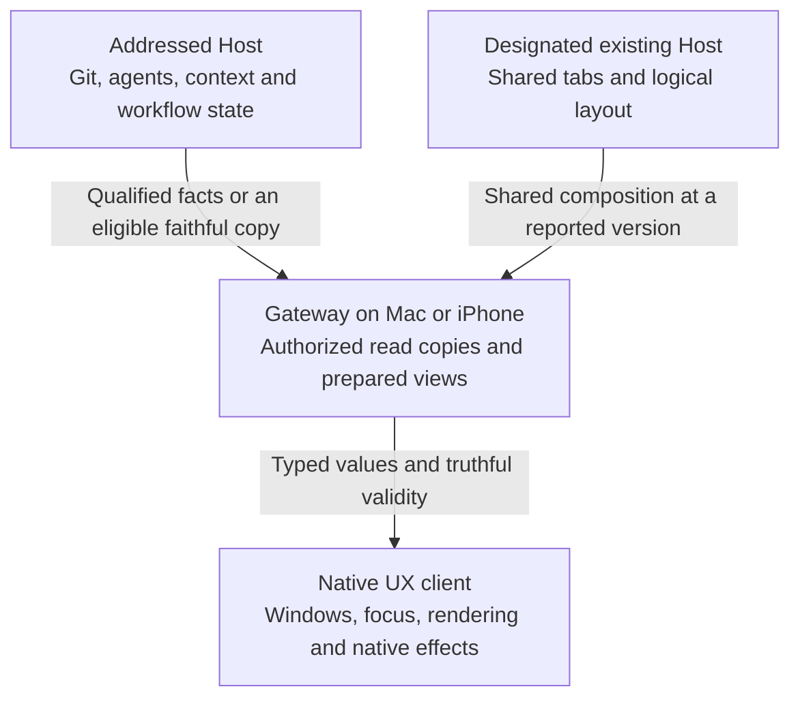
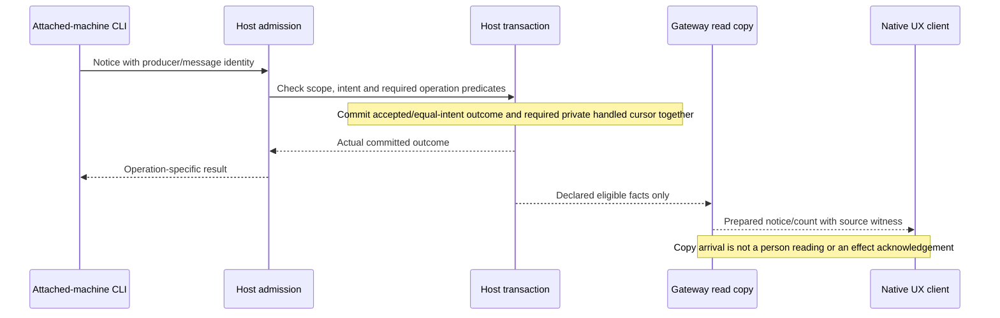

# Where each kind of state lives

**Reader question:** what does the Host store, what can a Gateway copy, and what stays with the Mac or iPhone interface?

The proposed answer is **Host-owned operational state, a designated Host for shared workspace state, private state at its real authority boundary, Gateway read copies and prepared views, and device-local native state**. The Gateway runs on both macOS and iOS. Its lifecycle on iOS still needs qualification; this document does not promise an always-running phone process.

This is a Program Design companion to [DS02's observable contract](specification.md), [the initial profile](../../initial-profile.md), [shared workspace realization](../10-swift-client/shared-client-state-design.md) and [Gateway preparation](../09-gateway-cli/prepared-view-boundaries.md). It proposes responsibilities and transaction constraints. It does **not** declare a target export schema, SQL file layout, migration, replication adoption or completed implementation. [The complete placement matrix](storage-placement-matrix.md) accounts for all 86 current logical tables and their 597 columns; a classified column can still require a semantic split or an owner decision.

The important remaining limits are near the decision they affect: whole-copy authorization, mixed pane/Undo payloads, selected navigation/read-marker scope, original-Host recovery, actual copy-read snapshots and supported platform behavior. Source evidence is current application HEAD `624300332f5e50f7bb8cbb9fc786d5e5b4a3d462`. Source checks establish code boundaries, not runtime/crash/isolation behavior.

## Start with the owners

The arrows show reads flowing toward the interface. User mutations travel back through the Gateway to the addressed domain owner; shared layout mutations use the workspace authority's revision check. These are roles, not four required machines. The workspace authority is an explicitly designated capability of an existing Host; it can be the same Host that runs execution. A workspace can reference other Hosts. Those references do not move their Git files, processes or mutation authority into the workspace database. A phone reaches Hosts through its own Gateway, without requiring a Mac relay.

The future central control plane owns database-writer lease authority. It is separate from these application rows and from terminal input control. There is no temporary Gateway lease issuer, writer promotion or transfer feature in this scope. IP4 governs invalid authority: gated writes pause/refuse; no hidden spool or execution kill follows from that condition.

## Four questions for every stored value

| Question | What we must say | Example |
| --- | --- | --- |
| Who decides it? | One domain owner, with admitted operations for every change/delete/cleanup path | The execution Host decides an ask's answer settlement |
| What must commit with it? | Actual predicates, writes and private checkpoints in one required transaction | Accepted notice plus its handled CLI position |
| Who may receive it? | Actual resource/reader grant; table and database membership are explicit | A paired Gateway is not automatically allowed the whole context database |
| What is prepared from it? | Read inputs, source/currentness witness, pure transform and publication owner | Gateway computes counts; Swift assigns the admitted changed value |

A **transaction domain** is the scope in which one operation can check its predicates and commit its required changes together. A **replication unit** is one database identity/write history with a declared replicated schema and independent receiver positions. They are related, but a private table can participate in the source transaction without being in the copied table set. A directory, Git project, native pane or current SQL filename does not decide either boundary.

The inspected `agent-fleet-sync` source provides `ReplicatedSchema::replicated_tables()` and `local_migrations()`. Capture normalization skips layouts not declared replicated. This supports evaluating private co-commit state; it does not prove AgentStudio integration or authorize an export list. At local library HEAD `3a2153ec98de531085b4c4e618b972dffbb1f08e`, see `crates/fleet-sync-writer/src/replicated_schema.rs:4`, `capture_stream.rs:304` and `replication_sender.rs:220`. Earlier [consumer-fit research](research/fleet-sync-consumer-fit.md) pins its own historical baseline separately.

## Proposed storage responsibilities

| Boundary | Proposed contents and owner | Copy / read behavior | What remains to qualify |
| --- | --- | --- | --- |
| Host operational transaction domain | Sessions/provider association, context title/line/asks/answer settlement, their ordering/duplicate fences and retirement; the addressed Host owns all mutations | Publish only the declared eligible facts; private intake/order/receipt state is not automatically exported | Host execution/context identity replacing legacy pane coupling; exact schema, audience and recovery |
| Host annotation transaction domain | Saved messages, durable drafts/edit fences, output preparation/membership/finalization; the worktree's addressed Host | Selected faithful workflow facts can feed prepared review views; copying an attempt never performs its destination effect | Whole-copy audience, private destination/error/edit details, exact target records; can share a physical Host DB if compatible |
| Host topology and observation domain | Watched membership, repo/worktree identity, absence, source observations and required private source checkpoints | Host-qualified observations; a saved/copied row does not recreate a live watcher or establish coverage | Mixed pane facets, retention predicates, portable source representation and exact co-location |
| Shared workspace transaction domain | E25 workspace/tab/logical pane/layout intent at its explicitly designated existing Host | Eligible read copies and Gateway projection; mutations return through that authority with revision checks | Field split, navigation classification and Undo semantics; not all current Core rows qualify unchanged |
| Private authority / producer state | Credentials at the authority that verifies them; producer counter/claim/outbox state at its producer; required accepted-intake checkpoint at its Host | No default UI copy. Required private intake state may share the admitted workflow's SQL transaction | Credential separation, producer handoff, original-owner recovery and legacy queue policy |
| Gateway prepared state | Derived repository/sidebar/search/context views, keyed by source and preparation witnesses | Rebuildable from authorized inputs; no mutation of faithful Host rows | Snapshot/cut adapter, bounded demand/overflow/rebuild and measured workload |
| UX-client native state | Window/frame/focus, actual renderer/website data, installed editor resolution and native effects | Local application/publication; selected native facts can be preparation inputs | Per-platform adapters; portable selection must first be distinguished from actual focus |

This chooses domain responsibilities for further design, not a fixed number of SQLite files. In particular, do not split Sessions and context into per-project/per-pane databases merely because their UIs look separate. Current application-wide settlement scans multiple contexts inside one Local write. A narrower partition needs an explicit replacement for that operation and any read predicate it crosses.

Annotation, topology and operational modules still have separate reasons to change even if an admitted schema later co-locates them. Conversely, physical co-location alone grants no shared audience and does not turn their operations into one global transaction. The [matrix](storage-placement-matrix.md) therefore records owner, copy disposition, transaction groups and unresolved field meaning separately.

## Preserve the transactions that carry meaning

| Current group | Required meaning carried forward | Boundary we must not invent |
| --- | --- | --- |
| Session hook applies conversation/source/evidence/binding/question rows together | Current binding and accepted evidence change at one admitted Host boundary | A session notification followed by a separately unfenced context write |
| Context title/line/ask and intake checkpoint | Binding/order/retirement and matching message intent are checked in the actual write; admitted notice and handled cursor commit together | A Gateway receipt or earlier RPC preflight standing in for the predicate |
| Application-wide context settlement | Startup/deadline/stop and multi-pane notice dismissal preserve their declared grouped outcome | Independent per-pane commits described as the existing atomic operation |
| Annotation authoring and output | Exact revision/edit fences; preparation commits before effect; finalization commits attempt/event and exact eligible handled revisions together | Clipboard/file I/O inside an asserted SQL transaction, or replay caused by a copied row |
| Core graph replacement and applicable Undo | Graph membership/default layout, available Undo ownership, exact snapshot members and custody predicates are checked in the current Core closure | Moving the Undo write to another store without accounting for a close-without-Undo failure |
| Repository topology and pane facets | Repository/worktree relationship and availability control the current stored optional facets, including inactive workspaces | A refreshed repository inventory and stale pane facet presented as one validated state |
| Repository activity and volume cursor | Accepted activity and its monotonic source checkpoint commit together | Treating a copied volume watermark as another machine's live coverage |
| Ordinary Core then Local save | Core success can precede Local failure; actual native publication is another step | A single atomic save across Core, Local, Gateway and UX |
| Post-Core context retirement | Current Core retirement result enters a later Local retirement mailbox/drain | Claiming the Core close already durably retired context or terminated execution |

Primary application anchors: [Core graph closure](../../../../../Sources/AgentStudio/Core/State/MainActor/Persistence/WorkspaceCoreRepository.swift:190), [Core then Local](../../../../../Sources/AgentStudio/Core/State/SQLite/WorkspaceSQLiteDatastoreActor.swift:211), [topology closure](../../../../../Sources/AgentStudio/Core/State/MainActor/Persistence/WorkspaceCoreRepository+Topology.swift:104), [facet invalidation](../../../../../Sources/AgentStudio/Core/State/MainActor/Persistence/WorkspaceCoreRepository+PaneAssociations.swift:33), [activity/checkpoint commit](../../../../../Sources/AgentStudio/Core/State/MainActor/Persistence/WorkspaceLocalRepository+RepositoryLocalActivity.swift:12) and [restore with coverage withheld](../../../../../Sources/AgentStudio/Core/State/MainActor/Persistence/RepositoryLocalActivityStore.swift:18). The [transaction evidence](research/transaction-boundaries.md) and bounded source packets linked from the matrix complete the named groups. These paths are source inspection, not executed recovery proof.

## Walk one private checkpoint through the public view

This follows the currently wired **notice** cursor participant. New asks require an exact current session binding; new notices do not inherit that ask-only predicate. Scope admission still precedes duplicate lookup. Hook intake creates a fresh record identity and calls `submitHook(hook)` without that participant; an optional repository seam is not a wired durable hook checkpoint. Malformed/refused outbox items have their own cursor-only handling. A handled position means the producer item was handled, not necessarily that a domain notice was accepted. Preserve these distinctions before replacing the producer mechanism. IP1 does not authorize a new generic offline mutation queue.

If admission loses writer authority, it cannot commit only the accepted-notice checkpoint and report success. If the result is lost after commit, the operation retains its actual duplicate/uncertain semantics. Faithful replication and frontend notification are later observations; neither is required for the Host-local admission to depend on a running Gateway.

## Mixed rows need a semantic split

The highest-risk example is current `pane`. Its logical identity/parent and pin/note coexist with execution backend, launch/CWD/checkout, source-derived repo/worktree facets, residency and Undo/orphan fields. Copying that row wholesale would quietly select all of their owners and lifetimes at once.

- **Logical composition:** E25 kind-qualified nodes and membership/layout belong at the designated workspace authority. Their references to Host resources retain the addressed Host identity.
- **Execution and observed context:** the execution Host owns backend/session association and source-derived context. A derived repo facet is not the same thing as a user-selected persistent content reference.
- **Native residency and actual view state:** the UX owner decides actual mounting, focus and display. These are not evidence that an execution was created, stopped or adopted.
- **Undo/custody:** the present versioned payload contains `Tab`/`Pane`/drawer layout values and terminal-session member references. It contains no native surface owner, but it mixes logical and execution associations. It is not an admitted portable export merely because it is Codable JSON.

The current topology transaction durably clears invalid facets. Across several Hosts, the replacement must preserve this **observation validity** without turning a discovery gap into an implicit shared logical pane deletion or moving remote Git truth into the workspace Host. The preserved predicate belongs to the source Host's admitted observation, not to a lookup of remote resource IDs in the workspace Host's local topology. A missing local row must never clear an E25 content reference to another Host. The final qualified association shape and atomic validation/revalidation rule remain a named target-schema gap. No asynchronous best-effort invalidation is claimed equivalent to the current same-transaction predicate.

Undo is another explicit hold. The shared-state proposal favors per-device Undo history with inverse shared mutations through the revision boundary. Current close/record/restore co-commit graph and Undo/custody state. A separate local Undo append after a shared close adds a failure window; silently accepting that would change the retained-close guarantee. Possible resolutions include keeping required inverse/layout-restoration state at the workspace authority with device-qualified visibility, or defining a revised close/Undo contract. The whole legacy `workspace_terminal_session_ownership` row is in that joint split hold: its backend identity ultimately belongs to the execution Host, while its graph/Undo-driven cleanup columns are not an adopted execution lifecycle. No same-database guard is silently stretched across Hosts. Neither is selected here. U14/R5/R6 settle execution survival independently of Undo. They do not themselves waive IP5's retained-data constraint. Existing Undo expiry must not become an execution kill under R5/R6. The already-authorized shared tabs/layout outcome is not reopened by this gap.

## Whole-copy access is a real boundary

The inspected faithful engine sends the selected database's declared tables; it is not a per-reader row/column redactor. A Gateway receiving that copy needs authority to receive the **whole selected unit**. A filter applied to a sidebar after receipt cannot undo data disclosure. Paired private-fleet operation does not establish one universal person or data audience.

For now the proposal has two explicitly distinct read paths: an eligible whole-unit read copy, or an authorized scoped Host operation supplying the required prepared inputs. These use the existing Host operation/read boundaries; no redacted replica, second publication database or per-peer filtered engine is introduced. If a future requirement demands selective persistent offline copies, the unit/schema/audience design must settle it before export.

Copy positions, schema readiness, source incarnation/coverage and current native/preparation generation still qualify the read. Public library `copy_status` exists; it does not by itself supply an atomic application-query-plus-status cut. The [context-count source note](../07-agents-context/research/count-read-engine-evidence.md) records that adapter gap. Never promote an ack number into proof of Host liveness or a coherent multi-Host snapshot.

## Why these cuts, and when to revisit them

| Credible option | Gain | Cost and who pays | Evidence that changes the choice |
| --- | --- | --- | --- |
| Replicate current Core/Local files wholesale | Least initial movement of storage code | Wrong native/private audience and mixed identity/lifecycle; users bear disclosure and inconsistent behavior, developers inherit schema conflicts | Only credible if every field, audience and predicate qualifies; current mixed rows and key/trigger census already refute unchanged adoption |
| Split one database per project/pane/session now | Narrower units and potentially narrower copy audiences | Current cross-context settlement and binding/graph predicates cross those cuts; implementers must redesign them and users bear partial outcomes | A selected isolation/scale requirement plus a proved replacement for each crossed operation |
| Preserve coherent owner transaction domains; split mixed values deliberately | Keeps the strongest existing predicates and one owner per truth, while allowing private co-commit state | More up-front mapping and explicit unresolved schema/Undo/audience decisions; Lead and integrators pay | A required audience or measured workload that cannot fit the proposed domain forces an explicit narrower design |

The third option is the proposed starting point. It is not permission to merge every Host table into one exported database. Final database count and selected DDL wait for audience, mixed-value and recovery contracts. No performance claim chooses a database count in advance of representative measurement.

## Contract trace and proof seams

| Obligation | Structural realization here | Future discriminating proof |
| --- | --- | --- |
| R6/R9/R10 addressed Host and Gateway independence | Host transaction owners, qualified references and attached-machine notice path | Remove every Gateway while valid Host admission continues; cross-Host same-label inputs cannot change another target |
| R11 multiple Hosts | Qualified references and separate source/currentness witnesses for each addressed Host | Lose one Host while another continues; no result, mutation or availability is attributed to an inferred target |
| R14 writer authority | Actual gate on the required transaction and commit; central issuer independent of frontend | Controlled expiry at begin/statement/commit; no accepted effect with only a cursor commit; no process kill inferred |
| R15 distinct state meanings | Four questions, separate private/copy/prepared/native responsibilities and full matrix | Exact selected rows/cursors and currentness survive intended failure without accidental export |
| R16 truthful coverage | Source observations distinct from persisted/copy rows; explicit read-cut gap | Restart with identical activity rows still lacks live coverage until the declared source establishes it; stale witnesses rejected |
| R17 shared composition and marks | Designated workspace authority and subject-owned markers; native projection distinct | Two Macs and a Mac+iOS pair converge per resource; concurrent stale-base mutation conflicts; actual viewing is separately observed |
| C5/V7 transaction, read and native observation | Preserve actual closure groups and explicit Core/Local/effect splits | Failure at each real boundary, durable readback and actual native publication; source maps alone do not pass |

The remaining Program Design work is concrete: resolve E25 field/Undo/navigation cuts; map Host context identity and private admission state to eligible immutable-key records; define per-unit audience/retention/recovery and actual copy-query cuts; bind platform adapters. Then the separate Verification Design must assign every requirement its real target, journey, passing condition and unverified limit. This companion is neither that document nor implementation authority.
