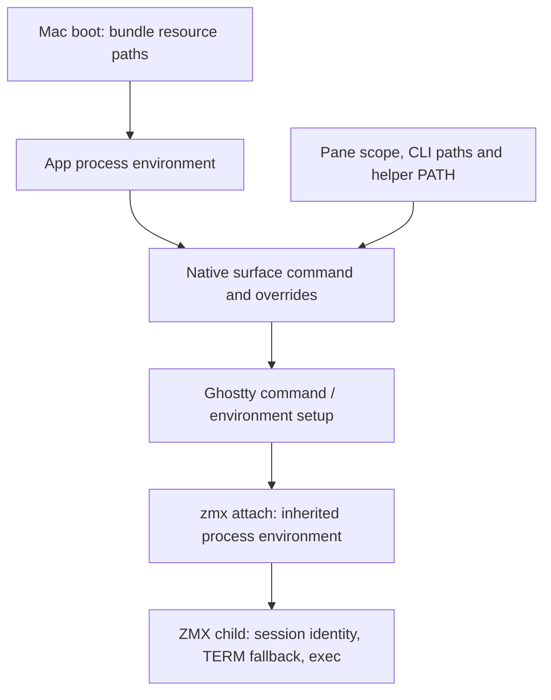

# Remote shell environment: source evidence and qualification boundary

The Host must establish a usable shell environment as well as a process and terminal attachment. Moving socket credentials alone does not reproduce the current launch path. This evidence informs the [near-term launch closures](../../11-operations-integration/near-term-migration.md#near-term-contract-closures) and [renderer-free fact sources](../execution-lifecycle-design.md#terminal-facts-have-a-host-owned-source-and-lifetime); it chooses no environment inheritance policy, resource installer or new public API.

Inspected app: `624300332f5e50f7bb8cbb9fc786d5e5b4a3d462`; ZMX: `8bab1f0173b07e79835ea372d749af3dbf0d0842`; Ghostty: `2fb0c9cacb3fc75dbc8aedee9b7ed4321f091d33`. The named vendor files match their checkout HEADs. This is source evidence, not a running shell observation or a claim about the latest upstream release.

## Current launch sources

The diagram shows the inspected local path. A remote Host needs its own admitted launch inputs and usable local resources; these Mac paths cannot simply travel with a DTO.

| Input family | Actual source | Remote consequence |
| --- | --- | --- |
| Base environment | [PaneIPCIdentityOwner initializer](../../../../../../Sources/AgentStudio/App/PaneAgents/PaneIPCIdentityOwner.swift:45) defaults to the app process environment. | A service's environment differs from the app's. Define the selected Host base, launch overrides and caller authority; do not silently inherit all daemon settings or copy a Mac environment wholesale. |
| Color convention | [App boot](../../../../../../Sources/AgentStudio/App/Boot/AppDelegate.swift:295) explicitly clears inherited `NO_COLOR` for app-hosted terminals. | A Host daemon's inherited `NO_COLOR=1` can change child CLI color behavior. Bind this existing behavior in the selected Host launch profile; do not let unrelated service-process inheritance choose it accidentally. This does not select a universal override for every user-supplied environment value. |
| App integration | [Pane environment](../../../../../../Sources/AgentStudio/App/PaneAgents/PaneIPCIdentityOwner.swift:118) supplies pane/workspace scope, socket/token, CLI store/channel and executable. | Bind Host-local scope, endpoint, credential and installed CLI/hook artifact. Environment strings are not enrollment or effect-time authority. |
| Helper discovery | [Shell environment preparation](../../../../../../Sources/AgentStudio/App/PaneAgents/PaneIPCIdentityOwner.swift:133) removes the MacOS executable directory from PATH, appends the Helpers directory and sets `GHOSTTY_BIN_DIR`. | A Host needs its own helper/executable lookup. Mac bundle paths cannot locate a Linux CLI or renderer resource. Preserve the selected command-resolution behavior explicitly. |
| Backend isolation / nesting | [Native ZMX startup](../../../../../../Sources/AgentStudio/App/Coordination/WorkspaceSurfaceCoordinator+ViewLifecycle.swift:414) sets `ZMX_DIR` and blanks `ZMX_SESSION` / `ZMX_SESSION_PREFIX`. | Host establishment must own its selected backend directory and nested-session behavior. Never accidentally attach a new execution to an inherited outer session. |
| Resource paths and terminfo | [Boot setup](../../../../../../Sources/AgentStudio/App/Boot/GhosttyStartupEnvironment.swift:17) sets `GHOSTTY_RESOURCES_DIR`, `TERMINFO` and a binary directory. [Resource discovery](../../../../../../Sources/AgentStudio/Core/Models/SessionConfiguration.swift:89) checks a bundled `xterm-ghostty` entry. | Qualify Host terminfo for the actually advertised `TERM`, plus resource paths for the selected shell/fact profile. Do not require the remote machine to read the Mac bundle or universally hardcode one TERM value. |
| Native command setup | [Surface creation](../../../../../../Sources/AgentStudio/Features/Terminal/Ghostty/GhosttySurfaceView.swift:402) supplies the explicit startup command; [Ghostty subprocess setup](../../../../../../vendor/ghostty/src/termio/Exec.zig:640) establishes TERM/TERMINFO and optional shell integration before applying environment overrides. | Native terminal capability, outer relay environment and inner Host shell environment are separate. A connected byte relay alone does not qualify the inner shell's capability database or completion/CWD source. |
| ZMX child environment | [Child exec](../../../../../../vendor/zmx/src/daemonize.zig:45) sets `ZMX_SESSION`, changes missing/`dumb` TERM to `xterm-256color`, then executes with `std.c.environ`. | This is inherited environment plus those explicit changes, not a terminfo installer or automatic shell-integration injector. A fallback TERM string does not establish that its database entry exists. |

## Shell integration is not established by resource presence

Ghostty's [setup call](../../../../../../vendor/ghostty/src/termio/Exec.zig:760) can inject integration only when resources and a supported detected/forced shell are available. Its [detection](../../../../../../vendor/ghostty/src/termio/shell_integration.zig:137) examines the first command executable's basename and recognizes the listed shells. If that executable is `zmx`, default detection does not recognize it as a shell. This is a conditional source conclusion; actual user configuration may force an integration, and user startup files may load one manually. Neither was observed here.

The ZMX child exec path inspected above inherits the environment and launches the supplied command; it does not independently perform Ghostty shell detection/injection. Thus installing resource files, passing `GHOSTTY_RESOURCES_DIR`, or returning a backend handle cannot by itself prove that the inner shell emits the selected integration signals. The current [command-finished activity path](../../../../../../Sources/AgentStudio/Features/Terminal/Routing/TerminalActivityProjector.swift:196) explicitly consumes a shell-integration fact. Title/CWD/progress may have other qualified producers; do not assume every fact requires the same script or fabricate one when that source is absent.

## What the Host profile must qualify

- The selected shell executable, arguments, working directory, base environment and admitted overrides on the supported Mac/Linux profile.
- Host-local app/CLI identity, endpoint and credential plus the existing notice-only store/consumer boundary where selected.
- Host helper lookup and backend isolation/nesting; no unintended Mac paths or outer-session inheritance.
- The advertised TERM/capability profile and its actually available Host terminfo/resource data, exercised by declared terminal behavior rather than checked only for a filename.
- The selected shell-integration or equivalent fact producer, with actual completion/CWD/title/progress observations under its stated coverage while native clients and Gateways are absent. Source-specific facts need separate qualification; a surviving shell or successful TUI draw cannot certify every class.

These are inputs to the existing backend/native/full-route experiments and Host fact design. Exact environment admission, resource packaging, supported shells and source coverage remain explicit profile/design work. No shell, vendor build, Rust adapter, VM, terminfo installation or live environment experiment ran for this evidence.
