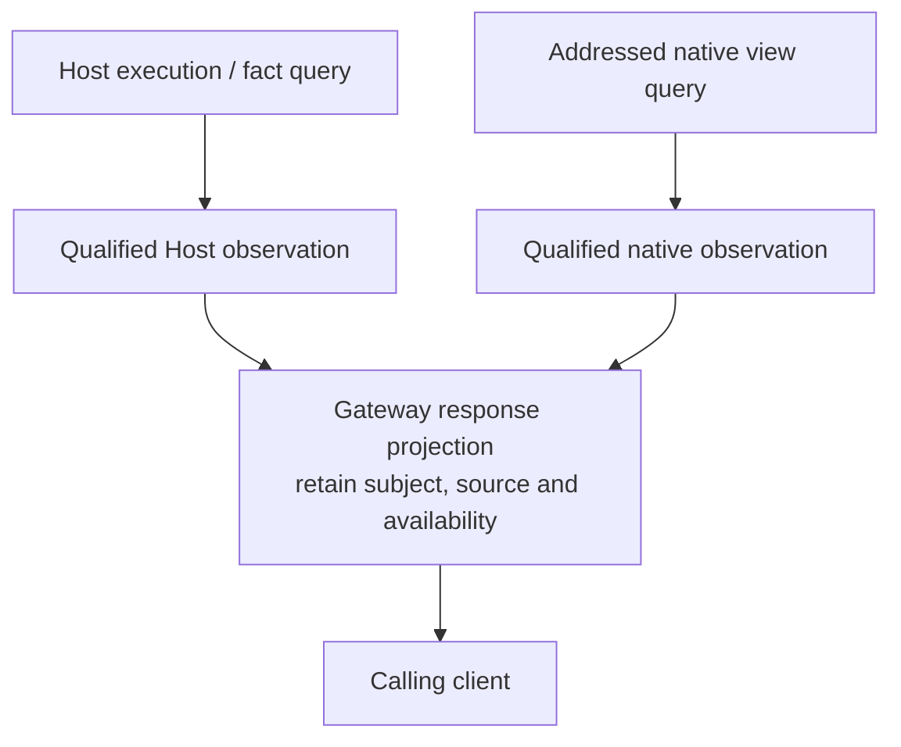

# Terminal APIs: execution facts and native view facts

**A Host session remains usable without a terminal view, while a renderer fact still belongs to an actual renderer.** The current `terminal.status`, `terminal.snapshot`, `terminal.send` and `terminal.wait` combine those concerns behind a pane handle. The remote design must split their sources before selecting its public shapes. It cannot copy the native runtime summary into a Host record and call it execution status.

This is a bounded structural map under [K5](specification.md), R5–R7/R9/R10/R13/R16 and the [existing entity bindings](../11-operations-integration/program-design-workbench.md#bind-the-specifications-entities-before-naming-packages). The current schemas and meanings below are source evidence, not selected future wire fields. Exact versioned operations, readiness guarantees, refusal variants and qualified positions remain G1/G3/G4/G6/G8.

## Bind the two kinds of observation

| Existing entity | Owner / candidate home | Shape responsibility |
| --- | --- | --- |
| E1 execution | Host `host_session_runtime`; `session_contracts` | Host-qualified execution identity and actual execution observation; not a native pane lifecycle |
| E2 attachment | Host `terminal_attachment`; `terminal_contracts` | Admitted session/view/control association; its absence is not execution absence |
| E16 client view | Existing native runtime/surface owners; selected `client_view_contracts` | Addressed device/view identity and actual renderer/input state |
| E22 observation | Actual Host fact source or native view owner; `observation_contracts` | Source, subject, lifetime/position and coverage; native and Host positions cannot be compared as one sequence |
| E4 attempt | Caller and addressed capability owner; `operation_contracts` | Operation-specific result, refusal and uncertainty; receipt is not a child effect |

This is the frontend projection path. Local native publication remains local. Gateway combines only the sources a selected frontend operation needs. Eligible Host-local execution queries are answered at the Host without traversing this Gateway projection; they do not acquire a dependency on a live native view merely to access their execution.

## Current status and snapshot fields

Source basis: app `624300332f5e50f7bb8cbb9fc786d5e5b4a3d462`, [result declarations](../../../../../Sources/AgentStudioProgrammaticControl/IPCQueryContracts.swift:453) and [native adapter](../../../../../Sources/AgentStudio/App/IPCComposition/AgentStudioIPCRuntimeAdapter.swift:30). Current snapshot is metadata, not terminal cells or a restoration image.

| Current field / method | Actual current meaning | Proposed ownership and no-view behavior |
| --- | --- | --- |
| `paneId` in all four results | Native pane selected through the workspace snapshot | Keep the E16 reference distinct from E1/E23. A Host-local operation binds its execution/context through admitted identity; it cannot invent a native pane or silently rename a session UUID to `paneId`. The selected facade/wire mapping remains explicit. |
| `lifecycle` in status/snapshot | `PaneRuntimeLifecycle` mapped to created/ready/draining/terminated | Preserve this as a native-runtime observation where that API is retained. Host execution lifecycle is a separately sourced E1 observation; no-view or native termination cannot imply physical process exit. |
| `isReady` in status | Current native runtime lifecycle equals ready | Native readiness stays at the native owner. Host establishment/readiness uses the selected backend witness. Neither readiness proves the other; no viewer cannot be reported as a healthy ready renderer. |
| `backend` in status/snapshot | Runtime metadata's execution-backend kind | Host can report its declared execution backend under the selected contract; the native runtime's metadata is not backend liveness evidence. Keep platform and implementation handles out of this semantic value. |
| `capabilities` in status/snapshot | Native pane capabilities, including input/resize/search/navigation/review/plugin kinds | Native capability presence remains native. Host capability discovery and per-attachment control authority are separate values; copying this list cannot authorize remote input or promise native search. |
| `lastSequence` in snapshot | Current pane runtime's envelope sequence | Keep a native sequence with its actual view/source scope. Host facts need their own qualified positions/coverage; an execution must not borrow a viewer's counter when no viewer exists. |
| `timestamp` in snapshot | Current runtime snapshot timestamp | Preserve source observation time and its meaning; Gateway read time or copy-apply time cannot manufacture a fresh Host observation. Exact future time representation is contract-owned. |
| optional `rendererHealthy` | Current `TerminalRuntimeSnapshotFacts` renderer fact | Addressed native owner only. With no addressed view, return the selected typed absence/unavailability, never default healthy or a fabricated false observation. |
| optional `readOnly` | Current native terminal input state | Distinguish native read-only state from Host input permission/controller state. A viewer may lack control while the actual native widget is writable, or the reverse. No-view does not decide Host permission. |
| optional `secureInput` | Native secure-input fact, influenced by the local command's PTY | Native owner only. A relay's local mode is not proof of the remote child's terminal mode. No-view means no native secure-input observation. |

An eventual combined response needs closed available/unavailable/partial outcomes with required source payloads, rather than unrelated optional booleans. This map does not freeze those enum names, add a copied status table or change current client schemas. DS01 must select and prove the concrete cross-language shapes.

## Input and its result

Current [send implementation](../../../../../Sources/AgentStudio/App/IPCComposition/AgentStudioIPCRuntimeAdapter.swift:74) rechecks own-pane authority and dispatches a Unicode input operation to the native runtime. Its [result](../../../../../Sources/AgentStudioProgrammaticControl/IPCQueryContracts.swift:514) contains `paneId`, `commandId`, optional `correlationId`, accepted/queued `disposition` and optional `queuePosition`.

For selected execution-directed Host-local input, the Host attachment/input owner must check the admitted execution binding and current control authority at the effect boundary. Native keys, text paste and raw terminal stream input retain their distinct encoding/ordering meanings. A native-view input method still targets that actual view; it cannot become a hidden remote-host fallback.

Attempt/command/correlation identities remain distinct from E1/E2. Accepted or queued describes its declared admission/delivery boundary, not child consumption or visible echo. A no-controller condition needs the selected refusal/acquisition behavior; removing a viewer cannot silently grant control to an agent. A lost result cannot justify automatic replay. Exact callable operations and receipt/reconciliation semantics remain required contract work.

## Every current wait condition has its own source

The [six conditions and result fields](../../../../../Sources/AgentStudioProgrammaticControl/IPCQueryContracts.swift:536) and [event matcher](../../../../../Sources/AgentStudio/App/IPCComposition/AgentStudioIPCRuntimeAdapter.swift:328) establish the current baseline.

| Current condition | Required distinction in the remote design |
| --- | --- |
| `attachReady` | Today this checks native runtime readiness. Host execution readiness and an admitted terminal attachment need their own actual backend/attachment witnesses; neither is inferred from the legacy condition name. A native-view-ready wait still needs a native view. |
| `commandFinished` | Selected Host shell/completion source must supply the actual completion event, exit code and duration meaning while no viewer is present. Quiet output, view closure and process exit are different facts. A missing source remains explicit, not a successful empty completion. |
| `rendererHealthy` | Actual addressed native renderer only; no-view is unavailable under the selected typed contract. A backend-generated query reply is not renderer health. |
| `titleChanged` | Host terminal-title source can operate without a viewer when qualified; native presentation/tab title and context override remain distinct. Do not relabel a local relay title as remote terminal evidence. |
| `cwdChanged` | Qualified Host shell/backend CWD source; the native relay's local directory cannot answer it. Coverage/source gaps must remain visible. |
| `progressChanged` | Selected source-qualified progress semantics; provider activity, terminal progress and native presentation are not interchangeable. Renderer-free production needs source qualification. |

Current wait results carry `paneId`, `condition`, `eventName` and these optional payloads:

| Current optional field | Ownership / preservation boundary |
| --- | --- |
| `commandId` | The matched source event's command association, not the execution identity or a newly manufactured success receipt. Preserve its actual absence where the source has none. |
| `correlationId` | The matched source event's correlation. An unrelated request/result cannot settle this wait merely because it has a successful ending. |
| `exitCode` | The matched command-finished event's exit value; it is not by itself physical termination of E1. |
| `duration` | The matched command-finished event's duration. Its unit and measurement boundary must be explicit in the selected contract; Gateway elapsed wait time cannot replace it. |
| `healthy` | The matched renderer-health event's value. The current healthy wait selects a true native event; no-view or missing evidence cannot manufacture one. |

The future contract must tie payload presence and subject/source to the actual variant, including unavailable/refused/timed-out/unknown outcomes where applicable. `afterSequence` and replay-gap handling remain attached to the source that issued the position; no global sequence or replay safety follows from the integer.

Cancellation/timeout ends the wait, not the execution. Availability of a Host observation does not establish a native display, and an unavailable native fact does not make every Host-local operation unavailable. The [restoration experiment](experiments/terminal-restoration.md) qualifies actual backend/native sources; it cannot decide a missing product meaning or silently broaden the snapshot method into a screen API.

## Near-term closure

Before integrating agent-facing terminal calls, DS01/DS03/DS04/DS07 must bind the selected method subset, own-execution authority, no-view outcomes, exact payloads and source positions. Real Host-local calls must work under their declared scope with all Gateways/views absent; actual native-target calls retain their own availability boundary. The selected renderer-free fact set still needs independent source evidence. This ownership map is not a completed wire contract or proof that those new services exist.

The [remote shell environment evidence](research/remote-shell-environment.md) identifies another source dependency: Host terminfo, helper lookup, launch inheritance and actual shell integration. A well-typed wait cannot produce a completion/CWD fact if its qualified producer never starts; resource files or a running shell do not establish that producer.
