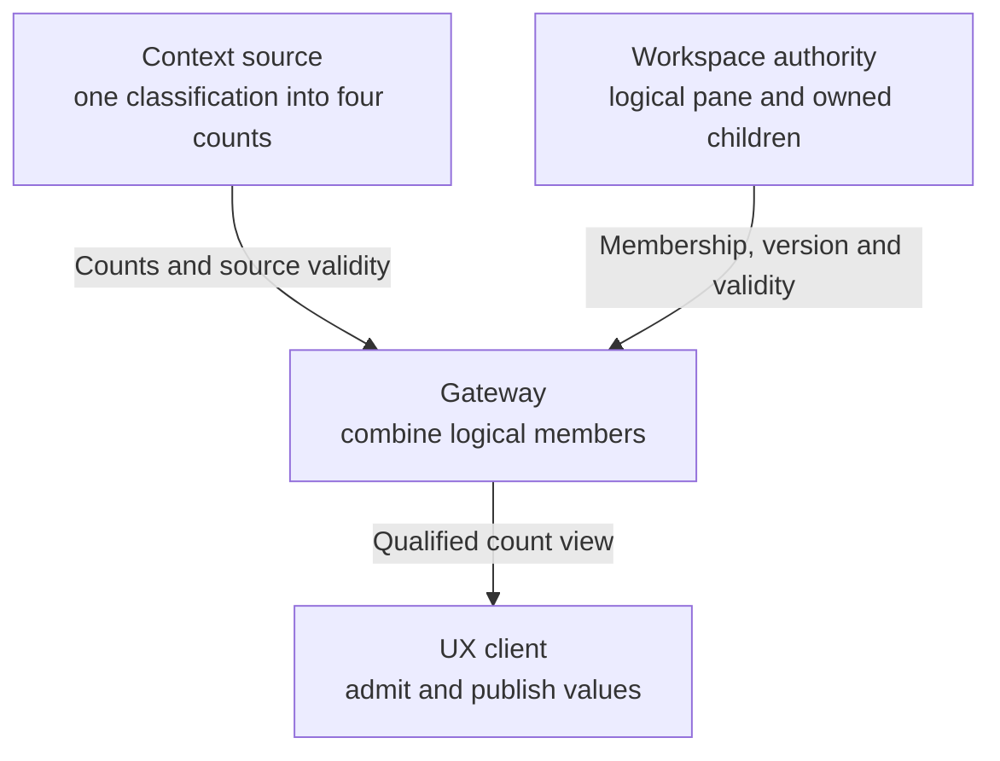
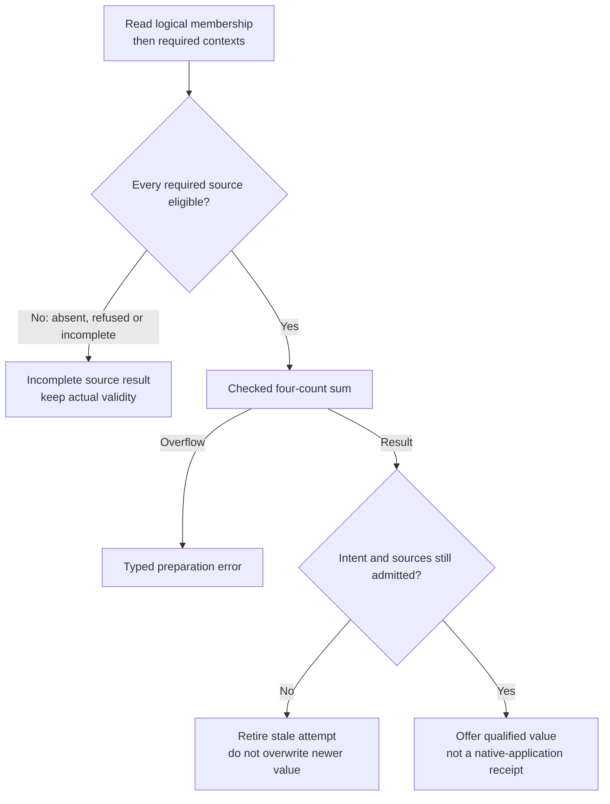

# Context counts: Host meaning, Gateway composition

**The Host classifies context messages. The Gateway combines qualified per-context counts for the shared logical pane and its owned children.** The UX client displays that result through its actual native publication owner. Collapsing a drawer or adapting the phone's native layout does not change logical membership. A count chip needs four counts; it does not need message bodies, answers, forms, timestamps or a globally newest ask.

This structural slice realizes [K8](specification.md#k8--notices-asks-answers-writer-ordering-and-offline-notices) and R15/R16 under the separate [Requirements](../../user-requirements.md), [observable Specification](../../2026-10-15-agentstudio-daemon.md) and [initial profile](../../initial-profile.md). It refines the [prepared-view boundary](../09-gateway-cli/prepared-view-boundaries.md), without selecting a public method, codec, replicated table or stored-data migration. Title/line, detail pages, Sessions status and read markers keep their separate contracts.

## From Host state to one chip



The source owns message classification and authoritative maintenance. E25 shared logical composition supplies membership; neither provider subagent ancestry nor device mounting/expansion supplies it. E16 remains the actual presentation target. The Gateway retains the logical-membership witness **and** every context-count source witness, then applies its existing generation/currentness checks before offering. A copy-backed read is an alternative qualified source, described below; it is not another Host writer.

For example, the owner context has approval/reply/attention/informational counts `(1, 0, 2, 3)` and one included child has `(0, 1, 0, 4)`. The Gateway prepares **own** `(1, 0, 2, 3)` and **including children** `(1, 1, 2, 7)`. The existing main chip counts the first three categories; informational is added for its separate display mode. If the child read fails, neither zero nor a successful complete total is manufactured.

## Where the entities and types live

The [integrated binding table](../11-operations-integration/program-design-workbench.md#bind-the-specifications-entities-before-naming-packages) still covers E1–E26. The following bindings refine this one family. These are responsibility modules, not a new crate per row.

| E / responsibility | Semantic owner and home | Single shape home; disposition |
| --- | --- | --- |
| E1/E10/E11 execution-scoped context, binding and messages | Host context service, `session_context`, and binding owner `agent_binding` (new); source predicates remain at the actual storage boundary | Existing proposed `context_contracts` / `agent_contracts`; Host truth retained under its selected policy. An execution context reference is Host-qualified and is not an E16 pane ID |
| E22 per-context count observation | Actual Host/copy source adapter; source qualification remains there | `context_contracts` owns `ContextCounts`; `observation_contracts` owns portable validity. Gateway `prepared_view_inputs` carries actual source witnesses. Counts are derived, not a new stored truth |
| E25 logical membership and E16 native target | Designated shared-workspace Host owns E25; existing native owner supplies E16 application target only. Gateway `prepared_view_inputs` captures qualified membership through its shared-state reader | `shared_workspace_contracts` owns existing `SharedWorkspaceRef`, `SharedLogicalPaneRef` and `LayoutRevision`; `prepared_view_inputs` carries the E25 read witness. `ContextCountMembership` is derived from logical membership, not native presence |
| E19 desired interest and E22 prepared result | Gateway `prepared_view_owner`; pure arithmetic in `view_preparation` (new responsibilities) | `prepared_view_inputs` wraps the family value with captured witnesses/generation. Desired/prepared values are rebuildable runtime state |
| E17/E18 read permission and writer authority | Actual source admission and Host write gate; `principal_admission` / `capability_authority` (existing proposed homes) | `authority_contracts` supplies admitted scope. Private credentials and issuer/grant material do not enter the count value |
| E23/E24 service context | Actual Host/Gateway identity owners | Existing proposed `service_contracts`; Host qualification is retained even when two Hosts reuse a path or raw session identifier |

`context_count_projection` is one pure context-domain implementation used by the Host read adapter and, only where its declared data is available, an eligible copy-read adapter. It knows neither SQL nor sockets. `view_preparation` consumes its four-count result and does not duplicate message classification. Removing this separation would make every frontend or Gateway independently decide what an open ask means.

## The exact internal family values

These are internal Rust-domain shapes. `ContextRef` identifies an already-defined retained E11 scope, qualified by its Host. Execution-backed scope follows E1; an active E10 provider binding is not required merely to read context. Binding admission still governs operations that require it. Other context scopes and portable owned-child/element mapping retain their explicit G8/G9 definitions; pane content kind alone does not select them.

`context_contracts` owns `Count`, `ContextCounts`, the unit error `CountOverflow`, `CountSourceValue` and `CountSourceFailure`. Internal `AdmittedCountContribution` belongs to the pure `context_count_projection` module. `view_preparation` owns `CountMember`, `CountScopeBinding`, `OwnContextCounts`, `ContextCountMembership`, `ContextCountSources`, `ContextCountViewValue`, `CountRequiredSource`, `CountSourceProblem` and `CountPreparationError`. These family-local pure values depend on context/shared-workspace domain contracts only. The `prepared_view_inputs` integration wrapper owns actual witnesses/admission stages; Host code never imports Gateway runtime code to return a count observation.

| Value | Required fields / closed variants | Valid construction |
| --- | --- | --- |
| `ContextCounts` | `needs_approval: Count`, `needs_reply: Count`, `attention: Count`, `informational: Count`; no nullable fields | `Count` is an internal nonnegative `u64` newtype. Construction and addition are checked; no narrowing to native `Int` or generic floating-point JSON occurs here. Wire encoding and supported limits remain DS01 contract work |
| `AdmittedCountContribution` | Closed variants `Excluded`, `NeedsApproval`, `NeedsReply`, `Attention`, `Informational`; no payload | Source-domain decoding/classification constructs it from a valid message and visibility state. Hidden or noncontributing state is `Excluded`; malformed source state is a read failure, never `Excluded` |
| `CountMember` | Required `logical_pane: SharedLogicalPaneRef` and `count_scope: CountScopeBinding`; no nullable fields | A selected mapping establishes the result for that member. Browser/Bridge/code-viewer kind, missing rows, missing renderer or absent provider binding alone cannot infer `NoCountScope` |
| `CountScopeBinding` | Closed `Context { reference: ContextRef }` or `NoCountScope` | `NoCountScope` means the admitted mapping establishes no E11 count-bearing scope for this member. It differs from unresolved mapping and from an existing scope whose read failed. If a nonterminal member retains context, it uses `Context` |
| `ContextCountMembership` | `owner: CountMember`, `included: UniqueLogicalCountMembers`; no nullable fields | Trusted capture validates ownership against one qualified E25 read. Logical nodes are unique. Distinct count scopes must resolve among `Context` members; duplicate/unresolved context mapping remains G9, not silent deduplication/double counting. Portable owned-child mapping itself remains an explicit G9 dependency |
| `CountSourceValue` | `Observed { counts: ContextCounts }`, `SubjectAbsent`, `IncompleteCoverage`, `UnestablishedCoverage`, or `Unavailable { reason: CountSourceFailure }` | The source adapter pairs the value with the requested context and its actual E22 witness/validity outside the pure function. `SubjectAbsent` requires an authorized complete lookup; an unavailable or incomplete lookup cannot establish it |
| `CountSourceFailure` | Closed internal variants `NotAuthorized`, `SourceUnavailable`, `SourceInvalidated`, `UnsupportedReadProfile`, `StorageUnreadable`, `CapacityExceeded` | Actual boundary translates its failure into this vocabulary. The count read itself is write-free; it does not require a writer grant. Disclosure over a public method follows that method's authority/error contract; private driver errors and credential details are not payloads |
| `ContextCountSources` | A required map from every `Context` binding in admitted membership to its `CountSourceValue`; no extra references. Empty is valid if all members explicitly have `NoCountScope` | Missing/duplicate/foreign context sources are construction errors. `NoCountScope` requires no read or problem; unavailable is an explicit value for an existing scope, not an omitted entry |
| `OwnContextCounts` | `Observed { counts: ContextCounts }` or `NotApplicable` | A `Context` owner uses its observed counts. A `NoCountScope` owner is `NotApplicable`, not a failed read or an invented per-context zero. The declared native adapter can preserve today's zero-chip appearance |
| `ContextCountViewValue` | `Complete { own: OwnContextCounts, including_children: ContextCounts }` or `Incomplete { problems: NonEmptyCountProblems }` | `Complete` needs an eligible observation for every `Context` member and checked addition. `NoCountScope` adds no source or problem. A known-empty set of count-bearing scopes has aggregate zero; that identity is not an observation of a fabricated context |
| `CountRequiredSource` | `LogicalMembership { workspace: SharedWorkspaceRef, owner: SharedLogicalPaneRef }` or `Context { reference: ContextRef }` | Separates E25 membership authority from each Host-qualified E11 source; raw IDs cannot interchange their kinds |
| `CountSourceProblem` | Required `source: CountRequiredSource` and closed `problem`: `Absent`, `IncompleteCoverage`, `UnestablishedCoverage` or `Unavailable { reason: CountSourceFailure }`; no nullable fields | Used only by `Incomplete`; it preserves which required membership/context source prevented a complete result and why. Partial display or last-known reuse is a separate admitted presentation decision |
| `CountPreparationError` | `InvalidSourceSet` or `CountOverflow` | A pure-call failure, separate from a source outcome and the existing lifecycle disposition such as `superseded` or `closed` |

The pure source projection takes admitted contributions and returns `ContextCounts` or `CountOverflow`. The pure Gateway function takes `ContextCountMembership` and `ContextCountSources`, then returns `ContextCountViewValue` or `CountPreparationError`. It sums only resolved `Context` members, using zero as the aggregate identity; owner applicability remains explicit. It receives no engine position, database handle, network client, clock, mutable native object or message body. Its integration owner retains the captured view key/generation, E25 workspace resource/version/read witness, every required context source witness and actual native target/lifetime alongside the result. An E25 position is not a context Host revision.

Logical membership is required input, not caller-authored authority. Missing or unqualified membership prevents a new complete capture; authorized stale membership remains last known under IP1 even when context counts are fresh. The capture owner emits `Incomplete` with a logical-membership problem without invoking arithmetic. Both sources must be qualified. Two devices at the same E25 position use the same logical child set regardless of native mounting. Exact logical-node/context and portable owned-child mapping remain G9. `NoCountScope` is an established mapping result, not a substitute for that gap. Unresolved/duplicated context mapping prevents trusted-input construction (`UnsupportedReadProfile`), without implicit deduplication, double counting or no-scope inference.

| Admitted example | Defined result |
| --- | --- |
| Nonterminal owner with established `NoCountScope`, plus agent-terminal child mapped to A | Own is `NotApplicable`; including children is A's qualified counts |
| Terminal owner mapped to A, plus browser child with established `NoCountScope` | Own and including-child counts are A's counts; no failed browser context is fabricated |
| Owner retains a context while its provider is unbound/ended | Read the retained context under actual permission; lack of active binding alone cannot produce `NoCountScope` |
| Member mapped to A, but A's read fails | `Incomplete` for A; never `NoCountScope` or zero |

These variants preserve the ability to represent the existing chip on any pane kind. The current [child policy](../../../../../Sources/AgentStudio/Core/Models/DrawerChildContentPolicy.swift:28) permits terminal/browser children; the [owner validator](../../../../../Sources/AgentStudio/Core/Actions/ActionValidator.swift:463) does not require a terminal owner. The [toolbar](../../../../../Sources/AgentStudio/App/PaneContext/PaneContextToolbarControls.swift:17) has no content-kind filter. Future context ownership follows its selected G9 mapping, not a type-level assumption that every member is an execution.

The source adapter must preserve the full E22 validity distinction. An observation with known incomplete or unestablished coverage is not eligible as a complete per-context count merely because four integers were decoded. Its integration record retains the actual validity and supplies `IncompleteCoverage` or `UnestablishedCoverage`; it cannot relabel partial counts as a complete source. A pure `Complete` result establishes complete arithmetic over the declared eligible observations, not current Host liveness or successful native application. A faithful copy can be complete within its recorded scope while still being last known; that source basis/currentness remains in the mandatory integration wrapper. The exact public validity/error projection remains with DS01 and the domain read contract.

For an incomplete attempt, the view owner can retain an authorized previous complete value as **last known**, with the actual changed validity, under IP1. This does not select a partial-sum display, silent zero substitution, or permission to keep displaying revoked data. The source records remain available to their integration owner; the incomplete result does not erase them.

## What changes from the current call path

The current [compact producer](../../../../../Sources/AgentStudio/Core/PaneContext/PaneContextService+Presentation.swift:106) captures canonical graph membership, awaits Sessions summary, performs SQL maintenance/projection, folds message inputs, and offers a display. [Composition preparation](../../../../../Sources/AgentStudio/Core/State/MainActor/Persistence/WorkspaceCompositionPreparation.swift:146) installs presence/placement/owned-child facts independently of drawer expansion; the [membership directory](../../../../../Sources/AgentStudio/Core/PaneContext/PaneContextMembershipDirectory.swift:43) validates owner/child relationships. Its [storage projection](../../../../../Sources/AgentStudio/Core/PaneContext/PaneContextStorage+MessageProjection.swift:17) captures title/line only from the owner, while messages from owner/children contribute to counts. [The real chip](../../../../../Sources/AgentStudio/Features/RepoExplorer/Models/RepoExplorerPaneMessageCountProjection.swift:6) selects own versus including-drawer counts and applies display arithmetic.

| Edge | Current | Proposed / consequence |
| --- | --- | --- |
| **Changed:** source decoding/classification | App context service/storage projection decodes message state into count inputs | Host `read_recorded_context_counts` is a write-free count read. It admits/classifies committed source data through the reusable pure projection. A copy adapter can reuse that same logic only within its eligible read contract |
| **Changed:** view composition | One app fold scans the combined owner/drawer message inputs | Gateway validates declared membership and checked-adds already-classified per-context counts. It does not need message IDs, timestamps or positions for these four totals |
| **Preserved:** maintenance authority | Capture can persist line expiry/staleness and settled-message hiding | Those writes stay Host-owned and pass its real writer gate; pure projection and copy reads never perform them |
| **Preserved:** membership | Canonical graph validates owned drawer children, including collapsed drawers | E25 canonical logical membership supplies the mapping to qualified context references; neither provider subagents nor native mounting replaces it. Exact logical-node/context mapping remains G4/G9 |
| **Preserved:** asynchronous currentness | Compact capture rechecks membership after awaits and fences older source revisions | Gateway capture/candidate admission fences both successes and failures. UX admission separately checks the actual native target/lifetime |
| **Changed:** publication boundary | Local mailbox offers the complete `PaneContextDisplay` to a MainActor atom | Selected typed socket value reaches an off-main UX decoder; the existing native publication owner applies admitted changed values. The mapping back to actual views must be selected before cutover; this design adds no atom |
| **Preserved:** user actions | Read, mark-read, answer, receipt confirmation and action execution are separate calls | Counts do none of those effects. A count observation does not authorize a stored action or mark a subject viewed |

```mermaid
sequenceDiagram
    participant View as Shared workspace reader
    participant Gateway as Gateway capture owner
    participant Source as Host or eligible copy reader
    participant Pure as Pure count preparation
    participant UX as UX publication owner
    View-->>Gateway: E25 owner/children with resource/version/witness
    Gateway->>Source: Read selected count scope with admitted permission
    Source-->>Gateway: Per-context values, source witnesses and validity
    Note over Gateway: Check complete required source set and eligibility
    Gateway->>Pure: Membership and typed count sources only
    Pure-->>Gateway: Complete / incomplete / checked arithmetic error
    alt Current generation and permitted source state
        Gateway-->>UX: Offered count result with captured fences
        Note over UX: Admit off MainActor; publish at actual native owner
    else Source, permission or membership changed
        Note over Gateway: Retire stale attempt; keep newer desired work
    end
```

The sequence names semantic shapes; it is not a new public RPC or a commitment to one read per context. UX interest names the logical target; it cannot replace the shared membership read. A source adapter may batch eligible reads, but must retain per-context values/witnesses and any actually established same-transaction relation. Workspace authority, source Hosts and database units never acquire a global atomic cut by being combined in one view.

## Host capture, faithful copies and maintenance

The current [line-expiry and settled-hiding code](../../../../../Sources/AgentStudio/Core/PaneContext/PaneContextService+Lifecycle.swift:256) writes `stale` / `display_hidden` and bumps revisions. Hiding is persistent state, not a filter that can replace the workflow using the Gateway's clock. For the **four counts**, however, settled messages already have no attention contribution in the [existing fold](../../../../../Sources/AgentStudio/Core/PaneContext/PaneMessageCountFold.swift:12). Their later hiding does not change these totals. Timestamps only choose the unused newest ask. Thus the count read can be write-free over committed state; line expiry, settlement, hiding and pruning keep their Host owners. The [lifecycle counterpart](../../../../../Sources/AgentStudio/Core/PaneContext/PaneContextService+Lifecycle.swift:115) remains separate.

| Source | What this family can consume | Effect and validity boundary |
| --- | --- | --- |
| Host count capture | Write-free `read_recorded_context_counts`: admitted context read scope in; classified count observation or explicit source outcome out | One coherent read boundary supplies its value and actual source witness. It performs no line expiry, message hiding/settlement/pruning, receipt acknowledgement or read marking. Read permission/storage readiness still apply; a writer grant is not an input to this operation |
| Eligible faithful copy | A read of selected committed context data, projected with the same context-domain classification implementation | The read and its applied-cut witness come from the same read boundary. It describes recorded state at that cut. It does not establish current Host maintenance, Host liveness, ask answer eligibility or native viewing |
| No qualified source | An explicit source problem | No successful empty source or fabricated current total. IP1 can govern authorized last-known presentation separately |

This chooses no raw-message export, new stored count table, always-running count process or count-specific outbox. Copy integration is unavailable until the selected unit/schema/audience supplies the required data and a valid read witness. A Gateway receiving only an unrelated copy cannot claim it can reconstruct this family.

IP4 still gates actual maintenance writes. Read-only counts describe committed workflow state; they do not pretend a deadline settlement or an input refused during an authority outage was recorded. A known coverage gap must accompany the observation under R16. The broader public context read/maintenance method and its invalid-authority result remain G8/G13 contracts; this count-only read does not silently change that method's effects.

The local shared-library source has a distinct `ReplicatedDatabase::reader()` and a guarded `ReadPool` executor, separate from `begin_write` / writer admission. That is source support for a read-only adapter, not integration proof. Its public reader does not expose a transaction/acquire handle, so several independent queries cannot be assumed to share a snapshot. The adapter must establish the selected value/witness read boundary through actual supported queries or an explicit read interface; it cannot scrape private engine tables or invent a global revision. [Source qualification](research/count-read-engine-evidence.md).

## Failures and overlap



| Case / owner | Defined handling | Observable seam |
| --- | --- | --- |
| Duplicate/foreign member or source, capture constructor | Reject `InvalidSourceSet`; no double counting or Host substitution | Actual admitted membership and source keys |
| Shared membership unavailable/stale or context source absent/unavailable/incomplete, capture owner | Preserve membership and per-context validity separately; no newly current complete capture from an unqualified input. Context absence does not itself mutate the shared graph or remove a native drawer | E25 resource/version, source outcomes, family result and later actual membership change |
| Source value cannot decode or exceeds an actual capture budget, source adapter | Translate to `StorageUnreadable` / `CapacityExceeded`; never a successful zero | Adapter ending, unchanged observation state and bounded retained input |
| Count arithmetic overflows, pure projection/preparation | Return `CountOverflow`, no wrapping/saturation | Pure result and absence of a complete candidate |
| Old read or failure returns after a new generation, Gateway view owner | Existing candidate admission retires it as superseded/invalidated; newer intent remains pending | Captured generation, attempted result and actual offer disposition |
| Client stops reading, Gateway delivery owner | Existing bounded keyed replacement/removal contract applies independently of Host intake and copy apply | Real delivery backlog/offer and independent source progress; numeric limits remain G2/G10 |
| Connection drops or iOS Gateway is suspended, transport/lifecycle owner | Count delivery may stop; Host processing and execution do not terminate for that reason. Reconnect/resume follows the selected E19 profile | Actual Host witness independent of each Gateway |
| Permission changes while work is pending, admission/candidate owners | Revalidate at the actual sensitive read and later offer/application boundary; already delivered bytes cannot be recalled | Real revocation and late-completion refusal; exact public policy remains G8/G12 |
| Response lost after Host maintenance, Host operation owner | Preserve actual known/unknown effect meaning; neither Gateway nor pure fold retries that write as an assumed read | Actual transaction and returned/lost outcome; no blanket replay |

Capture capacity is reserved before spawning work. The existing view owner tracks cancelled/superseded computations until joined; dropping a response slot is not completion. This family adds no new queue or task lifetime.

## Why this split, and what would change it

| Direction | Gain | Cost and payer / revisit signal |
| --- | --- | --- |
| **Per-context domain counts, Gateway logical-membership composition** | One classification implementation; chip preparation need not receive message records or establish cross-Host recency | Gateway capture depends on the qualified E25 authority read plus actual context sources. Domain maintainers own classification compatibility. A real per-message consumer gets its own scoped read |
| Send all count inputs and fold them in Gateway | Gateway can compose a richer per-message view locally | Source exports more identity/time/state data and Gateway must obtain eligible records. It still cannot own Host maintenance. Revisit only for a real consumer requiring those inputs |
| Keep current full composition in Swift | Smaller first extraction change | Each frontend retains more semantic preparation; it does not realize the selected portable Gateway-view direction by itself. It can serve as a comparison baseline |

The four totals are additive for disjoint context scopes: their current fold increments exactly one category per eligible message. This is a structural equivalence argument against the checked source, not measured speed, executed runtime proof or a global freshness claim. The current unconsumed newest-ask output is excluded from this family; adding a selected consumer for it would reopen its identity/order contract separately.

## How this slice realizes the obligations

The integrated workbench retains the system-wide trace. Each row below covers this family only; `none` means outside this slice, not removal of an obligation. Exact global gaps remain at their existing homes.

| U | R / scenario | E | Owner | Interface | Shape and home | State | Failure | Proof |
| --- | --- | --- | --- | --- | --- | --- | --- | --- |
| U1/U2/U15/U17 | R1 frontend route | E4/E17/E18/E22 | Gateway router and actual Host admission | Selected context read; `gap: public method/authority mapping` | Per-context values in `context_contracts`, actual source wrapper | Read/capture only; no copied-row mutation | Actual authority/transport outcomes | Real addressed read through each permitted entry |
| U1/U4/U5/U6/U11 | R2 Host platforms | E11/E22/E23 | Host context source | `read_recorded_context_counts` | `ContextCounts` / `context_contracts` | Derived from committed rows | Storage/profile refusal | Same source-backed values on Mac/Linux; `gap: actual target storage binding` |
| U12/U17 | R3 device Gateway | E16/E24 | Device Gateway view owner | Pure count preparation and actual UX socket | Membership and typed family result | Same arithmetic, separate mobile lifecycle | Source/delivery unavailable | Actual Mac/iOS path; `gap: mobile hosting qualification` |
| U5/U6/U11 | R4 capability parity | E5/E11/E22 | Context source owner | Selected K8 count read | `gap: complete public read and platform profile` | Source-captured observation | Absence/refusal differs from zero | Real equivalent read outcomes and actual read cut |
| U14 | R5 detach | none: no attachment operation | Existing attachment owner | none: unchanged by count family | none: no detach payload | No count operation terminates execution | none: count family adds no detach recovery | Existing V3 path; global trace retains obligation |
| U14/U15 | R6 execution continuity | E1/E19/E24 | Host context/runtime and Gateway view owner | Existing capture/candidate lifecycle | Count values with existing interest/lifetime wrapper | Closing view ends only its work | Connection loss cannot kill E1 | Independent Host witness while Gateways disappear |
| U16 | R7 concurrent Gateways | E16/E22/E24/E25 | Each Gateway's capture owner | Qualified logical membership plus independent target | E25 resource/version and each source position in `prepared_view_inputs` | Native mounting does not change logical scope | One client loss cannot cancel peer use | Same logical pane/positions with different Mac/iOS native projections |
| U7/U8/U9/U10 | R8 engineering | E11/E22 | Domain projection and Gateway view owner | Typed constructors and checked addition | Closed variants in family homes above | No negative count or untracked new task | Invalid set and overflow rejected | Actual type/lint/build and controlled-interleaving seams |
| U15 | R9 autonomous integration | E1/E10/E11 | Host context owner | Existing admitted Host-local input; independent count read | Existing E11 authority/workflow contracts | Gateway demand does not gate input | IP4 applies only to actual gated writes | Authorized local input while every Gateway is absent |
| U15 | R10 terminal facts | none: not terminal fact acquisition | Existing Host fact owner | none: no new terminal interface | none: context counts are not terminal facts | No count proves terminal coverage | none: this slice adds no terminal recovery | Existing V3/DS04 source seam; global trace retains obligation |
| U18 | R11 multiple Hosts | E11/E16/E22/E23/E24/E25 | Gateway capture owner | Exact qualified source set | `ContextRef`, E25 identity and typed source keys | No combined global cut | One failed Host cannot become another's zero | Equal raw IDs on two Hosts, separate workspace source and one loss |
| U2/U18 | R12 machine CLI | none: no new CLI command | Existing CLI routing owner | none: exposure unchanged | none: no CLI payload added | Attached machine remains authoritative target | No direct-Host frontend fallback | Existing V1 effect path; global trace retains obligation |
| U9/U17/U19 | R13 socket compatibility | E16/E22 | Protocol owner and UX admission | Selected family projection | `gap: serialized encoding/limits/version profile` | Internal counts retained exactly | Lossy/narrow numeric conversion rejected at boundary | Real Rust/Swift producers/consumers and actual socket |
| U20/U21 | R14 central authority | E18/E23 | Host writer gate and context reader | Read-only count port separate from maintenance | Read scope in `authority_contracts`; maintenance uses actual grant | Recorded reads need no writer grant; writes remain gated | No copy/pure-fold gate bypass | Invalid writer grant plus real count read; adapter still unproved |
| U4/U9/U13/U15/U16/U18 | R15 state meaning | E11/E16/E19/E22/E25 | Host classification, Gateway composition and native publication | Domain projection and qualified count capture | Exact family values and source wrappers | Derived totals differ from retained workflow and native state | No read/action/receipt conflation | Actual rows, derived counts, offered value and native publication |
| U9/U13/U15/U16/U18 | R16 validity | E11/E16/E22/E25 | Source/candidate admission owners | Qualified `Complete` or `Incomplete` | Membership and context-source problems/witnesses | Preserve recorded/last-known/incomplete/unestablished meaning | Missing input never becomes complete zero; stale failures fenced | Held membership replacement, partial source, revocation and late completion |
| U22 | R17 shared state | E16/E25; E26 unchanged | Workspace authority and actual native owner | Qualified E25 membership read; no marker mutation | `SharedWorkspaceRef`, `SharedLogicalPaneRef`, `LayoutRevision` / existing shared-state contracts | Logical child set survives native collapse/unmount/phone adaptation | `gap: exact E25-node/context mapping` | Same logical membership/cuts yield same counts; receipt never marks read |

The count-shape, constructor and pure-function seams can be exercised without networking. Source decoding, currentness, writer gating and copy cuts require their real adapters/transactions. Swift publication and the socket contract require real cross-language/native observation. Public method exposure, data-unit/audience selection, exact E25/E16 mapping, full Host read effects and numeric operating profiles remain explicitly unfilled; this family does not authorize their implementation by inference.

Closing an E16 projection must not be used as Host-context retirement. Source absence comes from the actual E11 owner and selected retained lifetime; today's pane-retirement storage is not automatically the future execution-context retirement rule. Repeating a count read can observe newer committed values and a new witness. Cancellation ends its delivery/work custody without rolling back maintenance or terminating execution.
