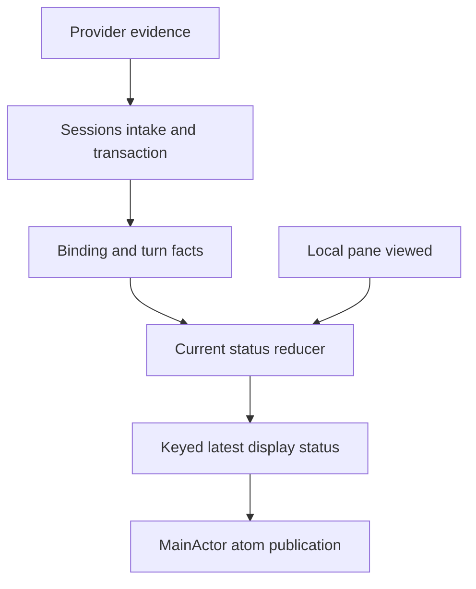
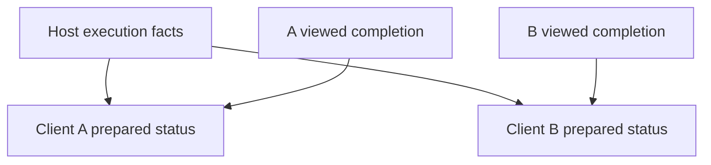
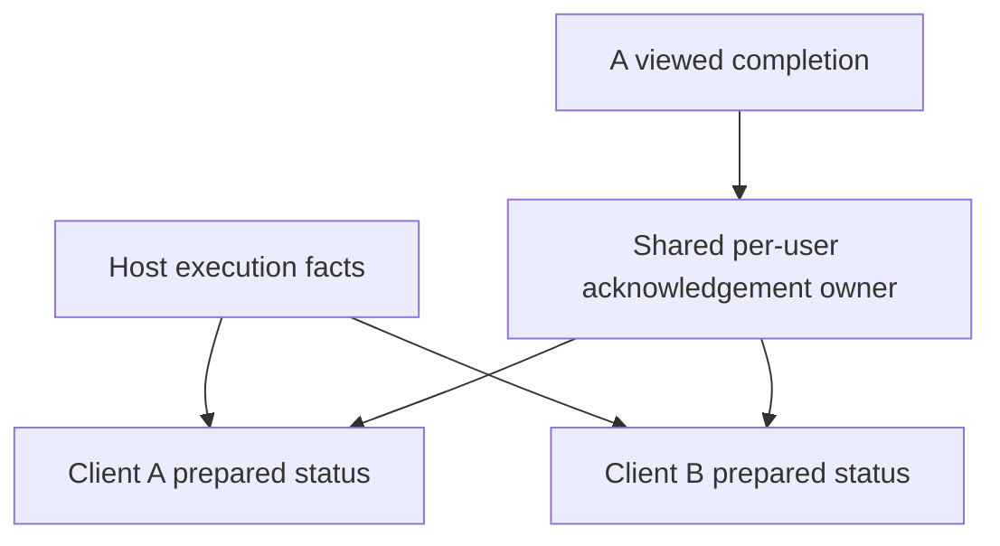

# Session status: shared execution facts and viewed state

**Execution evidence and actual viewing are separate facts. Completed-agent viewed state is shared across participating devices under IP12; its concrete scope and realization still need design.** The current app combines binding/turn facts and a local “seen after completion” input in one runtime reducer. Porting that reducer unchanged would not establish the selected shared meaning.

This is a bounded current-source walk and design comparison supporting [U9/U13/U15/U16](../../../user-requirements.md), [DS07](../specification.md) and [DS10](../../10-swift-client/specification.md). It is not a selected data home, public interface or complete Program Design. All source observations below are at product `624300332f5e50f7bb8cbb9fc786d5e5b4a3d462`; no runtime or compiler test was run.

## What the current app combines

The exact visible distinction is a finished bound turn: without a later view the reducer produces `.idle(.done)`; after an eligible `.paneViewed` input it produces `.idle(.ready)`. The input compares the current process's monotonic instants. Open approval/question/blocked asks have higher status precedence; this viewing input does not answer or settle them. [Reducer and state](../../../../../../Sources/AgentStudio/Features/Sessions/Models/SessionStatusState.swift:75).

### One real entry-to-result path

Every edge in this table was inspected in source. It begins at the registered typed session-event handler; raw socket parsing and initial credential authentication are outside this bounded walk.

| Boundary | Call, state/effect and return meaning | Decisive source |
| --- | --- | --- |
| Typed IPC handler → app adapter | Canonicalizes the pane target, requires matching-pane provenance and awaits the configured Sessions port | [registration](../../../../../../Sources/AgentStudioAppIPC/AppIPCSessionMethodRegistrations.swift:46), [actual port injection](../../../../../../Sources/AgentStudio/App/Boot/AppDelegate+IPC.swift:477) |
| App adapter → Sessions intake | Maps provider payload to `SessionsHookAdmission`, generates the record ID and awaits `submitHook`. A domain admission value crosses this boundary; thrown errors are translated by the adapter | [adapter](../../../../../../Sources/AgentStudio/App/IPCComposition/AgentStudioIPCSessionsAdapter.swift:32), [admission/outcome types](../../../../../../Sources/AgentStudio/Features/Sessions/Models/SessionsHookAdmission.swift:8) |
| Intake FIFO → repository | Preserves mutation order. Hook submissions can be refused at per-pane/global limits; command-finished input is deliberately accepted into the FIFO even at hook capacity | [submission](../../../../../../Sources/AgentStudio/Features/Sessions/Runtime/SessionsIngestion.swift:115), [consumer](../../../../../../Sources/AgentStudio/Features/Sessions/Runtime/SessionsIngestion.swift:197) |
| Repository → application-local SQL | Loads binding context and reduces inside the write closure, then writes operation/evidence/binding/source changes and any supplied commit participant. Returns ignored or committed data, or throws | [repository](../../../../../../Sources/AgentStudio/Features/Sessions/State/SQLite/SessionsRepository.swift:8), [actual SQL adapter](../../../../../../Sources/AgentStudio/App/Sessions/WorkspaceSessionsSQLiteAccess.swift:22), [datastore write](../../../../../../Sources/AgentStudio/Core/State/SQLite/WorkspaceSQLiteDatastoreActor+ApplicationLocalTransactions.swift:20) |
| Committed result → runtime display reduction | A recorded-only result returns without changing display status. Other committed evidence updates the relevant generation, turn and prompt state; later pane-viewed input can change its presentation status | [committed path](../../../../../../Sources/AgentStudio/Features/Sessions/Runtime/SessionsIngestion+Status.swift:76), [viewed path](../../../../../../Sources/AgentStudio/Features/Sessions/Runtime/SessionsIngestion+Status.swift:189) |
| Runtime status → mailbox → native publication | Offers complete keyed status. Equal desired values suppress work; pending values replace only the same key. Retirement preserves removal and rejects later offers. The independently draining lane awaits a MainActor sink that assigns the atom | [mailbox and lane](../../../../../../Sources/AgentStudio/Features/Sessions/Runtime/SessionStatusPublicationMailbox.swift:10), [sink wiring](../../../../../../Sources/AgentStudio/App/Boot/AppDelegate+IPC.swift:325), [atom](../../../../../../Sources/AgentStudio/Features/Sessions/State/MainActor/Atoms/SessionStatusAtom.swift:19) |

The consumer resumes the hook continuation after its repository/status work, without awaiting actual native status application. The IPC adapter then returns an `admitted` result even when the internal outcome was ignored. Its reply is therefore not a displayed-state receipt. Capacity/storage errors return through the adapter's error mapping; no retry follows from that mapping. This is current behavior to classify against the selected future operation contract, not a newly approved receipt rule.

Two details constrain extraction. The FIFO's hook limits do not establish a hard bound on all pending mutation classes, because authoritative command-finished input bypasses that capacity check. The mailbox's single coalesced wake is safe only because the actual pending data is a keyed bank, including removals; replacing that bank with one global “latest event” would discard other panes. Neither mechanism supplies durable replay.

## Proposed responsibilities and interface boundaries

These are proposed responsibilities, not new public type declarations. Existing entity identities remain distinct: execution session E1, provider conversation E9, binding E10, client view E16 and scoped observation E22.

| Responsibility | Candidate home and what crosses its boundary | What it must not infer |
| --- | --- | --- |
| Authoritative provider evidence and binding/turn reduction | Host session/context owner; qualified source input, binding generation, provider/turn identity and operation-specific result | A connection ID is not a provider binding; a client viewing state does not finish execution or settle an ask |
| Complete shared execution observation | Host observation owner; selected binding/turn/prompt facts with source generation, revision/coverage and closed validity meaning | The current app's `seenAfterDone` flag is not automatically shared Host truth; exact observation schema/retention remain open |
| Viewing state | Selected view/user scope; an acknowledgement of the actual observed completion under that scope | Receiving a socket frame is not viewing; viewing an old completion cannot mark a newer turn seen |
| Presentation reduction and coalescing | Proposed Mac Gateway prepared-view owner combines the shared observation with the selected viewing state, then emits compact complete keyed updates | Gateway-local receipt does not imply user viewing or Host mutation completion; its own coalescing does not license dropping required Host evidence |
| Native ingress and publication | Swift supplies actual view/focus inputs and applies already prepared changed values to its existing atom/native owner | Swift does not become the Host evidence reducer or a SQL replica writer |

Ordinary transforms within an owner remain direct typed calls. Mailboxes and subscriptions appear at real ownership/asynchronous boundaries. One bus implementation may carry observer notifications, but the domain write, the selected viewing owner and the native publication remain separate decisions.

The current source establishes local `ContinuousClock.Instant` comparisons; it establishes no common monotonic-clock domain across these machines. A proposed viewed input must identify the source generation and observed completion/revision under the selected observation contract. Exact token shape, survival across restart and retention are unresolved; changing to wall-clock timestamps alone would not establish which completion the user actually saw.

## The selected viewing policy

S26/IP12 selects shared completed-agent viewed state: actual viewing in client A is reflected in client B for the same declared shared scope. Ask settlement, terminal control and delivery receipts remain different outcomes. Additional annotation/review-file/context-notice marker families retain their existing G9 clarification; this selection does not silently include them.

### A — Historical per-client alternative

Client A can show ready while B still shows a new completion. This preserves independent client attention and avoids cross-Gateway acknowledgement synchronization. Users may see the same completion indicator again on another client. Maintainers must still define the view scope and validate the observed completion; persistence or cross-restart memory is not selected by this option.

### B — Selected shared viewing outcome

Viewing in A also clears the indicator in B for that same user. Users avoid repeated completion indicators. Maintainers must supply stable user scope, one acknowledgement owner, ordering for concurrent/new completions and synchronization to other Gateways; its storage home and durability need an explicit contract. A Gateway-wide Boolean would incorrectly merge different clients/users without those decisions.

**B is the selected outcome for completed-agent viewed state.** The earlier recommendation for A is superseded by [IP12](../../../initial-profile.md). Separate actual-view evidence, subject/completion revision and audience still need binding; receiving a replicated row or socket frame does not mark anything viewed. This chooses no table, storage home, global order or new acknowledgement service.

Host evidence/binding extraction and type-safe input classification can continue while the concrete shared marker binding is designed. Final completion-status DTOs, viewed-input scope, materialization, concurrent/offline transitions and propagation need their declared contracts. Sharing itself is settled and cannot be reopened by a faster channel benchmark.

## Proof that separates the boundaries

Use E3's [mapped coordination cases](../../10-swift-client/experiments/coordination.md#applying-the-typed-input-proposal-to-this-experiment) and E2's operation/currentness contracts. Under the selected viewing policy, two clients observe the same completed binding, only A views it, then a newer turn completes before an old viewed acknowledgement is released. Observe each client's prepared status and the unchanged authoritative execution/ask state. The old acknowledgement must not clear the newer completion merely because the resource label is unchanged.

Separately inspect hook refusal, recorded-only versus display-changing commits, keyed replacement/removal and shutdown. These are source-derived proposed discriminators, not executed tests or acceptance. No whole status reducer, view-history store or cross-machine clock protocol is adopted by this comparison.
