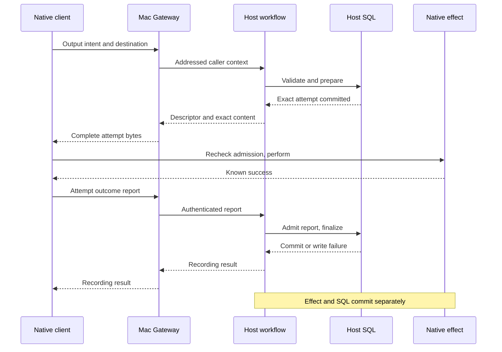

# Annotation output across Host and native client

**The Host owns the prepared attempt and workflow finalization. The declared destination owner performs the clipboard/file effect. A Gateway copy or prepared view performs neither.** A connection can disappear between those boundaries without proving whether the effect happened.

This is a bounded structural proposal for U4/U9/U13 and R4/R13/R15/R16, under [DS08 K10](specification.md#k10--annotation-editing-and-output-effects). The [shared Requirements](../../user-requirements.md), [existing E12–E15/E20 definitions](../../domain-entities.md#reviews-annotations-and-output) and [transaction groups](../02-data-ownership-replication/research/transaction-boundaries.md#output-has-two-commits-with-an-effect-between-them) govern its meaning. It adds no selected public methods, remote effect credential, durable effect registry, database partition or automatic recovery mechanism. Destination/audience, restart, retention and authority profiles remain G3/G8/G9/G12; lease-dependent writes consume DS03/G13.

## What the current path establishes

Source is AgentStudio `624300332f5e50f7bb8cbb9fc786d5e5b4a3d462`. The observations below come from code, not executed clipboard/file or daemon experiments.

| Current boundary | Decisive source behavior | Consequence for the distributed realization |
| --- | --- | --- |
| Destination and preparation | [executeNew](../../../../../Sources/AgentStudio/Features/Bridge/Runtime/WorktreeAnnotations/WorktreeAnnotationOutputCoordinatorActor.swift:295) resolves destination, materializes bytes, then prepares before performing the effect | Selection cancellation can precede any attempt. Once preparation commits, later refusal/disconnect must not be reported as if no attempt existed |
| Preparation write | [prepareOutput and insertion](../../../../../Sources/AgentStudio/Features/Bridge/State/SQLite/WorktreeAnnotations/WorktreeAnnotationSQLiteRepository+Output.swift:76) validate bytes/snapshot and check current session, membership and draft constraints inside the owning write | Host retains the exact saved-message revisions, ordering, bytes and declared destination as E15. Gateway preparation does not supply a substitute write fence |
| Clipboard | [Native perform](../../../../../Sources/AgentStudio/App/Coordination/WorktreeAnnotationOutputEffects.swift:104) checks product admission/cancellation, clears contents, then calls setData | A failed write need not mean the clipboard remained unchanged. Native admission and actual outcome are separate from Host SQL state |
| File | [File admission](../../../../../Sources/AgentStudio/App/Coordination/WorktreeAnnotationOutputEffects.swift:117) precedes application-owned asynchronous writing; the [writer](../../../../../Sources/AgentStudio/App/Coordination/WorktreeAnnotationOutputEffects.swift:150) has different new-file and explicit-repeat paths | Cancelling the originating task cannot be presented as undoing an admitted write. New output uses exclusive naming; repeat can replace the recorded file. Failed cleanup can leave residue; this source does not prove disk durability |
| Finalization | [finalizeKnownSuccess](../../../../../Sources/AgentStudio/Features/Bridge/Runtime/WorktreeAnnotations/WorktreeAnnotationOutputCoordinatorActor.swift:426) records success and reports partial success if finalization fails, even if its failure-record write also fails | Known destination success survives loss/failure of finalization. A later failure marker is another write, not a rollback of the effect |
| SQL closure | [finalizeOutputAttempt](../../../../../Sources/AgentStudio/Features/Bridge/State/SQLite/WorktreeAnnotations/WorktreeAnnotationSQLiteRepository+Output.swift:362) records event/attempt and [matching-revision handled state](../../../../../Sources/AgentStudio/Features/Bridge/State/SQLite/WorktreeAnnotations/WorktreeAnnotationSQLiteRepository+Output.swift:770) in one write | Preserve the actual group at Host. A later edited saved revision must not be marked handled merely because an older revision was exported |
| Repeat/recovery | [repeatOutputAttempt](../../../../../Sources/AgentStudio/Features/Bridge/State/SQLite/WorktreeAnnotations/WorktreeAnnotationSQLiteRepository+Output.swift:250) accepts an unknown source and creates another ID with exact bytes/membership and lineage; [recovery](../../../../../Sources/AgentStudio/Features/Bridge/State/SQLite/WorktreeAnnotations/WorktreeAnnotationSQLiteRepository+Output.swift:431) can mark prepared attempts unknown | New attempt identity is not a transport retry. An uncertain old destination effect is not known failure, and recovery must not race an earlier external writer |

The [22-operation map](annotation-operation-map.md) remains the complete nested vocabulary. Current command outcomes, durable attempt state and native outcomes are different unions: for example, current known effect failure may be recorded as a cancelled attempt with an error. Do not expose a storage state string as the complete distributed result.

## Responsibilities and the crux

The existing coordinator can call an in-process effect port. A Rust Host cannot invoke that Swift object directly. The [Gateway's selected client-native dispatch route](../01-service-contracts/communication-design.md#client-native-operations-reach-their-actual-owner) is already needed for external UI controls. The remaining choice is who sequences an explicitly requested output attempt and how that route is reused, without moving annotation rules into Swift or letting a replicated row become a command.

| Structure | What it gains | What it costs and who pays |
| --- | --- | --- |
| Keep the coordinator in-process unchanged | Existing call sequencing | Does not realize the remote Host/native boundary; treating a Swift object call as remote would hide a missing protocol |
| Native command runner sequences Host preparation → local effect → Host outcome recording | Uses the existing operation client/destination owner; frontend CLI/MCP can invoke the selected native aggregate through Gateway client dispatch | Client adapter owns attempt-scoped sequencing and truthful interrupted/partial result; Host must admit a qualified report. It does not remove the native dispatch path already required for UI controls |
| Host orchestrator invokes a registered remote native-effect capability | Reuses Gateway client dispatch and keeps the apparent workflow sequence at Host | Adds Host-originated delegation/destination binding, attempt-result custody and reconnect semantics beyond ordinary UI dispatch. Host still cannot observe a lost native result or roll back an effect; service/client maintainers bear that incremental protocol |

**Proposed realization: the native command runner sequences the existing operation roles.** Host annotation logic remains in its owning library; the runner only carries prepared identity/bytes, calls the destination port and reports its actual outcome. An external frontend can reach that selected native runner through Gateway dispatch, while a native initiating command starts it at its existing owner; its Host operations still traverse Gateway. The shared dispatch transport reduces the callback alternative's cost, but does not settle its additional Host-originated authority/custody contract. Revisit if a settled requirement needs that outcome. No public API is selected here. E2 A10/A14 must establish the actual destination/report/finalization path before any reliability claim.

These are semantic homes within the [integrated component proposal](../11-operations-integration/program-design-workbench.md#proposed-composition-and-dependency-direction), not additional mandatory crates:

| Responsibility | Owner and interface job |
| --- | --- |
| Annotation transaction and exact output | Host annotation workflow/repository: prepare, inspect, admit qualified result, finalize and explicit repeat |
| Routing and authorized finite content | Gateway operation/content adapters: preserve Host/attempt/client qualification, bounds and interruption; never infer destination success |
| Explicit native attempt sequence | Existing native command/application owner, with one attempt-scoped job: invoke Host roles, obtain exact content, perform through native port, return/report actual observations |
| Clipboard, chooser, reveal and file writing | Actual destination adapter: native API admission on its required executor, asynchronous file I/O off MainActor, explicit task custody through completion |
| Output history display | Gateway preparation plus native publication: permitted history/validity only; observing prepared/succeeded rows must never call the effect port |

## Typed boundaries, without freezing another schema

The following describe information and checks each boundary must retain. They are not another hand-maintained public DTO catalog. DS01 supplies the one selected schema; DS03 supplies real caller/report authority.

| Boundary value | Required distinction |
| --- | --- |
| Selected output intent | Host-qualified E12 scope, selected E14 saved revisions and relevant session/projection/source preconditions, output kind, and a declared destination owner. A client file path is not a Host path or a portable capability |
| Prepared attempt | E15 reference, immutable revision membership/order/content, output kind/format and the declared destination binding. No permission is constructed by deserializing an attempt ID |
| Finite content | E20 descriptor and exact bytes/length/digest bound to that E15. Completion proves only the qualified transfer, not effect admission, native application or finalization |
| Destination admission | Actual client/destination, current caller/surface/cancellation predicates and the exact prepared attempt. Recheck at the actual native admission boundary; a prior Gateway check cannot keep a closed/revoked surface alive |
| Destination observation | Closed cases distinguish not-admitted/cancelled-before-effect, known success, known failure with its actual partial-state/residue limits, and outcome not established. Success carries actual destination information only under the selected privacy profile |
| Host recording result | Separate committed finalization, refusal/conflict, known failure to finalize and unestablished reply. Pair it with the independently observed destination result; do not flatten both into a success boolean |

Represent only combinations the real path can establish. A success report must match the prepared Host/session/attempt/destination and the actual admitted reporting principal. A payload that names the right attempt is not evidence that its sender performed the effect. The report-admission/credential design remains an explicit gap, not an implied acceptance of arbitrary frontend assertions. Reporting an outcome is also not another permission to perform it.

## One explicit attempt through the required route

This diagram shows the proposed known-success path and its possible finalization failure. Every frontend control/content/report leg uses the Gateway. Refused preparation, content failure and interrupted result paths are described below; they must not be disguised as this success path.

[Standalone rendered diagram](assets/annotation-output-1.svg)

Preparation can instead return refusal/failure, with an uncertain reply distinguished from known noncommit. The client must not run an effect merely because it requested preparation or found a history row. An admitted attempt plus incomplete/mismatched content still supplies no effect input. Content can use the separate bounded finite-content lane rather than being included in a control response; the diagram does not select frame size or buffering.

## Interruptions and concurrency retain separate truths

| Interleaving | Proposed owner response / unresolved contract |
| --- | --- |
| User cancels destination selection before preparation | No effect invocation and no invented prepared attempt. A lost preparation reply is a different case and cannot claim that boundary |
| Preparation commits, view closes before native effect admission | Native adapter refuses new admission under its current predicates. The Host needs the actual qualified refusal/cleanup result; disconnect alone does not prove the report committed |
| Native file work was admitted, then view/request closes | The destination owner retains/joins its admitted work while the process lives. Stop offering that job as cancellable rollback; actual process loss can leave its outcome unestablished |
| Clipboard clears, then set-data fails; file write/cleanup fails | Report the real failure boundary and possible mutation/residue. Do not turn a failure code into “destination unchanged” |
| Effect succeeds, report or finalization fails | Keep the known local effect result distinct from Host/caller uncertainty. Attempt lookup can establish only the recorded state it finds; a prepared row does not prove no effect |
| Finalization commits, response is lost | Inspection of an authorized authoritative attempt can establish its recorded result. A delayed copy may still show old state; do not repeat the native effect to obtain a response |
| Old caller/report arrives after another attempt or recovery | Host validates the exact attempt and selected report/recovery rules at its actual write. No current UI selection or matching byte digest grants authority over another attempt |
| Explicit repeat of an unknown attempt | New E15 lineage with exact original bytes/membership and selected destination contract. It is a new effect. The current repeated-file path can replace a recorded file; moving the path to another machine is not an automatic equivalent |
| Restart/recovery considers prepared → unknown | Recovery requires the selected lifecycle/custody contract. SQLite writer serialization, an epoch or a lease does not by itself prevent a predecessor client file writer from finishing later |

A native attempt job owns its content reader, admitted file task and outstanding report operations for their actual lifetime. Bounded operation admission precedes spawning; an abandoned response does not release accounting for still-running work. This introduces no background service, durable local journal, automatic report resend or replay queue. Those mechanisms need a settled recovery promise and proof before selection.

## Data, cutover and proof seams

E15's exact bytes, membership and finalization group remain Host workflow state. Any selected faithful copy carries only its declared table/audience contract; copying a private destination path or error string is a separate privacy decision. Gateway history/summary preparation can omit those details. Native folder preference and permission/bookmark custody remain native inputs under their selected lifetime, not a newly replicated preference table. Neither summary nor copy becomes an output executor.

Cutover must replace the current in-process aggregate sequence at its real command/effect composition boundary and route authoritative workflow writes to one Host owner. Preserve the existing command catalog and feature import rules. Do not leave an independent Swift SQL writer or add a catch-all remote native-command channel. Existing prepared attempts/destination paths require an explicit migration/adoption profile before release; this excerpt does not choose one or implement a compatibility branch.

Qualification stays within [E2 A10/A14](../07-agents-context/experiments/host-autonomy.md#finite-discriminating-cases) and the existing E5 route/native cases. Observe actual preparation commit; hold content/effect admission; race client close/revocation; observe exact clipboard/file state including residue; fail finalization after known success; lose a reply after commit; and exercise explicit repeat separately from reconciliation. Any recovery case must prove custody over a possible predecessor writer. Controls include inspecting/history/copy apply without an effect-port invocation. Source checks, fake destination ports and matching hashes do not establish these real native/service outcomes.

Exact destination scope/privacy, report authority/schema, attempt lookup/reconciliation, concurrent-report rules, content budgets and restart/cutover policy remain contract inputs. Neither the diagram nor an attempt ID supplies those guarantees.
