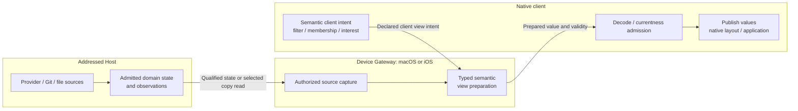
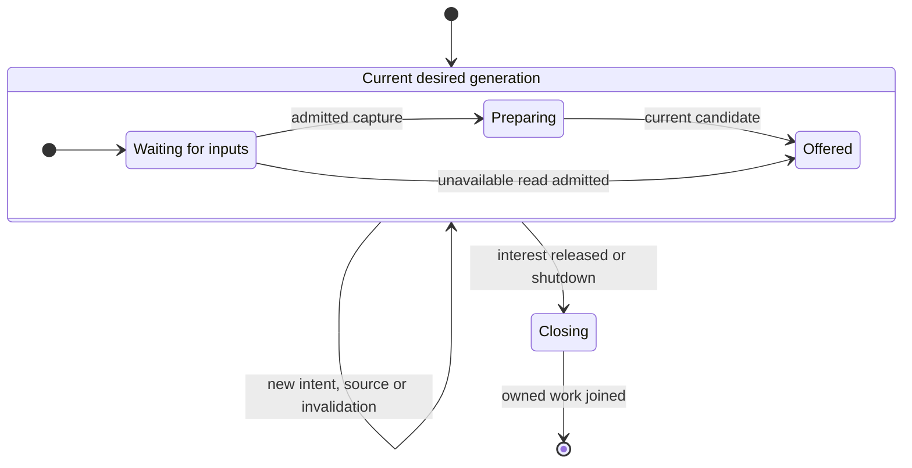
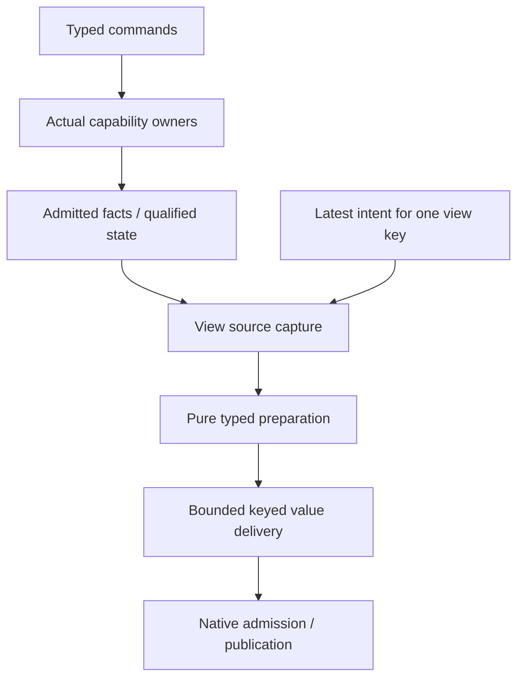

# Gateway prepared views: the concrete processing boundary

S28 now requires the Gateway role on macOS and iOS, talking to the UX client. The Mac process/socket realization below is not iOS hosting proof. The [mobile qualification](../11-operations-integration/research/ios-gateway-hosting-evidence.md) must settle safe Rust startup, runtime ownership, local socket custody and suspension/reconnect before claiming that platform works; Host execution remains independent.
**Prepare portable semantic views in the device's Gateway, and keep native layout, measurement and application in the UX client.** Host capabilities acquire and process their machine data. A faithful copy supplies selected reads; the Gateway combines authorized observations with client intent into a view. Swift decodes and admits that value off MainActor, then publishes changed values and applies native presentation through its existing owners.

This is the Lead's structural proposal for the prepared-view portion of R15/R16, constrained by R1–R14 and the [shared Requirements](../../user-requirements.md). It is a design excerpt, not a completed Program Design, selected wire schema, data export list or implementation authorization. The [observable spine](../../2026-10-15-agentstudio-daemon.md), scoped contracts and their open profiles remain fixed inputs. Open cells below are design dependencies, not defaults or proposed runtime flags.

## Bind existing entities before choosing components

The [integrated binding table](../11-operations-integration/program-design-workbench.md#bind-the-specifications-entities-before-naming-packages) covers E1–E26. The [shared-state companion](../10-swift-client/shared-client-state-design.md) separates E25/E26's proposed Host authority from Client preparation and actual native state. This excerpt refines capture/preparation without redefining those resources; module homes are not a crate per row.

| Entity / obligation | Semantic owner and code home | Shape at this boundary | State disposition / exact gap |
| --- | --- | --- | --- |
| E1 execution session; E9/E10 provider conversation/binding | Host domain owners; `host_session_runtime` / `provider_conversations` / `agent_binding` (new candidates) | Host-qualified execution reference, distinct provider reference and binding generation; qualified shared observations | Host truth, with selected retained evidence. Never use the current SessionSummary `id` as all three identities; restart/source-fact profile remains open |
| E11 context message | Host context workflow; `session_context` (new candidate) | Scoped message/detail/count observation with binding/revision and authoritative operation results | Retained workflow separate from prepared counts. Audience, retained history, source-maintenance and unit/export profiles remain open |
| E16 client view target | Existing native composition; Client `client_view_inputs` adapter | Qualified actual native target, membership and display intent, distinct from E25 logical nodes | Native presence stays client truth. E25 tabs/layout are shared; exact element/projection and other preference scope remain to bind |
| E19 subscription | Gateway desired-interest owner and each actual source-delivery owner | Desired view/source scope distinct from a transport connection, current registration and delivery position | Rebuildable interest and live delivery state; retention/resume and authority profiles remain open |
| E20 finite content | Host source/content owner; Gateway transfer adapter; existing native/worker consumer | Addressed descriptor, content identity, selected bounds, source witness and completion/cancellation result | Runtime content custody and optional cache; bytes are not automatically replicated rows |
| E22 scoped observation | Actual Host/native source; proposed Gateway `prepared_view_owner` owns only its derived observation | Required source set, source-specific witnesses, declared validity and typed semantic value | Derived/cached Gateway view. A copy position does not imply complete source coverage, liveness or current permission |
| E23/E24 Host/Gateway instances | Service composition and source connection owners | Host-qualified resource context carried through every read/view/result | Running-service identity; restart/re-adoption remains open. Equal paths or remote URLs do not merge resource authority |

Rust shapes follow validated newtypes, payload enums, closed domain errors and exhaustive transforms. One selected schema authority supplies Rust and derived/validated Swift consumers; current Swift atoms/SQL rows are not that wire schema. Tokio owns asynchronous lifetime; blocking adapters are bounded, spawned work is tracked and drained, and first-party unsafe remains forbidden. [Engineering realization](../11-operations-integration/rust-engineering-design.md).

## What moves and what stays native



[Standalone rendered diagram](assets/prepared-views-1.svg)

These arrows are data flow, not dependency imports or a new global bus. Host operations retain their command/result route through Gateway. Required Host input collection continues without any Gateway or visible view. A UI demand change can contract optional display work without terminating execution or dropping required provider/context evidence.

| Preparation work | Recommended home | Why |
| --- | --- | --- |
| Git/filesystem/provider acquisition, authoritative workflow reduction and SQL maintenance | Host capability/source owner | Depends on machine truth, credentials and transaction predicates; must not need a native client |
| Semantic filter/group/sort, status/count composition, keyed source-validity and declared display deadlines | Gateway prepared-view owner / pure transforms | Reusable client-dependent processing with explicit source/intent inputs; keeps it off Swift MainActor |
| Font metrics, visible width, viewport, responder, row selection, native table plan/application | Native client, off MainActor where supported and publication/application at its actual owner | Those facts belong to the real renderer and cannot be established by Host rows or Gateway receipt |
| CLI table formatting and MCP tool presentation | Thin frontend adapter | Presentation of the shared operation/read result, without another Git/session/context implementation |

The current sidebar already separates detached preparation from native candidate/application feedback. It also mixes semantic values and native metrics in some prepared types. Move the responsibilities deliberately; do not serialize the entire current projection object. [Current sidebar read catalog](../10-swift-client/sidebar-read-needs.md).

The credible narrower alternative keeps more client-specific semantic preparation in the current Swift worker while Gateway prepares only shared Host-derived views. It reduces the first protocol/data move but leaves more composition work per frontend. The recommendation above moves portable semantic work and retains native materialization. Its cost is explicit client-input, source-witness and protocol/cancellation machinery. No speed winner is claimed: the existing [Swift coordination/publication experiment](../10-swift-client/experiments/coordination.md) and [route experiment](../11-operations-integration/experiments/route-performance.md) must compare the actual path and workload before performance justifies a larger move.

## The concrete consumer views

Each row names a candidate semantic result, its real inputs and what the client still supplies. These are responsibility/field sketches; DS01 and the domain contracts still freeze exact variants, optionality, supported profiles and limits.

| Candidate view / current consumer | Inputs the Host must acquire or process | Gateway preparation and client boundary |
| --- | --- | --- |
| Repository sidebar groups and checkout rows | Watched-root/discovery membership; repository/worktree identity; branch/status/PR observations; coverage/activity/update progress | Combine qualified source facts with selected grouping/filter/pin and open-pane context. Emit semantic groups/rows, loading/degraded states and qualified action targets. Native paint and actual row application remain local |
| Pane sidebar rows | Shared execution/binding/status and context observations; selected activity sources | Combine with client active-residency/drawer membership, notes/pins and display intent. Prepare compact/expanded semantic lines and chips. Native selection can choose the prepared variant without a Host round trip |
| Session display status | Ordered provider/binding/turn/prompt evidence, open-ask counts and applicable agent-line work | Combine shared observation with the selected viewing scope. Native supplies actual viewing; receiving bytes never marks a completion viewed. This row cannot be frozen before the existing viewing-policy choice |
| Compact context summary | Admitted messages/ask state, ordered title/line, source revisions and authoritative maintenance | Prepare selected own/including-child scopes and counts using a declared source set. Client placement is separate from execution ownership; reading a copy never confirms receipts or performs SQL maintenance |
| Context detail/page | Authorized message/session/detail observations and page/snapshot witnesses | Prepare bounded detail or relay selected coherent pages. Keep answer/withdraw/mark-read/actions as explicit authoritative operations. Native popover location, generation and presentation stay local |
| Terminal/attachment status | Host execution/attachment/control and renderer-independent facts | Combine only with actual native renderer/read-only/secure-input observations when the consumer needs them. Missing renderer facts remain absent/unavailable. Terminal VT bytes use their own continuation path |
| File/review metadata and finite content | Actual Git/filesystem source and annotation workflow, with source/generation and exact-content evidence | Prepare authorized metadata; route finite descriptors/bytes under their actual custody. Native worker/publication application is a separate boundary; transferred bytes do not execute output |
| Command availability / native context | Host capability and authority observations where applicable | Combine with actual native window/focus/target state under the existing command catalog. Displayed enablement is advisory; the effect owner validates current target/authority again |

The [sidebar catalog](../10-swift-client/sidebar-read-needs.md), [session/context/native catalog](../10-swift-client/session-native-read-needs.md) and [Bridge catalog](../08-files-review-output/client-read-needs.md) supply current fields, transformations, production consumers and read-side effects. They are broader than the current app RPC DTOs. A DTO omitted from RPC can still be needed by the native client; a captured field is not automatically needed on the new wire.

The [query/table dependency map](../02-data-ownership-replication/research/query-data-dependencies.md) connects those consumers to current stored rows, live inputs and read-side writes. Use it to distinguish a pure prepared view from Host maintenance or acknowledgement; it selects no target export list.

## Behavioral interfaces to freeze

| Boundary / owner | Inputs and preconditions | Output and effect boundary | Exact remaining shape/profile work |
| --- | --- | --- | --- |
| Source capture; Gateway source adapter calls the actual Host/copy/native owner | Authenticated data scope, qualified subjects, required observation scope; current pairing | Qualified captured values or explicit unavailable/currentness failure. Authoritative read-side writes, when required by that operation, execute at Host | Complete domain read DTOs, source witnesses, copy-read readiness and source lifetime/restart profile |
| Desired view; Gateway prepared-view owner | Admitted client/view scope plus typed family-specific intent, source subjects and request generation | Retains/replaces desired interest and schedules bounded preparation; closing it ends view work only | Exact exposed view families, request bounds, native client targeting and reconnect/resume |
| Pure preparation; Gateway library | Immutable source capture, current client intent and declared time context | Candidate semantic value, source-validity and any presentation-only deadline; no SQL/network/native effect | Field/union schema and exact source consistency, clock and preference/viewing profiles |
| View delivery; Gateway subscriber owner | Current candidate for that key/generation and allowed data scope | Keyed replacement/removal/unavailable disposition under a bounded delivery contract | Full value versus scoped deltas/content transfer, per-key capacity, overflow/refill and currentness semantics |
| Native application; existing Swift/native owner | Validated prepared value for current client target/generation | Applies publication/native plan or rejects stale/unavailable context. Existing native baseline feedback remains client-local unless an explicit cross-process contract requires it | Portable semantic DTO and adapter, native invalidation/application result, real socket and renderer proof |
| User command; actual Host or declared native effect owner | Typed operation and qualified current target/authority | Operation-specific result: acceptance, commit, presentation, partial or unknown only where supported | Selected per-operation contract and reconciliation. A view/copy revision is never a write grant |

The pure-preparation boundary is a direct typed library call. Transport, storage, source admission and native effects are real ports. This does not justify one interface per helper, a second backend, a generic reactive framework or an extra always-running process.

### Shape rules

The selected schema must retain these distinctions:

- Resource references carry their Host context and kind. Provider conversation, execution, binding, attachment and native target identities remain different types.
- Source witnesses are source-specific: selected replica database/incarnation/epoch/position; Host observation scope/lifetime/position; or native client lifetime/generation. The Gateway integration's `prepared_view_inputs` union reuses the shared replication types through `replication_read_adapter`. Portable observation meaning lives in `observation_contracts`; pure transforms do not import engine or SQL types. No one integer is a global revision across Hosts, SQL copies and native windows.
- View intent carries only that family's required semantic inputs. Trusted caller scope comes from admission, not a payload-supplied identity. Native geometry need not cross the socket when no semantic consumer requires it.
- A replacement carries the current view key/generation, typed semantic payload and declared source validity. Removal of a subject or closed interest differs from unavailable observation; a read failure cannot masquerade as successful empty membership.
- Closed validity variants preserve complete, known partial and coverage-unestablished meanings. Last-known data and the policy for displaying it remain separate. The pending offline-display selection is not answered by retaining a cache.
- Semantic equality includes every field a consumer relies on, including target/source fences and validity. Equal paint text or equal row IDs alone cannot suppress a changed permission/currentness/removal meaning.
- Process-local monotonic instants never cross the wire. Cross-Host recency needs a declared observation/clock contract; Gateway receipt order does not silently become time of activity.

Exact discriminants, required/nullable fields and bounded error reasons still need DS01/domain profiles. Current optional-field bags, raw SQL rows and arbitrary JSON values are not the target type model. No fallback decoder or compatibility flag is selected.

## Internal capture and candidate contracts

The following refines the existing source-capture, preparation and delivery responsibilities. These are proposed internal Rust contracts for E16/E19/E22 and R13/R15/R16, not new public methods or selected wire field names. Intent types live in `client_view_inputs`; witness-bearing capture/candidate values live in `prepared_view_inputs`; lifecycle and offering live in `prepared_view_owner`. Pure family transforms are ordinary functions in `view_preparation`. This adds no process, database, global reducer or reactive framework.

| Internal value | Required shape and meaning | Construction and caller constraint |
| --- | --- | --- |
| Admitted view intent | E19 interest reference; kind-qualified E16 target where applicable; declared view family, qualified subjects and that family's semantic intent; local desired generation | Client-input admission constructs it from actual caller context. A payload-supplied client/Host name is not trusted authority. Exact sharing scope and reconnect profile remain the existing open contracts |
| Qualified source read | Family-specific typed value paired with its actual source witness, or a typed unavailable disposition. A permitted subject-absence result additionally needs the declared complete-scope witness | Actual Host/copy/native source adapter constructs it. Copy rows and their observed cut come from the same read boundary. Missing/failed/partial reads cannot be turned into successful empty values |
| Captured family inputs | Admitted intent and generation; the family's required source reads; explicitly supplied time/ordering context where the fold depends on it | Capture owner pairs values with their witnesses and retains the required source set. This is an immutable preparation input; it is neither a database writer nor a globally atomic snapshot across unrelated sources |
| Prepared candidate | The same view key/generation and source witnesses; typed family result and validity; optional presentation eligibility deadline only for a family whose policy defines one | Pure family transform returns the typed family value; the Gateway owner wraps it with the unchanged captured witness and generation. Neither step establishes newer source state, permission or native application |
| Preparation disposition | Closed internal outcomes: `offered`, `superseded`, `sourceInvalidated`, `cancelled` or `closed`, paired with the attempted view key/generation | View owner returns the actual disposition after candidate admission or retirement. This closes that preparation attempt; `offered` is not a transport receipt or native application acknowledgement |

The representation of a source witness follows its actual source: replica database/incarnation/epoch/applied cut; Host observation subject/source lifetime/position/coverage; or native client target/lifetime/capture generation. These are different tagged shapes, rather than optional fields on one universal revision record. Their union belongs to Gateway integration, with the explicit dependency on the shared receiver/protocol read types; `view_preparation` takes family values and declared policy/time inputs without that dependency. Exact shared-engine types are reused for their replication meanings; a Gateway generation does not replace them.

Wire DTOs may be decoded by a transport adapter. An admitted intent, qualified read or current candidate is constructed after its real admission checks; deriving deserialization for that trusted stage would allow the bytes to bypass those checks. The compiler can distinguish the stage and family types. Runtime checks still establish the actual caller, source lifetime, permission, current generation and effect boundary. A value admitted earlier still needs the relevant currentness/authority check at the responsible later boundary.

### One concrete family: compact context preparation

The compact context view combines the owner's title/line with counts for its declared membership. These are separate inputs. The [concrete count-family design](../07-agents-context/context-count-preparation.md) gives count classification one context-domain implementation and lets Gateway preparation combine per-context totals. It replaces the earlier draft's requirement to send message-level count inputs to Gateway for this chip.

#### Match each input to its actual consumer

| Input / consumer | Proposed boundary | Meaning preserved |
| --- | --- | --- |
| Owner title and line | Successful qualified owner read, with optional typed title/line values | Only the owner supplies these fields. Known absence differs from source failure; a child's newer message does not replace the owner's title |
| Own / including-child chip counts | Source-domain per-context counts plus qualified E25 logical owned-child membership | Host domain classifies message state; Gateway combines the four counts. E16 native mounting, drawer expansion and provider subagent ancestry do not decide logical count membership |
| Source scope and validity | Actual readers supply E25 membership and required contexts, each with its own witness/validity | Missing, incomplete, unestablished, absent and refused remain distinct. Fresh context values cannot make stale logical membership current. Complete arithmetic over last-known inputs is not proof of current Host state |
| Detail / action consumer | Separate bounded context-detail and authoritative action contracts | Count preparation does not read forms/answers/actions, confirm a receipt, mark read or perform an action |
| Offered result / native publication | Existing candidate/generation admission, followed by actual native admission | Offer, socket receipt, UI publication and user viewing remain separate observations |

The new [internal family values](../07-agents-context/context-count-preparation.md#the-exact-internal-family-values) own the exact count types, complete/incomplete variants and checked-addition errors. This section does not duplicate that schema. Owner title/line and the full compact display still need their separate selected shape and composition contract; the count family alone is not a complete pane-detail protocol.

The current [fold](../../../../../Sources/AgentStudio/Core/PaneContext/PaneMessageCountFold.swift:32) calculates four attention-class totals and a newest blocking-ask reference. The [actual chip](../../../../../Sources/AgentStudio/Features/RepoExplorer/Models/RepoExplorerPaneMessageCountProjection.swift:6) consumes the totals. Blocking asks classify as approval and nonblocking asks as reply, irrespective of their separate approval/question/blocked reason. The unused newest-ask result does not justify adding message identities or cross-Host recency to every count request. A selected consumer for it needs a separate qualified identity/ordering contract.

#### Compact state and detail pages have different contracts

Current compact capture runs in a SQL **write** closure: it expires lines and hides settled messages before producing count inputs. The detail snapshot uses a SQL read closure, but the enclosing service first calls `ensureOpen`, whose startup work can settle blocking asks. It also updates an in-memory detail-version map. Neither entire service operation is pure merely because its name says read. [Compact capture](../../../../../Sources/AgentStudio/Core/PaneContext/PaneContextService+Presentation.swift:106) · [detail service](../../../../../Sources/AgentStudio/Core/PaneContext/PaneContextService+Detail.swift:27) · [startup work](../../../../../Sources/AgentStudio/Core/PaneContext/PaneContextService.swift:93).

Compact capture rechecks membership after awaiting inputs; the detail operation does not perform the same post-await directory check. Native paging adds its own generation/revision fence. The proposed candidate admission applies to each asynchronous family rather than assuming those current paths already provide identical guarantees. This is a source-observed distinction, not an executed race result.

Current `pane.context.get` omits absent optional title/line/session fields; `session.query` instead requires an explicit nullable session and enforces null exactly when unbound. DS01 must retain a deliberate method-specific absence/null and invalid-state contract with real Rust/Swift coverage. [Context encoding](../../../../../Sources/AgentStudioProgrammaticControl/IPCPaneContextReadContracts.swift:175) · [session invariant](../../../../../Sources/AgentStudioProgrammaticControl/IPCSessionContracts.swift:195). The count-family internal `u64` is not a public encoding choice.

Host maintenance remains outside pure preparation and copy reads. Whether a selected Host read refreshes state, its transaction result and invalid-grant behavior stay explicit G8/G13 contracts. A copy does not carry out blocked Host maintenance, and cancellation or lost delivery does not undo a write already committed. [Query/transaction analysis](../02-data-ownership-replication/research/query-data-dependencies.md).

Repository/sidebar preparation uses its own family values. A context count capture cannot be passed to that function. Known families can be selected exhaustively without dynamic topic strings, a macro pipeline or a state-owning task per transform.

## View preparation lifetime

The proposed owner keeps runtime desired intent, its current generation, qualified source state, pending affected scope, owned computation and latest offered observation. Those are rebuildable view-coordination values, separate from faithful SQL copies and Host truth. This does not choose durable view persistence or logical-interest survival across reconnect; E19's profile remains open. A connection and an execution keep their separate owners.



[Standalone rendered diagram](assets/prepared-views-2.svg)

These are internal coordination states for the current desired generation. A new admitted intent, source change or invalidation starts the next generation at its input-capture state. Superseded jobs remain tracked separately for accounting/join; their completions cannot move a newer generation back to waiting or overwrite its offered value. `Offered` may carry the selected family's ready or unavailable observation; it never means Swift applied it. A successful preparation, read failure, empty scope and removal all undergo the same view-key/generation/source checks before an offer. A late failure must not replace a newer valid value merely because only success candidates were fenced.

Waiting for a replacement does not certify the previous observation as current. Known invalidation changes its validity before reuse. Whether a permitted previous value remains visible follows the existing offline/partial-presentation contract, rather than this internal state diagram.

| Transition / guard | Owner action and invariant |
| --- | --- |
| Admit a new intent or source change | Update the desired generation and retain affected scope. A complete replaceable input can replace the previous value for that same key; disjoint invalidations are unioned or deliberately widened under that family's refresh contract |
| Admit computation | Reserve bounded worker/retention capacity before spawning. The source/I/O owner loop does not run expensive preparation. Worker count, pending-key count and retained captures all count toward the selected resource budget; a semaphore alone does not bound a queue of already-spawned waiters |
| A newer generation arrives during preparation | Keep its pending intent/scope; mark the older candidate superseded. Cancellation is cooperative and old synchronous work remains accounted for until it finishes or joins. Replacing a reply slot does not retire the computation |
| Admit any completion | Compare the attempted key/generation and relevant source lifetime with current desired state. Offer only a permitted current disposition; retain the actual read witness rather than claiming a globally latest Host state |
| Semantic values compare equal | Keep operational source/currentness bookkeeping at its owner. Suppress unchanged display publication only where all consumer-relevant validity, target and removal meanings also remain equal; raw source progress alone is not permission to repaint every row |
| Native target changes after Gateway offer | The client's admission/application boundary rejects the old target/lifetime/baseline. Heavy decode/validation and derivation stay off MainActor; the actual native owner still checks its current application target and publishes/applies the admitted value |
| Interest closes or service stops | Stop new preparation/offer admission and cancel/join owned reads, tasks and computations. Retire the runtime view state under its selected retention rules. Already-written bytes cannot be retracted; the actual client fence protects native application. Host execution, authoritative intake and domain state are not closed by this transition |

Exact capacities, scheduling eligibility, source-read cancellation outcomes, resume/delivery and retention remain the declared profile gaps. No debounce duration, unbounded pending map, automatic command replay or new durable view log is selected by this lifetime model. Deadline work belongs only to a family with a specified time-dependent transition, with an injected clock at its scheduling owner.

### Walk a superseded result through the boundary

For one admitted view, capture generation A against its declared copy cut and Host observation lifetime, then hold its computation. Admit a source/intent change as generation B while A still owns its worker capacity. When A returns, the owner records `superseded` and offers no A value; the Host's source processing continues. B is prepared from its own qualified capture when admitted capacity is available. Separately hold an A source-read failure until B has offered its value: the old error still cannot overwrite B. This latter failure belongs to asynchronous capture, not to the pure preparation function.

If the native target disappears after a B offer, local application can reject B without undoing Host work or changing the meaning of the offer. This example selects no global cursor, cross-Host atomic read, new viewing policy or exact queue budget. Its observation seams are the actual source read, captured generation/witness, preparation disposition, offered value and native acceptance/rejection. A channel enqueue or a cancelled handle cannot stand in for those boundaries. E3 owns the comparative execution; the separate Verification Design still has to choose the real journeys and reference outcomes.

## Coordination: owner calls and qualified fact fanout



[Standalone rendered diagram](assets/prepared-views-3.svg)

Commands call their owner. Selective fact fanout invalidates or updates consumers after the actual boundary; it does not execute a command by subscriber convention. Source-owned sequences and workflow transactions preserve required transitions. A latest-state lane contracts only complete replaceable values for the same key. A deadline schedules a declared transition; it is not quiet-period debounce.

The exact task/channel wiring remains an E3 experiment: scoped subscriptions and a shared typed fact hub can both implement qualified fanout after source admission. Neither candidate owns commands or replaces domain processing. This proposal chooses responsibilities and semantic boundaries; it makes no unmeasured claim that one fanout mechanism is faster or cheaper.

The proposed view owner retains desired source/intent state, supersedes older computation and owns task cancellation/shutdown. Pure preparation consumes an immutable capture; expensive computation has bounded worker admission rather than blocking the source/I/O owner loop. Cancellation of synchronous work is cooperative, and shutdown accounts for that work instead of merely dropping its reply. Exact worker/capacity budgets remain part of the performance profile. Required Host intake and copy application drain independently of a slow or absent UI. A global newest-one queue would lose other subjects, so delivery must retain keyed replacement/removal semantics or explicitly report the gap under its selected profile.

Replica apply and its transaction hook follow the shared engine's contract; read invalidation is delivered after commit. Do not publish uncommitted data or await native rendering inside copy apply. Duplicate invalidations can trigger a current committed read without repeating an application command or native effect. A rebuildable view does not by itself need another durable event log or outbox. Durable delivery is used only for a separately selected workflow that requires it; faithful copied state remains the recovery input for its declared read contract.

## One walkable interaction

```mermaid
sequenceDiagram
    participant UI as Native client
    participant GW as Device Gateway
    participant Host as Addressed Host
    UI->>GW: Admitted view intent / qualified subjects
    GW->>Host: Selected source interest or read operation
    Host-->>GW: Qualified observation / read result
    Note over GW: Capture sources and current intent<br/>prepare semantic value off UI executor
    GW-->>UI: Prepared value / generation / validity
    Note over UI: Decode and admit off MainActor<br/>publish changed values; apply native plan locally
    UI->>GW: Typed user operation / qualified target
    GW->>Host: Authoritative capability call
    Host-->>GW: Actual operation outcome
    GW-->>UI: Qualified result; later view update is separate
```

[Standalone rendered diagram](assets/prepared-views-4.svg)

For a selected copy-backed source, Gateway reads the committed copy under that read contract instead of asking Host for each display refresh. A copy-backed read does not establish Host liveness or bypass authority revalidation for an operation. Native-only effects use their declared client owner; their routing/absence/consent contract remains explicit rather than being forged as a Host result.

## Current-to-proposed changes

| Current source path | Proposed change | Preserved boundary / exact gap |
| --- | --- | --- |
| App filesystem/Git/Forge pipeline supplies keyed atoms | Move machine acquisition and admission to Host; Gateway captures qualified read inputs | Source coverage, branch/ref/currentness and failures remain source-specific. Complete Rust/library/platform realization remains open |
| Native capture → detached RepoExplorer worker → native materialization feedback | Move portable semantic preparation to Gateway; keep native metrics/plan/feedback in Swift | Native lifetime, demand epoch and accepted baseline stay real client facts. Do not move the complete current projection object unchanged |
| Sessions commit/reducer → keyed status mailbox → MainActor atom | Host processes shared evidence; Gateway derives selected display status; Swift publishes | Recorded-only, binding/turn ordering, keyed removal and viewed-after-completion scope remain distinct; viewing policy is still open |
| Context display read performs SQL expiry/visibility work | Keep required authoritative maintenance in Host; Gateway pure projection consumes an admitted observation/read | New data homes must preserve transaction/clock/admission semantics. Central lease expiry and read-side-write behavior need their actual G13 profile |
| Swift Bridge source/provider → finite content → worker | Host supplies actual source/workflow; Gateway routes authorized metadata/content; native worker applies | Five finite kinds, source/lease/generation and bytes versus rendering/effects remain distinct. Descriptor tokens are not automatically portable across processes |
| Existing application stores, without AgentStudio fleet replication | Proposed selected shared-library writer/copy read integration; no current AgentStudio predecessor | Units/table membership/retention and actual receiver/query hook remain unselected. An engine feature is not integration proof |

Current-source anchors are in the three read catalogs and the [operation maps](../11-operations-integration/capability-placement-map.md#operation-level-maps). These changes select no stored-data cutover, coexistence flag or legacy backend fallback. Each moved behavior still needs one chosen authority and an explicit integration/cutover contract.

## Failures and interleavings

| Case | Responsible owner and consequence | Proof seam / policy still needed |
| --- | --- | --- |
| Old preparation completes after newer intent/source | Gateway view owner rejects the stale candidate for that key; source processing continues | Controlled input/compute overlap and observed output generation; exact shape/profile |
| One Host is unavailable in a combined view | Gateway preserves other Hosts' attribution and reports missing/currentness scope | Two Hosts with equal paths/IDs plus one loss. Aggregate/offline-display profile remains open |
| Client stops draining | View delivery remains bounded and independent of required Host/copy work | Actual slow socket/native consumer and queue observations; exact refill/detach/overflow profile |
| Native candidate is rejected after preparation | Client retires/re-prepares against its actual native baseline; authoritative Host work is unchanged | Existing native rejection and stale-lifetime path with real prepared values |
| Copy database/incarnation or source lifetime changes | Source adapter invalidates the old witness; view cannot reuse an old position as a new source's currentness | Actual refill/reconnect/reset with declared read-validity contract |
| A native client disappears | Native observations become unavailable/absent under their contract; Host execution and required facts continue | Real view/client removal with independent Host witness; exact native-route absence result |
| View-driven read needs authoritative SQL maintenance while lease is invalid | Actual Host write gate applies; Gateway cannot perform the maintenance through its copy | G13 and context read contract must select the observable behavior; no gate bypass or default grace |
| Command succeeded but response/view update is lost | Actual operation owner retains its supported outcome/reconciliation semantics; view is not a command receipt | Operation-specific lost-reply observation; no blanket automatic replay |
| Currentness or authority changes while values look equal | Admission/equality contract preserves meaningful fence/validity changes | Equal-content source replacement/revocation cases; exact permission/cache profile |

## What this resolves and what still needs a decision

This proposal names the processing split and the consumer-facing work the Gateway must do. It avoids treating the current bus, atom, SQLite row or entire native projection object as the unit of extraction. It also explains why native UI code remains even with a reusable Rust engine: actual measurement, interaction and application need the actual client.

The [initial profile](../../initial-profile.md) already selects shared completed-agent viewed state and portable tabs/layout, authorized marked last-known display, one terminal controller with viewers, worktree machine CLI through its attached local Host with local activation when absent, and pause/refusal of invalid-authority gated writes without a new spool. This excerpt preserves those directions. Extra read-marker families, exact native/shared element mapping, conflict/offline transitions, cross-Host recency, controller handoff, data units/export/retention and lease details remain in their existing contract homes. Numeric latency/memory/queue bounds and supported wire/authority profiles are still required; no unmeasured socket speed or performance improvement is claimed.

The full structural design and its Verification Design remain unfinished. Real source-to-copy-to-query-to-Swift publication, mixed-version socket behavior, native application and target platform proof are still needed. This excerpt supplies concrete boundaries for that work rather than claiming independent review or planning readiness.
