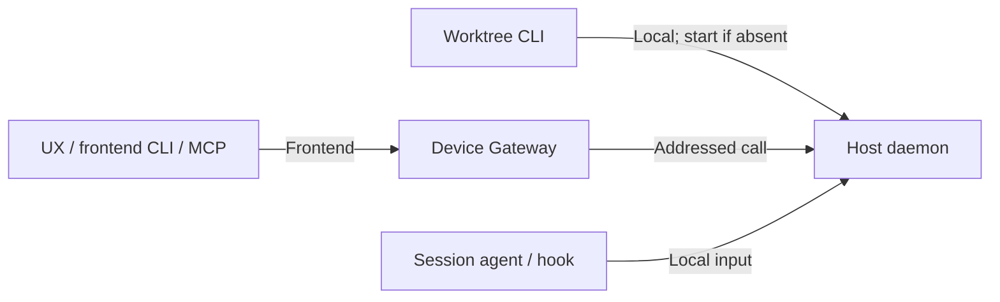

# Gateway, multi-host routing and CLI adapters: observable contracts

This is the DS09 slice of the [system Specification](../../2026-10-15-agentstudio-daemon.md). The separate [Requirements](../../user-requirements.md) authorize its meaning; the [domain definitions](../../domain-entities.md) and shared [operation interpretation](../../capability-contracts.md#shared-interpretation-of-an-operation) apply. Its [design brief](README.md) owns scope, inputs and unresolved work. Existing open gaps are preserved; this partition selects no new behavior.
The [initial profile](../../initial-profile.md) supplies the selected IP1–IP12 directions, including the corrected worktree-CLI class under S30. Remaining gaps concern their exact contracts and realization; they do not reopen the selected high-level choices.

## Which service does the caller use?

The worktree machine path does not pass through the Gateway. A Linux CLI can therefore use its Host while every user's device is disconnected. Frontend-only actions still use the Gateway and actual native owner. The Mac CLI remote worktree use case is required. Its direct connection versus local Host relay, credential and complete verb classification remain open.

## K2 — CLI entry and local installation branch

**Consumer / entities / basis:** CLI operator; E4/E7/E8/E21; U2/U4/U17, R1/R4. Existing verbs are worktree `new/list/remove/prune`, provider package `install/uninstall`, provider hooks, pane verbs, help/discovery and dot-separated RPC calls. Exact methods are the [fifty-seven-name inventory](../../research/extraction-survey.md:84).

When targeting its executing machine, worktree CLI acts on that machine's attached Host daemon under R12/IP3 on macOS/Linux, independently of Gateway availability. It starts or activates that local Host when absent. Authorized session work remains Host-local; UX/frontend CLI retains R1's Gateway route. Exact startup/readiness/failure, non-session discovery/authority and verb classification remain G1/G8/G12. The relayed Mac CLI `--host vm-1` use case is required; direct remote connection versus local Host relay and its credential remain open. Missing attachment cannot authorize an inferred target; failed activation cannot masquerade as successful submission. Formatting/help stay frontend observations; today's pre-IPC Git/package branches are baseline, not selected alternate backends. A remote path cannot silently become Mac-local, and exposure does not prove a supported effect.

For selected install operations, malformed preflight inputs are distinguishable from later partial writes. Reinstall convergence, owned-group removal and preservation of unrelated configuration must be stated per provider. Provider trust is separate from installing files. K15 covers installation/pairing; K7 covers hooks. Today’s local execution selects no standalone service-absent fallback. The Host-local route itself is selected by S16/R12.

**Proof:** real CLI invocation through the selected entry plus exact filesystem/provider-config effects at the named machine. For worktree machine work, exercise an absent local Host, its activation/readiness and the intended effect with every Gateway unavailable; activation failure must not report successful submission. A parser test, daemon-start receipt or exit code alone cannot prove prune or hook admission. Exact startup/admission and other CLI branch scope remain open; worktree local activation itself is selected.
