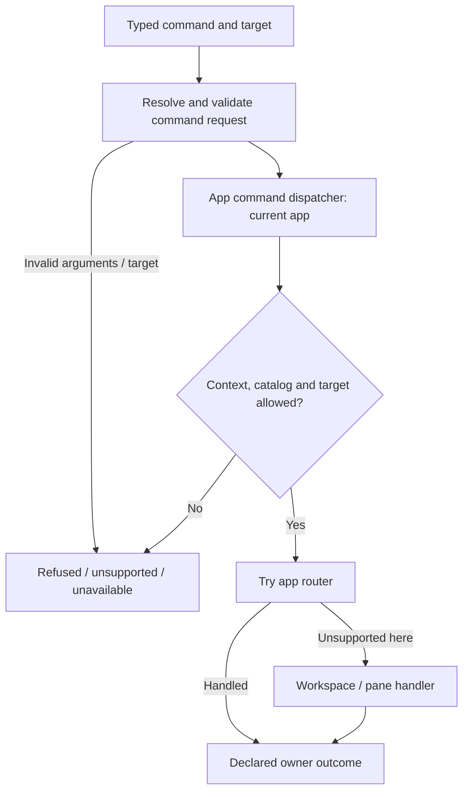

# Command identities, native dispatch and backend capability calls

**Every existing command identity needs a disposition. Its current dispatch tag does not decide whether its behavior belongs to a remote Host, a Gateway view or a native client.** Preserve the one command/display catalog while tracing the actual effect behind each identity.

The current `AppCommand` set has **154 identities**. Its existing [complete source inventory](../../research/evidence/2026-10-15-daemon-extraction-survey/command-surface-inventory.md) was compared with the current enum and both exhaustive IPC projection switches at AgentStudio `624300332f5e50f7bb8cbb9fc786d5e5b4a3d462`: no missing/extra identities or metadata mismatches. This checks enumeration/exposure/dispatch-mode, not every handler's behavior. [Identity source](../../../../../Sources/AgentStudio/Core/Actions/Commands/AppCommand.swift:7), [projection source](../../../../../Sources/AgentStudio/App/Commands/AppCommand+IPCProjection.swift:174).

The [154-command execution map](command-execution-map.md) follows those identities through their current typed branches to immediate effect/forwarding owners or refusals. It adds concrete current-result limits and proposed integration per consumer family; a full transitive or runtime audit remains separate.

## The current dispatch path

This is the **current native-app path**, before extraction. The [adapter](../../../../../Sources/AgentStudio/App/IPCComposition/AgentStudioIPCCommandAdapter.swift:60) parses allowed argument variants, resolves explicit targets and validates again before dispatch. The [dispatcher](../../../../../Sources/AgentStudio/App/Commands/AppCommandDispatcher.swift:161) checks mode/context/catalog/target; an addressed workspace window requires an actual current owner. It tries the app router, then the workspace/pane handler when appropriate. A handler result, native effect, backend effect and later presentation retain their separate boundaries.

| Current classification | Count | What the classification establishes | What it does not establish |
| --- | --- | --- | --- |
| All-channel exposure | 24 | The catalog permits that channel class | Caller authority, current availability or effect success |
| Debug/testing exposure | 130 | The catalog restricts the channel class | That the operation is shipped, available or selected for remote exposure |
| Headless dispatch mode | 143 | The typed programmatic path can be admitted under its context rules | App/window independence or a renderer-free Host implementation |
| UI-presentation dispatch mode | 11 | Presentation is a declared execution mode | Successful login, chooser result, rendered pixels or completed external action |

Exposure and execution mode are independent axes over the same 154 identities. They are not additional operation counts. The [DS10 command contract](specification.md#k6--command-catalog-targets-and-workspace-interaction) owns their observable interpretation.

## How commands consume the service design

| Actual behavior behind a command | Proposed realization | Data/view boundary to preserve |
| --- | --- | --- |
| Host Git/worktree/provider/context effect | Client command maps to the selected addressed Host capability; Gateway routes the request | Exact operation input/result and source/machine scope; copied rows do not execute the command |
| Session/terminal operation | Separate the Host execution/attachment/control operation from native focus/render behavior | Session, attachment, connection, controller and native view are distinct identities/lifetimes |
| Native focus, window, pane or local interaction | Existing native execution owner applies the selected client target | Current native residency/focus comes from that client, not from a Host SQL copy |
| Sidebar filtering/grouping/sorting or other prepared read | Gateway can prepare the selected semantic view using its scoped client inputs; Swift publishes/applies native values | Canonical membership/observations, view preferences and rendered rows are different state; exact preference scope remains DS02 |
| Combined backend and native workflow | Name both owners and their separate results rather than one generic success | Backend mutation may complete before native construction/presentation fails; compensation is operation-specific |
| Current unavailable, dormant or unsupported branch | Keep its disposition visible until product selection changes it | A case name cannot count as implemented behavior; a required future capability cannot disappear because today's wrapper refuses |

Those are realization rules, not 154 new RPC methods. The [eighteen-family acquisition/placement map](../11-operations-integration/capability-placement-map.md) binds each underlying domain to its owning specification. The future command-to-capability matrix must be based on actual execution owners, not name prefixes or the current mode tag. Native code keeps the one display/shortcut/command identity catalog; shared service DTOs do not import native view state or duplicate that catalog.

For example, the current headless shell's worktree-creation cases report unavailable, while the separate native creation coordinator calls the Git package and reconciles inventory. The [native creation path](../11-operations-integration/capability-placement-map.md#native-worktree-creation) and the required Linux fork capability still need their complete target contracts. Conversely, a native window/pane query must remain truthful about an absent client window rather than become a fabricated Host fact.

## Exact work still to bind per command

Each identity retains its current exposure, arguments, durable target and privilege/eligibility contract until the owning design explicitly replaces it. For selected service integration, bind its actual handler/data source, Host versus client effect machine, capability operation or native action, state/transaction, Gateway view dependency, cancellation/partial/unknown result and proof seam. The wire/schema home and native-target authority are still DS01/DS03/DS10 work.

Shared arrangement/viewing state, selected public subset and unavailable-feature selection remain owner decisions in their existing homes. Enumerating 154 identities supplies a coverage boundary; it does not settle those decisions or prove the commands work on the new topology. No product build, compiler, runtime, native interaction or Host/Gateway implementation is claimed here.
