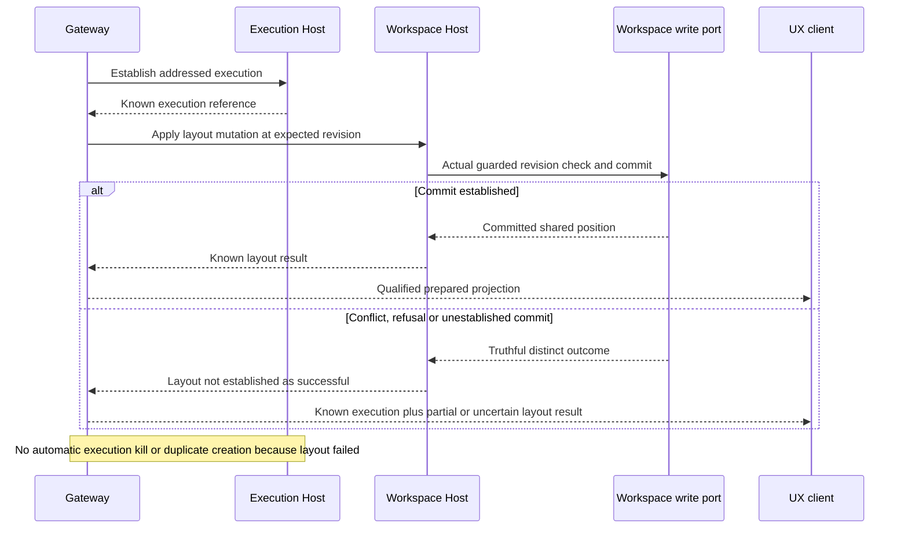

# Shared tabs and read state: proposed realization

The [initial profile](../../initial-profile.md) and U22/R17 require sharing across participating devices. This document proposes the structural realization of E25/E26; it does not reopen that outcome. **A designated existing Host owns shared workspace composition. Gateways receive qualified observations/copies and prepare views. Each IDE owns its actual native projection.** Read markers follow their subject's Host. The exact extra marker-family coverage is still being clarified through Sun.

This is a proposed design, not a schema migration, running service, selected wire format or complete Program Design. Current data declarations still need the [UUIDv7/key qualification](../02-data-ownership-replication/research/schema-prerequisites.md) before admission to a replicated unit. The [domain appendix](../../domain-entities.md) owns the entity meanings; these are their candidate code homes.

## Ownership and tradeoff

| Truth or operation | Proposed authoritative owner | What the Gateway and IDE do |
| --- | --- | --- |
| E25 shared workspace/tab/layout composition | One explicitly designated Host capability and data unit for that shared workspace scope | Client routes admitted mutations to that Host and prepares reads; IDE captures intent and applies its native projection |
| Git, execution, provider/context and annotation state referenced by the workspace | Their actual addressed Host owners, which may differ from the workspace authority Host | Client preserves qualified references and source validity; a layout reference grants no other Host capability |
| E26 completed-agent viewed state | Host owning the execution/binding subject, with a trusted shared-reader scope | Replace native pane identity as the shared subject; Client prepares status; IDE reports its declared viewing action |
| Annotation/notice/review-file marker families | Subject Host is the candidate owner where sharing applies; exact family scope still pending | Keep current source distinctions and explicit coverage; do not silently claim all families are already specified |
| Native window frames, residency, physical divider measurement, actual focus and view presence | Actual IDE/native owners | Supply qualified native inputs and apply prepared values; a phone-specific flattened projection cannot write itself back as a user layout edit |
| Pure view preparation and offered observations | Gateway's existing typed preparation owners | Capture qualified shared/Host/native inputs, compute off MainActor, check generation/source witnesses, offer changed outcomes |

This reuses Host-directed operations and Host-writer/Client-copy integration without a new server, Client-to-Client route or multi-writer copy. The cost is explicit: shared composition edits depend on its designated Host and actual writer validity. Other Hosts' independent operations and continuing executions do not acquire that dependency. IP1/IP4 govern last-known presentation and invalid-grant refusal; there is no automatic authority switch or writer transfer.

A Client-owned authoritative UI unit is not logically forbidden by the phrase “a copy is not another backend”; it would be an additional domain/role and require explicit routing, replication and availability contracts. The designated-Host proposal is chosen here because it fits the existing path with fewer new contracts. It is a Lead design choice, not a storage decision attributed to the owner.

## Explicit designation and identity

Every shared-workspace operation carries a declared workspace resource and its designated authority Host. It does not use the first connected/healthy Host, a current CWD, or a native window ID as that designation. A logical pane's content can reference an execution, repository, file/review product or other declared content on a different Host. Each actual backend operation still reaches and is admitted by that target's owner.

The shared workspace identity and native workspace/pane view identities have different types. Two native projections can materialize the same logical node without becoming the same E16 object. First-party generated resource/node identities follow UUIDv7; copied provider identifiers retain their upstream meaning. Old composite/noncanonical keys cannot be relabelled and exported as an eligible fleet-sync schema.

Persistent Host identity versus a running Host incarnation, restart/re-adoption and pairing remain the actual G3/G12 contract. A socket address, matching path or observed PID cannot supply that identity. This proposal must not freeze a live-process identifier into a durable reference and claim restart continuity without that binding.

## Candidate modules and typed boundaries

These are internal design shapes. They do not select serialized field names, numeric limits or a schema generator.

| Entity / boundary | Candidate home and shape | Construction and dependency rule |
| --- | --- | --- |
| E25 resource and logical state | `shared_workspace_contracts`: `SharedWorkspaceRef`, `SharedWorkspaceState`, `SharedLogicalPaneRef`, `LayoutRevision` | Owner-qualified references; logical node kinds remain distinct from `NativeClientTarget`; no SQL/native runtime types in these contracts |
| E25 mutation | Host `shared_workspace_runtime` and `shared_workspace_store` port: an admitted typed mutation plus its expected base revision | Runtime owns domain decisions and serialization; the actual storage adapter checks current writer validity and revision with the commit, rather than trusting an earlier network check |
| E26 marker | `read_marker_contracts`: `SharedReadScope`, kind-qualified `ReadSubject`, family-qualified `ReadCoverage` | Trusted reader scope comes from admission, not a name in payload. Provider/binding, annotation revision, review-file source and notice identity cannot be freely substituted |
| E26 mutation/capture | Subject Host's marker/domain owner and explicit storage or runtime port under its selected lifetime | Current transient versus durable meaning is retained unless explicitly revised; being shared does not require every marker to become a SQL row |
| Client capture and preparation | Existing `prepared_view_inputs`, copy/runtime read adapters, pure `view_preparation` and offering owner | Source-specific witnesses remain in integration capture, not engine handles in pure functions. Composite reads declare their positions; no coherent global multi-Host transaction is implied |
| Native projection | Typed Swift adapter plus current native target/application owners | Apply only to current kind-qualified targets and matching native/preparation generation; MainActor publishes/applies, it does not acquire/join/schedule domain state |

The E25 write result distinguishes **committed**, **known conflict**, **known refusal** and **unestablished commit outcome**. Conflict carries the authoritative revision/read route; refusal retains actual authority/capability/validation meaning. A transport error cannot be converted into a known noncommit. An unestablished attempt is not automatically resent. Each eventual public result must have a closed variant and one schema home under DS01.

The data unit has one designated writer. Several Clients submit operations to it; that is not several database writers. The initial concurrency rule is revision-checked application: one operation can commit from a base revision, while another stale-base operation receives conflict/current state. No client-wall-clock last-writer-wins or implicit whole-snapshot merge is selected. Domain mutation and copy-application progress remain separate outcomes.

## Portable selection and local navigation

The shared model contains portable tab membership/order, logical pane/content references and declared split/layout intent. Native geometry adaptation and actual focus remain per device under IP11. Device-local view navigation and Undo history are the proposed realization; the user-visible selection of an active tab or named arrangement remains an explicit G9 classification item, rather than an adopted per-device default. Selecting a named arrangement can change the logical published layout, so the current `local_tab_cursor.active_arrangement_id` placement is not evidence that this selection must remain local. Its final shared-layout selection contract must be explicit under G9.

Per-device Undo/navigation history does not grant permission to overwrite the shared graph with an old snapshot. A proposed inverse shared mutation goes through the same authority/revision boundary and can conflict after another device changes relevant state. Closing a native window can remove that device's projection; a requested shared tab/pane removal is a shared mutation. Neither is an execution-termination command.

Current table groups mix composition, cursor, Undo and native properties. The migration design must split by those meanings and preserve relationships/retention, not move all of `core.sqlite` or all `local_*` rows wholesale. This document authorizes no database rewrite or migration execution.

## Creating execution and placing its view are different commits

The execution Host and workspace authority Host can differ. Client composition sequences the two operations; the Host does not gain a new Host-to-Host forwarding path. Each actual Host admission remains in force.

[Full-size rendered diagram](shared-client-state.svg).

The placement branch begins only after a known execution result; an uncertain execution-creation result must instead remain uncertain and cannot invent an execution reference. A list/name match is not proof of which attempt created a process. No generic launch journal or replay mechanism is added here.

Even after the shared layout commit, actual native mounting/publication can fail or remain unestablished. That cannot erase the commit or be reported as completed pixels/focus. Likewise copy progress can establish that a committed shared version is readable without proving the initiating frontend received its reply. The existing central-renewal/write/copy sequence remains the data-plane reference.

## Read-marker detail and current limits

Completed-agent viewing is settled as shared. Its subject must follow the Host execution/binding and covered source generation, not a native pane alone. The current viewed instant is process memory; shared behavior alone does not promise restart durability or a new history log. Source coverage and a newer unseen completion remain distinguishable from an old viewing action.

Annotation saved-revision viewed state, review-file checkmarks and context-notice read are separate current families. The exact additional shared-family scope is with Sun. Their persistence must be traced where not already known; no current value is promoted to durable global history merely because SQL replication exists. Data arrival, reading a detail view, explicit mark-read, acknowledgement, ask settlement and output handled state retain their operation-specific meanings.

A marker's reader scope is not its frontend device or bearer token, and private-fleet pairing alone is not proof that every authenticated actor is the same user. Admission must bind the declared reader scope and subject privileges. Offline actions cannot silently become acknowledged shared writes; any local display overlay is explicitly provisional and not a hidden durable queue.

## Failure and proof seams

| Case | Required distinction / owning seam |
| --- | --- |
| Workspace Host unavailable, other Host alive | Last-known shared state marked under its actual coverage; shared mutations unavailable; independent target-Host work remains available under its own grant |
| Writer grant invalid | IP4 actual gate outcome, no copy write/grace/spool and no execution termination |
| Two Clients mutate the same base | One authoritative committed order or known conflict, no silently overwritten peer change |
| Phone adapts the visible layout | Native projection changes without a shared topology mutation unless the user issues one |
| Layout response lost | Commit versus response observation separated; no automatic replay or value-equality proof |
| Backend execution established, placement fails | Preserve the known execution and honest partial/unknown placement result |
| Native mount fails after commit | Shared state remains committed; native result is separately refused/failed/unestablished |
| Old viewing action arrives after newer subject state | Its family-qualified coverage cannot assert that newer unseen state was read |
| Subject/reader/Host kind is wrong | Typed admission rejects before an unauthorized mutation or cross-scope disclosure |

The later Verification Design must cover these actual boundaries with the current schema, storage, Host/Client and native adapters. Source tables or a codec self-roundtrip do not establish them. Numeric performance tolerances, exact public shapes, final reader scope and marker classes, stable identity bindings, schema migration and platform qualification remain explicit gaps.
