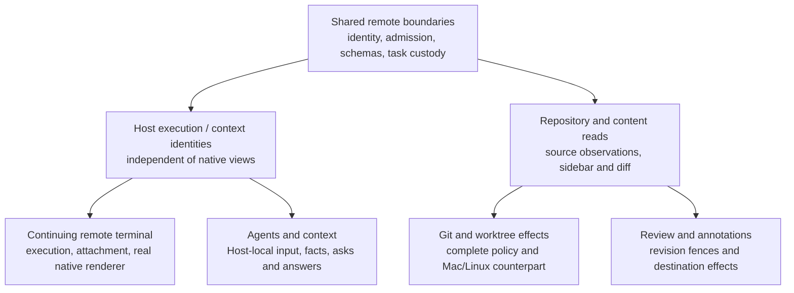
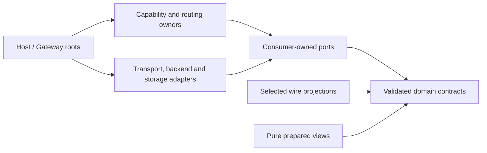
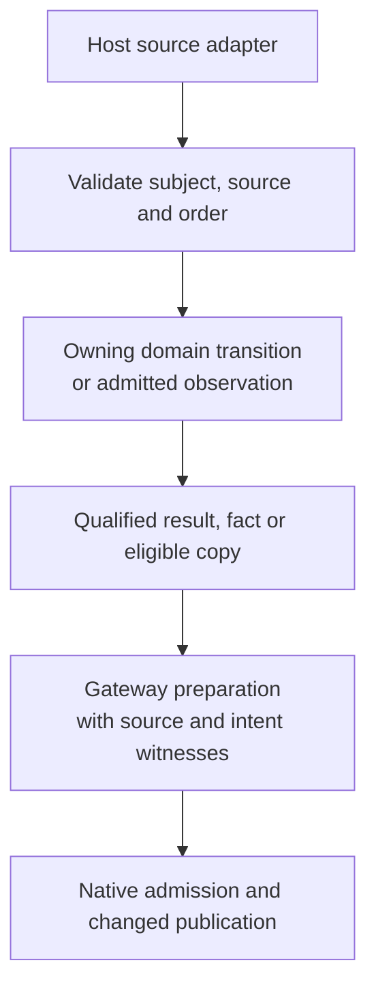

# Migrating AgentStudio into the Rust system

**Keep the whole product in view; detail the next useful slice.** The goal is to replace backend responsibilities from AgentStudio and `agentstudio-git` incrementally, connect their Rust replacements to the actual clients, prove the selected contracts, then retire each replaced path. A new daemon beside an unchanged app is not the migration.

Read this map first, then the [hierarchical feature checklist](migration-feature-checklist.md), [complete command and operation crosswalk](migration-operation-crosswalk.md), and [near-term remote-session slice](near-term-migration.md). The existing [eleven domain designs](../README.md) own the detailed contracts; this is the cross-domain migration view, not a twelfth subsystem or an accepted implementation plan. [U23 and its direct owner source](../../user-requirements.md) authorize the whole-map/detailed-near-term approach.

The [smaller migration branches](migration-detail-branches.md) name behavior hidden inside broad families: native preview/zoom/startup, browser memory, local action displays, private approval workflow, Git support/configuration, CLI syntax and retained unimplemented contracts. They refine the hierarchy without treating each helper as a new product feature.

Fleet, persistent bot servers and machine provisioning are orthogonal. AgentStudio is the person's console into an addressed working environment. The Host-deployment/workspace relationship is explicitly left open; this map selects neither one nor several workspaces per Host. That does not defer the required many-Gateways/many-Hosts model. Central writer-lease authority and its later server scope remain unchanged.

## The route through the work

These are prerequisite relationships, not dates or a promise that every row must finish before another can start. Terminal and agent/context work need the shared Host execution/context identities; Host-local integration does not depend on completing a native terminal viewer. Terminal delivery is the proposed first integrated route, while context and repository/Git work can progress independently once their own inputs are stable. The owner has not selected a release ranking. Shared composition/read marks, frontend/native adapters, storage and operations cut across these branches from their first use. They are not postponed wholesale to a final phase.

### What each depth contains

- **Whole map:** every known feature and operation has a home, incoming/outgoing paths, a contract destination, dependencies and a migration boundary. Open scope and unsupported behavior remain visible.
- **Next slice:** concrete entity shapes, owners, dependency ports, transitions, failures, proof seams, app integration and removal boundary. An implementation plan follows its ready design; it does not invent missing contracts.
- **Later slices:** cohesive capability groups with their interface dependencies and exact unresolved questions. No speculative schema/codec/toolchain choice is frozen merely to fill a box.

Mapping is one question; delivery is another. The [checklist](migration-feature-checklist.md) leaves every delivery checkbox open until its actual integration and proof boundary is met. A source census, Advisor agreement, document review or successful socket echo cannot check off a migrated feature.

## Subsystems before crates

The [existing entity bindings](program-design-workbench.md#bind-the-specifications-entities-before-naming-packages) remain the structural identity reference. The table below groups those homes by responsibility, without introducing new domain identities. Package/module names are existing design candidates; they are not declarations that every module needs a crate.

| Cohesive responsibility | Candidate existing design homes | What it owns / what stays outside | Main dependency |
| --- | --- | --- | --- |
| Execution and terminal attachment | `host_session_runtime`, `terminal_attachment`, `session_contracts` | Continuing execution and attachments/control; native renderer and logical workspace are outside | Backend/clock ports; selected terminal contracts |
| Provider evidence and session context | `provider_conversations`, `agent_binding`, `session_context` | Evidence/binding, ordered input and ask/answer transactions; not bot persona enrollment | Execution/context identity and guarded storage port |
| Repository discovery and observations | Host repository/source owners in DS05 | Filesystem/Git acquisition, membership and coverage; not native sidebar layout | Git/read/source ports and qualified observations |
| Git/worktree effects | DS05/DS06 Host capability owners and Git adapter | Git semantics plus explicit app worktree policy, cancellation/residue; not a second UI Git implementation | Git mechanics, filesystem/platform and exclusion ports |
| Finite source products | DS08 Host content/review owners | Qualified file/tree/diff descriptors and bounded bytes; not viewer pixels | Addressed source and content-custody contracts |
| Annotation workflow | DS08 annotation/source owners | Saved revisions, edit fences and output workflow; not clipboard/Finder effect itself | Source fingerprint, guarded transaction and destination-result contracts |
| Shared logical workspace and selected read state | `shared_workspace_runtime`, subject-owned marker modules | Selected shared logical state; not native focus/window presence or execution lifetime | Explicit authority designation, revision/read-scope contracts; exact cuts open |
| Gateway connection/routing and preparation | `gateway_service_identity`, `prepared_view_inputs`, `view_preparation`, offering owner | Addressed connectivity/interests and derived values; not another writer of Host truth | Service contracts, authorized reads/copies and native intent |
| Process/platform adapters | Host/Gateway composition and named network/storage/backend/native adapters | Runtime, transport, storage and platform effects at their boundary | Consumer-owned ports; roots inject implementations |
| Native UX interaction | Existing Swift/BridgeWeb hosting and command owners | Actual windows, focus, geometry, renderer, user input and native effects | Typed socket/read/command adapters; changed-value publication |

The final crate split follows independent dependency, platform, lifecycle or reuse reasons. Keep cohesive rules as modules until a real boundary justifies separate compilation. Avoid one crate per command/table/feature and avoid a catch-all bus, shared `types` crate or universal coordinator.

### Dependency direction

Arrows here are code imports, not network hops. Adapters also use their actual external libraries and selected wire projections. Pure domain/preparation code cannot import SQL rows, QUIC streams, Swift/AppKit or backend handles. Host core must not import Gateway runtime to share a transform. Shared replication types stay with their library and enter through data adapters, not duplicate position definitions.

[Router/agent-collaboration Rust conventions](research/router-rust-standards.md) and the [engineering realization](rust-engineering-design.md) constrain every slice: Tokio runtime owned by composition; tracked/cancellable/joined tasks; validated newtypes and payload enums; one boundary schema authority; private adapter errors translated to domain errors; workspace dependency/lint inheritance; `unsafe_code = "forbid"` in first-party code; responsibility-named modules. Existing `main.rs`/`lib.rs`/`mod.rs`/crate-root `error.rs` retain their conventional roles. The reference's crate list and version pins are not a dependency shopping list.

## Commands are requests to an owner

Preserve one user-visible command identity and its display/shortcut metadata. A command catalog entry is not permission, readiness or an execution result. The current [154-command map](../10-swift-client/command-execution-map.md), [57-method map](../01-service-contracts/rpc-operation-map.md) and [Git operations](../05-git-discovery/git-operation-map.md) overlap but are not interchangeable catalogs.

| Command class | Proposed route / owner | Result that must remain distinct | Where its detailed mapping lives |
| --- | --- | --- | --- |
| Frontend Host capability | UX/frontend CLI/MCP → Gateway → addressed Host admission/capability | Rejected input, refused authority, operation result and uncertain external effect | DS01 plus DS04/05/06/07/08 |
| Machine-local worktree CLI | CLI → executing machine's attached local Host daemon on macOS/Linux; start or activate that local Host if absent | Daemon activation/readiness versus command admission, actual Git/filesystem effect and partial/unknown outcome | DS05/DS06/DS09; R12/IP3; no Gateway dependence |
| Eligible Host-local session input | Attached-machine authorized CLI/hook → local Host admission | Local reachability versus valid session scope; received versus admitted/committed | DS03/DS07; no Gateway dependence |
| Shared composition mutation | UX intent → Gateway → explicitly designated workspace authority | Shared commit/conflict versus native application; other Host execution remains separate | DS02/DS10 |
| Native interaction/effect | Local action at native owner, or admitted external route via Gateway to addressed UX client | Accepted/queued versus actual focus, rendering, clipboard/file/editor effect | DS10 and DS08 destination contract |
| Gateway-owned read/interest | Frontend → Gateway's authorized routing/preparation/subscription owner | Cached/last-known/qualified read versus current Host liveness or successful mutation | DS01/DS09 |

The [operation crosswalk](migration-operation-crosswalk.md) supplies every currently recorded identity with a source and migration group. It does **not** blindly publish every SDK requirement as an RPC/MCP tool. Compound commands retain their parts: create execution, change logical layout and mount a native view can have different owners and different failure outcomes.

### Preserve client contracts and name the selected changes

Internal restructuring preserves the selected client-facing behavior. Some target differences are already required by the owner/profile; they must be implemented as those explicit contracts, not described as unchanged current behavior.

| Boundary | Current-to-target distinction | Governing direction / remaining work |
| --- | --- | --- |
| View close and execution | Current local cleanup can retire an execution after pane/Undo references disappear; target view close detaches while execution continues. | R5/R6 and U14 select that change. Preserve graph/Undo/history guarantees separately and retire old destructive work; identical `pane.close` spelling does not make the effect identical. |
| Machine-scoped worktree CLI | Current worktree entry runs before IPC and operates without the app. Target worktree machine work calls its attached local Host daemon on macOS/Linux, independently of Gateway availability. | IP3 selects local Host start/activation when absent. Preserve help/output/exit and actual Git/filesystem semantics; finish admission, readiness/failure and packaging. UX/frontend CLI is a separate Gateway class; Mac CLI remote worktree use is required; direct connection versus local Host relay and its credential remain open. |
| Shared composition and viewed state | Current local graph/Undo writes do not implement cross-device conflicts; the target shares portable tabs/layout and selected viewed state. | R17/IP11/IP12 select sharing. Exact subjects, concurrent edits, inverse/Undo failure guarantee and extra marker-family scope remain explicit. Native focus/geometry is not automatically shared. |
| Terminal methods and subscriptions | Current terminal results are pane/native metadata and current event delivery is connection-bound. Host observations, no-view behavior and recoverable interests require explicit shapes/lifetimes. | R5–R7/R10/R13/R16 constrain the result. Select the facade, variants, positions and versioning before changing a client contract; one method name or a new cursor is not compatibility proof. |
| Other feature cutovers | Current command/display identities, flags, retained refusals, nested result/effect boundaries and selected data survival remain their reference. | No generic “better success” result, removed native control, newly working dormant verb or weakened retained-data guarantee follows from moving implementation to Rust. A further observable change needs its own governing direction. |

## Observations are not commands

This is a family of paths, not a new global bus. Terminal byte streams and native ingress use their own boundaries. A database commit, public event, UI invalidation, delivered frame and actual user action are separate observations.

| Incoming family | What the Host/source owner does | Contraction / ordering rule | What reaches the client |
| --- | --- | --- | --- |
| Filesystem and Git refresh | Acquire and validate scoped membership/status/content; record source coverage | Coalesce refresh demand only where replaceable; do not drop required mutations or coverage transitions | Qualified repository/file/diff views with partial/stale/unavailable distinctions |
| Provider lifecycle/evidence | Validate provider/session/binding and reduce admitted evidence | Preserve the source's required ordered facts and replacement fences | Prepared status/detail; completion and actual viewing remain separate |
| Agent title/line | Admit current writer generation and ordered number | Latest state may contract only after the actual writer/order fence | Changed qualified title/line, not every raw callback |
| Notice/ask/answer | Admit and commit the operation's workflow plus required private checkpoints | No generic debounce or latest-wins replacement of these operations | Counts/detail/results under their actual settlement and read contracts |
| Annotation and review | Keep exact source/revision/edit fences and output membership | Saved edits/mutations are operations; refresh invalidation is separately scoped | Prepared review/editor state and immutable output content; external effect separately observed |
| Terminal bytes/control | Backend attachment preserves VT/input order and control authority | No arbitrary byte loss or uncertain-input replay; bounded slow viewer handling | Raw ordered terminal lane plus typed attachment/control outcomes |
| Faithful copy apply | Data runtime applies its actual atomic rows/position/hook boundary | Invalidates eligible derived readers; refill is not a fresh business command | Qualified read inputs with copy/source witnesses; no native effect replay |
| Native client facts/intent | Actual client owns focus/geometry/visibility/edit buffers and user actions | Contract before a MainActor hop; domain joins/scheduling stay off it | Declared preparation intent or admitted operation; MainActor publishes/applies values |

The [typed-input map](../02-data-ownership-replication/research/typed-input-processing.md), [prepared-view design](../09-gateway-cli/prepared-view-boundaries.md), [count example](../07-agents-context/context-count-preparation.md) and [storage placement](../02-data-ownership-replication/storage-placement-design.md) supply the details. A bus is useful for scoped committed facts; it is not the command executor, transaction coordinator or universal delivery policy.

## Strangle one capability at a time

1. **Pin its contract and predecessor.** Trace the actual app and Git-package paths, including refusal/partial behavior. Decide the selected supported outcome before altering it.
2. **Implement at the new owner.** Rules, task custody and effects move behind the existing design's narrow ports. Preserve required source transaction predicates; improve internal structure deliberately.
3. **Connect real consumers.** Replace that capability's backend entry in AgentStudio/CLI with the declared Gateway/Host/native path. Any temporary facade has one named boundary, owner and removal condition.
4. **Prove the same selected outcome.** Compare real source/effect/read/native behavior, failure and target isolation on the supported profiles. Old method names or self-roundtrips are not parity proof.
5. **Cut over and retire.** One selected production owner for the migrated capability. Remove the old backend route and its obsolete scheduling/cleanup only after the replacement proves the contract. Unmigrated capabilities retain their existing owners until their own cutover.

This permits temporary migration seams, not indefinite dual writers or a hidden direct-Host fallback. It does not choose a flag system or compatibility bridge. The ready slice's plan must make dispatch selection, import/data handling, rollback limits, joined old tasks and removal precise. Native display/catalog code that still has a job is retained, not deleted merely because the backend moved.

## Near-term focus and later branches

The proposed next integrated spine is [remote session and terminal attachment](near-term-migration.md): addressed Host, session/attachment/control contracts, actual Swift socket path, backend adapter and native renderer. It is a bounded design focus, not an owner-approved release promise. No full annotation schema or workspace cardinality decision is needed merely to study that path; any state/authority boundary it actually uses must still be settled.

- **Then or in parallel under stable contracts:** provider/context input and fact ownership; repository discovery/status and finite content.
- **After the relevant reads/source contracts:** Git mutation/fork; review/annotation/output workflows.
- **Across all branches from first use:** identity/permissions, selected state lifetime, observation validity, central writer admission where required, native client mapping, Mac/Linux counterpart and actual version/packaging boundaries.
- **Shared-state expansion:** exact portable tabs/layout and selected read-marker bindings, schema/audience/refill and concurrent edit behavior. This uses earlier capability identities, not a second backend inside the Gateway.
- **Broader qualification:** Mac+iOS, multiple Macs, multiple Hosts, CLI/MCP surface, startup/shutdown/update and measured workload. These obligations shape contracts early; a narrow demonstration does not close them.

The exact Host deployment/workspace association, extra marker-family scope, mandatory performance workload and still-unmade public/data profiles stay explicit. Internal layout/crate choices that preserve settled outcomes belong to the Lead. No unrelated Fleet/Tool Portal/bot deployment is a prerequisite.

## What the map deliberately cannot claim

The 42 feature leaves, 18 surveyed families and overlapping operation catalogs are a finite coverage baseline. The crosswalk checks that none of **those recorded items** lacks a destination; it cannot prove the repository has no undiscovered behavior. Near-term source walks and independent comparison must add newly found branches to their existing feature home before cutover. Unavailable/debug/retained code gets an explicit disposition rather than disappearing from the denominator.

The [near-term map](near-term-migration.md) names the next contract closures. It is not a ready implementation plan. The separate Verification Design and actual integration/platform/contract evidence remain required for the slice being built. Far-future leaves stay high-level so we can start the agreed next slice without inventing every future internal detail.
