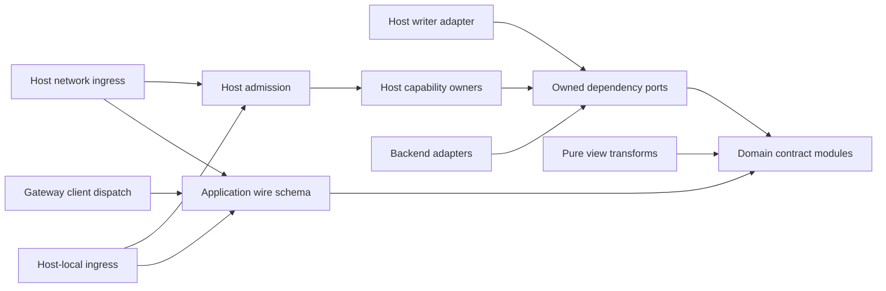
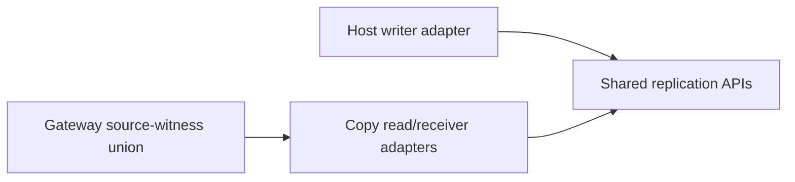
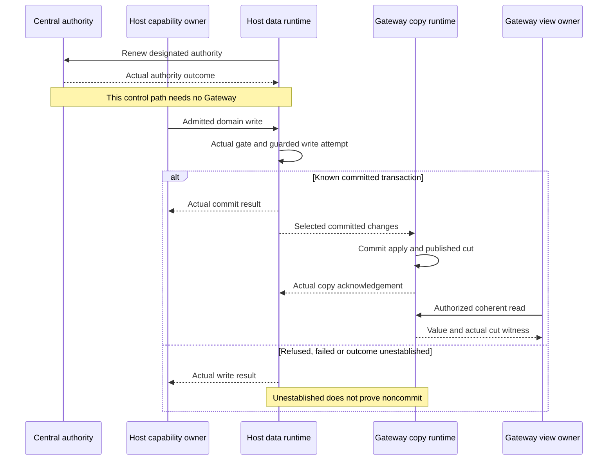
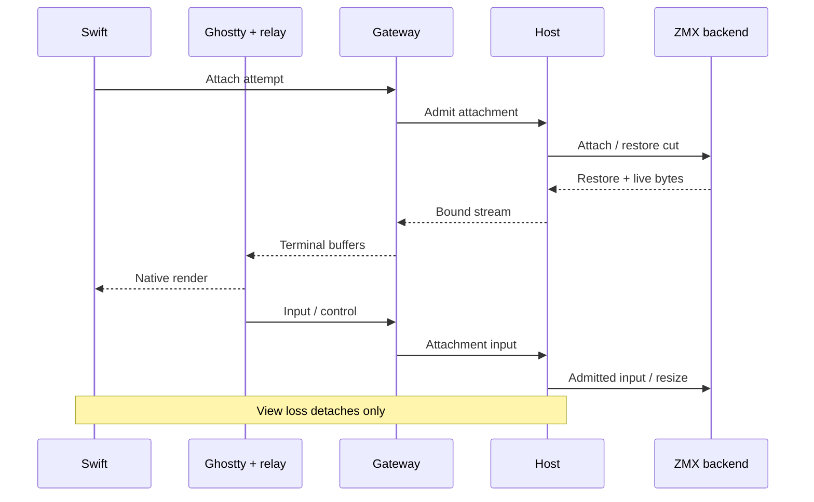

# Program Design workbench: how AgentStudio can consume the Rust services

S28 requires the Gateway on macOS and iOS. S32 now selects a separate Mac service and embedded iOS runtime, native control through Mac UDS or selected iOS FFI, and direct browser HTTP/WebSocket content. The [bounded transport realization](../../increments/00-qualification/bridge-gateway-transport/program-design.md) owns that adapter split. Its [native safety check](../../increments/00-qualification/bridge-gateway-transport/native-binding-safety.md) leaves the ordinary UniFFI candidate incompatible with U10 despite a green lint. Runtime startup, instance trust and actual suspension/reconnect still need qualification; Host execution remains independent.
This is the Lead's concrete structural proposal, grounded in the current [Requirements](../../user-requirements.md) and [Specification](../../2026-10-15-agentstudio-daemon.md). The [delivery explainer](../../delivery-increments.md) is a non-governing proposal for the owner's requested MVP/integration discussion; its labels and order establish no priority or implementation sequence here. A `gap` below is a real contract/design dependency, not an implementer default. Module names illustrate responsibility homes; they do not create a crate for every box.

The [initial profile](../../initial-profile.md) now fixes shared tabs/layout/read marks, one controller, corrected worktree local-Host routing/activation and the stated offline/writer/safety/platform directions. [Shared client-state realization](../10-swift-client/shared-client-state-design.md) proposes a designated existing Host for E25 workspace composition and the subject Host for E26 markers, with Client preparation and native projection separate. Exact marker-family scope, identity, schema and sync/failure contracts remain incomplete; these are not questions whether the already-selected sharing is wanted.

Start with the [capability acquisition and placement map](capability-placement-map.md) to see how each of the eighteen surveyed source families gets data, processes it, crosses a state/effect boundary and reaches a client. This integrated workbench then binds the entities and common interfaces; neither view replaces the detailed operation contracts in their owning folders. The [context-count realization](../07-agents-context/context-count-preparation.md) makes one family concrete: one domain classification implementation, qualified per-context totals and Gateway membership composition, without a new copied count table.

The [Gateway prepared-view excerpt](../09-gateway-cli/prepared-view-boundaries.md) makes one portion concrete: current consumer fields and transformations, proposed typed source/view interfaces, native application and failure boundaries. Its [internal capture/candidate contracts](../09-gateway-cli/prepared-view-boundaries.md#internal-capture-and-candidate-contracts) and [view lifetime](../09-gateway-cli/prepared-view-boundaries.md#view-preparation-lifetime) distinguish source reads, pure preparation, stale-completion admission, offered values and actual native application. It links the sidebar, session/context and Bridge read catalogs and preserves their unmade policy/schema choices.

The [storage-placement companion](../02-data-ownership-replication/storage-placement-design.md) and [complete table matrix](../02-data-ownership-replication/storage-placement-matrix.md) bind the current census to proposed owners, transaction groups, private/copy boundaries and explicit mixed-row holds. They do not select a physical database count or admitted export schema.

The [migration map](migration-map.md) connects these responsibilities to the [feature tree](migration-feature-checklist.md), [command/operation lookup](migration-operation-crosswalk.md) and [near-term slice](near-term-migration.md). It is a rolling migration view, not a selected complete implementation sequence.

## The technical crux

Build one authoritative implementation of a capability in the Host, with thin transport and client adapters. The Gateway is the route to that owner and a place for connection/subscription/read-model work; it is not a second Git/session/context implementation. Native Swift owns the actual display/input and declared native effects. Keeping these jobs separate matters more than picking the smallest serializer.

There are three viable integration directions to compare:

| Direction | Gain | Cost / payer | Status |
| --- | --- | --- | --- |
| Separate Rust Gateway with socket client | Process isolation, one Mac service reusable by Swift/CLI/MCP, required frontend route | Wire/schema/framing and process lifecycle proof; service/app packaging | Selected service boundary; exact protocol/adapters remain to choose |
| iOS Gateway hosting inside the application lifecycle | Embedded engine with selected native binding and direct browser adapter under S32 | Runtime startup, generated/native safety and suspension/reconnect require actual qualification | Role and embedded placement are selected; safety-compliant binding and runtime behavior are not realized |
| Keep backend behaviors in Swift and forward terminal bytes only | Smaller first terminal experiment | Does not satisfy full Host autonomy/Git/agent scope; can accidentally make Swift the backend again | A bounded experiment only, not the full target |

Recommended design direction: preserve the separate Gateway, give each Host capability one owner, and keep native clients behind one validated socket schema authority. IP2 selects one controller; restoration, handoff and exact effect/authority contracts still precede final wire shapes. No FFI bridge is required for the separate-process socket boundary.

## Bind the Specification's entities before naming packages

The Specification defines E1–E26. This table binds them without changing their meanings. Rust module homes are candidate **new** homes; native owners named existing remain current code. Wire names are schematic fields, not a selected public schema. E25/E26's detailed new realization and remaining gaps are in the linked shared-state companion.

| Entity | Semantic owner / candidate code home | Boundary shape and schema home | State disposition / exact gap |
| --- | --- | --- | --- |
| E1 execution session | Host session owner; `host_session_runtime` (new); ZMX keeps backend execution | Host-qualified `SessionId`, backend reference, declared execution observation; `session_contracts` (new) | Live execution plus selected retained registry; G3 identity/re-adoption/persistence gap |
| E2 terminal attachment | Host attachment/control owner; `terminal_attachment` (new); existing native surface consumes its view | `AttachmentId`, addressed session, declared view/control state; `terminal_contracts` (new) | Live association; replacement, controller/resize/focus G4 gap |
| E3 connection | Local/network transport adapters; `connection_runtime` (new), not session owner | `ConnectionId` and connection-lifetime values in `connection_contracts` (new); authenticated context is separate | Runtime-owned, not persisted as execution identity; connect/close cannot terminate E1 |
| E4 frontend request attempt | Capability caller/handler plus Gateway routing; `operation_attempt` (new) | Attempt/correlation, typed target, operation-specific input/outcome; `operation_contracts` (new) | One attempt; retained reconciliation/duplicate contract G8 gap; no universal journal |
| E5 Host capability | Host application service per domain; `capability_catalog` (new) | Selected method and closed result definitions in `operation_contracts` / `protocol_contracts` (new) | Contract metadata; exact public subset/version G1/G8 gap |
| E6 frontend device | Client identity/admission integration; `client_admission` (new) | Device-reference meaning in `client_identity_contracts` (new); identity/enrollment fields G2/G8 gap | Selected retained identity plus runtime admission; device is not a socket count or payload-provided trusted name |
| E7 repository | Host Git/discovery owner; `repository_operations` (new); pinned Git library is baseline | `HostId` + repository reference in `repository_contracts` (new); path/name representation G7 gap | Git truth plus retained membership/observations as selected |
| E8 worktree | Host Git/worktree owner; `worktree_operations` (new) | Host-qualified worktree/association in `worktree_contracts` (new); registration/directory effects separate | Git/filesystem truth; replacement/incarnation G3/G7 gap |
| E9 provider conversation | Host provider integration; `provider_conversations` (new) | Provider-qualified opaque conversation value in `agent_contracts` (new), not an execution-session ID | Selected retained evidence; upstream IDs are not rewritten to UUIDv7 |
| E10 agent binding | Host transactional admission; `agent_binding` (new) | Binding generation + provider provenance + E1 context; `agent_contracts` (new) | Retained/admitted current association; binding checks stay in the write transaction |
| E11 context message | Host context service; `session_context` (new) | Scope, message ID, notice/ask and settlement in `context_contracts` (new) | Retained workflow; exact audience/history G8/G9 gap |
| E12 annotation session | Host annotation workflow; `annotation_session` (new) | Reviewed source/comparison identity and revision in `annotation_contracts` (new) | Retained session; shared edit/recovery profile gap |
| E13 annotation thread | Host annotation workflow; `annotation_threads` (new) | Thread identity, anchor and lifecycle in `annotation_contracts` (new) | Retained; source refresh/currentness preserves its actual boundary |
| E14 annotation message | Host annotation workflow; `annotation_messages` (new) | Message identity/saved revision in `annotation_contracts` (new); draft/edit fence is distinct | Retained saved revision; native editor draft is not the saved record |
| E15 output attempt | Host annotation workflow; `annotation_output` (new); actual destination owner remains native/client or named machine | Immutable attempt/membership/content and effect result meanings in `annotation_output_contracts` (new) | Retained workflow + external effect; delivery/finalization partial/unknown is explicit |
| E16 client view target | Existing `MainWindowController` / `BridgePaneController` and their native composition; portable arrangement owner **gap** | Existing `IPCHandle` / `IPCTargetSelector` are the source baseline; `client_view_contracts` (new) owns selected cross-process target values | Live native state plus selected retained intent; DS02 arrangement-home decision |
| E17 principal | Each actual admission boundary; `principal_admission` (new), including native effect admission | Validated caller/scope/binding in `authority_contracts` (new); private credential material is not a DTO | Runtime admission with retained credential state as selected; G8/G12 gap |
| E18 authority grant | Capability authority integration; `capability_authority` (new); central owns database-writer leases separately | Privilege/target/data scope in `authority_contracts` (new); lease adapter reuses the shared engine's actual grant types | Retained/runtime as selected; no all-powerful Gateway principal or ordering-claim substitute |
| E19 subscription | `gateway_client_interest` / `host_source_delivery` (new), each owning its own state | Subject/filter/source-position and delivery meanings in `subscription_contracts` (new) | Desired interest and actual delivery distinct; resume/retention G6/G8 gap |
| E20 finite content transfer | Host product/content owner; `finite_content` (new); native/worker consumes bytes | Content descriptor, kind, currentness, range/length/digest, lease; `content_contracts` (new) | Bounded live/cached transfer; binary bytes not huge control DTOs |
| E21 provider installation | Host `provider_installation` (new); existing `CodexPackageInstaller` is the current CLI mechanics baseline | Provider/resource pairing, plan/result and partial-effect values in `provider_installation_contracts` (new) | Files/config truth; not provider trust or credential revocation |
| E22 scoped observation | Fact source / derived-view owner; `host_fact_observation` / `prepared_view_owner` (new) | Portable meaning in `observation_contracts` (new); internal source-witness union in Gateway `prepared_view_inputs` (new), with the integration edge below | Retained input versus cached/derived read; known partial and unestablished coverage cannot claim complete |
| E23 Host service instance | Host composition/lifecycle; `host_service_identity` (new) | Host identity/platform/capability/pairing values in `service_contracts` (new) | Install/clone/restore identity G3/G8/G12 gap; hostname alone insufficient |
| E24 Gateway runtime instance | Gateway composition/lifecycle on macOS/iOS; `gateway_service_identity` (new), with Mac process hosting and a separately qualified mobile startup/lifecycle port | Gateway identity/attached-Host map in `service_contracts` (new) | Runtime role distinct from UX views; iOS suspension/termination profile is unqualified; shared composition is separate E25 Host-owned state |
| E25 shared workspace composition | Proposed designated Host `shared_workspace_runtime`, through `shared_workspace_store` | `SharedWorkspaceRef`, typed logical nodes and `LayoutRevision` in `shared_workspace_contracts` | Canonical shared composition; Client copies/prepares and IDE projects. Actual authority designation, identity, schema/UUIDv7 import, layout selection and conflict/Undo contracts still need completion |
| E26 shared read marker | Subject Host's actual domain owner: provider status, `annotation_messages`, `session_context`, and review-file owner if selected | Trusted `SharedReadScope`, qualified `ReadSubject` and family `ReadCoverage` in `read_marker_contracts` | Preserve selected transient/durable meaning; exact extra marker-family scope is with Sun. No native-pane-only key or generic writer bypass |

Every domain ID gets its own validated type even if represented by UUID bytes. Newly generated application identities follow UUIDv7; imported provider identities and SQL integer/composite keys retain their own semantics. Deserialization checks shape, then semantic constructors validate meaning. Domain errors are closed variants and translate transport/storage errors at their edges.

These are module/type homes, not one new crate per row. `protocol_contracts` owns the selected serialized DTO/schema projections of these domain values. Writer-private SQL row shapes stay in their actual storage adapters. Existing native bindings are grounded in [window hosting](../../../../../Sources/AgentStudio/App/Windows/MainWindowController.swift:14), [Bridge hosting](../../../../../Sources/AgentStudio/Features/Bridge/Runtime/BridgePaneController.swift:28), [target parsing](../../../../../Sources/AgentStudioProgrammaticControl/IPCTargetSelector.swift:10) and [installer mechanics](../../../../../Sources/AgentStudioIPCClientCore/AgentPackage/CodexPackageInstaller.swift:19).

## Proposed composition and dependency direction

Composition owns these components; an indented child is constructed/supervised by its parent, not a network hop:

```text
Host composition
├─ Network ingress
├─ Host-local ingress
├─ Caller/target admission and capability owners
├─ Backend adapters
└─ Host data runtime
   ├─ Authority client and renewal
   ├─ Guarded writer adapter
   └─ Capture and independent copy delivery

Mac Gateway composition
├─ Client socket and Host-network adapters
├─ Routing and addressed native-client dispatch
├─ Copy receiver integration
└─ Qualified view capture, pure preparation and delivery
```

The two dependency views below separate application contracts from shared replication integration. The Host writer adapter appears in both because it implements an application storage port and uses the shared engine APIs; it remains one module in the ownership tree.



[Standalone rendered diagram](assets/program-design-1.svg)

The replication integration dependencies are shown separately so shared arrow trunks cannot imply that capability rules import the replication engine:



[Standalone rendered diagram](assets/program-design-2.svg)

Arrows are code dependencies, not network sends. Composition roots inject concrete adapters. Core rules do not import Swift/AppKit, QUIC sockets, libgit2 or SQL row types. Do not make each box a separate crate by default; split where independent dependency/lifecycle/reuse reasons justify it. One application schema authority supplies application messages; shared-engine protocol types retain their external authority and are adapted rather than hand-copied.

`host_network_ingress` and `host_local_ingress` are separate adapters inside the Host ingress group. Both depend on the selected operation/wire contracts and invoke `principal_admission` before their actual capability owner; local reachability is not an authority grant. `gateway_client_dispatch` depends on client operation contracts and the admitted live-client registry, not AppKit or Host SQL.

E22's internal tagged `SourceReadWitness` belongs in `prepared_view_inputs`. Its copy variant reuses the actual shared-engine read-position types through `replication_read_adapter`, which may depend on the shared receiver/protocol APIs. Pure `view_preparation` functions receive the admitted family data and policy/time inputs, not engine or SQL types. The Gateway wrapper carries the captured witness alongside the pure result and checks it before offering. Portable observation DTOs remain in `observation_contracts` / `protocol_contracts`; this does not duplicate the engine's position schema.

| Candidate crate/module family | Its one job | Why it changes |
| --- | --- | --- |
| Domain contracts | Validated Host/session/repository/context identities, semantic values and closed domain results | Domain meanings/invariants |
| Protocol contracts | Selected wire DTOs, schema/version/capability admission, Swift-derived/validated shapes | External contract/pairing changes |
| Host application owners | Session, agent/context, repository/worktree, annotation/content operations | Domain behavior and transaction/lifecycle policy |
| Backend/storage adapters | ZMX private IPC, Git mechanics, OS process/peer/filesystem and selected SQL access | External engine/platform/storage realization |
| Gateway core | Attachments to Hosts, caller routing, delivery subscriptions and eligible prepared reads | Multi-Host/client delivery and currentness needs |
| Transport adapters | Byte framing, codec, authentication channel integration, local/network I/O | Protocol carrier implementation |
| Executable composition | Configuration, service startup, dependency wiring and owned shutdown | Deployment/lifecycle integration |
| CLI/MCP adapters | Parse/format/expose the intentional supported operation subset | Human/tool presentation and discovery |
| Shared fleet-sync integration | Consume shared protocol/session/writer/lease/receiver rules through their real APIs | Selected state replication and authority-hosting integration |

No default `utils`, `types`, `sync` or `db` bucket owns these jobs. Conventional `lib.rs`, `main.rs`, `mod.rs` and crate error homes stay conventional. Files should name the behavior they own. Exact repository/crate publication and dependency pins remain DS11 design choices; the generic shared library is not permission to import Router product code.

Forbidden target edges: Swift performing Host Git/context mutations behind the service; Gateway updating Host truth through copied SQL rows; Host depending on a Mac to admit authorized session input; native UI atoms doing SQL/derivation/retention; one domain importing another domain's private storage internals. Injection is at the real backend/storage/clock/transport boundary, not every function.

## Lease renewal, writer gating and selected read copies

The [candidate shared-library integration](../02-data-ownership-replication/research/fleet-sync-consumer-fit.md) supplies the existing research basis. The following binds its responsibilities to roots; it selects no dependency adoption, database partition, lease duration/outage rule or central-server implementation.

| Responsibility | Custodian and placement | Boundary |
| --- | --- | --- |
| Authority binding and renewal | Host `host_data_runtime` owns `host_authority_client` for each selected database unit | Direct Host↔designated central authority port, independent of every Gateway connection. Exactly one designated authority binding per unit; G13 supplies setup/validity policy |
| Guarded authoritative writes | Host `replicated_writer_adapter`, injected at the actual capability storage port | Selected writes enter the shared engine's real gate/transaction path. Required binding/context/order predicates remain inside that same actual write; the Gateway cannot preflight them into validity |
| Capture and per-copy sending | Host `host_replication_runtime`, owned beneath Host data runtime | Committed selected changes feed independent copy delivery. No Gateway acknowledgement is a prerequisite for reporting the Host domain commit; bounded retention/refill remains its declared contract |
| Copy apply and publication | Mac Gateway `gateway_copy_runtime`, with one admitted receiver per selected source/unit | Shared receiver apply commits rows/position, hook SQL and admitted follow-up intent before acknowledging that boundary. External follow-up has its own outcome. Published copy/cut supplies `replication_read_adapter`; arrival alone is not ready-to-serve projection state |



[Standalone rendered diagram](assets/program-design-3.svg)

These are logical application/control/data edges, not a selected connection opener or codec. The library's current transport is not proof it plugs into the chosen Gateway↔Host carrier; DS01/E3/E5 must qualify the adapter and session behavior. Authority availability and actual grant validity are different inputs; the commit branch runs only after the real gate admits the write under its selected G13 profile. The central role is a separately injected authority port now and a later server, not a hidden Gateway issuer. Removing every Gateway leaves Host renewal, Host-local input and the guarded writer path composed. No grace, private spool or process-termination rule is invented here. Selected copies remain readers and never replay commands or native effects.

The known-commit branch illustrates one possible observation order. The domain reply, independent per-copy progress and an authorized copy read do not wait for one another's network acknowledgement by convention; their actual completion/currentness contracts stay separate. A copy read still requires its actual committed/published cut, not partially applied rows. A write whose result is unestablished may nevertheless have committed and later replicate; its result must not suppress capture or authorize blind retry.

## The terminal integration path

**Current:** app terminal pane → surface startup preparation → Ghostty surface command → local `zmx attach` → ZMX starts/attaches execution. `createPaneSession` presently creates the directory/handle only. Current pane/Undo cleanup can later retire a backend after native attachments disappear. These are separate mechanisms from ZMX's ability to have zero clients.

**Proposed remote path:** selected client view → Ghostty PTY-facing relay → Gateway terminal attachment → remote Host terminal adapter → existing ZMX session IPC/PTY owner. Control requests use the typed service contract; the terminal lane preserves binary continuation and the selected return path for input/query replies. A local PTY-facing relay is an adapter for Ghostty's existing command-backed terminal surface, not another always-running application service. Its exact realization is an E1/native-leg feasibility question.



[Standalone rendered diagram](assets/program-design-4.svg)

This path does not add a second terminal emulator on the Host by assumption. E1 must show whether current/newer ZMX state restoration is sufficient; if not, that evidence decides the smallest backend extension. A terminal byte relay alone does not supply complete renderer-free title/CWD/activity facts. Those sources and retained meanings must be bound separately under DS04/DS07.

The [execution and fact-source design](../04-terminal-runtime/execution-lifecycle-design.md) supplies the separate create/list and Host fact paths. Creating E1 invokes a Host-owned backend-establishment port without creating E2 or a Ghostty surface. `host_terminal_facts` owns the selected fact inputs and retained observation path for the execution lifetime; native render callbacks are not its sole producer.

## Interface shapes to settle

These are proposed semantic boundary shapes, deliberately independent of codec. Optionality/discriminants must be frozen only after the referenced contract profile is selected.

| Boundary | Proposed shape / invariant | Exact unresolved field or policy |
| --- | --- | --- |
| Frontend → Gateway request | Attempt/correlation, typed operation, kind-qualified target; Host context required for Host work; caller context from authentication, not trusted payload name | Complete method/argument schema, native target scope, pairing and deadlines |
| Gateway → Host operation | Same user attempt intent plus validated origin/delegation context and explicit Host resource | Cross-hop credential/scope/revocation realization, duplicate/reconciliation policy |
| Gateway → addressed native client | Selected client-native operation, explicit client instance/lifetime and kind-qualified target; actual native owner rechecks admission and target before effect | Public membership, client registration/consent, absence and interrupted-result profile; [complete proposed route](../01-service-contracts/communication-design.md#client-native-operations-reach-their-actual-owner) |
| Attach result | Closed success/refusal/uncertain boundaries; on known attach, attachment/session/stream binding and declared restoration profile | Exact ticket/stream association, replay/cut witness and controller state |
| Terminal frames | Discriminated output/input/resize/restoration/control-status classes; byte payloads remain byte buffers | Binary framing, negotiated bounds, ordering/control policy and lost-input acknowledgement |
| Observation subscription | Declared subject/source generation/coverage and source-position meaning; value variant plus complete/partial/unestablished distinction | Exact cursors, history contract, freshness and overflow/refill behavior |
| Finite content | Typed descriptor + range/length/digest/currentness + bounded binary chunks/result | Content kinds/limits/leases, materialization/revalidation and version profile |
| Native output | Immutable attempt/revision membership/bytes and actual client destination; typed effect result then Host finalization | Client consent/custody, crash recovery and exact partial/unknown receipts |

Every operation declares only outcomes it can prove. A generic `Result<T, String>` or status plus optional fields does not carry enough meaning. Transport accepted, domain committed, effect observed and UI presented stay separate. No universal exactly-once executor, automatic input retry or global operation journal is selected.

## Coordination and Swift publication

| Lane | Candidate Rust mechanism to evaluate | Swift-facing consequence |
| --- | --- | --- |
| Commands/effects | Direct typed application operation with owner-scoped admission | One result with the actual effect boundary; UI does not send a mutation through a global fact bus |
| Ordered domain transitions | Source-owned sequence/subscription and bounded delivery | Preserve ordering/gap meaning; replay only under selected retention contract |
| Replaceable observations | Latest-state/watch-style publication with source revision/coverage | Coalesce only where intermediate states are semantically replaceable; no equality-as-continuity inference |
| Terminal output | Independent bounded binary streams and truthful resynchronization/detach outcome | Buffer chunks across the socket; avoid per-byte actor/UI wakeups |
| Large file/review content | Finite descriptor/range transfer separate from hot control | Verify source/currentness and completion before native/worker application |

Tokio is the runtime constraint, not a mandate for one global hub. One owning task per state/lifecycle can be simpler than locks around shared mutable state. A queued/broadcast channel's capacity is not a global memory bound. TaskTracker/equivalent owns spawned effect tasks, cancellation and shutdown drain; blocking Git/filesystem work has a deliberate bounded blocking owner. A timeout/cancel message does not undo a committed effect.

The [Rust engineering realization](rust-engineering-design.md) details the inherited workspace/lint, dependency and task-custody direction using a [checked Router baseline](research/router-rust-standards.md). Its process-task view preserves execution lifetime separately from frontend delivery and leaves the named contract gaps open.

Swift's target path is socket read/decode → semantic/admission/contraction off MainActor → a thin adapter assigning already-prepared changed values to the existing observation owner. Atoms publish values and indexes; they do not schedule, join arbitrary domains, own I/O, retain workflow history or decide permissions. The exact reusable presentation types and native control owners remain DS10 work. Nothing here creates a new atom/store/event case by inference.

The [Sessions input-to-status walk](../07-agents-context/research/session-status-ownership.md) makes one boundary concrete: the existing reducer combines provider/binding/turn facts with local viewed-after-completion state. The proposed Host owns the former; the latter needs a selected client/user scope before Gateway prepares its display status. Moving the entire current reducer to one shared Host would silently select that policy. The source walk preserves reply-versus-publication, recorded-only, capacity and keyed-removal distinctions; exact future interfaces and viewed-state data homes remain open.

The [Host context lifetime proposal](../07-agents-context/host-context-lifecycle-design.md) refines R9's local entry, transactional binding/order checks, owner results and later read/copy path. It separates pane/Undo retirement and Swift shutdown from Host context lifecycle, and names the startup/deadline/recovery contracts that cannot remain dependent on a UI query.

## Failure simulation a reader should be able to perform

The [annotation output lifetime proposal](../08-files-review-output/annotation-output-lifecycle-design.md) makes the native-effect boundary concrete: Host preparation and finalization surround an explicitly requested client destination effect, with every frontend leg routed through Gateway. Its proposed native command runner sequences those roles without duplicating annotation rules; qualified reporting, external-writer custody and interrupted/partial outcomes remain explicit contract inputs rather than a replicated-row trigger.

| Failure/interleaving | Responsible boundary | Required distinction / open design |
| --- | --- | --- |
| UI or Gateway disappears | Host session versus attachment/connection | Execution continues; cleanup of viewers is not termination; exact reattach identity/restoration gap |
| One Host is unavailable | Gateway routing and each Host source | Other Hosts remain correctly attributed; no default redirection; aggregate partial-result profile gap |
| Viewer stops draining | Host/Gateway attachment delivery owner | Bounded resources; no arbitrary silent VT loss; resnapshot/detach profile and budgets gap |
| Effect completes but reply is lost | Actual capability/effect owner | Known effect vs uncertain caller; operation-specific reconciliation; no blind replay |
| Provider binding changes while write waits | Host transaction/admission owner | Revalidate inside the owning write; stale writer cannot become current through reconnect |
| Native effect succeeds, SQL finalization fails | Native destination + Host annotation workflow | Actual effect persists; partial/unknown outcome, never invented rollback |
| Central unreachable while a current grant is still valid | Authority runtime + actual gate | Network loss is not automatically invalid authority; current grant semantics and truthful renewal outcome apply |
| Writer grant invalid/lapsed | Actual Host writer gate | IP4 pause/refusal of affected writes, no new spool/grace and no execution termination; G13 finishes exact gate/coverage/partial outcomes |
| Source observation gap but values equal | Actual source/derived observation owner | Coverage remains unestablished until proved; do not report complete/current by equality |
| New client/service binary is incompatible | Schema/pairing admission at each hop | Refuse before mutation under selected matrix; one failed Host pairing must not disturb another |

## Building and importing the changes

The repository currently compiles Swift targets and pins `agentstudio-git`. A Rust Host cannot simply `use` that Swift package on Linux. Its behavior is the contract reference; a Rust/Linux implementation belongs behind an explicit owning library interface. Whether that Rust mechanics library lives in the Git repository or a shared workspace remains a packaging decision, not permission to recreate Git ad hoc in AgentStudio.

The coherent packaging proposal is:

- Rust workspace dependencies share versions/lints; Host and Gateway executables are thin composition roots, with narrow library crates where reuse/dependencies justify them.
- Build Host artifacts for the selected Mac and Linux profiles, a Mac Gateway artifact and the required iOS Gateway/runtime artifact under its qualified hosting profile. Package the exact ZMX/backend resources and identify their versions; merely changing a Git pin does not replace running sessions safely.
- Derive/validate Swift protocol shapes from the selected single schema authority. Swift imports generated/validated client contracts, not raw Host SQL rows or a second backend.
- Bundle/install Mac helpers through the selected app/service packaging contract; Linux installs the declared Host/backend artifacts. Launchd/systemd/service-registration choices remain DS11, not invented commands in this document.
- Bind the affected terminal, context/status, Git/read-model, command and Bridge/native-effect ports in their existing App composition owners. Preserve feature import boundaries and one authority path per moved capability. This states integration homes, not their implementation order.
- Keep CLI argument/help/format and MCP tool exposure thin. Eligible authorized machine-side agent/hook operations use their own Host. Machine-scoped worktree CLI calls its attached local Host daemon under the corrected IP3 and activates it locally if absent. UX/frontend CLI uses Gateway; process location alone grants neither authority nor a default target.
- Each delivered capability/profile requires Rust lint/build/behavior evidence, current Swift `mise run` gates, real service/OS/native proof, and artifact/binary-identity observations. No test run is claimed here.

Do not introduce permanent dual paths or compatibility flags as the extraction mechanism. Stored user data, old deployed clients and running ZMX sessions need explicit migration/pairing/cutover contracts before a release changes them. Development stand-ins and fixtures never establish shipped integration.

### What the app actually imports or launches

| Artifact | Producer / consumer | Integration meaning |
| --- | --- | --- |
| Domain and operation libraries | Rust workspace → Host/Gateway composition | Cargo dependency with deliberate API/version boundary; shared domain rules live once |
| Git/backend library | Owning Git/backend package → Host adapter | Port/account for the pinned Swift SDK behavior in a qualified Rust/Linux realization; package import alone is not parity |
| Wire schema and generated/validated Swift shapes | One schema authority → Rust adapters and Swift contract owner | Reuse the existing IPC/ProgrammaticControl ownership where it fits; do not create another command catalog or hand-maintained schema copy |
| Mac Gateway executable | Rust build → selected app/helper/service installation | Swift connects to its endpoint; it does not import a Rust ABI merely because the service is Rust |
| iOS Gateway runtime | Rust engine embedded within the mobile application lifecycle | Native control uses the selected binding; browser content uses loopback HTTP/WS. Startup, IP6 compliance and actual device execution remain to qualify |
| Mac/Linux Host executable and ZMX resources | Target build/package → executing machine | Explicit binary/platform/backend identity and pairing; paths, permissions and protected-directory access belong to that process |
| Terminal PTY-facing relay | Selected client adapter → actual Ghostty surface command | Replace local attachment startup at its owning seam after real native proof; not an extra always-running daemon |
| Swift UI adapters and BridgeWeb consumers | Existing Swift/React build → native app bundle | Consume validated prepared results/content and send typed operations; retain native rendering and client effects |
| CLI/MCP tools | Thin adapter build/package → operator/provider/tool caller | Shared operation client, intentional exposure and attached-machine targeting; no duplicate discovery/Git engine |

The dependency build is therefore contract/domain libraries → backend/capability implementations and transports → Host/Gateway/adapter binaries → generated/validated Swift client binding → app composition/package. Independent capability libraries can build separately once their contracts are fixed. This is an artifact dependency explanation, not a task/PR plan or a selected new build script.

Current app commands are `mise run setup`, `mise run build` and `mise run test` at the repository root. The eventual Rust workspace inherits the selected repository's formatting, all-target Clippy, dependency and behavioral-test gates. Their exact task integration, cross-compilation/signing/service installation and CI artifacts must be written in DS11 and the accepted implementation plan; this chapter does not invent already-existing `mise` Rust tasks. No product build was run.

No current UI establishes the new remote-Host picker, continuing-session catalog or shared arrangement experience. Their screen/interaction design remains a named DS09/DS10 gap; the current Ghostty widget does not by itself define those screens. The explainer shows the technical integration proposal rather than a fabricated implemented UI.

## Requirement → design → proof inventory

Each row is a separate Specification obligation, including where this workbench is incomplete.

| Obligation | Proposed realization / interface | State or failure boundary | Proof / exact remaining gap |
| --- | --- | --- | --- |
| R1 (U1/U2/U15/U17) entry | Gateway socket adapter → addressed Host or selected native client owner; admitted Host-local entry separate | Actual target/origin survive routing; no client fallback for Host work | Real Host, native-client and Host-local paths; G1/G8/G12 profile gaps |
| R2 (U1/U4/U5/U6/U11) platforms | Shared Host owners + platform backend adapters | Selected capability parity and truthful refusal | Real Mac/Linux effect; full backends/package profiles incomplete |
| R3 (U12/U17) Gateway platform | Mac Gateway executable and embedded iOS Gateway runtime; S32 adapters over the shared engine | UX stays a client of its device Gateway; iOS native binding and browser/lifecycle behavior are not established by the Mac executable | Actual artifacts/device route and native/browser/lifecycle proof; G2/G11/G12 remain |
| R4 (U5/U6/U11) capability parity | Per-domain operations and typed result/effect profiles | Partial/unknown/cancellation/residue per capability | Full domain specs/platform realization still needed |
| R5 (U14) detach | Attachment owner separate from Host execution | Last view ends association, not execution | Real last-pane close and same workload; exact attachment/control gap |
| R6 (U14/U15) no presentation | [Host creation and execution lifetime](../04-terminal-runtime/execution-lifecycle-design.md) independent of Swift/Gateway | Creation is distinct from attachment; UI/network loss cannot issue termination | Real create-without-view and independent process/PTY evidence; G3/G8 readiness/re-adoption gaps |
| R7 (U16) multi-Gateway | Host attachment/control plus independent Gateways | IP2 one controller/other viewers; R17 shared state is separate | Real concurrent Gateways; exact handoff/identity/limits still need proof |
| R8 (U7–U10) engineering | Typed boundaries, workspace DAG/lints and Tokio custody under IP6 | First-party unsafe forbidden; pinned dependencies through safe interfaces permitted; no hidden spawned custody | Actual compiled bindings/inventory/compliance; G11 realization gap |
| R9 (U15) local integration | [Host provider/context entry and lifetime](../07-agents-context/host-context-lifecycle-design.md), Host-owned authority renewal and actual guarded transaction | No pane/Mac dependency, including renewal; view retirement is not Host context retirement | Real input and valid renewal with all Gateways absent; startup/maintenance/credential/method profiles remain gaps |
| R10 (U15) terminal facts | [Host terminal fact-source/admission owner](../04-terminal-runtime/execution-lifecycle-design.md#terminal-facts-have-a-host-owned-source-and-lifetime), guarded observation persistence | Selected source runs for E1 lifetime independently of views; no assumed Host emulator | Real fact witnesses with Swift/Gateways absent; backend source qualification and G6 profile remain gaps |
| R11 (U18) multi-Host | Gateway's Host-keyed routing/subscription map | No wrong-Host fallback/currentness | Two real Hosts, equal paths and one loss; aggregate profile gap |
| R12 (U2/U18) CLI target | Attached-machine contract + thin adapters; IP3 worktree local-Host route and activation | Host-local session class separate from frontend; no inferred-default target/fallback | Actual CLI/machine effects; discovery/bootstrap/authority contracts remain |
| R13 (U9/U17/U19) schemas | One contract authority + Swift/Rust process adapters | Semantic invalidity, bounds, pairing, interruption | Real two-process UDS and separate remote proof; exact codec/schema gap |
| R14 (U20/U21) authority | Host `host_data_runtime` / authority client / guarded writer; separately injected central port; Gateway copy receiver | Direct Host↔central renewal; Gateway neither issues grants nor owns Host validity; no transfer feature | Remove every Gateway and observe renewal plus gated R9 writes; G13 and later server gap |
| R15 (U4/U9/U13/U15/U16/U18) data meaning | Domain/private-row/projection/wire separation; [typed capture/preparation boundary](../09-gateway-cli/prepared-view-boundaries.md#internal-capture-and-candidate-contracts) | Arrival does not add authority or prove an external effect; a pure fold cannot perform Host maintenance/acknowledgement | Selected source→copy→client/effect cases; units/export/lifetime and full DTO gaps |
| R16 (U9/U13/U15/U16/U18) validity | Source/coverage-aware observations and subscriptions; [generation lifetime and completion guards](../09-gateway-cli/prepared-view-boundaries.md#view-preparation-lifetime) | Partial, superseded or unestablished coverage stays distinct; late failures/removals are fenced as well as successful values | Real held read/computation/native-apply cases; exact family validity/refusal/resource profiles remain gaps |
| R17 (U22) shared state | [Designated workspace Host, subject marker owners, qualified Client preparation and native projection](../10-swift-client/shared-client-state-design.md) | E25/E26 shared meaning distinct from E16 presence/focus; no copy writer or layout-failure execution kill | C6/V8: cross-device agreement, concurrent/partial/native outcomes; exact scope/schema/designation and lifecycle gaps remain |

Full public schemas, target storage units, supported pairing/install profiles and complete Mac/Linux realizations remain the named contracts in their owning designs. No gap is an implicit default, release ordering or permission to add another owner.
