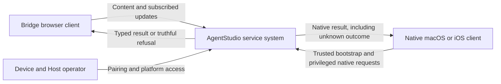

# Bridge transport: observable boundary

The [shared Requirements](../../../user-requirements.md) and [S32 source](../../../research/owner-inputs/bridge-transport-direction-2026-10-22.md) authorize this boundary. Existing E3/E4/E16/E19/E20/E23/E24 retain their [domain meanings](../../../domain-entities.md); existing K9/K10 own file/review/annotation behavior. No transport replacement changes saved revisions, destination effects or partial-outcome semantics.

## Consumer context

This is the externally observable system boundary. The structural realization is in [Program Design](program-design.md). There is no new user-visible screen in this transport slice: existing Bridge views remain the UI. Service-backed loading/error/reconnect presentation still needs a current-app-grounded UI contract before a product cutover.

P7: the present native scheme path mediates browser content, while the requested remote route needs direct browser delivery without giving a browser ambient native authority. O7: the browser can consume its permitted products through its device Gateway; native privileges and remote identity remain distinct.

## Browser access and identity

| Entity | Same-instance rule and relationships | Invariants and observable states |
| --- | --- | --- |
| E27 — Bridge access grant | One issuance of browser access under an E18 authority grant for one admitted E17 principal, to a declared E16 pane/context and qualified Host/worktree resources within one E24 lifetime. A fresh issuance is a different grant even for the same pane; it cannot silently inherit another pane's rights. One pane may receive successive grants; one grant belongs to one issued scope. | Canonicalizes the owner's fresh scoped Bridge capability. Active, expired and revoked access are distinct. It delegates only already-admitted rights; it is not a database-writer lease, Host pairing identity, content revision or evidence of an effect. U25/S32. |

**R19 — Browser scope.** Before protected content, a domain operation or a subscription is made available, the system MUST establish an active E27 covering the actual pane/context, addressed Host/resource and requested operation. A missing, invalid, expired, revoked or wrong-scope grant MUST NOT authorize that use. Browser possession of a port, an Origin value or another pane's grant MUST NOT confer privileged native operations. Replacing or releasing the pane MUST invalidate its previous access before that access is reused for a different context.

C8: refusal and revocation prevent new protected admission after the access owner observes the change. Bytes already admitted to a transport cannot be retracted; subsequent chunks, operations and each subscription update must recheck the current grant and pane generation rather than continue under a cached allow decision. Protected delivery must remain bound to the verified Gateway instance throughout use; a replaced process on a reused port is not that instance. V10's reference is U25's narrow-access and impersonation constraints and the issued scope; a correct frame or successful WebSocket upgrade alone is insufficient.

## Delivery and native control

**R18 — Direct browser delivery.** For a selected Bridge content/update operation, its E20 bytes or E19 updates MUST travel between the browser and its device E24 through same-origin loopback HTTP/WebSocket. Swift MAY bootstrap and perform declared native interactions, but MUST NOT act as the per-content-chunk relay. Privileged native control MUST remain on the declared native boundary: UDS on macOS and the selected embedded interface on iOS. An ordinary browser request MUST NOT bypass the Gateway to address a Host service directly.

C7: an admitted content request returns its declared descriptor/currentness, bytes and completion or a typed refusal/failure under K9. Native output still reports its own effect result under K10; delivery is not presentation or clipboard success. V9's reference is S32 plus the existing operation contract, preserving every selected product kind and its own failure semantics.

## Remote Host communication

**R20 — Remote identity.** Gateway-to-remote-Host service communication MUST use Quinn QUIC with authenticated TLS 1.3 and the paired/pinned peer identities admitted for both sides. A wrong, unpaired or revoked peer MUST NOT gain protected service access merely because TLS encryption succeeded. Each E4/E19/E20 MUST retain its addressed E23 context. WebTransport support MUST NOT be required for the initial browser route.

C9: authentication failure, unavailable network/transport and a rejected application operation are distinguishable outcomes. No automatic TCP fallback, pairing ceremony, global latest-version requirement or speed bound is selected. V11's reference is the provisioned allowed-peer set and S32; connecting to a different Host or accepting a wrong key fails it.

## Platform lifetime

**R21 — Device availability and continuing execution.** The macOS Gateway MUST be separable from the Swift UX process; the iOS Gateway MUST be embedded in the app's lifetime. Loss, suspension or replacement of a local browser/native/remote connection MUST NOT be reported as continuing availability without a working path, and MUST NOT by itself terminate E1 Host execution under R6. Resume MUST establish current connection/access state before presenting newly fetched data as current; it MUST NOT infer delivery or replay uncertain input from a previous connection.

C10: local runtime availability, E3 connection state, E19 subscription state and E1 execution state remain separate. V12's reference is U12/U14/U15 and the actual platform lifecycle. No indefinite background runtime, immediate automatic socket closure or preserved QUIC connection is promised.

## Cancellation and resource boundaries

**R22 — Owned streaming work.** Every selected stream MUST have declared byte/queue/connection bounds and a cancellation owner. When the consumer cancels or disappears, the system MUST either observe the corresponding owned read/delivery work retire and release its reserved capacity, or expose cancellation pending/unknown; browser abort or local socket closure MUST NOT be substituted for Host completion. An already-admitted effect MUST settle under its operation contract independently of transport loss. Explicit effect cancellation is permitted only where that contract defines it. Cancelling transport MUST NOT be reported as rollback of an already applied mutation.

C11: distinguish requested cancellation, local body/receiver retirement, Host retirement and effect outcome. Exact product budgets and latency limits remain G8/G10. V13's reference is U8/U9 and the operation's actual ownership/effect contract; losing a handle while its producer continues fails the retirement claim.

**R23 — Real boundary compatibility.** Each selected native, browser and remote boundary MUST qualify its actual producer and consumer, including version/schema rejection, malformed or oversized data, interruption and wrong-context input. Native macOS socket coverage remains required under R13; the embedded iOS binding and browser protocol need their own boundary coverage. One codec's self-roundtrip MUST NOT be presented as that coverage.

C12 and V14 use U9/U19 as their reference. The initial qualification can prove a declared finite profile; it cannot close the whole sixteen-call/twenty-two-operation migration merely by using a shared transport.

## Coverage

| Need | Entities | Problem/outcome | Obligation | Contract / proof obligation |
| --- | --- | --- | --- | --- |
| U17/U25 | E3/E16/E19/E20/E24 | P7/O7 | R18 | C7 / V9 |
| U9/U25 | E4/E16/E17/E18/E23/E24/E27 | P7/O7 | R19 | C8 / V10 |
| U3/U18/U25 | E3/E4/E19/E20/E23/E24 | P7/O7 | R20 | C9 / V11 |
| U12/U14/U15/U17/U25 | E1/E3/E19/E24/E27 | P7/O7 | R21 | C10 / V12 |
| U8/U9/U13/U25 | E3/E4/E19/E20 | P7/O7 | R22 | C11 / V13 |
| U9/U17/U19/U25 | E3/E4/E19/E20/E24/E27 | P7/O7 | R23 | C12 / V14 |
