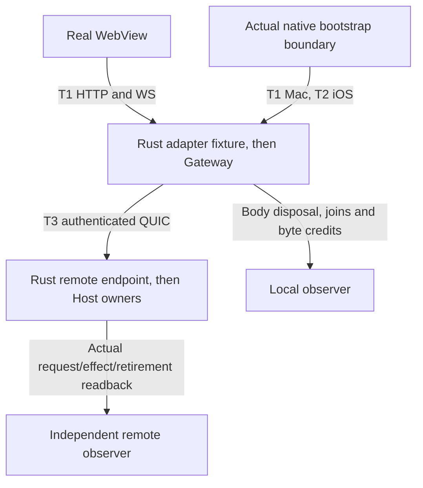

# Bridge transport qualification

These are planned observations over the [Specification](specification.md) and [Program Design](program-design.md), using the existing [Requirements](../../../user-requirements.md). They record no executed result. T1/T3 first qualify isolated adapter boundaries; the same observations must then reach the real selected Gateway/Host operation owners before the product obligations are closed.

## What each need will be shown by

- **Direct browser delivery and narrow access — U17/U25.** Load the actual WebView through Rust, read controlled content and subscribe, then try wrong scope/credentials. Observe the real Rust delivery and absence of refused protected work. Initial probes leave production native-bootstrap identity, all feature operations and physical iOS unverified.
- **Truthful cancellation and typed boundaries — U8/U9/U13/U19.** Hold a consumer, abort it, and observe the actual producer, Host retirement and byte credits; send malformed and incompatible opposite-language messages. Initial probes leave the complete business schema inventory and product integration unverified.
- **Continuing execution and device lifetime — U12/U14/U15.** Background, suspend, terminate and resume a physical device while a remote execution stays independently observed. Reconnect only through a current bootstrap and observe a fresh result. Device/signing access and the selected native binding are prerequisites, not presumed present.
- **Remote transport and Host identity — U3/U18.** Run real authenticated Rust endpoints on Mac/Linux with independently provisioned correct and wrong identities, concurrent small/bulk streams and two distinct target contexts. Measure the declared workload; no latency acceptance number or production pairing proof is implied.

The arrows marked “then” are two proof stages, not a claim that a stand-in is the product. The native bootstrap, operation owner and independent observer are named explicitly so a local socket close cannot impersonate Host completion.

## T1: Actual macOS WebView to Rust

**Target:** isolated native WKWebView/WebPage on Sunclaw, an actual Rust/Axum loopback listener and the unchanged selected Bridge bundle. A tiny initial page can calibrate networking/auth/cancellation, but it does not qualify BridgeWeb integration. Record macOS/WebKit/build identities, actual process sandbox/signing identities, Rust dependency lock and application schema pair.

**Entry and reference:** native bootstrap into the literal bound origin; browser fetch and WebSocket into the shared typed Gateway operation boundary. A deterministic producer supplies declared bytes/revision independently of the transport. An initial fixture behind the Host port is explicitly a source stand-in; T3 and product integration replace it.

The finite qualification profile is 16 MiB of declared content, 32 KiB chunks, 256 KiB counted application buffering per stream, 2 MiB aggregate counted application buffering, 64 KiB maximum browser frame and eight pre-auth upgraded connections. These are probe parameters, not adopted production limits. Count actual bytes across the relevant owners; kernel buffers, allocator overhead and process RSS are separate measurements. The unauthenticated-frame expiry uses an injected clock in its rule check; target timeouts contain hangs rather than decide correctness.

Observe:

1. Same-origin app load and actual HTTP/WS exchange, initially without adding ATS exceptions. Print the origin and secure-context observation. Any exception needed is a recorded platform result, not an assumed universal requirement.
2. Correct HTTP credential and first WS `hello` permit the declared scope. Wrong Host/authority or Origin is refused before upgrade/protected dispatch; missing/invalid/expired/revoked/wrong-pane/wrong-Host credentials cannot subscribe or read protected content. Revoke an active subscription and replace its pane generation at a held update boundary; no later update admission may use the old grant. Test forged Origin with no credential too: Origin is not authentication. Verify protected routes emit no CORS headers, and inspect actual credential custody: retained in the communication worker, absent from rendering-thread application state, URL, storage and diagnostics.
3. Hold the reader after an announced chunk boundary. Observe counted buffers stay within the declared credits and another admitted small request can complete. A producer that fills an uncounted side queue is a wrong implementation even if the visible queue stays bounded.
4. Abort at a causal read boundary. Observe response-body disposal, every tracked local read producer's actual completion, the exact upstream read cancellation and actual upstream retirement. Record pending/unknown where that last result cannot be established. A cancellation acknowledgement alone does not pass. Separately hold an admitted effect, lose its consumer/connection, then release it: the effect must settle once under its operation record and be reconciled without resending. Implicitly cancelling or replaying it fails.
5. Replace pane scope and source revision while delivery is held. Old grants cannot read the new scope; old descriptors cannot silently acquire replacement bytes or currentness. Preserve K9's operation-specific invalidation result.
6. Observe that Swift supplies only bootstrap/native interactions and zero content-chunk forwarding calls. Capture actual browser-consumed bytes independently. A Rust log saying “sent” does not prove consumption, currentness or rendering.
7. End the verified Gateway instance and have an isolated impostor bind its former port. The old page/worker must not accept forged content or updates as that Gateway. Correlate native loss, browser requests and actual response authentication. An asynchronous native teardown with an unclosed impersonation window does not pass. Qualify pinned loopback HTTPS for actual fetch and WS if used; navigation-only trust handling is insufficient.
8. Compare first-frame, one-use-ticket and credential-bearing-subprotocol handshake arms. A separate local process forges Origin and holds the declared pre-auth allowance; record legitimate-client refusal and recovery, header redaction, response protocol selection and bounded resource use. Ordinary HTTP/socket flooding remains a separate limit; avoiding upgraded slots does not prove immunity.

Negative controls must include an actual omitted auth check, continued detached producer, uncapped secondary queue and stale source descriptor. Each must fail the corresponding observer. These are deliberately wrong fixture variants, never production flags.

## T2: Physical iOS lifetime

**Target:** a signed physical iOS device with embedded Rust, the selected native binding and actual WebView; launch without debugger behavior that prevents normal suspension. Record exact OS/build, permissions, entitlements, foreground/background/suspension/termination evidence and the tested network path.

Use separate arms for quick background/return, actual suspension, process termination and network change. Observe listener and TCP/WS/QUIC outcomes rather than inferring them from app state. Count actual port/origin changes, WebView/worker reloads and retained or lost in-memory UI state. Reusing a port must still establish fresh Gateway identity and grants. Apple distinguishes kernel-visible listeners from executing application code. The Gateway's own UDP to a LAN Host is a different local-network operation from WKWebView traffic; record allowed/denied/undetermined privacy behavior and qualify Tailscale separately.

Pass the selected lifecycle profile only when the UI stops asserting a usable stale path, fresh foreground bootstrap reestablishes scope, the first resumed result has the declared currentness, and the independently observed remote execution retains its intended identity. No uncertain terminal input or effectful operation is resent to manufacture recovery. A simulator or successful Mac socket run does not substitute for these observations.

The proposed listener stop/reopen policy and the choice for a short-lived background QUIC connection must be frozen before this run. Neither immediate kernel teardown nor migration through suspension is the reference. Device/signing access, complete native safety compliance and the desired recovery profile remain explicit prerequisites.

## T3: Actual Gateway-to-Host transport

**Target:** actual Quinn/rustls endpoints on Sunclaw macOS and the isolated Linux environment. First qualify transport fixtures, then replace their source/effect stand-ins with actual Gateway/Host owners. Freeze source/dependency identities, peer-key material, target identities, stream inventory and workload before measurement.

Provision distinct peers independently of the process being tested. Observe both directions of correct-key and wrong-key refusal, missing client authentication, revocation and a wrong Host target. A permissive verifier must fail even if it encrypts. The initial manually provisioned profile does not prove a production pairing ceremony, key storage or revocation distribution.

Run a held bulk stream alongside small control messages and terminal-like ordered bytes. Record per-class latency distribution, throughput and counted buffering at both endpoints. Compare to one declared TCP/TLS baseline without changing the application workload. No speed winner, tail-latency guarantee or broad UDP-blocked fallback follows from source-level multiplexing.

At controlled boundaries, disconnect before admission, after admission and after an effect before its reply. Observe actual operation/effect state through the corresponding owner, retain uncertainty and do not resend effectful work. Use two Host-qualified contexts so one failure cannot redirect a request or make another Host's reply appear to belong to it. This integrates the existing custody distinctions rather than treating a local receipt fixture as real Git/provider proof.

## Optional WebTransport arm

This is a separate experiment and not a dependency of T1–T3. Record actual feature availability on each OS/WebKit build; use correct/wrong certificate hashes and the published many-stream reduction with a single-stream control. Unsupported or stalled WebTransport does not fail the required HTTP/WebSocket browser route. The public WebKit issue and library maturity reports are research, not a reproduced result here.

## Coverage rows

No project `verify-<app>` journey currently reaches this new transport route; the current source registers the native scheme instead. The entries below are **needed, lasting** journeys. Existing socket-custody/native/Capture experiments are useful calibration inputs but do not drive these boundaries, so none is counted as reused product proof.

| Requirement / obligations | Proven by / reference | Seam and planned target/journey | Pass condition and wrong implementation | Reuses / unverified |
| --- | --- | --- | --- | --- |
| U3 · R20 | Compare the same interactive/bulk workload over authenticated transports; C9/V11 and the declared workload | Host port and independent endpoint observers; T3, needed/lasting | Report actual distributions and correct target/authentication. Wrong-key acceptance fails regardless of speed | none; numeric product latency threshold remains G10 |
| U8 · R22 | Abort a held stream and observe owned work finish; C11/V13 | Body disposal, tracked task joins, Host retirement; T1/T3, needed/lasting | Actual joins and credit release, or explicit remote pending/unknown. Detached producer fails | none; full product operation-owner integration |
| U9 · R19/R22/R23 | Drive opposite-language malformed/auth/cancel cases against explicit typed outcomes; C8/C11/C12 | Native/browser/remote decoders and actual protected-work journal; T1–T3, needed/lasting | Invalid semantic context cannot reach protected work; unknown effects stay unknown. Self-roundtrip-only or guessed success fails | none; complete selected business variants and native binding |
| U12 · R21 | Observe an embedded device runtime through real lifecycle transitions; C10/V12 | Native lifecycle, actual sockets and first resumed data; T2, needed/lasting | Fresh access/current path after recovery; Host execution independent. Stale-ready state fails | none; physical device, signing and qualified native profile required |
| U13 · R22 | Trace bulk bytes and cancellation without Swift chunk relay or MainActor domain work; C7/C11 | Native bootstrap/chunk instrumentation and Rust producer ownership; T1/T2, needed/lasting | Zero Swift content-forwarding calls, native publication only, actual producer retirement. Relaying/deriving on native UI lane fails | none; integrated runtime/performance profile |
| U14 · R21 | Disconnect the view/device while independently observing execution; C10/V12 and R5/R6 | Host session/process observer; T2/T3, needed/lasting | The view loss alone does not terminate/replace execution. View-close Kill fails | none; natural Host failure and dead-agent restart are separate |
| U15 · R21 | Remove every client while Host-owned execution continues; C10/V12 | Actual Host owner and independent process/fact observer; T2/T3, needed/lasting | Required execution/facts continue under valid authority. Renderer-dependent progress fails | none; full provider-hook/fact families need their own migration proof |
| U17 · R18/R21/R23 | Use the real selected native/browser entry without bypassing Gateway; C7/C10/C12 | Bootstrap and direct browser request; T1/T2, needed/lasting | Actual boundary reached, current scope and no Swift byte relay. Direct UX-to-Host or stale native binding fails | none; native UDS/FFI identity/safety and all operation mappings |
| U18 · R20 | Mix two addressed Host contexts and fail one; C9/V11 | Host-qualified adapter routing and independent per-Host readback; T3, needed/lasting | No reply/effect crosses target identity; healthy Host remains independent. Implicit-default redirection fails | none; complete aggregation/selection UX |
| U19 · R23 | Send real supported and incompatible producer shapes over each selected boundary; C12/V14 and R13 | Actual Swift/TypeScript/Rust clients; T1–T3, needed/lasting | Supported pairs agree and unsupported frames/versions refuse before effects. Single-codec tests fail coverage | none; full schema/version matrix and physical iOS |
| U25 · R18–R23 | Follow bootstrap, protected read/subscription, cancellation, remote identity and recovery end to end; C7–C12/V9–V14 | Combined T1/T2/T3 observations, needed/lasting | All six obligations have their actual owner observations. HTTP success alone fails | none; fixture stages never waive real Gateway/Host/native integration |

The unresolved production budgets, native trust/binding realization, key lifecycle and device target must be resolved before these rows can claim full product proof. Initial bounded probes can proceed only under their own frozen experiment grant, preserving those stand-ins as unverified.
