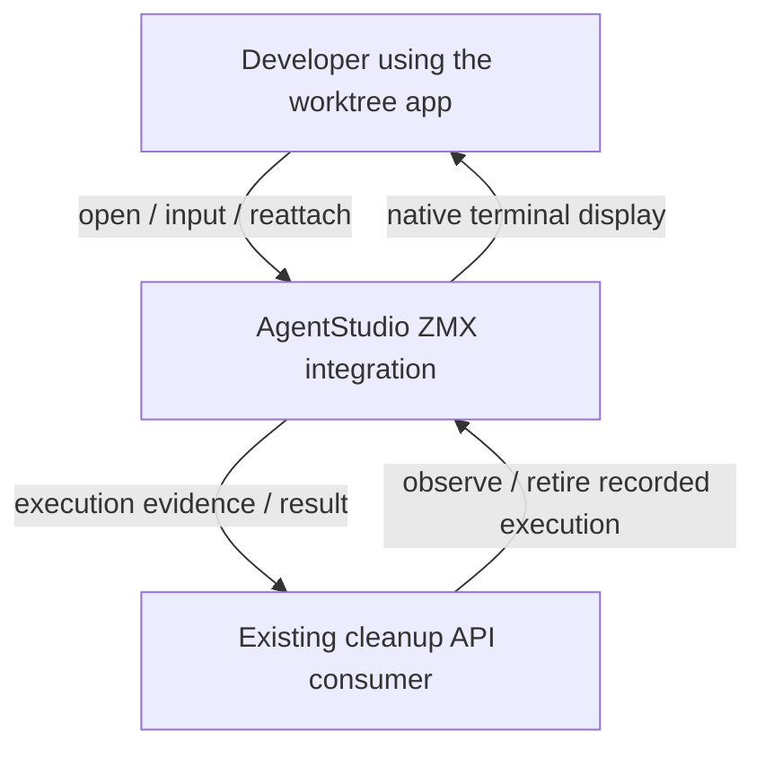

# ZMX worktree adoption: observable contract

## What this step delivers

The developer can run this AgentStudio worktree with the newer ZMX backend, start a terminal in the existing native Ghostty surface, and attach a fresh surface to the same still-running execution. The app's existing identity observation and verified cleanup must speak the backend's actual protocol. A vendor-pin update alone cannot supply that outcome.

The authority is [U24 and S31 in the shared Requirements](../../../user-requirements.md#requirement-rows). This is one bounded part of that need, with U9's meaningful-failure-testing constraint. It advances the existing macOS integration; the complete Host/Gateway system and later ZMX restoration work remain in their existing design homes. All identifiers below are local to this Specification.

**P1:** normal attachment runs the ZMX CLI, while verified cleanup has a separate Swift protocol reader. Their versions must agree. **P2:** a session name, a successful write, or a socket's presence does not establish the identity or extinction of an execution.

**O1:** a usable native terminal and fresh attachment with the exact durable session identity. **O2:** truthful control results that preserve the existing cleanup safety contract, including on incompatible or malformed replies.

## Entities and identity

| Entity | Meaning and identity | Relationships and invariant | Observable states |
| --- | --- | --- | --- |
| E1 Backend revision | The exact ZMX source revision selected for this worktree; a version string alone does not identify it | Each E5 exchange targets one running backend; source and delivered binary must correspond | selected, built, running |
| E2 Terminal execution | A still-running terminal process family, distinguished by machine boot and process incarnations; its durable session name is an address, not proof of incarnation | Zero or more E3 attachments may refer to it; replacing the process family creates a different execution even at the same address | running, terminating, extinct |
| E3 Native attachment | One native terminal view's attachment to E2; a fresh view is a different attachment | Each attachment refers to one execution; losing a view alone does not prove execution loss | attached, detached |
| E4 Cleanup evidence | The recorded boot, daemon/terminal incarnations, process group and session-creation witness identifying the execution a cleanup obligation concerns | One obligation concerns one E2; a replacement execution does not inherit that obligation | not yet observed, recorded, pending retirement, completed |
| E5 Control exchange | One bounded observation or retirement attempt against an exact endpoint | A retirement's identity inspection and Kill share one connection; an exchange never retargets a namesake after inspection | inspecting, validated, refusal/failure, Kill requested, returned |

The current durable session name and stored cleanup-evidence meanings remain authoritative. This slice introduces no new persisted identity or data migration.

## Required behavior

| ID | Normative obligation and success case | Failure expectation | Trace |
| --- | --- | --- | --- |
| R1 | For E1 at source revision `7f0ffdb999833a1817dd3c6222c269d4ed4a7548`, E5 observation and retirement shall use that revision's versioned control contract. A valid response yields the same process/creation facts the backend independently reports. | An invalid version, shape, tag or excessive declared payload shall not yield valid cleanup evidence or authorize Kill. EOF before a complete response, an unavailable peer, timeout or cancellation remains a failure rather than an absent or completed execution. Valid responses fragmented across reads remain valid. | U24, U9 → E1/E4/E5 → P1 → O2 → C1 → V1 |
| R2 | In the isolated macOS worktree app, E3 shall start through the existing native attachment path, transmit input to E2 and display output returned from E2. A fresh E3 shall reattach using the same stored session name to the same still-running E2. | A new execution at the same name does not satisfy reattachment. Restoring exact parser state, all scrollback or every intermediate frame is not required; source bytes and live input/output must not be replaced by a success acknowledgement. | U24 → E1/E2/E3 → P1 → O1 → C2 → V2 |
| R3 | E4-based retirement shall retain the existing boot/incarnation/parent/group/creation and same-connection checks. Sending Kill returns pending; completion concerns extinction of the originally recorded processes/group. | A mismatched or unverifiable live execution is protected. An absent endpoint with an extant original family is pending, not completed. A positively extinct original family may complete while leaving a stale or replacement endpoint untouched. The stored evidence format and durable session text are not rewritten. | U24, U9 → E2/E4/E5 → P2 → O2 → C3 → V3 |
| R4 | The upgraded worktree shall keep the outer Ghostty source revision `2fb0c9cacb3fc75dbc8aedee9b7ed4321f091d33` unforked and exercise its own isolated runtime data and ZMX root. | Adoption shall not enumerate, replace, terminate, rename or migrate installed-app executions, nor alter another worktree's vendor source or prepared outputs. | U24 → E1/E2/E3 → P1/P2 → O1/O2 → C4 → V4 |

R1 uses the pinned upstream protocol as its reference; it does not standardize ZMX's private protocol as AgentStudio's future network API. U9 applies only to the proof of this slice, not a claim that every project failure case is covered.

## C1 — Control compatibility

An observation reads the exact endpoint, retaining the existing limits of 65,536 bytes per payload and 1,500 ms for the whole exchange. These are refusal bounds, not a latency acceptance target. Valid control data describes the execution; local process inspection supplies independent incarnation and ownership checks. Unexpected, malformed or incompatible data cannot be converted into “not found.” Output arriving before Info may be consumed without being interpreted as Info, subject to the same frame validation and total exchange deadline.

The supported successful pair is the upgraded Swift adapter and the selected E1 revision on macOS. An old daemon is an incompatible peer: bounded refusal or timeout is acceptable, preserving the original execution. There is no version fallback, alternate header trial, blind transport-level replay of Kill or old-session replacement. A later existing cleanup pass may inspect the recorded execution afresh before deciding whether to request retirement again.

## C2 — A fresh attachment to a live execution

Use one exact stored session name. The first native attachment produces an execution marker and receives live output after a real input operation. Dispose only that native attachment, create another, and obtain a second live marker from the independently identified same execution. The restored display may be lossy. The requirement concerns a still-running execution, not rebuilding a dead process or resuming a provider conversation.

No new UI action is selected. The existing pane/native-surface composition supplies the attachment, and this step changes neither pane-close policy nor the future detached-session UX.

## C3 — Observe, request retirement, reconcile

| Situation | Caller-visible result | Protected effect |
| --- | --- | --- |
| Endpoint positively absent during initial observation | no identity observed | no Kill |
| Valid matching execution | recorded E4; retirement may request Kill and return pending | only the inspected connection can receive Kill |
| Recorded boot differs from current boot | original execution completed | no signal to a current-boot namesake |
| Original family extinct, endpoint stale/replaced | completed for the original obligation | endpoint remains untouched |
| Endpoint absent, original family remains | pending | no unverified process signal |
| Identity mismatch, malformed/old protocol, unavailable inspection | typed failure, obligation unresolved | no authorization to kill an unverified execution |
| Failure after a possible write | do not infer extinction from the error | original process evidence remains the reconciliation reference |

## C4 — Worktree boundary

The integration target is a fresh private debug/proof root, using this worktree's paired binary and adapter. Source adoption may be prepared without installing or publishing the app. Existing installed old-protocol executions are outside that target. Their release transition requires its own explicit policy before using a shared live root; lossy display approval grants no permission to kill them.

## Proof obligations

| Slot | Reference and passing observation | Target and negative discriminator |
| --- | --- | --- |
| V1 | Exact upstream v1 header/Info contract; literal malformed/version/length cases, plus real socket exchange with the delivered adapter and selected backend | macOS product module and isolated delivered backend; old-offset, unchecked-version or unbounded-allocation builds fail |
| V2 | C2's two live markers and independently unchanged execution identity | isolated native app with unchanged Ghostty source; a replacement shell or a fixture that bypasses native input fails |
| V3 | C3's result/effect table and original process-incarnation evidence | real current cleanup entry and real backend, with controlled replacement/refusal cases; “Kill sent means completed” and namesake retirement fail |
| V4 | Pinned source/binary pairing, unchanged outer Ghostty source, private roots/outputs and preserved unrelated state | worktree setup and debug app; borrowing an old shared ZMX output or touching installed roots fails |

The [Verification Design](verification-design.md) selects observations over these references. Prior copied-source probes are feasibility evidence, not a passing product integration.

## What this step does not deliver

- Rust Host/Gateway, remote network transport, replication, leases or the machine-scoped CLI.
- Public `zmx.create` adoption, a new capture relay, arbitrary VT/parser equality or transcript retention.
- Dead-agent/process/Host-restart recovery, input replay, provider checkpointing, or an installed-session transition.
- A new bus, atom, store, coordinator responsibility, command or UI control.
- A complete Linux Host qualification or app performance target. Existing Linux component results remain attached to their own build/profile.

The pre-existing name-only health/inventory issue is separate from production observation and reattachment: those production paths use direct identity control and exact stored-ID attach. This step does not change list parsing or use it as proof of health or cleanup completion. The generic name extractor must continue exposing unresolved rows to existing test cleanup verification.
