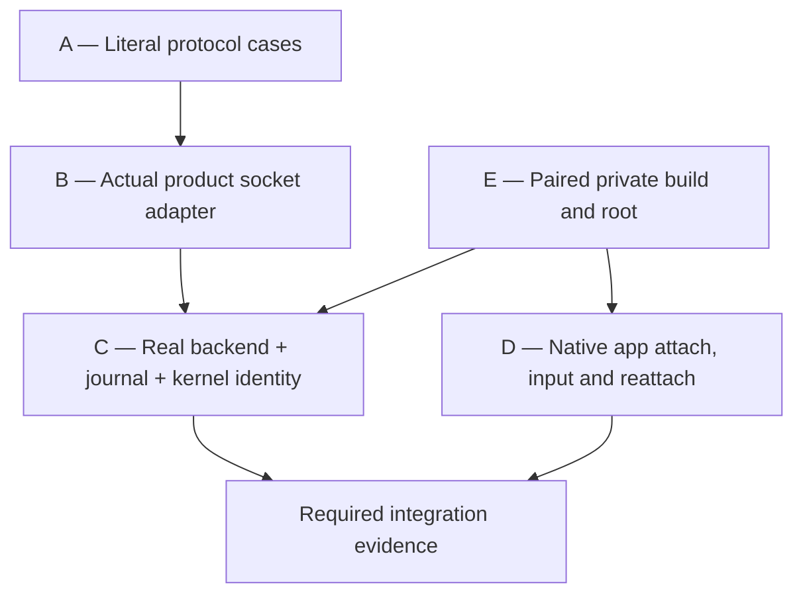

# ZMX adoption: how we will prove it

[Specification](specification.md) · [Program Design](program-design.md) · [Shared Requirements](../../../user-requirements.md)

The proof must use the delivered product adapter and the ZMX executable built by the worktree's actual ReleaseFast producer. Previous copied-adapter, ReleaseSafe and standalone Ghostty probes show feasibility. They do not establish that the integrated app has the right binary, framing or native route.

Every row below is a plan for future proof. It records no new passing run or review result.

## The owner's proof view

| Requirement | Proven by | What stays unverified by this slice |
| --- | --- | --- |
| [U24](../../../user-requirements.md#requirement-rows): advance ZMX with lossy restoration and unforked Ghostty | Use the upgraded private app to start a terminal, send input, replace its native attachment and receive fresh output from the same execution; separately observe and safely retire a real owned execution through the delivered control adapter. | Dead-agent/process/Host-restart recovery, installed-session transition, arbitrary VT/parser equality, public-create adoption and the future remote Host/Gateway route. |
| [U9](../../../user-requirements.md#requirement-rows), applied to this slice: tests must distinguish meaningful failures | Challenge the actual parser, socket adapter and cleanup entry with wrong-version, malformed, replacement-identity and early-completion cases, and show that each wrong behavior fails its corresponding observation. | This does not claim whole-project test coverage, Linux product behavior or an agreed performance target. |

## Coverage rows

| Need and obligations | Reference and seam | Planned target / journey or reused test | Passing condition and wrong build | Remaining proof work |
| --- | --- | --- | --- | --- |
| U24 → R1,R2,R3,R4; V1,V2,V3,V4 | Specification C1–C4 and exact selected upstream v1 source; Program Design's real codec/socket/native/kernel/build seams | Observations A–E below. Native journey **needed, lasting**: drive the actual private app's normal terminal startup and native input, replace only its attachment, read its rendered markers, and independently compare execution witnesses. Real backend cleanup observation **needed, lasting** at the current product entry. | All A–E pass on the paired product build. The native view shows both operation-correlated markers and the same execution witnesses; the cleanup caller returns pending before extinction and preserves mismatched/replacement executions; the private binary/source/root correspond. A pin-only update, replacement shell, mocked native input, old shared output or “Kill sent means completed” fails. A differently implemented valid codec and a different lossy restored display still pass. | The lasting native and real-cleanup journeys must be built before proof uses them. No existing project verification skill was found under `.agents/skills` or `.codex/skills`; the repo has test and observability tasks instead. Required observations are not waived by that gap. |
| U9 → R1,R3; V1,V3 | Specification C1/C3's invalid-response and protected-effect cases; same production codec/socket and identity guards | Observation A uses permanent module tests; B uses a controlled actual Unix peer; C uses a real backend/process family. No separate manual journey is needed for A/B. The lasting C journey is shared with U24. | Wrong header offset, ignored version, allocation before length validation, namesake retirement and completion on write acknowledgement must each fail. Each negative case closes through the correlated returned result plus peer EOF/process outcome, not a delay. Allowed byte fragmentation or Output-before-Info succeeds within the same bounded exchange. | Permanent malformed-frame cases and event-based cleanup observations must be added. Existing tests alone do not decide these cases; test names or source declaration counts are not passing counts. |

## Shared observations

### A — Pure byte validation

**Evidence class:** automated behavior; no app or socket needed. Drive the real internal codec with literal header/body vectors derived independently from selected upstream `src/ipc.zig` and `handleInfo`, not by calling the same Swift encoder to generate its own expectations. Check exact outbound Info/Kill bytes, valid Info field values, wrong header/body versions, nonzero reserved header bytes, unsupported tags, short headers/bodies, wrong Info size and payload lengths at and above the existing cap.

A decoder still using length offset 1, omitting version checks or accepting a short Info body must fail. Preserve the distinction between pure input rejection and actual socket EOF. These tests observe value conversion, not OS identity or real ZMX behavior. A separate structural inspection must show that validated header length dominates the connection's payload allocation/read; black-box refusal alone cannot establish allocation ordering. A build that allocates from the raw declared length before that guard fails this structural check even if it later returns invalidResponse. Reuse the existing `AgentStudioCoreTests` target and `@testable import AgentStudioCore` convention; there is no existing dedicated frame-codec suite to count as proof.

### B — Real Unix-socket delivery and refusal

**Evidence class:** API transcript and state inspection. Run the actual product connection/control adapter against a controlled private Unix peer, from a dedicated execution thread rather than blocking the Swift cooperative pool. The peer must emit real fragmented/coalesced headers/payloads and Output-before-Info; collect the actual request bytes and observe the correlated return and connection close. A fake peer replaces ZMX only for malformed-wire scheduling; it does not satisfy C.

For refused input, read the actual client stream through EOF to detect any prohibited Kill bytes. Do not infer their absence from a success counter or a final process snapshot. Close and join the peer task and descriptor ownership before returning. Existing policy timeouts remain failure behavior; test correctness waits for exact events/results and uses only the runner's hang bound.

### C — Existing cleanup entry, real daemon and real process family

**Evidence class:** automated real-path behavior plus durable-state and kernel observation. Use the selected ReleaseFast binary and the product `ZmxBackend.observeSessionIdentity` / `retireVerifiedSession`, then the existing journal/datastore cleanup entry. Register process exit observations before inducing retirement. Independently read boot/PID/start/parent/group and backend creation evidence; never use the candidate's own emitted identity as the only oracle.

Matching retirement must first return pending, then complete only after original family/group extinction; reopen the journal to verify the correlated durable outcome. Replacing the endpoint/session or supplying mismatched creation evidence must preserve the replacement and leave a truthful unresolved/result state. Positive absence, failed inspection, absent endpoint with surviving family, extinct original with stale endpoint, and cancellation/error after a possible write follow C3. Control reuse must establish that validation and Kill use the same connected peer.

Use an isolated old binary/root for the incompatible-peer case: bounded refusal/timeout and unchanged original execution, followed by separately owned fixture cleanup. That case does not promise old-daemon interoperability or authorize querying an installed root. Wire-level no-Kill proof comes from B's fully consumed peer stream; real-old unchanged-process evidence is a distinct observation, not a substitute for packet evidence.

**Reuse boundaries:** `E2ESerializedTests/ZmxE2ETests` already calls real Info/Kill and exercises reopened obligations, replacements and stale endpoints. Its current deadline/yield loops and `ZmxTestHarness` polling cannot be copied into new proof. The affected lifecycle waits need exact fixture/process events and completed teardown under the existing test standard. Existing `WorkspaceTerminalSessionCleanupTests` uses a recording backend: reuse its journal/native ordering checks, but never count it as real-wire or real-process evidence. `ZmxBackendIntegrationTests` also does not supply that evidence merely because its name says integration.

### D — Native terminal, live input and fresh attachment

**Evidence class:** actual app interaction and independent execution inspection. On Sunclaw, build/run the private macOS debug app at the delivered source, unchanged outer Ghostty pin and local candidate ZMX. Use the existing native startup path, not a standalone Ghostty library fixture or a separate terminal emulator. The terminal produces one controlled marker after actual native input. Capture native text and independent execution witnesses. Recreate only the native attachment through the existing view lifecycle, preserving the stored ID and original execution, then send new input and obtain a new marker.

A fresh shell producing identical canned text must fail because its process incarnation differs. A path that injects input directly into ZMX while bypassing native input must fail the entry check. A snapshot alone cannot satisfy the second live marker. Lossy prior display contents are allowed; exact VT/parser equality is not the oracle. Inspect the actual PID-targeted debug UI when visual evidence is needed, and join/clean only this journey's resources.

### E — Source, binary, output and runtime isolation

**Evidence class:** structural and runtime evidence. Verify the selected committed ZMX source, unchanged outer Ghostty source, actual ReleaseFast producer options, exact binary consumed by the test/app, private prepared vendor paths and private debug data/ZMX roots. The existing vendor verifier reads committed HEAD gitlinks; a merely staged gitlink or borrowed old primary output cannot establish pairing. The existing local-vendor setup is the supported producer for a deliberately divergent pin.

Run the repository's focused checks, lint and complete aggregate at the integrated source, plus the separate opt-in ZMX lifecycle lane; the aggregate deliberately excludes that lane. A skipped lifecycle suite, missing selected binary, empty discovery, failed setup or stale test bundle cannot count as its pass. Keep actual exits/counts and failures. No app build or runtime proof in this document has happened.

## Remaining limits

The future Linux Host and iOS Gateway have their own contracts; this native macOS adoption does not qualify them. Old installed sessions and dead-agent restoration remain separate design decisions. Required native/product proof remains required even if a component probe is already green. The [current experiment report](../../../explainer/progress.html) is the home for executed observations and their narrower targets.
