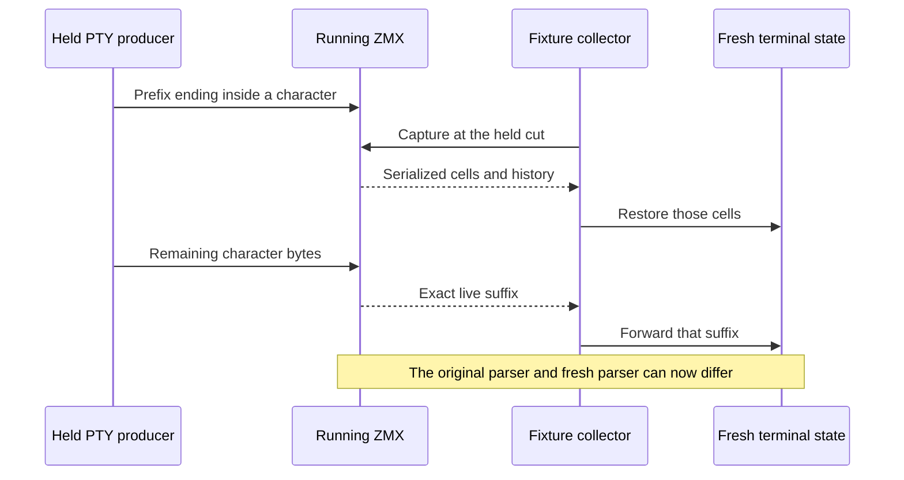

# Larger Capture experiment on the newer ZMX

**The live handoff preserved all 110 exact raw suffixes. Formatted reconstruction stayed lossy: final plain text matched in 4 of 110 Capture cases and 18 of 55 Init cases.** This is a new, completed backend experiment on 22 October, separate from the earlier small native Ghostty demonstration and the older-pin stress run.

Capture asks the running ZMX terminal to serialize its displayed cells and selected history. Init supplies ZMX's attachment restoration stream. Neither is a checkpoint of a dead agent. The owner permits lossy display restoration; these exact comparisons describe the losses and do not invent a product acceptance threshold.

## Follow one split character

The first forced UTF-8 case makes this concrete. The original stream splits the euro character after its first byte, `e2`, with `82 ac` still to come. The reconstructed text contained two replacement characters where the uninterrupted terminal contained `€`. All sixteen forced UTF-8 Capture cases had extra replacement characters, despite retaining every numbered record. A byte-perfect suffix therefore does not imply a correct reconstructed display.

The active-alternate cases expose a different loss: primary-screen history can be absent when restoration begins from the alternate screen. The largest observed deficit was 544 numbered records. Equal final cursor, CWD and screen mode cannot reveal that missing history.

## What actually ran

The Lead ran the unmodified `7f0ffdb999833a1817dd3c6222c269d4ed4a7548` ZMX backend on Sunclaw, macOS arm64, using the already-built Zig 0.16 ReleaseSafe binary. Its verified SHA-256 is `89290268a5504c0019cbf5bff6d3fa1f544dbc5b788096e8fa33231f5a4a134b`. No product or vendor source changed, and Ghostty was not forked.

- **Reference and sensitivity**
  - Fresh uninterrupted PTY execution of the unchanged 418,746-byte corpus, with all 6,442 expected numbered records in order.
  - Uninstrumented full-byte replay matched the reference; deliberately dropping or duplicating record `000010` produced the corresponding missing or extra record.
- **Full matrix**
  - Two distinct arms: register Init before Capture, or observe without Init.
  - Per arm: 26 ordinary forced cuts, three active-alternate cuts and 26 continuous-output cuts.
  - Total: 110 Capture comparisons and 55 Init comparisons. All forced cuts occurred at their declared offsets; every raw suffix was exact.
- **Completed run and cleanup**
  - Driver exit 0, all three controls valid, 279 exact process families and 558 kernel process-exit observations.
  - Final private session inventory empty; no control/progress FIFOs remained.
  - 869,431,499 cumulative evidence bytes, below the fixture's 2 GiB write budget. Original daemon logs sit outside that counter; it is not a total disk-footprint limit.

Two four-case pilots are retained separately. An earlier full attempt stopped after 76 comparisons because its process-accounting fixture trusted a socket peer PID that had exited. The corrected fixture uses the blocked producer's readiness, Info PID and actual kernel parent/UID/start identity. The incomplete run is preserved and contributes no cases to the completed matrix. Its final private Kill and empty inventory were observed, but that failed setup had no incarnation-tracked exit proof. This was an instrument failure, not a Capture verdict.

## Read the results by element

| Observation | Capture reconstruction | Init reconstruction |
| --- | --- | --- |
| Exact final plain text | 4 / 110 | 18 / 55 |
| Exact canonical VT serialization | 4 / 110 | 18 / 55 |
| Exact full attachment serialization | 4 / 110 | 18 / 55 |
| Equal final title | 104 / 110 | 54 / 55 |
| Equal final CWD | 110 / 110 | 55 / 55 |
| Equal final cursor | 110 / 110 | 55 / 55 |
| Equal final alternate-screen mode | 110 / 110 | 55 / 55 |
| Cases missing numbered records | 33 / 110 | 3 / 55 |
| Cases with extra replacement characters | 24 / 110 | 11 / 55 |

No case added an extra numbered record. All six forced alternate-screen Capture cases lost numbered primary history. None of the 58 forced Capture reconstructions matched exact final plain text; the four exact Capture matches came from continuous-output cases. Init matched one forced ground-state case and seventeen continuous cases.

These finite counts are not general success probabilities. The earlier pin had zero exact matches in its retained report, but this is not a controlled version-only comparison: the new fixture corrects causal draining and cut coverage, and continuous cut offsets vary with actual I/O scheduling. The new source changed Init scrollback preparation; the Capture range serializer did not materially change.

The retained scorer also checks the foreground on `RED` and the canary. The later independent scorer reproduces these narrow foreground diagnostics; neither is a complete style oracle. A canonical VT mismatch must not be described as a style-only difference.

## What explains the losses

The Advisor's different-family scorer independently reconstructed the saved wire bytes and built its own small VT model. It found **zero disagreements across 165 scores × 16 fields, 721 boundary fields and the three controls**. It also compared raw canonical-VT and Init equality. This is an independent saved-evidence check, not another runtime run or formal design review.

It separates three causes:

- **Blank bottom row, then overwrite — 32 Capture cases.** The formatter omits trailing blank rows, then emits an absolute cursor position. In a fresh terminal, the last content row occupies the bottom row; the first live line overwrites it. Twenty-seven cases lose one numbered record; five lose a wrapped continuation row without losing its ID. The Lead checked the serializer, its pinned formatter and decisive raw cases. Init's separate history/viewport redraw avoids this particular loss in this matrix.
- **Alternate screen — six Capture and three Init cases.** Restoration contains the active alternate screen, leaving out primary history from before the TUI. This is separate from the blank-row defect.
- **Parser continuation — mid-sequence cuts.** Exact subsequent bytes still reach a fresh parser without the original partial UTF-8, CSI or OSC state. Records can survive while their text or style differs.

A ZMX-side viewport redraw or explicit preservation of the omitted rows is a repair hypothesis for the first cause; **no repair has been implemented or tested**. It requires no proposed Ghostty fork. It would not by itself restore primary history omitted at an alternate-screen cut or make parser continuation lossless.

The independent check leaves Init fragmentation unexercised and its continuous cuts confined to the first 7.3 KB. It models this corpus's foreground colour and screen operations, not arbitrary VT state or native pixels. [Independent rescore and limits](../../../../../../tmp/practices-research/2026-10-22-advisor-capture-rescore/RESCORE.md).

## Why the measurements are credible

The producer appends a separate device query only after the unchanged corpus and canary finish. Without an initialized terminal, ZMX's exact reply fences backend parsing. With Init, the collector first receives actual Output through the query, then sends a recorded fixture reply to release the producer. That is fixture input, not a claimed backend response. The query is excluded from reconstructed content, and the raw full replay verifies that instrumentation did not alter the scored reference state.

A separate Lead checker parsed saved wire independently, verified replay injection and actual state replies, reconstructed Capture/Init boundaries, checked the literal cut inventory and recomputed plain/VT/title/CWD/cursor/record scores. **4,531 assertions passed, exit 0.** The actual process-family/exit and transfer checks passed separately. Ten local/remote fixture modules and the full evidence archive matched their hashes. Ruff, format and strict basedpyright passed; these static gates are separate from the runtime evidence. The subsequent independent rescore described above agrees with these saved outcomes; it does not re-observe process cleanup or qualify product integration.

[Declared experiment and limits](../../../../../../tmp/experiments/2026-10-22-capture-stress/plan.md) · [Observed summary](../../../../../../tmp/experiments/2026-10-22-capture-stress/observed-summary.json) · [Separate wire audit](../../../../../../tmp/experiments/2026-10-22-capture-stress/full-r2-audit.json) · [Process and transfer checks](../../../../../../tmp/experiments/2026-10-22-capture-stress/lifecycle-and-custody-check.json) · [Full raw case results](../../../../../../tmp/experiments/2026-10-22-capture-stress/full-r2/results.json) · [Preserved incomplete attempt](../../../../../../tmp/experiments/2026-10-22-capture-stress/full-incomplete-evidence.tar.gz).

## What this changes for AgentStudio

The result supports keeping three subjects separate:

- **Live bytes:** the tested same-connection ordering and exact suffix are usable evidence for a handoff design.
- **Displayed restoration:** Capture and Init can lose parser continuation, text or history. The accepted lossy UX still needs explicit visible guarantees before selecting a production restoration mechanism.
- **Authoritative Host data:** agent status, Git state, durable operations and any canonical transcript need their own sources and ownership. A formatted terminal snapshot cannot stand in for them.

This does not select a second Host VT engine, a ring buffer, a network protocol or a product fallback. It does not qualify arbitrary native TUI rendering, Linux renderer equivalence, complete Host/Gateway integration, performance, installed-session transition or dead-agent resurrection.

[Next experiments](remaining-experiments.md) covers Git realization, Bridge/review content, actual provider hooks and physical iOS as well as the terminal and filesystem follow-ups.
