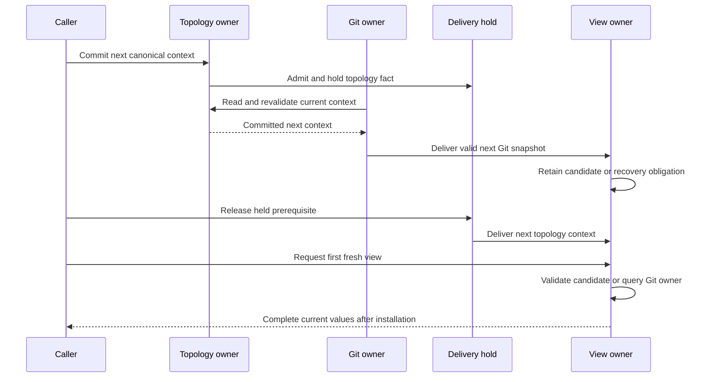

# When valid Git data outruns its prerequisite

**Eight normal cases matched, and twelve deliberately broken controls were detected.** All 20 fresh processes exited 0. The experiment used real typed Tokio owners and channels, two Hosts and three view owners. It compared two allowed recovery mechanisms through both direct fact feeds and an additional shared hub.

The question is practical: a Git snapshot can be valid at its source while a receiving view has not yet learned the topology context that makes it valid. The view must preserve the work or recover it before completing a fresh read. A second profile delays an already-admitted snapshot until its context has been replaced; that old snapshot must never overwrite current presentation.

This is synthetic in-memory component evidence. It does not identify an ordering bug in current Swift, choose a bus, deliver the Host/Gateway, execute Git or replication, or establish overload and latency behavior. The source and view rules are shared; the actual fact-delivery paths differ.

## Follow a snapshot that arrives early

The topology owner commits the new canonical context first. Only its outgoing fact is held. Holding the canonical change itself would make the Git derivation invalid and test a different problem.

The drawing shows one view; all three receive the actual facts. It groups Git's two real context calls and the final recovery work so the causal ordering stays readable. The table below separates retained installation from the actual scoped Git-owner query. The unheld Git fact bypasses the held item through the selected direct or hub path. The workload inspects the hold task's join and separately settles the receiving views' actual intake. A completed delivery task does not prove consumer installation.

## Two recovery mechanisms, two controlled profiles

| Mechanism | What the early receiver keeps | How the first fresh demand completes |
| --- | --- | --- |
| Retain candidate | The exact complete snapshot with its target and observation lifetime | Match it to the now-known context, install it, then reply |
| Recover on demand | A keyed invalidation obligation; no retained snapshot payload | Ask the actual Git owner for the selected target, validate and install the returned current value, then reply |

Neither mechanism is selected for the product. A rejected input can have a completed rejection receipt while its separate recovery obligation remains open.

| Normal profile | Controlled ordering | Required observation | Actual result |
| --- | --- | --- | --- |
| Early dependency | Commit next topology; hold only its admitted delivery; derive and deliver valid next Git snapshot; then release topology | First fresh response contains next context, branch fresh-a-1, staged 2, unstaged 1; no later data input repairs the result | Matched for both mechanisms, both paths and all three views |
| Obsolete delivery | Establish next context; derive and hold next snapshot; install final topology and final snapshot; then release the exact old snapshot | Old snapshot is rejected without installation; first fresh response remains final-a-1, staged 4, unstaged 0 | Matched for both mechanisms, both paths and all three views |

Eight composite targets span two Hosts and two repositories per Host. Only Host A / repository 1 / worktree 1 changes. The other seven remain at their literal baseline in every view. Root tokens, branches, counts and observation lifetimes are compared in full; a revision number alone cannot prove the value is current.

## Why final state alone is insufficient

Each wrong mode changes real owning behavior before observation. The checker never edits a report to simulate failure. Each ran once for every mechanism and delivery path, giving twelve controls.

| Wrong implementation, confined to view 1 and A / repository 1 / worktree 1 | Actual observation | Deciding failure |
| --- | --- | --- |
| Forget the early value and recovery obligation | First fresh response and final prepared value remain base-a-1 | Required work disappeared; later topology cannot silently discharge it |
| Install the obsolete held snapshot | One real installation writes the old next snapshot under the final known context; the first fresh response and final state are subsequently correct | The installation journal catches the invalid intermediate write despite later repair |
| Fulfill before recovery | Actual caller receives base-a-1; final diagnostic is correctly fresh-a-1 | A repaired final bank cannot undo an incorrect completed fresh request |

Every finding was confined to the intended view and composite target. Both other views, the other seven targets, source truth and common lifecycle rules stayed healthy. A crash, malformed report, missing task ending or unrelated failure could not count as calibrated detection. The premature-reply control additionally proves the owner's actual send preceded its first valid repair; caller logging may occur later because tasks run concurrently.

## What the evidence actually closes

The finite run used one two-thread Tokio runtime per process. Views autonomously receive facts as well as servicing controls; explicit checkpoints still capture and consume finite admitted prefixes. Direct delivery has six leaf queues of 32; hub delivery has three leaf queues of 64 plus a real hub ingress of 64. Both have 192 leaf slots, with different total retention. The selected held payload and source/view banks retain data outside those queue slots. This is logical accounting, not a heap measurement.

All 190 spawned-task joins, including separate trace collectors, completed. All 280 counted queue meters drained with zero refusals; all 2,244 oneshots were created, sent and received with zero failures. All 36 frozen source/config/reference files and the executable stayed unchanged. Twenty raw reports total 2,884,528 bytes; the largest is 147,628 bytes. A separate Lead custody check passed 399 checks, including raw hashes, complete matrix and per-case result/summary agreement. Reusing the output prefix was refused before another case, leaving all 118 saved files unchanged.

Rust formatting, offline checking and warning-denied all-target Clippy passed; the Lead executable build exited 0. All nine Python files passed Ruff, formatting and strict basedpyright with zero errors or warnings. Independent pre-run source checking found overly strict installation-count assertions; those were corrected before execution so additional equal-current installations remain allowed with the same payload, provenance, currentness and ending bounds.

Open the [plan](../../../../../../tmp/experiments/2026-10-21-coordination-causality/plan.md), [literal reference](../../../../../../tmp/experiments/2026-10-21-coordination-causality/expected-results.json), [actual summary](../../../../../../tmp/experiments/2026-10-21-coordination-causality/run-001/summary.json), [frozen manifest](../../../../../../tmp/experiments/2026-10-21-coordination-causality/run-001/manifest.json), [Lead custody and closure check](../../../../../../tmp/experiments/2026-10-21-coordination-causality/lead-evidence-check.json) and [source/static handback](../../../../../../tmp/experiments/2026-10-21-coordination-causality/source-readiness.md). The custody check verifies saved observations and endings; the separately frozen semantic checker decides literal correctness and calibrated failures.

An independent Sol Researcher inspected every raw report and result, source/binary identity and closure receipt without executing the checker. It corroborated the finite outcomes and found no material contradiction. Its [separate evidence account](../../../../../../tmp/experiments/2026-10-21-coordination-causality/independent-evidence-check.md) is research evidence, not formal review or product acceptance.

## What this changes for the migration

Dependencies belong in contracts between source truth and the view that consumes it. A fact bus can carry the messages, but it does not supply causal validity, preserve rejected recovery obligations or authorize an old installation. Typed identities prevent accidental mixing; actual owner reads and final currentness checks enforce the runtime rule.

This adds one bounded C13 reference alongside [first-demand invalidation](demand-results.md) and [scheduled eligibility](eligibility-results.md). Subscription replacement, unknown/deleted targets, launch-epoch replacement, replay/live cuts, concurrent source changes during reads, overload, fairness, memory, latency and native Swift/socket behavior remain unqualified. A saturated owner/fanout/query cycle needs a separate liveness profile; these small queues were not driven to capacity. No claim that copies never block a writer follows from this instrument.
