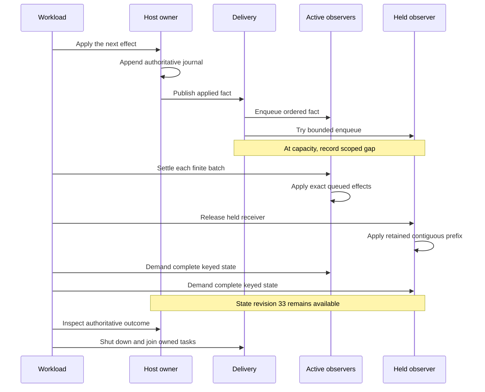

# Rust coordination: both candidates passed the finite profile

**The first real Tokio comparison preserved the declared outcomes in both candidates.** Across 40 fresh processes, all 26 normal runs matched the independent oracle and all 14 deliberately broken controls were detected. Every process exited 0; the two premature-close controls were classified inconclusive because they closed before their admitted work settled.

This does **not** select a bus. There was one run per profile and arm, no latency or heap measurement, and no Swift, socket, actual Host/Gateway or database integration. The common preparation cases exercised the same dedicated owner in both arms; they do not distinguish the two delivery topologies. The [full E3 procedure](../../../designs/10-swift-client/experiments/coordination.md) still has unexecuted cases.

## What the two candidates actually do

The Host owner applies each operation to its own keyed state or non-idempotent journal **before** publishing a fact. Delivery then carries ordered effects and complete keyed latest state through separate paths. A frontend observation cannot become the authority for whether the underlying operation happened.

| Boundary | Scoped owners | Shared typed fact hub |
| --- | --- | --- |
| Domain operation | Two Host owner tasks | The same two Host owner tasks |
| Ordered delivery | Each Host has a queue per observer: six queues of 16 | One additional hub task has three combined queues of 32 |
| Latest state | Two complete per-Host keyed snapshots | One combined keyed snapshot, plus the hub's own keyed bank |
| Observer subscriptions | Six ordered and six state subscriptions | Three ordered and three state subscriptions |
| Ordinary owned tasks | Seven, including the trace collector | Eight, including hub and trace collector |
| Held preparation cases | One additional owned computation | One additional owned computation |
| Equal comparison envelope | 96 ordered-observer slots total | 96 ordered-observer slots total |

Equal observer capacity does not mean equal memory cost. The hub adds ingress, state and a task; scoped owners add explicit per-Host subscriptions. All three observers in this profile are interested in both Hosts. This is not a selective-interest scale study.

## Follow one slow observer

The workload deliberately holds observer 3 while two active observers settle at explicit checkpoints. It uses owner replies and gates, rather than sleeps or a claim that the system became idle.

Actual result: all 33 Host effects existed exactly once and both active observers applied all 33 in order. The held scoped subscriber retained 16 effects and reported its first missing sequence as 17. The held hub subscriber retained 32 and reported its first missing sequence as 33. All three later read complete state revision 33.

The difference follows the frozen queue arrangement. It does not show that the hub is faster, or that a gapped terminal stream can safely resume. This profile promises explicit incomplete observation for the held fact subscriber; it makes no durable replay claim.

## Normal cases and what they establish

| Profile | Runs across both arms | Observed outcome |
| --- | --- | --- |
| Ordered effects and keyed state | 2 | First demand saw `alpha`; later demand saw `beta` and independent Host B `quiet`. Exact per-target effect orders matched. |
| Old preparation, replaced execution | 4 | Old success and old failure were rejected after a new incarnation was offered. |
| Old preparation, same execution | 4 | A newer preparation generation stayed current; releasing old success/failure did not withdraw it or another Host's value. |
| Slow observer | 2 | Required owner/active effects continued; the held observer had an explicit scoped gap and retained current complete state. |
| Admission closed before completion | 2 | The exact late candidate was processed and rejected before actual joins and case closure. |
| No observers | 2 | All observer tasks joined and actual leaf endpoints reported zero receivers before effect 51. The owner still applied it once and retained revision 2. |
| Keyed population and skew | 8 | At first demand, all 8 or 64 keys remained correct with 64-byte or 4-KiB payloads. The hot key reached revision 8,448 and the quiet Host's effect 9,001 was applied and observed. |
| Payload boundary | 2 | A 16,384-byte value was retained; a 16,385-byte fixture value was refused before owner mutation. |

These are 13 finite normal profiles per arm, not 26 independent product features. Bulk operations are causally scripted requests to concurrent owners, not a simultaneous multi-producer load or fairness benchmark. Observers read state at explicit demands; automatic watch-change wakeups were not exercised. The preparation owner is a common subprobe, separate from the A/B fact wiring. Source revision reordering, controlled deadlines and cross-producer causal prerequisites remain unqualified. A later [partial-invalidation probe](demand-results.md) separately exercises two first-demand profiles; this original comparison did not cover them.

## Did the oracle catch real mistakes?

Each wrong mode changed an actual owning, routing, observer-application or closure stage. No finished JSON report was edited to create a failure.

| Deliberately wrong mode | Independent observation that rejected it |
| --- | --- |
| Skip an authoritative effect | Literal owner journal and effect list differ |
| Swap Host labels | Target-to-effect assignments differ even though the set of target labels is unchanged |
| Apply an effect twice | Actual non-idempotent owner application count and journal differ |
| Install an old preparation | The specific old candidate is installed rather than rejected; current offered value is wrong |
| Reverse two observer effects | Exact per-target order fails despite the same final count |
| Offer a correct value one checkpoint late | The first demanded snapshot is wrong even though the final state converges |
| Close before released work settles | Closing ordinal precedes its specific late completion and subsequent joins; later zero tasks do not repair the false close |

All seven controls were detected in each arm. The independent source challenge also caught a pre-run oracle mistake: checking only the set of Host keys could not identify swapping both keys. The assignment check was corrected before any runtime execution. [Pre-run corrections](../../../../../../tmp/experiments/2026-10-21-coordination-topology/pre-run-corrections.md) preserve that distinction.

## Resources and evidence

All 40 raw reports were hash-checked against their receipts; each was below 4 MiB. The raw total was 3,666,169 bytes, and the run directory including its frozen source snapshot was 3,927,232 bytes at this check. Source and binary stayed unchanged during the matrix. All reported tasks had actual completed joins. Counted queue admissions equalled consumption after shutdown.

At the 64-key, 4-KiB endpoint, each arm's owner state represented 262,144 payload bytes. Its leaf publisher snapshot referenced the same amount of payload backing. These are separate logical scopes and may share allocation; adding them does not produce a heap total. The hub's keyed bank, Host banks and diagnostic checkpoint copies are separately visible. Heap allocation and latency are explicitly **unmeasured**. The queue peak is logical accounting that may include a receive handoff, not exact channel occupancy.

The unpublished instrument uses Rust 1.98.1, Tokio 1.48.0 and the existing Router lint table, with first-party unsafe forbidden. Lead formatting, all-target Clippy with warnings denied and build exited 0. Python Ruff, formatting and basedpyright passed with zero errors or warnings. No AgentStudio app build or suite was run for this instrument.

Open the [frozen plan](../../../../../../tmp/experiments/2026-10-21-coordination-topology/plan.md), [actual matrix summary](../../../../../../tmp/experiments/2026-10-21-coordination-topology/run-001/summary.json), [manifest and binary identity](../../../../../../tmp/experiments/2026-10-21-coordination-topology/run-001/manifest.json), [Lead evidence check](../../../../../../tmp/experiments/2026-10-21-coordination-topology/lead-evidence-check.json) or [source/accounting handback](../../../../../../tmp/experiments/2026-10-21-coordination-topology/source-readiness.md) for detail.

An independent Sol Researcher inspected source, all raw hashes and result records, actual joins/endpoints and the retained binary. It found no remaining material contradiction for these finite claims and supplied the explicit demanded-read limitation above. This was an independent evidence check, not formal program or product review. [Handback and scope](../../../../../../tmp/experiments/2026-10-21-coordination-topology/independent-evidence-check.md).

## What this changes for AgentStudio

Typed owner boundaries are practical with either delivery arrangement. We can preserve commands at their execution owners, publish facts selectively, and provide clients with complete keyed views without putting every operation onto one universal bus.

The remaining topology decision needs the real consumer mix and measurements. Two hidden-scope/first-demand profiles now have the separate results linked above. Remaining discriminators include controlled deadline/equality behavior, explicit cross-owner causal dependencies, source-revision ordering, recovery and native Swift publication. Those stay in E3; this result neither removes them nor chooses a product policy. The actual socket → Gateway → addressed Host route, database commits/copies and physical iOS still require their own proof.
