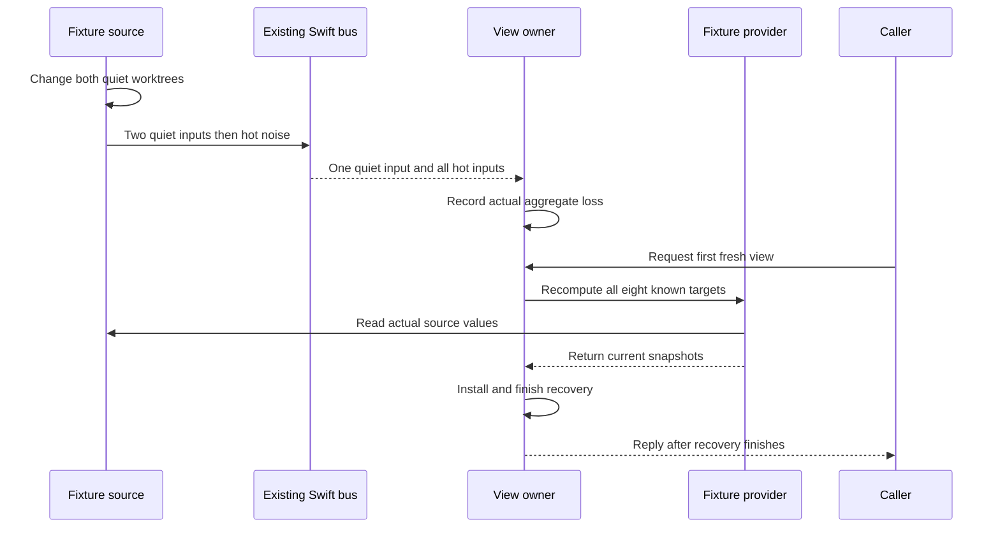

# Quiet work can disappear behind ignored traffic

**The unchanged Swift EventBus lost a required quiet invalidation in the exercised mixed queue.** Filtering before admission and full-scope recomputation each produced current first replies in the declared fixture. All eight processes exited 0: two explicitly incomplete baselines, four qualified matches and two detected wrong controls. The incomplete baselines are counterexamples, not successful future-client contracts.

This is a standalone source-component experiment with synthetic envelopes and a fake filesystem/Git provider. It does not reproduce a current AgentStudio Git or UI failure, select a Rust bus, or deliver the Host/Gateway. The existing live batch method is real; the inspected production sources do not call that batch entry. The production projector and publication schedule still need their own proof.

## Follow a quiet invalidation through loss and recovery

Two worktrees on Host B change in the fixture's authoritative source. Their invalidations enter the same bounded subscription as ignored topology noise from Host A. Ignoring noise after dequeue is too late to prevent it occupying the queue.

The drawing follows the successful recovery profile for one view. All three views consume actual subscriptions. In these runs, the first quiet input survived and the second was lost; the frozen oracle permits any legal zero-or-one quiet survivor and does not assume this particular victim. The two changed targets, source reads, returned values, installations and first caller response are checked independently.

## Three mechanisms, with the same source truth

The source has eight composite targets across two Hosts, two repositories per Host and four worktrees per Host. Only Host B / repository 1 / worktrees 1 and 2 change. Three views begin with real baseline provider reads. Observation lifetimes stay fixed; file-data revisions advance separately.

| Profile, each at capacity 2 and 256 | What actually enters the view queue | Actual first response |
| --- | --- | --- |
| Coarse intake | Both topics share one queue; noise is ignored after receipt | One quiet target remains stale in every view; reply is explicitly incomplete |
| Filesystem interest | The unchanged bus filters out topology before its bounded queue | Both quiet inputs arrive, zero drops, both changed values present |
| Recover after loss | Same coarse queue and actual loss; the fixture recomputes all eight known targets through its provider | Recovery completes before reply; both changed values present |

The real component receives one synchronous batch containing two quiet inputs followed by as many hot inputs as the queue's capacity: four offers at capacity 2, 258 at capacity 256. A reader may take one item while the batch posts, then it must await the bus's consumption bookkeeping before taking another. The hot suffix displaces every quiet item still buffered. Two canaries ensure at least one loss without inventing a pre-dequeue gate or relying on a chosen scheduling order.

Every coarse reader in the actual corpus retained the first canary and lost the second, giving one replacement drop per subscription. Every narrowed reader received both canaries and no noise. The reports contain 3,114 actual intake observations and 18 replacement drops across the entire matrix, including the wrong controls.

An aggregate loss count does not name a lost worktree. Recovery therefore reads the entire declared known scope. It asks a separate provider that actually queries the fixture source; rereading a stale prepared Git cache could not establish recovery. This finite source remains unchanged during recovery, so concurrent mutation and snapshot/live-cut races remain untested.

## A correct final bank cannot repair a stale first reply

Both controls change actual view 1 behavior at capacity 256. They initially recompute the other six targets while omitting both canaries, so either legal quiet-survivor schedule still leaves at least one stale value. The checker never edits a raw report to manufacture failure.

| Broken behavior | Actual first response at Host B / worktree 2 | Final diagnostic | Why the checker rejects it |
| --- | --- | --- | --- |
| Skip the canaries, clear recovery and reply as current | Baseline branch, despite the changed source | Still stale | Missing recovery and falsely qualified currentness |
| Reply before canary recovery, then finish the real reads | Baseline branch | Correct changed branch | A completed stale response remains wrong after later repair |

In the early-reply control, view 1's owner send was recorded at ordinal 987, its caller received the stale value at 988, and the canary recovery phase opened at 991 and ended at 1018. These are trace positions, not timings. Caller tracing need not generally follow owner tracing: the real response yield happens before the owner records its send.

All findings stayed within view 1 and the two intended canary targets. The other six targets, both other views and common source/lifecycle checks remained healthy. A crash, malformed report, missing task ending or unrelated failure could not count as a detected control.

## What was built and what actually ended

Four source files were copied byte-for-byte from the pinned product baseline: the bus plus the real UUID, trace-record and performance-reporter declarations. The reporter was passed as absent. The isolated build compiles a minimal infrastructure module and the unchanged bus with twelve new fixture files; this is not the product SwiftPM graph or packaged app.

Sunclaw compiled and ran the component with Apple Swift `6.4`, Swift 6 language mode, complete strict concurrency, warnings-as-errors, SDK `27.0` and a macOS 26 arm64 target. Both compilation producers and the three compiler/SDK receipt producers exited 0. All eleven Python sources passed Ruff, formatting and strict basedpyright. The [raw static outputs and exact file list](../../../../../../tmp/experiments/2026-10-21-eventbus-live-overflow/lead-static-receipts.json) are retained separately from runtime results.

All 48 owned fixture task joins completed: three readers and three fresh-request tasks in each process. The reports include 24 actual reader-stream endings, 24 actual first replies and 316 provider returns. The unchanged bus's internal weak termination-cleanup tasks expose no join handles and remain unobserved. This is not a claim that all Swift runtime work was joined.

All 40 frozen inputs, the actual executable, the infrastructure library and raw report hashes remained unchanged. Eight raw reports total 3,029,634 bytes; the largest is 625,858 bytes. The complete frozen-source/observation corpus measured 3,448,781 bytes at the separate custody check, below its 64 MiB cap. That check passed 186 checks with zero failures. Reusing the output prefix was refused before any remote call, leaving all 118 saved files unchanged and launching no additional case.

Open the [declared plan](../../../../../../tmp/experiments/2026-10-21-eventbus-live-overflow/plan.md), [literal reference](../../../../../../tmp/experiments/2026-10-21-eventbus-live-overflow/expected-results.json), [actual matrix summary](../../../../../../tmp/experiments/2026-10-21-eventbus-live-overflow/run-001/summary.json), [frozen inputs](../../../../../../tmp/experiments/2026-10-21-eventbus-live-overflow/run-001/manifest.json), [custody/closure check](../../../../../../tmp/experiments/2026-10-21-eventbus-live-overflow/lead-evidence-check.json) and [build receipt](../../../../../../tmp/experiments/2026-10-21-eventbus-live-overflow/lead-build-check.json). Artifact identities are recorded there; version strings alone do not identify the executable.

## What this tells us about the bus decision

An independent Sol Researcher inspected every raw report and per-case result, exact source/build custody and actual work endings without executing the semantic checker. It found no remaining material contradiction within this scope. Its [separate account](../../../../../../tmp/experiments/2026-10-21-eventbus-live-overflow/independent-evidence-check.md) preserves the pre-run corrections and the distinction between corroborated raw evidence and the Lead's historical fresh-prefix receipt. This is research evidence, not product acceptance.

The useful design question is where required work can be lost and who preserves or recovers it. A bus can correctly implement a bounded lossy contract while a consumer fails a stronger freshness obligation. Selective admission, separate delivery domains and explicit recomputation have different costs; this experiment ran the first and third, not a partitioned-queue candidate or a Rust comparison.

The current Git projector subscribes to both topology and filesystem topics and ignores several topology variants only after dequeue. It also needs some registration/lifecycle handling. Removing every topology event is therefore not an established product fix. Canonical topology assertions arrive through a separate direct path; a physical registration is not itself canonical authority. [Exact source survey](../../../../../../tmp/practices-research/2026-10-21-daemon-progress/quiet-topic-survey/source-notes.md).

This adds bounded C12 component evidence alongside [partial invalidation](demand-results.md), [scheduled eligibility](eligibility-results.md) and [causal delivery](causality-results.md). Actual production publication, the full Git pipeline, 8/64-source skew profiles, concurrent recovery, replay/restart, native/socket publication, heap, latency and fairness remain unqualified. No product/vendor source or installed session changed.
