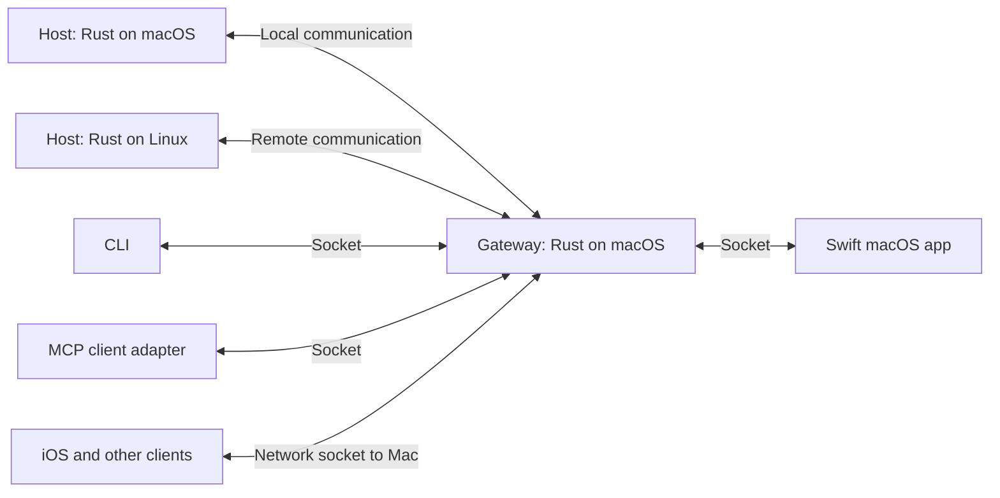

# AgentStudio daemon extraction survey

This survey maps the current external surfaces, their execution and state owners, and the contracts a Rust extraction must account for. It is source evidence for the whole-system specification, not an approved crate graph or an executable implementation plan.

Baseline: AgentStudio `624300332f5e50f7bb8cbb9fc786d5e5b4a3d462`; agentstudio-git `4cca397dfc869857064da4e9ec8289ea46adc479` (exact consumer pin); Codex Router example checkout `691cd560347d6e570dd3db0315b9ddb3ee259f84`. Inspected 2026-10-15. Existing tests were read, not executed. Runtime, performance, deployment, and extraction correctness are unverified.

## Required outer shape

The owner specified Host daemon feature parity on macOS and Linux and a Rust Gateway service on macOS. The latest explicit route is **MCP/CLI/iOS/macOS app → socket → Mac Gateway → Host**. Only the Gateway connects to the Host on the frontend route; there is no direct frontend-to-Host bypass. One Host supports multiple simultaneous Mac Gateways with separate attachments, as selected in the exact multiple-Mac question. Multiple client devices and Mac-local work are included. Numeric limits, per-capability contracts and internal ownership still require design.

Authorized in-session agent/hook/context input uses the session’s own Host locally. CLI machine work targets its attached Host; its ordinary Mac-local physical route remains open after independent review N1, rather than being inferred from the target-machine rule. One Gateway can connect to several remote Hosts, independently of the multiple-Gateways-per-Host requirement. Swift↔Rust Gateway schemas require real Unix-socket interoperability coverage; embedded Rust–Swift FFI is not a prerequisite. See the [later owner corrections](owner-inputs/owner-service-corrections.json).

Working names proposed by the Lead: **AgentStudio Host** for the remote process and **AgentStudio Gateway** for the Mac process. These names do not decide internal ownership.

Later confirmed lifecycle primitive: **detach an attachment** and **terminate its session** are separate. Closing a pane detaches while execution can continue. A detached-session view or optional cleanup timer is a later UX/policy layer; the owner's fifteen-minute example did not select a deadline/default. Natural exit, process failure and reboot remain explicit outcomes rather than promises of immortal execution.

Later confirmed no-client outcome: the Host continues sessions, authorized agent inputs and terminal facts/activity while Swift is closed or the Gateway is disconnected. Native pane membership/renderer availability cannot be required to admit that existing authorized work. Concrete credential, source-fact and history/recovery mechanisms still require design.



Unresolved meaning includes numeric/per-instance limits, standalone service-absent CLI availability, exact sharing/retention contracts and transport/security/recovery policy. Host-local session input and attached-machine CLI execution are settled; neither is an unresolved Mac-reachability branch. Mac-only Gateway placement, multiple simultaneous Mac Gateways per Host, broader frontend devices, Gateway-only frontend routing and no-client Host activity are settled. An earlier [remote-boxes discussion](../../../wip/2026-09-26-remote-boxes/2026-09-26-remote-boxes-problem-statement.md) contains one-per-box/phone/Mosh/NDJSON ideas and conflicting app-hub wording. It is historical input; current owner statements take precedence. The supplied research remains candidate mechanism evidence. All three [original research memos and later corrections](owner-inputs/README.md) are preserved from this exact session. Unix sockets only cover same-machine edges; phone access to the Mac Gateway requires an appropriate network socket contract and a reachable Mac.

## Survey tree

```text
AgentStudio service system
├── Services: macOS/Linux Rust Host with feature parity; Mac-only Rust Gateway
├── Consumers: macOS app; iOS/other clients; CLI; MCP; provider hooks and agents
├── Capabilities
│   ├── Repository discovery and inventory
│   ├── Git facts, branches, diffs, content, and remote operations
│   ├── Worktree creation, fork, removal, and pruning
│   ├── Terminal sessions, I/O, observations, and process lifecycle
│   ├── Agent Sessions, binding generations, and activity
│   ├── Pane messages, asks, answers, titles, and status
│   ├── Files, reviews, and annotations
│   └── Workspace/pane state and native presentation
├── Communication: local interfaces; remote protocol; streams and content
├── Authority: identity; targeting; permissions; revocation; release channels
├── Data: canonical state; operational history; caches; local UI memory; config
├── Lifecycle: start; stop; reconnect; recovery; retention; observability
├── Platforms: macOS and Linux contracts, including full fork counterparts
├── Rust foundation: crate DAG; Tokio; types; safe APIs; naming; linting
└── Proof: contracts; real storage/filesystem/process interactions; performance
```

## Current surface and owner map

These are current-source observations. The last column names a distinction to preserve in the design, not a future owner assignment.

| Surface | Current execution owner | Extraction distinction |
| --- | --- | --- |
| CLI worktree commands | `AgentStudioWorktreeOperations` runs in the CLI before IPC setup | Actual local execution, not a socket wrapper |
| CLI package install/uninstall | Provider-specific installers in IPCClientCore | Local configuration and resource effects |
| CLI provider hooks | Pure Codex/Claude projection, then authenticated Sessions RPC | Provider vocabularies differ; not a generic queued event feed |
| CLI pane verbs | Typed wrappers over pane-context methods; CLIStore also holds ordering/cursors | Notice-only offline path differs from interactive asks |
| RPC framing and descriptors | IPCTransport and ProgrammaticControl | Generic mechanics/contracts already separated from app |
| RPC serving and authority | AppIPC server, connection reader, principal registry, broker | Same-UID and pane lifecycle assumptions are local today |
| Workspace/layout/command queries | App adapters, dispatcher, AppDelegate, PaneTabViewController | Explicit targets still depend on app/window owners |
| Sessions and pane context | Ingestion/service actors plus shared SQLite transaction ports | Non-view logic, but App composes their binding/ask joins |
| Repository inventory | Native filesystem intake, scanner, topology mutation/persistence | Observation is not canonical membership by itself |
| Git/remote/forge refresh | Git projector, remote refresh actor, Forge actor, demand coordinator | Currentness and attention are app-owned policy |
| Native worktree creation | WorktreeCreationCoordinator calls SDK through a narrow port | Different policy path from CLI creation |
| Git package | Contracts, local libgit2 engine, system-Git remote engine | Git mechanics differ from application lifecycle policy |
| Terminal | zmx backend plus Ghostty SurfaceManager/runtime | Persistent process survival differs from surface-backed control |
| Bridge File/Review | Pipeline/construction actors, product sessions, controller/WebKit adapters | Data construction differs from page/install/render authority |
| Annotations and output | Durable annotation service plus App output effect port | Remote file writes, local clipboard and Finder are different effects |
| Native OS ingress/effects | App lifecycle, folder chooser, OAuth, editor/browser/Finder adapters | Client effects cannot use remote paths as local paths |
| Observability/configuration | Data-root/bootstrap readers, trace runtime and export projection | Preserve channel separation and exported-data scrubbing |
| Bridge development HTTP host | Debug-only Swift/Hummingbird executable, loopback routes into a real Bridge product host | Existing non-view composition and proof seam; not a shipped remote daemon |

Primary entry points: [CLI main](../../../../Sources/AgentStudioIPCClient/main.swift:6), [CLI dispatch](../../../../Sources/AgentStudioIPCClientCore/AgentStudioIPCClientCommandLineRunner.swift:87), [worktree dispatch](../../../../Sources/AgentStudioWorktreeOperations/WorktreeCommandLine.swift:11), [server composition](../../../../Sources/AgentStudio/App/Boot/AppDelegate+IPC.swift:424), [command execution](../../../../Sources/AgentStudio/App/IPCComposition/AgentStudioIPCCommandAdapter.swift:117), [filesystem composition](../../../../Sources/AgentStudio/App/Coordination/FilesystemGitPipeline.swift:152).

The [Bridge development executable](../../../../Sources/AgentStudioBridgeDevelopmentServer/AgentStudioBridgeDevelopmentServerMain.swift:7) rejects non-debug execution, binds [loopback](../../../../Sources/AgentStudioBridgeDevelopmentServer/BridgeDevelopmentServerConfiguration.swift:18), and exposes health/bootstrap/release plus command/stream/content routes through its [HTTP application](../../../../Sources/AgentStudioBridgeDevelopmentServer/BridgeDevelopmentHTTPApplication.swift:18). It prepares real Core/Bridge dependencies and joins lifetime to a parent input pipe. This is stronger evidence of existing separable composition than a protocol declaration, but no behavior was run here and its development effects are not production-native effects.

## IPC and CLI inventory

The [compiled index](../../../../Sources/AgentStudioProgrammaticControl/BuiltInDescriptors/IPCBuiltInMethodIndex.swift:35) supplies 54 built-ins; three composition-owned methods make **57 declared RPC names**. This is a source inventory, not a successful-effect count.

| Family | Complete method names |
| --- | --- |
| Authentication | `auth.login`, `auth.status` |
| System | `system.ping`, `system.identify`, `system.version`, `system.capabilities` |
| Window/workspace | `window.list`, `window.current`, `workspace.list`, `workspace.current` |
| Pane/layout | `pane.list`, `pane.current`, `pane.snapshot`, `pane.focus`, `pane.split`, `pane.close` |
| Drawer | `drawer.addPane`, `drawer.toggle` |
| Terminal | `terminal.status`, `terminal.snapshot`, `terminal.send`, `terminal.wait` |
| Pane context | `pane.message.send`, `pane.message.ask`, `pane.message.withdraw`, `pane.message.changes`, `pane.line.set`, `pane.title.set`, `pane.writer.claimEpoch`, `pane.context.get` |
| Sessions | `session.event`, `session.refusal`, `session.query` |
| Bridge diff | `bridge.diff.load`, `bridge.diff.refresh`, `bridge.diff.getPackage`, `bridge.diff.renderState`, `bridge.diff.selectFile`, `bridge.diff.scrollToFile`, `bridge.diff.expandFile`, `bridge.diff.collapseFile` |
| Bridge tree | `bridge.fileTree.search`, `bridge.fileTree.setFilter`, `bridge.fileTree.revealPath` |
| Bridge file | `bridge.fileView.open`, `bridge.fileView.getContent`, `bridge.fileView.showMarkdownPreview` |
| Bridge telemetry | `bridge.telemetry.snapshot`, `bridge.telemetry.flush` |
| UI/sidebar | `ui.commandBar.open`, `ui.arrangements.open`, `sidebar.grouping.get`, `sidebar.surface.get` |
| Events | `events.subscribe`, `events.unsubscribe` |
| Commands | `command.list`, `command.execute` |

Of the 54 built-ins, 31 are all-channel and 23 debug-testing. With the three composition methods, channel projection admits 34 names on stable/beta and 57 on debug, before authority and availability checks. Debug provenance remains a separate check. Sources: [descriptor defaults](../../../../Sources/AgentStudioProgrammaticControl/BuiltInDescriptors/IPCBuiltInDescriptorSupport.swift:112), [registry filtering](../../../../Sources/AgentStudioAppIPC/AgentStudioIPCRegistryAuthorization.swift:32), [typed admission](../../../../Sources/AgentStudioAppIPC/AppIPCTypedMethodRegistration.swift:224).

The exhaustive [command IPC projection](../../../../Sources/AgentStudio/App/Commands/AppCommand+IPCProjection.swift:174) covers **154 identities**: 24 all-channel and 130 debug-testing; separately, 143 headless-tagged and 11 UI-presentation-tagged. The source switch is the authoritative complete identity inventory. Preserve the independent axes of command identity, exposure, arguments, targets, privilege, execution mode, result boundary and agent eligibility.

The later [E2 effect-boundary classification](evidence/2026-10-15-daemon-extraction-survey/e2-effect-boundaries.md) links complete source matrices for 57 app RPC names, 44 Git operations, 16 Bridge calls and 22 nested annotation operations. It distinguishes admitted input, committed state, native effects, partial/unknown outcomes and client receipt. These are overlapping protocol layers, not additive feature counts or runtime parity proof.

A [normalized per-command inventory](evidence/2026-10-15-daemon-extraction-survey/command-surface-inventory.md) includes all 154 names and their current exposure/mode tags. Source-text extraction compared the identity and both switch sets for equality; it is not compiled or runtime validation and assigns no future execution owner.

**Headless does not mean standalone.** Command execution dispatches into shell/workspace owners. Server construction requires an accepting main window. Four worktree-creation identities lack parameterized IPC contracts and return unavailable; dormant Inbox and retired Panes settings also return unavailable. `focusSidebar` is advertised all-channel but its UI-presentation execution is separately restricted. Sources: [server window gate](../../../../Sources/AgentStudio/App/Boot/AppDelegate+IPC.swift:432), [shell outcomes](../../../../Sources/AgentStudio/App/Boot/AppDelegate+HeadlessIPCCommandHandling.swift:30), [dispatcher](../../../../Sources/AgentStudio/App/Commands/AppCommandDispatcher.swift:161).

CLI branches are `worktree new/list/remove/prune`; Codex/Claude `package install/uninstall`; provider `hook` events; pane verbs `notify/ask/withdraw/answers/line/title/pane`; compiled help; explicit live discovery; ordinary dot-separated RPC calls. Provider installers edit provider-owned configuration/resources; worktree operations execute in-process. Only classified never-submitted, notice-shaped requests may queue offline. Delivery uncertainty, asks and withdrawal do not become generic offline commands. Sources: [provider branch](../../../../Sources/AgentStudioIPCClientCore/AgentPackage/AgentPackageCommandLine.swift:15), [pane vocabulary](../../../../Sources/AgentStudioIPCClientCore/PaneCLIInvocation.swift:6), [offline gate](../../../../Sources/AgentStudioIPCClientCore/OfflineOutbox/PaneNotificationOfflineHandler.swift:58).

### Authority and connection contracts

- Current local path: trusted socket directories and same-UID peer gate → connection principal → typed method/target normalization → authority → effect owner → result validation. See [paths](../../../../Sources/AgentStudioAppIPC/AgentStudioIPCPaths.swift:109), [peer gate](../../../../Sources/AgentStudioAppIPC/AgentStudioIPCAuthentication.swift:553), [agent checks](../../../../Sources/AgentStudioAppIPC/AppIPCPaneAgentAuthorization.swift:50).
- Pane credentials are reusable verifier-backed credentials with connection leases and close/Undo/final-revocation checks, not merely a one-shot login. See [authentication](../../../../Sources/AgentStudioAppIPC/AgentStudioIPCAuthentication.swift:265).
- Current [pane launch identity code](../../../../Sources/AgentStudio/App/PaneAgents/PaneIPCIdentityOwner.swift:68) caches a generated environment per pane; [issuance](../../../../Sources/AgentStudio/App/PaneAgents/PaneIPCIdentityOwner.swift:75) creates the raw bearer, while [environment projection](../../../../Sources/AgentStudio/App/PaneAgents/PaneIPCIdentityOwner.swift:118) supplies it to the pane shell. Descendants can inherit that bearer. Persistence is [verifier-only](../../../../Sources/AgentStudio/App/PaneAgents/IPCContinuityRepository.swift:20), not recoverable raw-token storage. [Issue failure](../../../../Sources/AgentStudio/App/PaneAgents/PaneIPCIdentityOwner.swift:102) still launches a terminal with empty authority values. The environment also contains machine-local socket/store/executable paths. These values are not portable Linux routes. Older token-fd prose is stale. No running-process credentials were read here.
- Requests and responses have different frame bounds; discovered schemas and wire identity are validated. See [frame policy](../../../../Sources/AgentStudioIPCTransport/IPCFramePolicy.swift:16), [catalog decoder](../../../../Sources/AgentStudioProgrammaticControl/IPCMethodCatalogDecoder.swift:56).
- Blocking asks own a connection admission state; later requests are busy. EOF/read failure and app stopping trigger different committed ask settlements. See [connection reader](../../../../Sources/AgentStudioAppIPC/AgentStudioAppIPCConnectionReader.swift:19), [ask settlement](../../../../Sources/AgentStudio/App/IPCComposition/AgentStudioIPCPaneContextAskWait.swift:8).
- Event subscriptions are connection-owned and slow subscribers can be ejected. This broker is not a durable remote replay journal. Terminal waits separately use runtime subscription/replay. See [broker](../../../../Sources/AgentStudioAppIPC/IPCEventBroker.swift:45), [terminal handoff](../../../../Sources/AgentStudio/App/IPCComposition/AgentStudioIPCRuntimeAdapter.swift:107).
- Documentation mentions permission RPCs not present in the 57-name index. Fourteen event names are declared, but source tracing established Bridge publication and left terminal/permission socket publication unobserved. Declared constants and injected broker tests do not establish live feeds. See [event vocabulary](../../../../Sources/AgentStudioProgrammaticControl/IPCEventContracts.swift:3), [Bridge producer](../../../../Sources/AgentStudioAppIPC/AppIPCBuiltInBridgeReviewRegistrations.swift:221).

## Git and worktree inventory

The [consumer pin](../../../../Package.swift:37) uses the exact inspected package checkout. Its [client contract](../../../../../agentstudio-git/Sources/AgentStudioGitContracts/AgentStudioGitSDK.swift:3) has **33 local requirements**, **10 remote requirements**, and a separate [discovery-only operation](../../../../../agentstudio-git/Sources/AgentStudioGitContracts/GitDiscoveryReadContracts.swift:23).

| Plane | Complete operations |
| --- | --- |
| Identity/worktrees | `repositoryIdentity`, `worktrees`, `validateWorktree`, `createWorktree`, `forkWorktree`, `forkWorktreeEligibility`, `pruneStaleWorktree`, `removeWorktree`, `lockWorktree`, `unlockWorktree` |
| Status/index/ignore | `statusObservationPlan`, `statusFacts`, `exactLineCountDetail`, `completeStatus`, `trackedPaths`, `isPathIgnored`, `ignoredPaths` |
| Branch relations | `branches`, `remoteNames`, `branchUse`, `aheadBehind`, `assessBranchIntegration`, `deleteLocalBranch` |
| Review/object reads | `resolveReviewDefaultTarget`, `captureReviewComparisonTargets`, `resolveRevision`, `readTree`, `diff`, `countCommitRange`, `summarizeDiffImpact`, `contributionDiff`, `directReviewComparison`, `content` |
| Remote | `clone`, `fetch`, `captureRemoteTrackingSnapshot`, `stageFetch`, `promoteStagedFetch`, `cleanupStagedFetch`, `cleanupAbandonedStagedFetches`, `push`, `remoteReferences`, `probeRemoteBranch` |
| Narrow discovery | `readDiscoveryCandidate` |

The examined public contracts do not expose generic commit/stage/checkout/merge/rebase/stash or watch/subscription APIs. Internal worktree index writes do not make this a general index-editing service.

Local libgit2 reads run outside actor executors; repository writers serialize entire transactions. Remote operations deliberately run system Git through bounded/cancellable process machinery. Staged fetch and expected-reference promotion are separate operations. See [writer registry](../../../../../agentstudio-git/Sources/AgentStudioGitLocal/Runtime/GitRepositoryWriterRegistry.swift:4), [remote runner](../../../../../agentstudio-git/Sources/AgentStudioGitRemote/GitProcessRunner.swift:45), [staged fetch](../../../../../agentstudio-git/Sources/AgentStudioGitRemote/SystemGitRemoteClient+StagedFetch.swift:53).

AgentStudio's **55-file worktree policy module** additionally owns branch/start-point resolution, network preflight, config-selected materialization, evidence archival, stale-lock assessment, removal policy, branch retirement and prune previews. `list` can fetch and is not necessarily effect-free. Removal/prune currently default to a `.notChecked` activity probe; no app-pane integration was established. See [runner](../../../../Sources/AgentStudioWorktreeOperations/WorktreeOperationRunner.swift:78), [removal](../../../../Sources/AgentStudioWorktreeOperations/WorktreeRemovalRunner.swift:158), [prune](../../../../Sources/AgentStudioWorktreeOperations/WorktreePruneRunner.swift:45), [archive verification](../../../../Sources/AgentStudioWorktreeOperations/WorktreeEvidenceArchiver.swift:131).

**Native and CLI creation differ.** Native creation uses a distinct coordinator, publication hold and rescan, plain creation for default/selected branches, and copy-all ignored material for native forks. CLI default CoW uses main-worktree config inclusion; changes-only and no-fork select different paths. These are observable policy differences to resolve, not duplicate code to merge blindly. See [native coordinator](../../../../Sources/AgentStudio/App/Coordination/WorktreeCreationCoordinator.swift:13), [native fork](../../../../Sources/AgentStudio/App/Coordination/WorktreeCreationCoordinator.swift:184), [CLI materialization](../../../../Sources/AgentStudioWorktreeOperations/WorktreeOperationRunner+CreationMaterialization.swift:7).

### Linux fork counterpart

The owner explicitly requires a Linux counterpart. Current Swift package distribution is macOS-specific; copying the SwiftPM dependency into a Rust/Linux manifest is not an extraction strategy. Shared native backends, safe wrappers or a Rust realization require separate evidence and design.

Current fork includes eligibility, contained traversal, strict CoW file cloning, metadata, link/special-node policy, Git-administration relocation, rewritten-pointer metadata, index construction/adoption proof, branch CAS, cancellation, rollback and typed residue. It is not only `fclonefileat`. See [eligibility](../../../../../agentstudio-git/Sources/AgentStudioGitLocal/WorktreeFork/WorktreeForkEligibility.swift:23), [materializer](../../../../../agentstudio-git/Sources/AgentStudioGitLocal/WorktreeFork/APFSStrictCloneMaterializer.swift:32), [error contract](../../../../../agentstudio-git/Sources/AgentStudioGitContracts/GitWorktreeForkError.swift:6).

Linux primary evidence: [FICLONE](https://man7.org/linux/man-pages/man2/ioctl_ficlone.2.html) provides file-data CoW on a supporting same-filesystem pair, not tree snapshots or metadata equivalence; [openat2](https://man7.org/linux/man-pages/man2/openat2.2.html) provides explicit traversal restrictions. Existing Mac metadata and UTF-8-name assumptions need an explicit Linux contract, including [symlink metadata](https://man7.org/linux/man-pages/man7/symlink.7.html), [xattrs](https://man7.org/linux/man-pages/man7/xattr.7.html), [ACLs](https://man7.org/linux/man-pages/man5/acl.5.html), and [inode flags](https://man7.org/linux/man-pages/man2/ioctl_iflags.2.html).

Rustix `v1.1.4`, research commit `c4caf5caaa7e93828a2e4a4cdba1dd0171e45717`, exposes a [safe whole-file clone wrapper](https://github.com/bytecodealliance/rustix/blob/c4caf5caaa7e93828a2e4a4cdba1dd0171e45717/src/fs/ioctl.rs#L45). This is evidence that first-party unsafe is not necessary for that call; it is not a dependency selection, an unsafe-dependency audit, or proof of the complete fork. Safe ACL/symlink metadata coverage, kernel/filesystem support and unsupported outcomes remain open. No byte-copy fallback has been authorized.

The later [Linux feasibility procedure](../designs/06-worktree-fork/experiments/linux-feasibility.md) adds a separately pinned Rustix `1.1.5` API/backend check and a Fly environment qualification. The safe `openat2` export depends on the selected backend cfg. No semantic ACL-copy/FIEMAP convenience wrapper was established in that crate, but Linux POSIX ACL transport through safe xattr calls is a concrete candidate with kernel validation and an independent semantic/access oracle. Resolution-time containment, later directory movement, name-based cleanup races and numeric identity after custody ends are separate cases. The foreground operator channel also needs actual guest-result/retry/timeout qualification. No probe has run and no Linux parity or new product dependency follows from the source evidence.

The [fork contract worksheet](../designs/06-worktree-fork/research/worktree-fork-contracts.md) expands the current request/result, copy fidelity, Git/branch effects and cleanup boundaries into explicit counterpart-contract questions. Its source baseline and native/CLI differences do not choose the target policy or establish Linux runtime behavior.

## State, background inputs and runtime boundaries

| Data family | Present meaning and boundary |
| --- | --- |
| `core.sqlite` | Canonical topology/workspace graph plus durable session ownership and Undo lifecycle |
| `local.sqlite`: operational | Sessions, pane context/asks/write ordering, annotation history/output recovery, credential continuity, activity and outbox cursor |
| `local.sqlite`: UX/cache | Rebuildable enrichment and nonrebuildable recency/window/sidebar/cursor preferences; not one disposable cache class |
| CLIStore | Separate CLI-owned ordering/cursor/outbox state; app reads notice outbox and joins effect with its cursor transaction |
| Configuration | Launch data roots/environment, global preferences and per-main-worktree copy rules |
| Runtime-only state | Live process/native owners, current observation authority, subscriptions, surface/page/install generations |

Sources: [prepared datastore](../../../../Sources/AgentStudio/Core/State/SQLite/WorkspaceSQLiteDatastoreActor.swift:100), [feature transaction boundary](../../../../Sources/AgentStudio/Core/State/SQLite/WorkspaceSQLiteDatastoreActor+ApplicationLocalTransactions.swift:18), [outbox identity/commit](../../../../Sources/AgentStudio/App/PaneAgents/PaneCLIOutboxDrain.swift:83), [activity authority after restore](../../../../Sources/AgentStudio/Core/State/MainActor/Persistence/RepositoryLocalActivityStore.swift:18).

Today atoms and accepted capture revisions are process-local. WAL does not establish a safe shared GUI/Gateway/Host writer model. Core and local failures also differ; core may commit before a subsequent local failure. These require explicit ownership and receipt semantics, not copying database paths into another process.

Filesystem intake, scan validation, Git observation continuity, remote refresh and Forge results have independent source/currentness contracts. Refresh demand captures owning-window visibility, sidebar/tab/pane attendance and filesystem activity. Attention is therefore also an input to the work owner. Current settled-unavailable activity admits unknown worktrees to background local Git, not automatic remote/Forge demand; this is current-process behavior, not future Host policy. App-closed and disconnected policy remains open. See [attention capture](../../../../Sources/AgentStudio/App/Coordination/WorkspaceSurfaceCoordinator+RepositoryFactDemand.swift:46), [demand sets](../../../../Sources/AgentStudio/App/Coordination/RepositoryFactDemandCoordinator.swift:108), [unknown-activity scenario](../../../../Tests/AgentStudioTests/App/Coordination/RepositoryFactDemandCoordinatorTests.swift:103).

**Terminals:** zmx session/process control is distinct from Ghostty rendering and callback observations. Current terminal input/scroll/prompt actions require a surface; programmatic column/row resize is rejected. Current command-finished/title/CWD facts pass through Ghostty. Daemon session survival alone does not establish a headless terminal data plane. See [terminal dispatch](../../../../Sources/AgentStudio/Features/Terminal/Runtime/TerminalRuntime.swift:496), [zmx backend](../../../../Sources/AgentStudio/Core/RuntimeEventSystem/Runtime/ZmxBackend.swift:182), [callback admission](../../../../Sources/AgentStudio/Features/Terminal/Ghostty/GhosttyCallbackRouter.swift:8).

**Sessions/pane context:** hook projections feed actor/repository reduction, binding generations, title/line epochs, notices and asks. App composition joins Sessions and pane context. Late old exits, superseded writers and answer/disconnect races have explicit local rules. Provider resume hints are strings, not a source-proven session-resume execution API. See [ingestion](../../../../Sources/AgentStudio/Features/Sessions/Runtime/SessionsIngestion.swift:29), [composition](../../../../Sources/AgentStudio/App/PaneContext/SessionsPaneContextComposition.swift:34), [pane service](../../../../Sources/AgentStudio/Core/PaneContext/PaneContextService.swift:183).

**Bridge:** WebKit scheme/bootstrap/capability handling, semantic product sessions, shared construction actors, content endpoints, web worker preparation and DOM fulfillment are different owners. Its native/web protocol is a second external contract family beyond the 57 app RPCs. File/Review methods include source-current/retry/viewer-mode, comparison targets/update, intake/publication/viewed state, annotations commands/output/projection, worker session/resync and subscriptions. See [semantic vocabulary](../../../../Sources/AgentStudio/Features/Bridge/Models/Transport/BridgeProductCallContracts.swift:461), [scheme ingress](../../../../Sources/AgentStudio/Features/Bridge/Transport/BridgeSchemeHandler+RPC.swift:21), [provider dispatch](../../../../Sources/AgentStudio/Features/Bridge/Transport/BridgePaneProductSchemeProvider.swift:278).

The complete [Bridge surface inventory](evidence/2026-10-15-daemon-extraction-survey/bridge-surface-inventory.md) records7 control variants,16 semantic calls,22 nested annotation operation kinds and5 finite-content kinds. These are different vocabulary levels, not additive app RPC counts. Provider response construction and committed-effect application are separate; exact response bytes/session completion do not by themselves prove durable storage or rendered output.

Clipboard, chooser, Finder, browser/editor and local output files are location-sensitive. Bridge foreground authority uses pane placement/residency, not application focus; it must not be conflated with Git refresh attention. See [activity authority](../../../../Sources/AgentStudio/Features/Bridge/Runtime/BridgePaneActivityCoordinator.swift:13), [native output effects](../../../../Sources/AgentStudio/App/Coordination/WorktreeAnnotationOutputEffects.swift:74).

Dormant Inbox is retained schema/source, not an active responsibility to revive. Plist URL registration does not prove a generic application deep-link handler. Some architecture prose also describes provider/launcher directories that current source does not contain. Code and owning contracts take precedence over those stale tree descriptions.

**Machine-qualified paths and pairing:** current Git status/diff names are strings and worktree locations are URLs, not a cross-platform byte-name or machine-qualified path contract. Bridge file descriptors and annotation projections also carry String paths. This makes path/name policy relevant beyond fork to the path-carrying status/tree/diff/content/annotation/output surfaces. The exact support for non-UTF-8 names, case/normalization distinctions and local materialization is open; no lossy conversion is selected. Stable/beta/debug roots and per-connection catalog/version admission also need a cross-service pairing contract; separate local channels do not establish safe mixed-channel or mixed-version forwarding. Current catalog admission requires exact compatibility identity, not range negotiation. See [status paths](../../../../../agentstudio-git/Sources/AgentStudioGitContracts/GitStatusContracts.swift:144), [diff paths](../../../../../agentstudio-git/Sources/AgentStudioGitContracts/GitDiffContentContracts.swift:86), [worktree locations](../../../../../agentstudio-git/Sources/AgentStudioGitContracts/GitWorktreeContracts.swift:15), [Bridge file descriptor](../../../../Sources/AgentStudio/Features/Bridge/Models/Transport/BridgeProductFileDescriptorValueContracts.swift:118), [annotation path](../../../../Sources/AgentStudio/Features/Bridge/Models/Transport/BridgeProductWorktreeAnnotationProjectionContracts.swift:452), [registry](../../../../Sources/AgentStudioAppIPC/AgentStudioIPCRegistryAuthorization.swift:32), [catalog compatibility](../../../../Sources/AgentStudioProgrammaticControl/IPCMethodCatalogDecoder.swift:56).

## Rust standards carried from the owner's example

Codex Router is an engineering example, not an instructed linked dependency. The inspected reference checkout is not asserted to be latest main. The shared [Rust rules](../../../../../../../dev/devfiles/shared/language-rules/rust-rules.md) and current Router manifests/configuration establish these inputs:

| Concern | Convention to carry into design/planning |
| --- | --- |
| Runtime | Tokio; entrypoint owns one runtime; blocking work has an explicit bounded owner; track/drain side-effect tasks |
| Types | Payload enums, distinct validated IDs, typed domain errors, boundary validation including stored rows; no string-state/boolean bags |
| API layers | Separate domain meaning, transport shape, persistence rows and composition where responsibilities differ; narrow exports |
| Dependency graph | Responsibility-based crates; explicit directed dependencies; production and test graphs considered separately |
| Naming | Descriptive two/three-word responsibility modules; conventional `lib.rs`, `main.rs`, `mod.rs`; no generic dumping grounds |
| File size | Decompose by responsibility; the current AgentStudio contract treats over 600 lines as a smell and over 900 as a refactoring prompt, even though the Router checker has a 1000-line hard gate |
| Async errors/effects | Preserve not-submitted, accepted, completed, rejected, partial and unknown outcomes; transport loss is not automatic rollback |
| Safety/lints | Workspace `unsafe_code = forbid`; deny production unwrap/expect/panic/todo/unimplemented and relevant lock/async lints; test allowances are scoped |
| Formatting | Workspace lint inheritance, edition and pinned toolchain; checked formatting and all-target Clippy |
| Storage if SQLite is selected | SQLx migrations and checked queries, private row decoding into domain constructors; schema checks do not replace semantic validation |
| Tests | Real protocol/storage/filesystem/process interactions for cross-boundary claims; controlled concurrency and meaningful negative cases |
| Waits and clocks | Exact owner facts, controlled time where time is the subject, correlated completion for negative assertions, and joined shutdown; no polling/sleeps as correctness evidence |
| Observability | Structured tracing and scrubbed exported telemetry; effect/correlation evidence without private payload leakage |

Current Router examples: [workspace/lints](../../../../../codex-router/Cargo.toml:1), [lint allowances](../../../../../codex-router/clippy.toml:1), [formatting](../../../../../codex-router/rustfmt.toml:1), [client boundary](../../../../../codex-router/crates/collaboration-client/src/lib.rs:1), [storage depends on domain](../../../../../codex-router/crates/message-board-storage/Cargo.toml:1), [invalid stored-value scenario](../../../../../codex-router/crates/message-board-storage/tests/project_records.rs:64).

Manifest-only analysis found 27 Router workspace packages and 86 internal normal/build dependency edges with no cycle in that graph. This excludes dev-dependencies, feature resolution and compilation. The useful precedent is separated contracts/domain, storage, service, client, adapters and composition; its crate count and every historical dependency are not a design for AgentStudio.

Router's applicable library palette includes Tokio/tokio-util, Serde/schema tools, thiserror, SQLx, UUIDv7, tracing/OpenTelemetry and safe OS wrappers; HTTP/MCP crates only apply if the corresponding interfaces are selected. Each daemon dependency still needs a named responsibility. Do not import proxy/harness special cases or unrelated libraries wholesale.

Current CI invokes file-size enforcement, all-target Clippy, SQLx checks, format/dependency/audit gates and nextest. The older decomposition proposal says some integration was held; current CI already calls the checker. Current nextest config has zero retries and a runner hang bound; its prose guide is stale about termination. These are source discrepancies, not permission to weaken gates. See [current CI](../../../../../codex-router/.github/workflows/ci.yml:92), [nextest](../../../../../codex-router/.config/nextest.toml:1).

## Remote communication research

Do not equate compact encoding, compression, transport delivery, RPC completion and durable effects. They answer different questions. The official [gRPC concepts](https://grpc.io/docs/what-is-grpc/core-concepts/) distinguish per-RPC stream ordering and cancellation; already-performed changes are not rolled back. Its [compression guide](https://grpc.io/docs/guides/compression/) allows per-call/message and asymmetric compression, and recognizes that compressing can have little or negative gain. [Quinn data transfer](https://quinn-rs.github.io/quinn/quinn/data-transfer.html) distinguishes stream transfer from unreliable datagram messaging. Neither source establishes this product's reconnect or mutation-reconciliation contract.

gRPC/HTTP2 and QUIC are research candidates, not a choice made here. No latency/throughput/compression benchmark has been run. Before selecting, define representative control/event/content/terminal workloads, network conditions, message size/bandwidth/CPU bounds, responsiveness targets and reliable versus replaceable data classes. A compressed blob does not establish a fast user path; transport ACK does not establish an effect receipt.

### Shared typed operations and transport candidates

The newer supplied memo improves the reuse direction: GUI, CLI and integration adapters should invoke one authoritative operation implementation. That does not mean Gateway owns every Host resource or that an embedded/direct-mode client may bypass the required service route. Native effects, Host state, client continuation and transport failure remain different responsibilities. Later owner statements explicitly name iOS and MCP as frontend classes using the Gateway; their exact UI/runtime/library implementation is not selected by the memo.

| Candidate | Verified fit | Unsettled integration/contract |
| --- | --- | --- |
| tarpc0.38.0 | Rust-generated unary client/service types, application result separate from RpcError, Unix serde transport, deadline/cancellation context | Quinn adaptation, authentication/authority, effect custody, event/terminal streams, schema admission and resource bounds |
| MessagePack/tokio-serde0.9.0 | Compact binary Serde codec; default ordinary struct representation is positional arrays | Field order is wire meaning; not compression, automatic schema evolution or performance proof |
| quic-rpc0.20.0 | Native unary and three streaming patterns | Dependency called quinn is `iroh-quinn0.13`; not established upstream Quinn0.11 integration; UDS/version/deadline policy additional |
| Tonic/Protobuf | Explicit schema/code generation, unary and streaming patterns, UDS possible | HTTP/2/tooling/domain conversion and lifetime policy; no measured performance ranking |
| UniFFI | Rust/Swift FFI generation is separate from RPC generation | Generated unsafe C scaffolding needs qualification under the requested safety policy if chosen; no expansion/build failure or waiver claimed |

Tarpc cancellation aborts the top-level handler, excluding spawned tasks; it does not roll back committed effects. Its deadline wire shape is a remaining duration reconstructed on the receiver's monotonic clock, not a shared absolute deadline including transit. See [generated client](https://github.com/google/tarpc/blob/5d54c216096fb88b0a26d0c431c0483611601110/plugins/src/lib.rs#L765-L798), [Unix transport](https://github.com/google/tarpc/blob/5d54c216096fb88b0a26d0c431c0483611601110/tarpc/src/serde_transport.rs#L281-L359), [cancellation scope](https://github.com/google/tarpc/blob/5d54c216096fb88b0a26d0c431c0483611601110/tarpc/src/lib.rs#L255-L290), [deadline](https://github.com/google/tarpc/blob/5d54c216096fb88b0a26d0c431c0483611601110/tarpc/src/context.rs#L19-L60), [MessagePack serializer](https://github.com/carllerche/tokio-serde/blob/f02a9f65600684eeded47e8f03b3c108e80310d0/src/lib.rs#L448-L487), [quic-rpc manifest](https://github.com/n0-computer/quic-rpc/blob/5ed68d4323daa5cfb29539e47f981f0fab80c233/Cargo.toml#L24), [UniFFI scaffolding](https://github.com/mozilla/uniffi-rs/blob/7bc621ee9d0d15371d792612707ba5ed4111f950/uniffi_macros/src/setup_scaffolding.rs#L63-L94).

Explicit pairing/refusal tests are compatible with hard cutover; a mixed-version test does not require supporting old/new implementations simultaneously. Rust generated types also do not by themselves supply Swift/MCP schemas or semantic validation. The complete [API/lifetime research addition](../../../../tmp/practices-research/2026-10-15-daemon-extraction-survey/typed-api-lifetimes-addendum.md) records evidence and proof limits.

## Bus semantics and reduced topology recommendation

The current system is several coordination layers, not one bus: source admission; direct commands/results; local sequence/replay/subscriptions; bounded outbound handoff; shared fact fanout; consumer contraction; direct topology effects; and native App notifications. Current capacities/loss policies differ. No single Tokio channel preserves all of them, and none supplies a durable recovery log.

The leading direction is **scoped Rust owners, typed operation ports, typed facts/projections and a distinct terminal byte plane**. This is a recommendation under evaluation rather than an accepted crate/component design.

| Traffic meaning | Contract to choose before a primitive |
| --- | --- |
| Command/effect | One authoritative owner; target/authority recheck; admitted/completed/partial/unknown result; cancellation/cleanup custody |
| Exact ordered transition | Declared source/order scope and consumer completion/recovery obligation; no silent latest-value replacement |
| Replaceable state | Coherent keyed snapshot/delta, incarnation/revision/covered scope, equality suppression and gap/resnapshot outcome |
| Terminal bytes | Stateful reliable continuation, input/control authority, bounded slow-reader outcome and correct restoration cut |
| Client-native input/effect | Source/native installation generation, accepted application versus rendered/effect result |

Scoped subscriptions versus a shared typed fact hub is a wiring tradeoff. A versioned Gateway replica is a separate recovery choice that can complement either. It can serve labeled last-known state during Host loss, at the cost of coherent Host captures, retained Gateway memory and refill cost; stale replicas cannot authorize mutations. The existing [Bridge sealed keyed batch](../../../../Sources/AgentStudio/Features/Bridge/Transport/BridgeProductSealedViewBatch.swift:8) supplies a useful scoped-revision precedent. It does not justify moving every local Swift selection/draft/hover value into a Gateway replica.

Terminal design remains a larger correctness risk than codec spelling. Latest release v0.8.1 equals the current vendor; newer main adds Capture but no full restore/parser checkpoint guarantee. The Mac already uses a zmx relay behind Ghostty's PTY, so a relay is a credible remote-render candidate without an output-injection API. Host-side terminal state versus a ZMX extension, parser-version parity, restore/live ordering and source-of-facts need explicit evaluation. Host-created sessions also reverse today's surface→credential environment→attach→shell startup flow. These points are source findings and design choices, not executed failures or a selected third VT parser.

The [reduced K01–K10 risk catalog](topology-risks.md) contains the full blind-spot probes, alternatives and actual Claude second-opinion disposition. The [cross-lane evidence](evidence/2026-10-15-daemon-extraction-survey/second-pass-evidence.md) covers full Git parity, Swift/currentness, platform differences and measurement seams. No socket/serialization/Rust speed winner has been demonstrated.

The [original-research topic map](owner-inputs/disposition.md) also retains the complete p50/p95/p99 workload list, Tailscale direct/relay checks, hidden-viewer snapshot policy, temporary-attachment side effects, JSON-RPC→tarpc recommendation chronology, idempotency-key questions and mobile platform constraints. These are not silently dropped, accepted as measured facts or converted into a new transcript/retry/phone-deployment mechanism.

The later [mobile/network primary-source check](evidence/2026-10-15-daemon-extraction-survey/mobile-network-evidence.md) confirms conditioned iOS App Group UNIX IPC, Tokio iOS/socket-pair API support, ordinary app suspension and documented Tailscale path observation. No device build, actual route or performance result follows from those sources. The selected phone role is a client of the Mac Gateway; an embedded Gateway is only a historical research alternative requiring a later scope expansion.

## Edge-case and proof coverage

The [research edge-case matrix](evidence/2026-10-15-daemon-extraction-survey/edge-cases.md) records adversarial scenarios, current source/test anchors and remote gaps. It is a proof inventory, not executed proof or a future contract.

The highest-risk groups are authority recheck at effect time; lifecycle/Undo/revocation; reply loss after submission; notice-only offline admission; answer/EOF races; replay gaps and slow subscribers; core/local partial commit; stale snapshots; activity authority after restart; retention versus live references; zmx incarnation checks; Ghostty absence; old provider bindings; stale Bridge completion; and output destination/effect location. Linux fork adds containment, file-data versus metadata cloning, filename encoding, Git-pointer/index relocation, branch races and joined rollback.

The final specification must classify every surveyed capability as retained client behavior, Host behavior, Gateway behavior, explicitly excluded/deferred behavior, or unresolved. That classification is not complete yet. Detailed interface obligations and crate placement wait on that meaning; no service, storage, transport, or library implementation has been selected.

## Capability-placement constraints for the specification

This table advances placement by separating physical constraints from unsettled semantic ownership. It is not a selected component/crate graph. The user-required entry chain and macOS/Linux Host parity are fixed; internal state ownership is not. "Machine-relative" means the machine containing the target resource. Mac-local work is included; final per-interface/platform capability contracts remain to be written.

| Capability | Placement fact or required boundary | What can be specified now | Meaning still needed |
| --- | --- | --- | --- |
| Frontend service entry | Owner names MCP/CLI/iOS/macOS app → socket → Gateway → Host | Two Rust application roles; no direct frontend-to-Host bypass, including phones; local versus network socket admission differs | Existing standalone CLI branches and Gateway-unreachable agent calls need explicit outcomes; Gateway/Host instance cardinality |
| Repository discovery/filesystem events | Current scanners/watchers inspect a machine's filesystem and establish scoped observation authority | Inventory versus observation facts, source freshness and machine-location context must be distinguishable in the contract | Supported Linux observation/continuity outcomes; restart/disconnect policy |
| Git/object/status/diff/content | Current package operates on local repository paths with serialized mutations | Capture existing typed request/result, identity and error/effect behavior per Git operation | Desired parity and capability set; machine/path domain; native backend realization |
| Worktree create/fork/remove/prune | Current package mechanics and CLI/native policy differ | Preserve those differences in the source baseline and enumerate policy choices; Linux fork counterpart is explicitly required | Exact preserved/changed policy, eligible filesystems/metadata/name domain and standalone CLI availability |
| Terminal process/session | Current persistent zmx backend and Ghostty surface have different custody and control | Separate session lifetime, process incarnation, input acceptance, completion and rendering observations | App/Gateway-disconnected availability; Linux input/output/resize/scrollback contract; whether zmx remains the backend |
| Native terminal/web rendering | Current NSView/WebKit/IME/clipboard operations are Mac-client effects | Mark those current effects as native, separately from portable data construction | Exact future rendering/data boundary; no assumption that all current headless commands move to Host |
| Sessions/provider reduction | View-independent ingestion has ordering/binding-generation rules, composed by App today | Record provider vocabulary, binding/source epoch and stale-signal scenarios | Which service owns authoritative bindings and histories; cross-process time domain; remote hook route |
| Pane context/messages/asks | Durable service currently commits message/answer/write-order changes and connection-specific settlement | Message/ask/title/line/epoch contract inventory and current local settlement outcomes | Which disconnect ends caller intent; service lifetime and authority custody; owner of cross-feature join |
| Bridge File/Review construction | Construction actors differ from page/install/session publication authority | Semantic product calls, content access and install/epoch fences can be documented separately | Which products are served remotely, retained/cached where, and their disconnected behavior |
| Annotations/output | Histories and prepared output differ from clipboard/Finder/chooser/file effects | Distinguish durable intent, admitted effect, result receipt and output destination location | Host output versus Mac output, disconnected admitted effects, durable history owner |
| Refresh/attention | Current Git/Forge demand uses GUI attendance and local observation authority; Bridge has a different foreground definition | Keep attention input separate from command authority, source freshness and connection existence | No-client/multiple-client policy and allowed background resource cost |
| Canonical/operational persistence | Current core, local operational history, cache/UI memory and CLIStore have different authority/failure/commit semantics | Inventory these truths individually; no blanket 'local cache' classification | Authoritative writer/service per truth, migrations, recovery and cache/replica semantics |
| Credentials/permissions | Current same-UID local gate, bearer custody, verifier rows, pane lifecycle and debug provenance are separate checks | Current trust and revocation facts; cross-hop authority and location need explicit contracts | Remote trust/issuance/custody, disconnected revocation, channel/version pairing |
| Lifecycle and operation effects | Current admission, completion, cancellation, cleanup and shutdown joins are different owner facts | State which facts existing receipts actually establish; retain uncertainty as a distinct research case | Lifetime promises for UI/Gateway/Host; reconciliation/retry/retention policy |

For each selected capability, the Specification still needs the affected consumer; domain entities/identity; allowed inputs/targets; observable results and effect boundary; failures/refusals/partial/unknown outcomes; ordering/currentness/cancellation; compatibility and privacy constraints; and proof modality. Existing X/F scenarios supply questions and current evidence, not automatic future requirements. Program Design can assign crates, interfaces and stores only after those obligations are settled.

Each selected Host capability needs macOS/Linux parity and explicit platform realization; Gateway service remains macOS-based and supports cross-device frontend clients. Native presentation remains a separately identified client boundary. The xhigh survey and actual Claude second opinions cover Rust coordination, Swift publication, terminal traffic and two-hop transport risks. Remaining owner meaning concerns Gateway/Host cardinality and controller policy, workspace versus client continuation, Gateway-unreachable CLI outcomes, recovery/durability tolerances and platform/path policy. Multiple frontend devices, Gateway-only routing, detach/terminate separation, no-client Host activity and Mac-local inclusion are settled; none should be reopened as unanswered scope questions.


## Detailed storage and materialization follow-up

The [2026-10-16 data ownership survey](../designs/02-data-ownership-replication/research/data-ownership-survey.md) and [field catalog](../designs/02-data-ownership-replication/research/data-catalog.json) expand the state slice to 86 logical tables, 597 columns, 35 nested value containers and non-SQL resources. They separate current-source facts from candidate Host/Gateway/native-client homes, identify atomic joins and publication gaps, and record the unresolved client-arrangement mobility/storage decision. Both independently authored Lead and Advisor pictures were compared; their agreement is not owner adoption. No database, migration or runtime experiment has been executed.
