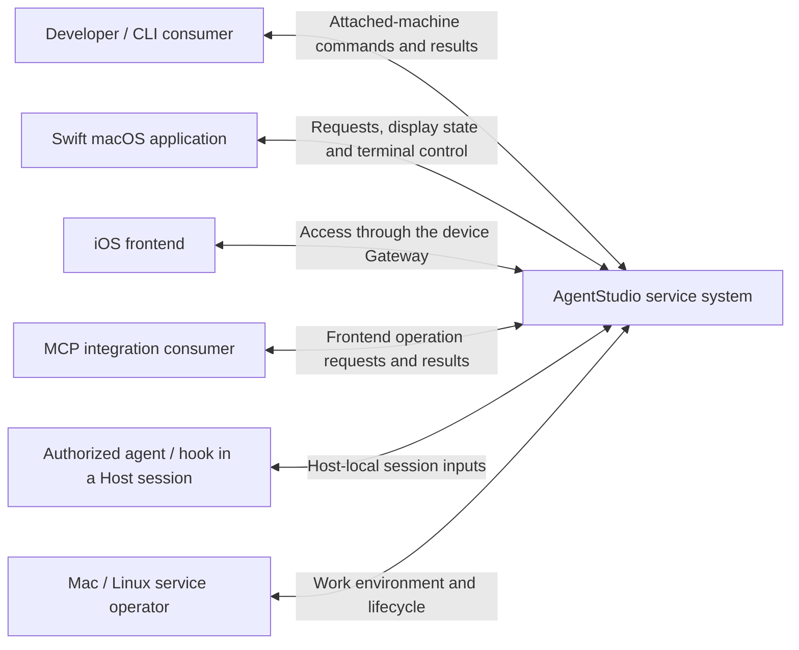

# AgentStudio Host and Gateway: user requirements

The owner wants a whole-system specification for moving AgentStudio's external inputs and execution capabilities into Rust services, together with a complete product-feature hierarchy showing what moves, splits or stays in the IDE. The whole daemon effort remains in research and design. S31 separately authorizes advancing ZMX work in this worktree; it is not blanket authorization for the complete distributed Rust product. The current names are Host daemon, Gateway and UX client. S28 supersedes the earlier Mac-only Gateway direction: the Rust Gateway runs on macOS and iOS, between each device's UX client and its addressed Hosts. S32 additionally selects separate macOS and embedded iOS hosting and the physical transport split; exact startup and background behavior still need qualification.

## People, problem and outcome

Developers and agents currently encounter several entry paths: app RPC, local CLI execution, provider hooks and the separate AgentStudio Git package. The requested Host daemon runs with feature parity on macOS and Linux, covering Mac-local and remote machine work. The Rust Gateway role is required on macOS and iOS under S28. Multiple frontend clients, including MCP, frontend CLI, iOS and the macOS app, use their declared Gateway entry; only the Gateway connects onward to the Host on the frontend route. Machine-scoped worktree CLI, authorized session-local agents and hooks interact with their own Host directly. S30 selects local Host activation when absent; these machine-local operations do not depend on Gateway availability. The Host is the backend for its machine’s Git, worktrees, agents and sessions; Swift is a client. One Gateway can connect to multiple Hosts, and CLI commands target their attached machine. The owner wants the complete surface understood before selecting internal extraction boundaries.

The diagram is context, not an allocation of internal data or capability ownership. Product meaning remains in the rows below.

No current UI establishes the requested service-backed detach/return, simultaneous phone/Mac access, shared tabs/layout/read marks or autonomous Host interaction. Their changed user-visible moments need a current-app-grounded design when those surfaces are selected; this context picture does not stand in for that UI work.

## Requirement rows

Evidence anchors S1–S13 are direct owner statements or explicitly supplied research in this conversation on 2026-10-15/16, not agent reports. Priorities marked must derive from the owner's explicit instructions; no relative release ranking has been assigned. S6 originally fixed Mac-local inclusion and a Mac-only Gateway; S28 supersedes only that Gateway platform boundary and the later working role labels. S9 is supplied research; S10 settles detach/terminate separation; S11 settles no-client operation; S12/S13 confirm multiple client devices and the Gateway-only frontend route. S14 settles Host-local session input; S15–S18 clarify backend responsibility, attached-machine CLI execution, multiple Hosts and Swift/socket compatibility proof. S19 is the shared replication research baseline. S21–S23 require separable authority integration, ready-machine Gateway operation and central control-plane lease authority; S23 supersedes only S20's earlier Gateway placement. S24 records direct owner requests for SQLite inventory/classification, data-placement rationale and storage/materialization/event correlation.

| ID | Affected class | Authorized need or constraint | Basis | Priority / assigner |
| --- | --- | --- | --- | --- |
| U1 | App/CLI developer and operator | Host daemons on macOS and Linux communicate with the Rust Gateway; frontend clients use the Gateway. The owner states "all the incoming data flows that way". Mac-local work is included. S13 explicitly confirms that only the Gateway connects to the Host on the frontend route. | S2 + S6 + S13 + S16 | must / owner |
| U2 | CLI consumer | CLI commands target their attached machine. For work targeting its executing machine, worktree CLI uses that machine's Host daemon on macOS/Linux without depending on a Gateway and starts or activates that local daemon if absent. Authorized session input remains Host-local; UX/frontend CLI operations retain Gateway access. S30 supersedes the S25 classification for worktree machine work. Exact local admission, startup/readiness/failure and verb classification remain design work. The relayed Mac CLI `--host vm-1` use case is required; direct remote connection versus local Host relay remains open; no inferred default target or uncertain mutation replay is authorized. | S2 + S14 + S16 + S30 | must / owner; absent local Host activation / owner via Advisor and corrected Lead message |
| U3 | App/CLI consumer | Remote communication must be efficient. S32 selects Quinn QUIC for Gateway-to-remote-Host transport; RPC semantics, codec/compression, workload and measurable responsiveness bounds still require qualification. Selection is not a measured speed winner. | S1 + S32 | must goal / owner; transport / owner via Advisor; acceptance bounds open |
| U4 | Developer and downstream agent | Survey the full external-input/execution surface, including app IPC, standalone CLI logic and the separately imported AgentStudio Git logic, step by step. Also provide a product-feature hierarchy for the whole current app: each feature explicitly moves, splits or stays in the IDE, with categories, walkthroughs and linked specifications distinct from the overall system design. Include the detailed current SQLite/table/data classification and distributed-state rationale. The Host remains the backend for its machine’s Git, worktrees, agents and sessions. Exact per-capability and target-data contracts still require design. | S1 + S15 + S24 + S27 | must / owner |
| U5 | Linux worktree user | AgentStudio Git's worktree fork behavior needs a Linux counterpart. The initial profile qualifies one explicit Linux environment/filesystem without weakening the complete selected operation. Its actual eligibility and metadata/name/failure contracts remain to be defined and proven. | S5 + S25 | must / owner; initial qualification scope / Sun |
| U6 | Library developer/maintainer | Platform-dependent macOS/Linux behavior has explicit interface contracts and appropriate platform realizations. | S5 | must / owner |
| U7 | Library developer/maintainer | Follow Codex Router as the Rust library example, including applicable crates, responsibility-based decomposition, a good dependency DAG, file/folder/module naming, formatting and linting conventions. This does not instruct linking or copying Router's product code. | S1, S2, S3, S4 | must / owner |
| U8 | Library developer/operator | Use Tokio with explicit ownership of asynchronous operation lifetimes. | S3 + the requested Router/shared-Rust example for lifetime ownership | must / owner |
| U9 | Library developer/consumer | Use strong types, discriminated unions and meaningful tests that exercise behavior and failure rather than merely mirror implementation. | S1, S3 | must / owner |
| U10 | Library developer/operator | First-party Rust, including first-party generated scaffolding, forbids unsafe. S25 adopts the Router-style initial boundary with pinned dependencies used through safe interfaces permitted. Concrete backend/native-boundary bindings and compliance evidence still require design; first-party code cannot be relabelled as a dependency to bypass the ban. | S3 + S25 | must / owner; initial dependency-scope interpretation / Sun |
| U11 | Mac-local and remote machine users | The Host daemon provides feature parity on macOS and Linux. Platform-specific mechanisms have explicit counterpart contracts; unsupported capabilities and admitted differences must be stated rather than hidden. This does not require native Mac presentation effects on Linux. | S5 + S6 | must / owner |
| U12 | Gateway developer/operator and device user | The Rust Gateway role runs on both macOS and iOS. The device's UX client talks to its Gateway, which communicates with addressed macOS/Linux Hosts. Phone access must not require a Mac Gateway relay. The name Gateway replaces the working Client-daemon label. Mobile hosting/startup, suspension/reconnect, packaging, local IPC and authority require explicit platform contracts; an always-running iOS background daemon is not inferred. | S28 supersedes S6's Mac-only platform boundary; S13 Gateway route retained | must / owner |
| U13 | App/CLI consumer and maintainer | Reevaluate the bus, stored-state/materialization/event meanings and Swift/Rust responsibility boundary pragmatically so Swift receives what it needs for display, user interaction and terminal control. The owner says “nothing is in main actor,” while also requiring pragmatic reevaluation and preserving the atom idea where useful. Current operating rules require native/UI publication on MainActor; domain work, I/O, admission and derivation stay off it. Do not mechanically preserve the existing class topology or treat current table names as future data owners. | S7 + S15 + S24; existing MainActor/atom operating contract | authorized research/design goal / owner; concrete topology open |
| U14 | Terminal user and service operator | Detaching a terminal attachment and terminating its session are separate primitives. Closing the last pane detaches while the session keeps running; the owner selected this outcome over automatic retirement after Undo. A detached-session view and optional cleanup policy can be designed separately. No fifteen-minute timeout/default is selected. | S10 | must primitive distinction / owner; cleanup UX/policy open |
| U15 | Detached-session user, agent and service operator | While Swift is closed or the Gateway is disconnected, the Host keeps sessions running, admits authorized agent inputs, and records terminal facts/activity independently of attached views. Host-local authorized inputs do not require a Mac. Under S25, work requiring an invalid/lapsed database-writer grant pauses or is refused without a new intake spool; presentation absence is not that authority failure and does not cause termination. Exact gate coverage, credentials, retention/recovery and natural failure contracts remain to be defined. | S11 + S14 + S25 | must / owner; invalid-writer tolerance / Sun |
| U16 | Multi-device user and integration consumer | One Host supports more than one Mac Gateway connected simultaneously, with separate client attachments. Support simultaneous Macs, iPhones and other frontend clients through the required route, including iOS Gateways under S28. S25 selects one terminal controller with other attachments viewing; S26/U22 require shared tabs/layout and read marks. Numeric maxima, per-Mac instance counts and exact handoff/sync/currentness contracts remain design work. | S12 + S13 + S25 + S26 + S28 | must / owner; initial controller profile / Sun |
| U17 | UX and service developer/operator | UX clients access their device's Rust Gateway; only the Gateway communicates onward to Host services on this frontend route. Under S32, browser content uses loopback HTTP/WebSocket; selected privileged native bootstrap/control uses UDS on macOS and FFI to an embedded Gateway on iOS. Supported CLI/MCP frontends retain their appropriate Gateway entry and shared typed operations; independent iOS CLI/MCP processes are not required. Host-local authorized input and machine-scoped worktree CLI under S14/S16/S30 remain separate and activate their local Host if absent. Codec, exact generated interfaces, native/FFI safety compliance and platform lifecycle still require qualification. | S13 + S14 + S16 + S28 + S32; S9 mechanisms advisory | must / owner; S32 physical native boundary / owner via Advisor |
| U18 | Multi-host user and CLI consumer | A Gateway on either supported platform can attach to multiple remote Hosts. Calls, results, paths and session identities retain the intended attached-machine context. Exact numeric limits and selection UX remain open. | S16 + S17 + S28 | must / owner |
| U19 | Swift client and service maintainer | Provide complete compatibility coverage for selected cross-language contracts, including schemas and the real macOS Unix-socket boundary. S32's selected embedded iOS native boundary needs its own real Swift/Rust binding coverage; browser HTTP/WebSocket and remote Gateway/Host contracts are separate producer/consumer boundaries. One implementation's self-roundtrips do not establish compatibility. Supported pairs, limits and individual cases follow each selected contract. | S18 + U9 + S32 | must / owner; selected iOS boundary / owner via Advisor |
| U20 | Service operator and maintainer | The central control plane is the lease-registry authority. The Gateway assumes machines are ready and connected; preparing, moving and copying machines belongs to the future control plane. Building that server remains later work, and database-writer transfer remains out of current scope. S25 selects pause/refusal of writes requiring invalid authority, without a new spool; lease duration, renewal and exact gate/failure contracts remain unselected. | S20 as superseded by S22/S23; S25 for the initial outage profile | must authority/boundary constraint / owner; initial outage tolerance / Sun |
| U21 | Service/library maintainer | Keep authority integration separately composable from Gateway routing and presentation. A separate crate or an appropriate module boundary is permitted; no exact new crate is mandated and no duplicate lease implementation is requested. S23 selects central control-plane hosting rather than the earlier Gateway-hosted assumption. | S21 + S23 | must design constraint / owner |
| U22 | Multi-device user | Share the user's tabs/layout and read marks across devices. The original viewed-state question establishes completed-agent sharing; explicit additional annotation/review-file/context-notice family coverage needs the narrower S26/G9 clarification, without reopening sharing itself. Participating devices observe the same declared shared logical state; exact portable/native elements, reader/subject binding, authority, sync/conflict/offline and retention need contracts. Copied rows do not perform a read action or native effect. | S26; explicit owner decision as relayed by Sun, interpreted with the original question | must / owner via Sun; exact extra marker-family scope open |
| U23 | Migration developer, integrator and owner | Cover AgentStudio and agentstudio-git in a hierarchical strangler migration map. Connect every recorded feature to its target home, commands/methods, observations/events/state and dependencies. Keep the whole path at high level and make the near-term slice detailed enough to design and plan. Validate coverage independently with the Advisor. Internal boundaries may improve while selected client-facing behavior/contracts remain intact. An inventory/checklist entry is not a delivered feature. | S29 | must / owner |
| U24 | Terminal/agent user and maintainer | Accept lossy ZMX terminal restoration while keeping Ghostty unforked. Work on serialization and automatic agent restoration at the ZMX boundary. Exact automatic-restore survival scope is being clarified; full terminal/parser-state equality is not a prerequisite for the initial integration. | S31 | authorized / owner; restart/resume scope open |

| U25 | File/review user, native-client developer and service operator | Move Bridge content/event delivery directly between the WebView and Rust Gateway over same-origin loopback HTTP/WebSocket, with Swift limited to trusted bootstrap and native interactions. Restrict the browser to its granted pane/worktree operations; retain separate privileged native control. Use authenticated Quinn QUIC onward to remote Hosts with paired/pinned identities, and keep WebTransport optional. macOS runs a separate Gateway service; iOS embeds it without an always-on background-service promise. | S32 | authorized / owner via first-hand Advisor relay; concrete contracts and platform qualification remain design work |

All U rows above have authority state `authorized` for the meaning actually stated. Open details in a row are not agent-authorized extensions. S32 selects the remote transport family, but no codec, automatic retry, exactly-once effect, shared database writer or universal filesystem support is inferred.

### Owner-source anchors

- **S1:** Request to research the full extraction surface across IPC, separate CLI and AgentStudio Git; use research/pathfinding; follow Router Rust standards, crates/DAG/decomposition/unions/types and meaningful tests; create a fully detailed specification; remote daemon with efficient/compressed communication.
- **S2:** Clarification: remote Linux daemon → Rust on Mac → Swift macOS; incoming data follows that chain; CLI talks to Mac client daemon. Codex Router means “Rust library example.”
- **S3:** “Make sure we use Tokio”; standard crates and standards from Router; good types/linting; no unsafe.
- **S4:** Carry Router conventions for writing file names, folder names, crates, linting and standards. Work tightly with the Advisor, split source work among Sol Workers, and validate difficult decisions/edge cases through the Advisor.
- **S5:** Interface contracts for macOS/Linux differences; forking in agentstudio-git needs a Linux counterpart.
- **S6:** Later explicit clarification: daemon feature parity on Mac and Linux; "Gateway rust only on Mac". This supersedes the earlier unresolved Mac-local scope question.
- **S7:** Explicit instruction: “Making sure nothing is in main actor and we follow atoms idea is good but everything should be reevaluated pragmatically.” Supplied transport/ZMX/iOS research to verify with the Advisor, full feature/Git/bus survey, and socket/performance questions; then explicit Sol xhigh research fanout and pragmatic Swift/Rust/atom reevaluation. Gather and reduce evidence into risks/blind spots before asking Claude for a second opinion. Specific supplied transport, framing, transcript and mobile mechanisms remain advisory pending that evaluation.
- **S8:** "We can go to latest zmx." A newer upstream revision is eligible for design evaluation; this does not establish runtime compatibility, authorize replacing live sessions or switch this research task to implementation.
- **S9:** Two further supplied research memos propose a shared typed Rust operations API with thin frontends, tarpc/MessagePack/Quinn/UDS, optional UniFFI/MCP, and independent session/connection/attachment/stream/request/subscription lifetimes. They are research inputs to verify, not blanket selection of libraries, mobile/MCP deliverables, direct-mode bypasses or durable replay guarantees.
- **S10:** In response to the concrete last-pane-close options, the owner selected A (close detaches/session keeps running), then clarified that detach and termination should remain separate primitives. A detached-session UX could close after fifteen minutes “or not”; that example does not choose a timer/default. The service implications of app-independent cleanup still need an explicit policy if selected. The [exact brief and reply](research/owner-inputs/owner-detach-selection.json) preserve the selection and its limits.
- **S11:** Direct selection to the no-client question: “Sessions, agents, facts (Recommended)”, whose displayed meaning was “Keep sessions running, admit authorized agent inputs, and record terminal facts/activity independently of attached views.” This resolves the pending no-client outcome; it is not an automated-hook inference.
- **S12:** The exact question asked whether one Host supports more than one Mac Gateway connected at the same time. The owner selected “Multiple Macs (Recommended)”, whose description allowed simultaneous clients with separate attachments and required controller/client-state contracts, and added “mukltiple macs, iphones, etc etc any clients”. This confirms multiple simultaneous Mac Gateways per Host as well as broader client-device support; it did not then make a phone a Gateway or choose a numeric maximum. S28 later explicitly adds the iOS Gateway role.
- **S13:** Earlier explicit frontend corrections: “gateway to host only”; “socket form client to gateway”; “mcp/cli/ios/macoks app -> gateway -> host”. These supersede the immediately preceding direct-to-Host selection. Complete original research and correction/selection records are preserved in the [owner-source archive](research/owner-inputs/README.md).

- **S14:** The [Host-local answer](research/owner-inputs/owner-service-corrections.json) preserves the Advisor’s exact question/options and verbatim owner answer: “obviosuly it ahs to go tot deamon host thast the point of itneraciton”. The question concerned an agent in a Linux terminal sending a hook, notice or pane title; this selects Host-local authorized in-session input. The answer is attributed to the Advisor’s Router relay, not a directly inspected provider transcript.
- **S15:** Direct clarification in this Lead conversation: “mabye we misudersthant the remote deamon is itnarcti with git and agent and everything you udnetandand?” This reasserts the Host backend’s scope.
- **S16:** Direct instruction: “all cli commands shoukld go to the maine they are attached to”. This locates machine-scoped work in the attached Host context: CLI on its attached Host uses that Host locally; frontend CLI targeting another machine uses its attached Host through the Gateway. The Advisor subsequently relayed the owner’s clarifications “yes in remote host” and “scoped by machine as terminal starts in some machine including local” in root message 01a144f8-a42b-7b43-9298-6e9fddcb0bd0. It refines S13’s frontend wording for Host-local CLI work without selecting a codec, implicit target fallback or unrestricted authority.
- **S17:** Direct instruction: “also we hsoud be able to attach mutipel remote hosts to our gateway”. This selects multiple Hosts per Gateway in addition to S12’s multiple Gateways per Host.
- **S18:** Direct request: “we woudl ahve full test coverage for compatability between a socker and swift to unix to check schemas does tha tmake sense?” This adds real Swift/Unix-socket contract coverage; it does not authorize executing product experiments in this design task.
- **S19:** The owner supplied the [agent-fleet-sync plan](research/owner-inputs/fleet-sync-plan-input.md) and asked to continue research and show a tree of data/replication decisions. It is the shared-mechanism research baseline, not proof that its crates are adopted or working in AgentStudio.
- **S20:** Earlier direct instruction: “we wil build the server for this later, rn, assume the authokrity for lease regsitry i8s the gateway, and assume that transferis out of scope”. The [exact source record](research/owner-inputs/gateway-authority-scope-selection.json) preserves that historical Gateway authority assumption. S23 supersedes its authority placement; later server work and the database-writer transfer exclusion remain.
- **S21:** Direct clarification: “we can make it a seprate crate or whatever so we can move it easily alter”. This supplies the authority-hosting separation constraint; the exact crate/module choice remains design work.
- **S22:** Direct clarification: “hmm assume a central authority that will connect for liter ocntorl flow nto gateway”; then “there are for movign cop0yign etc machines.  gateway assuems machie is ready and ocnnected”. This places machine preparation/move/copy in the future control-plane scope and makes ready, connected machines the Gateway's entry condition. Subsequent connection loss still requires a runtime contract.
- **S23:** Direct decision: “yeah lets make  cetnral contorl plane for leasese”. The [exact source record](research/owner-inputs/central-control-plane-selection.json) preserves this selection and S22. Central control-plane lease authority replaces the Gateway placement in S20; no implementation or lease-expiry policy is selected.
- **S24:** Direct requests for all SQLite tables to have an inventory/classification, for where data lives and why to receive more thought, and for detailed correlation of storage, materialization, events and current data structures with distributed AgentStudio. The [verbatim source record](research/owner-inputs/data-boundary-directions.json) preserves those statements. They require explicit state meaning and boundaries, not an assumed all-Gateway store, universal event log or exact export/migration choice.
- **S25:** Sun's delegated initial-profile disposition (supervision activity8121; corroborated by Chief8130) adopts the Lead's ten recommendations as changeable initial directions: offline last-known display, one terminal controller, ordinary Mac CLI through Gateway, invalid-authority write pause/refusal without a new spool, current retention meaning, first-party unsafe ban with pinned safe dependencies, one qualified Linux profile, desktop/remote exploratory workload, paired private fleet and retained selected native automation. The owner had explicitly directed real owner-only decisions to Sun. The [exact source record](research/owner-inputs/initial-profile-decisions-2026-10-18.json) attributes these choices to Sun, not direct owner quotations. Mandatory performance workload remains with the owner. S30 later supersedes this record's ordinary-Mac classification for machine-scoped worktree CLI only.
- **S26:** Sun's subsequent owner relay (daemon activity8188) states “Share across devices”: phone/desktop share tabs/layout and read marks. The [exact relay](research/owner-inputs/initial-profile-decisions-2026-10-18.json) supersedes the earlier unmade per-device-versus-shared questions. Engineering sync/conflict choices are for the Lead unless they expose genuinely open product direction, which returns to Sun. No storage allocation, merge algorithm or broader permission is inferred.
- **S27:** The [direct reader/feature-hierarchy correction](research/owner-inputs/feature-hierarchy-directions-2026-10-18.json) distinguishes overall architecture from the full product-feature hierarchy and asks for explicit moved/split/IDE-retained responsibilities and actual HTML walkthroughs. The owner then proposed Host daemon, Client daemon and IDE app labels; S28 later replaces the latter two with Gateway and UX client. This authorizes reader organization and complete coverage, not a new transport, deployment, release ranking or behavior-selection default.
- **S28:** Direct owner correction: Gateway is the preferred name, replacing the working Client-daemon label; the Rust Gateway runs on both iOS and macOS and talks to the UX client. [Exact direct messages](research/owner-inputs/gateway-platform-direction-2026-10-18.json). This supersedes the earlier Mac-only Gateway and phone-via-Mac boundary, without selecting an always-on mobile daemon, business-API FFI, startup binding, codec or release order.

- **S29:** [Direct migration directions](research/owner-inputs/migration-directions-2026-10-19.md): both repositories, incremental strangler migration, high-level whole map/detailed near term, hierarchical coverage, independently checked Advisor/Lead conclusions and internal redesign preserving client contracts. Fleet/bot concerns are orthogonal; Host-deployment/workspace cardinality is explicitly left open.

- **S30:** [Worktree CLI Host direction](research/owner-inputs/worktree-cli-host-direction-2026-10-19.md): the owner directly corrects “starts gateway” to “work with deamon not gateway” and requests formal review. The Advisor's first-hand owner relay records start/activation of an absent local Host daemon. Worktree machine work is Host-local independently of Gateway availability. Remote direct access, exact local admission, frontend-verb membership and startup/readiness remain open. This changes the earlier route classification, not the UX Gateway contract.

- **S31:** [Direct ZMX/restoration direction](research/owner-inputs/zmx-restoration-direction-2026-10-21.md): advance ZMX work here, accept lossy terminal restoration, keep Ghostty unforked, and work on serialization/automatic agent restoration at ZMX. This supersedes an exact-state or Ghostty-fork prerequisite. Whether automatic restoration includes dead-process/Host-restart recovery remains under clarification.

- **S32:** [Bridge/remote transport direction](research/owner-inputs/bridge-transport-direction-2026-10-22.md): first-hand Advisor relay of the owner's requested design change. Direct browser-to-Gateway loopback content replaces Swift chunk forwarding; macOS native control remains UDS and selected iOS native bootstrap/control uses FFI to an embedded Gateway. Remote Gateway/Host transport is Quinn QUIC with paired/pinned identities; WebTransport remains optional. This supersedes corresponding transport-only gaps, not Host-local CLI routing, central writer-lease authority, feature semantics or implementation gates.

## Goal boundary

| Boundary | Current owner meaning |
| --- | --- |
| Primary goal | Evidence-grounded Host/Gateway specification plus a complete hierarchical strangler migration path over AgentStudio and agentstudio-git: high-level whole-feature/command/observation dependency map, detailed near-term design and implementation planning, explained through navigable walkthroughs |
| Existing foundation | AgentStudio capabilities, IPC/CLI/provider integration and AgentStudio Git semantics are the survey baseline; exact future parity needs per-capability classification |
| Desired difference | Feature-parity Rust Host on macOS and Linux; Rust Gateway on macOS and iOS serving its device UX client and supported frontend entry classes through the declared platform entries; Gateway-only frontend Host route with Host-local session inputs; attached-machine CLI execution and multiple Hosts per Gateway; Linux fork counterpart and reevaluated domain/publication ownership |
| Allowed research scope | This AgentStudio worktree, pinned AgentStudio Git checkout, Codex Router as library/engineering example, primary platform/protocol references |
| Implementation boundary | The complete distributed Rust product remains in research/design. S31 separately authorizes advancing ZMX in this worktree, with lossy restoration accepted and Ghostty unforked. It does not authorize replacing installed sessions or choose dead-agent/process-restart recovery. The central control plane owns lease-registry authority with separately composable integration; building that server is later work and database-writer transfer is out of current scope. Gateway operation starts with ready, connected machines. Other package/deployment bindings remain open |
| Named exclusions | No linked Router product dependency is implied. No codec, schema migration, extra application service, unsupported-filesystem fallback or transcript retention is silently adopted from research. Gateway platform is macOS and iOS under S28; mobile hosting/startup and lifecycle still need qualification. Exact native app implementation scope is not selected by a protocol example. Existing backend/child process kinds are not prohibited |
| Complexity tolerance | Host and Gateway are the current Rust application roles plus Swift client. S23 additionally selects a central lease-control role whose server is later work; it is not an embedded Gateway authority or a current machine-orchestration implementation. Existing zmx terminal backends, CLI invocations and hook child processes remain distinct. Further application owners/services/recovery mechanisms need a stated need and design |
| Evidence | Complete source survey now; later specification must name behavioral, failure, platform and performance proof. Exact product acceptance workload/bounds remain open |
| Confirmation state | The recorded U meanings and S25/S26/S28 selections are authorized for their stated scope. Public/operational details and internal allocation remain named gaps; no new generic structural-confirmation gate is introduced |

## Affected classes still to distinguish

- Mac user and Mac-local CLI consumer: local work is included; Host feature parity on macOS/Linux is required. Individual interface/capability and daemon-absent CLI availability still need contracts.
- Agent/CLI running on remote Linux: existing hooks and pane authority make this a necessary surveyed class; authorized session-local inputs go to their Host under S14. Other service calls target the attached machine under S16; exact standalone availability and method scope remain open.
- Swift and other frontend client developers: MCP/CLI/iOS/macOS app consumers use the Gateway socket interface; native presentation/effect boundaries need contracts.
- Service operator: lifecycle, connection trust, credentials, upgrades and recovery outcomes still need owner tolerances.
- Library maintainer: Rust/platform contract, decomposition, linting and proof constraints are explicit.
- Buyers/customers distinct from these operator/developer classes: not identified; no needs or journeys invented.

## Open product meaning

1. Mac-local work and Host parity on macOS/Linux remain selected. S28 now selects Gateway on macOS and iOS, superseding S6's earlier Mac-only boundary; mobile hosting/lifecycle and safe startup remain engineering qualification work.
2. Resolved by S11 for client absence: Host sessions, authorized agent inputs and terminal facts/activity continue without Swift or a connected Gateway. Natural exit/process loss/reboot, service restart recovery, missed-history retention and optional detached cleanup still need explicit outcomes.
3. Phones have an iOS Gateway between the UX client and Hosts under S28; a Mac relay is not required. Multiple simultaneous Mac Gateways per Host remain selected. S25 fixes one controller/other viewers; S26 fixes shared tabs/layout/read marks. Numeric limits and exact control/sync/conflict contracts remain, rather than the already-settled high-level choices.
4. Resolved by S14: authorized agents, hooks and eligible context inputs inside a Host session interact with that Host locally, independent of every Gateway (macOS or iOS). Credential/scope mechanics and exact public method mapping remain contract work; pane-only credentials cannot remove the selected outcome.
5. Which existing command families and operational histories require parity; which remain client presentation or are deliberately deferred?
6. S25 selects one qualified initial Linux profile. Define its complete fork equivalence, eligibility, metadata/name/special-node behavior and unsupported outcomes; do not silently replace whole-feature parity with a leaf primitive.
7. What responsiveness, bandwidth/CPU and recovery outcomes define efficient communication? Which data may be replaced by newer state and which facts/effects must remain inspectable?
8. S25 selects paired private-fleet access and retained selected native automation. Credential custody/revocation, origin/consent, installation/upgrade and exact scope contracts remain.
9. S30 selects machine-scoped worktree CLI → attached local Host daemon, with local start/activation when absent; UX/frontend CLI remains through Gateway. Finish exact startup/readiness/failure, target discovery, non-session authority and verb classification. The remote Mac CLI use case is required; direct connection versus local Host relay and its credential remain open. Do not infer a fallback or retry.
10. S25 resolves the initial safety boundary: first-party unsafe remains forbidden; pinned dependencies used through safe interfaces are allowed. Concrete bindings, boundary inventory and compliance remain engineering/proof work.
11. Which filename/path domain is supported across status, diff, file trees, annotations, worktree operations and local output: including non-UTF-8 Linux names and names that collide under a receiving filesystem's rules?
12. What channel/version pairing and capability-refusal outcomes apply across Host, Gateway, app and CLI, including Gateway-version × Host-version pairs when several Hosts are connected independently?
13. Central lease authority, separately composable integration, later server work and the transfer exclusion remain fixed. S25 resolves invalid-authority writes as pause/refusal without a new spool. Exact authority binding, setup, duration/renewal, gate coverage and truthful loss/partial outcomes remain.

The no-client outcome and Host-local in-session input are resolved by S11/S14. Frontend requests follow UX client→socket→Gateway on the device→Host under S28. A phone's Gateway reaches Hosts without a required Mac relay. Host-local authorized session input does not require that frontend route. S16 fixes CLI execution context and Host-local machine work; frontend CLI targeting another machine uses the declared attached Host through the Gateway. Non-session authority and attachment discovery remain G1/G8/G12. S17 permits several Hosts attached to one Gateway. These decisions do not settle standalone service-absent availability, client selection UX or credential mechanics.

These questions do not authorize particular transports, stores, schemas, crate homes or retry mechanisms. They are inputs to settle before completing the separate Specification and Program Design. The preceding historical remote-boxes draft is advisory until its additional product scope is reconfirmed.

## Delivery constraints

The Lead owns requirements, specification, design, integration and acceptance. Sol xhigh Workers gather bounded source evidence. The Lead first reduces/catalogs risks, evidence gaps and likely blind spots, then obtains Claude Advisor's second opinion on that concrete packet. The Lead verifies decisive evidence and brings owner-controlled choices back to the owner. Advisor advice is not owner authority or executed proof.

The [survey](research/extraction-survey.md) is observational input. Requirements (this artifact), the separate [observable Specification](2026-10-15-agentstudio-daemon.md), and the future structural Program Design have separate identities. Crate layout and implementation sequencing will follow the agreed domain and contracts.
