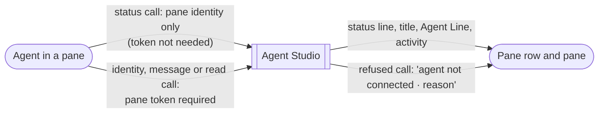

# Pane agent status by call intent — Specification

Requirements: [requirements](2026-10-15-pane-agent-status-by-intent-requirements.md) (U1–U5) → this Specification → Program Design: [program design](2026-10-15-pane-agent-status-by-intent-program-design.md)

## Defined terms

| ID | Term | Identity rule | Relationships | Invariants | States |
| --- | --- | --- | --- | --- | --- |
| E1 | Agent call | One request an agent process in a pane sends to the app: a hook event, or an agent CLI command. | Has one call intent (E2). Comes from one pane (E3). | The provider turn never fails or waits because of the app's answer. | accepted; refused |
| E2 | Call intent | The class of an E1, fixed by what it changes or exposes. | Every E1 has exactly one. | **Status:** hook status and activity, agent title, Agent Line, and the pane-level ordering of title and Agent Line writes. **Identity:** binding a pane to an agent session, session end, and writes made on behalf of a session. **Message:** notice, ask, withdraw. **Read:** the agent reading its pane, its messages or answers, or its session. **Control:** every other method. | status; identity; message; read; control |
| E3 | Pane claim | The pane and workspace an E1 says it comes from. | Carried by every E1. | Accepted only for a pane that currently exists as a member of the named workspace. A claim alone does not prove which process sent it; same-user processes can make it. | valid; unknown pane; retired pane; other workspace |
| E4 | Verified binding | The existing link between a pane and one agent session, made by an authenticated identity call. | At most one active per pane. | Created or changed only by an identity call with a recognized pane token. | active; ended |
| E5 | Unverified pane status | Status the app derives for a pane that has no active E4, from status calls carrying that pane's claim. | At most one per pane. Follows the pane's unverified main agent (E6). | Held in memory only. Never creates or changes an E4, a conversation record, a message, a resume or a routing decision. Cleared when the pane is retired, when an E4 becomes active, and on app restart. | Working; Idle · done; Needs you · approval; none |
| E6 | Unverified main agent | The first agent session, by provider and provider session id, whose status call reaches a pane that has no active E4. | One per pane at a time. | Status calls from other sessions in that pane do not change E5 while the main session lives. It is released by its status-path session-end call, or by the pane's authoritative command-exit fact when that fact was reported after this main was established (the same source-time fence the verified path uses). Release never ends a verified binding. After release, late ordinary facts from that provider and session id are ignored, and the next session to report becomes the main. A `SessionStart` from a released session may re-establish it when no live main blocks it, as a verified session can resume today. | set; released |
| E7 | Refusal record | The latest reason an E1 from a pane was refused, with its intent and time. | One per pane: the latest reason, plus a count since the pane last had an accepted identity call. | Contains no token, credential, message text or payload. The reason comes from a fixed set. It is shown alongside the pane's status and never replaces it. An accepted identity call clears it. | present; cleared |

## Requirements

| ID | Requirement | Over | From | Pass / fail |
| --- | --- | --- | --- | --- |
| R1 | A status-intent E1 must be accepted with a valid E3 and no recognized pane token, and change only that pane's status, activity, agent title or Agent Line. | E1, E2, E3 | U1, U2 | Fail if a status call from a pane with an unrecognized token changes nothing, or changes anything outside that pane's status values. |
| R2 | Identity, message and read E1s must still require a recognized pane token. Without one they are refused with a reason and change nothing. | E1, E2, E4 | U2, U3 | Fail if any such call succeeds on a claim alone, or if a refusal has no reason. |
| R3 | Control E1s must behave exactly as today. | E2 | U2 | Fail if any control method's authentication or authorization changes. |
| R4 | A status call must never create, end or change an E4, a conversation, a message or a writer identity tied to a session. | E1, E4 | U2 | Fail if any row in those stores changes because of a status call. |
| R5 | When a pane has no active E4, its row and pane must show E5 using the existing status copy. When an E4 exists, the E4-derived status wins and E5 is ignored. | E4, E5 | U1 | Fail if an unbound pane with an active agent shows no status, or a bound pane shows E5 instead of its verified status. |
| R6 | E5 must follow E6: a child or second agent session in the pane does not change the pane's status while the main session lives. | E5, E6 | U4 | Fail if a `claude -p` child's turn changes a pane's unverified status. |
| R7 | An accepted status hook must advance the pane's activity with source `hook`, with or without an E4. | E1 | U1 | Fail if an accepted status hook leaves activity unchanged. |
| R8 | A refused E1 must update that pane's E7, including a refusal before method dispatch (rejected login) and a hook with no session id or an unreadable payload. The pane's row and pane must show a persistent "agent not connected · reason" line while E7 is present and the pane has no active E4. The line appears together with the pane's status line and never replaces it. No toast or banner. | E1, E7 | U3, U5 | Fail if a refused call leaves E7 unchanged; if the pane shows nothing; if the connection line hides `Needs you` or any other status; or if any transient popup appears. |
| R9 | A hook must still exit 0 and finish within its existing time limit. A stale token must not lengthen a turn beyond that limit. | E1 | U2, Protected | Fail if a hook exits non-zero for any app-side outcome, or exceeds its limit. |
| R10 | Every hook failure must leave a diagnostic that names its pane and its reason from the fixed set, with no secret or payload. | E1, E7 | U3 | Fail if a failure is logged only as the generic `provider_hook_failed`. |
| R11 | An E3 naming a pane that does not exist, is retired, or belongs to another workspace must be refused with that reason and change nothing. A claim reaches only the exact claimed pane, never its drawer children or its owner. A successful status call never upgrades a connection's authority for later calls. | E3 | U2 | Fail if such a claim changes any pane's status, reaches another pane, or lets a later non-status call succeed on the same connection. |
| R12 | When the token is refused, the agent's title and Agent Line writes must still apply as the pane's own writer, even when provider session variables are present. Automatic session attribution applies only with a recognized token. Writer ordering is preserved, including the guarantee that a delayed older write never overwrites a newer one (N10). A stale write is rejected and never renumbered. A shell without the CLI store variables uses the same ordering store, found through the app's runtime metadata next to its socket. If no store can be found, the write is refused with `orderingStoreUnavailable` and changes nothing. | E1, E2 | U1, U2 | Fail if a stale-token agent's `agentstudio line` or `agentstudio title` changes nothing, or if a stale ordered write is accepted. |

Fixed refusal reasons (E7): `credentialNotRecognized`, `paneNotFound`, `paneRetired`, `otherWorkspace`, `intentRequiresToken`, `noSessionId`, `undecodablePayload`, `queueFull`, `appUnavailable`, `deadlineExceeded`, `orderingStoreUnavailable`.

When the app is not running, hooks behave as today: they exit 0 silently, and no record exists, because no app is there to keep one.

## Proof

| ID | Proves | Evidence |
| --- | --- | --- |
| V1 | R1, R2, R3, R11 | Admission tests per intent. For every pane-agent method, cover a recognized token, an unrecognized token, no token, and each invalid claim (unknown, retired, other workspace). Control methods keep today's results. |
| V2 | R4 | Sessions tests: status calls without a token leave bindings, conversations, operations and messages unchanged. |
| V3 | R5, R6, R7 | Sessions and row tests: unverified status appears for an unbound pane and gives way to a verified binding. It ignores a child session, and releases the main on command exit or status-path session end. A successor then becomes the main, while the released main's delayed ordinary facts are ignored. Further cases: A → B → A-resumed via `SessionStart` (the unverified equivalent of the existing verified scenario); and an old command exit held with `HeldStep` and controlled instants, which must not release the newer main. Activity advances on applied status. Bind, retire and quit races are covered. |
| V4 | R8, R10 | Refusal tests from each real failure producer: rejected login, missing session id, unreadable payload, and the others in the fixed set. Each updates E7, appears on the row and the pane together with the status line (for example `Needs you` plus the connection line), and leaves a diagnostic with pane and reason. App-down is the explicit no-record case. |
| V5 | R9 | Hook tests on both the 2 s and the 250 ms paths, with an unrecognized token. Login and the fallback call share one absolute deadline; an exhausted budget still exits 0 silently. A healthy-token run sends no fallback request. Exit 0, within the limit, status reaches the app. |
| V6 | U1, R5, R8, R12 | Real debug app with real Claude Code and Codex. One pane with a valid token shows status as today. One isolated fixture pane, whose shell token the app demonstrably rejects (a rejected-login receipt is required), shows its agent's status and a "not connected · credentialNotRecognized" line. Its real `agentstudio title` and `agentstudio line` calls apply. Binding, conversation and message records stay unchanged. |
| V7 | U1 | Name or reproduce why the 7 recognized-token panes never bound, and show they report status after the change. |
| V8 | R12 | CLI tests with provider session variables set and a refused token: first epoch allocation, a cached epoch, a stale counter, and a shell without the CLI store. A shell without the store variables finds the store through the runtime metadata. When none can be found, the write is refused with `orderingStoreUnavailable`. In every case an older call held while a newer call completes is rejected. |
