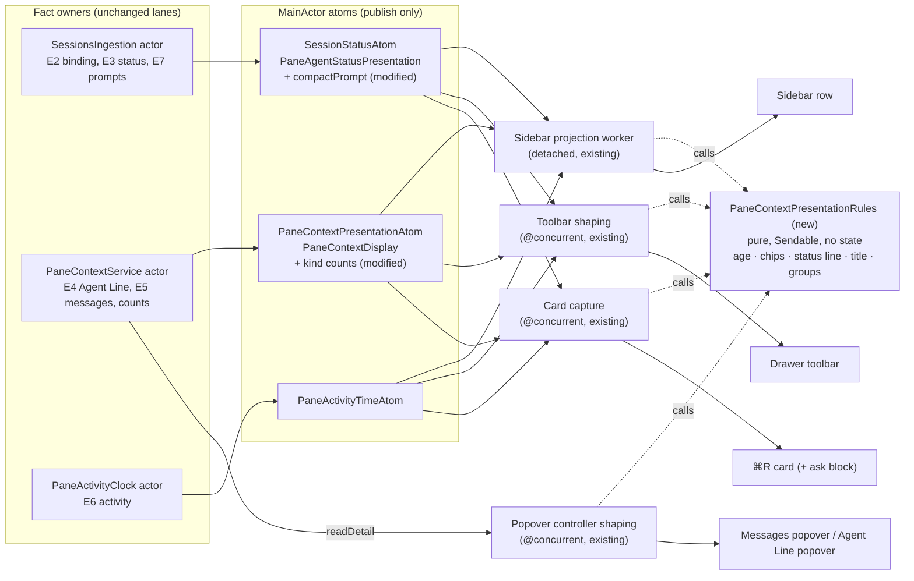
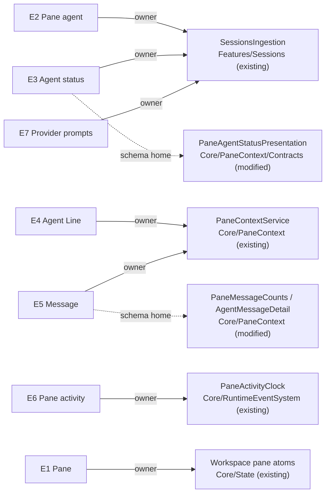
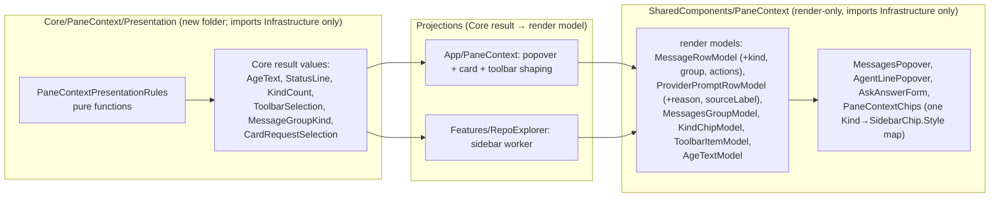

# Pane context display: program design

**Status:** revision 4, 2026-10-25, written by the 🦁 Lead. Revisions 2–4 close independent review rounds 1–3 (all findings accepted). The section "Contracts added in revisions 2–3" governs wherever an earlier paragraph is less specific. The owner waived the structural confirmation step ("you handle the 2 things and make prs and proof ready", 2026-10-25). The views below are still shown so the owner can check them at PR review.
**Requirements:** [requirements](2026-10-24-pane-context-display-requirements.md) (U1–U7, Q1 answered by the approved renders).
**Specification:** [specification r5](2026-10-24-pane-context-display-specification.md) (E1–E7, O1–O50, V1–V5, S1–S19), owner-approved 2026-10-25. Owner rules R1–R10: [owner-rules-checklist.md](owner-rules-checklist.md). Renders: [storyboard.html](storyboard.html) and `renders/`.
**Current system:** read at `origin/main` `2b3f49da5`. Evidence lane: `tmp/design-workflows/2026-10-25-pane-context-display/current-ui-model.md` in this worktree; the Lead opened the decisive anchors cited below.

## What changes, in one picture

Three owners publish facts today, and four surfaces shape them independently. That's why the same pane tells different stories (U1). The design keeps the owners and their threads exactly as they are. It replaces each surface's private formatting with **one set of pure presentation rules** that every surface calls on its existing off-main shaping step.



Plus two pieces of missing wiring and one new answer form:

- **Message actions:** the App injects the production `actionRunner` that `PaneContextService` already declares. Today the only construction leaves it at its `.unavailable` default (`SessionsPaneContextComposition.swift:53`, `PaneContextService.swift:62`), so "Open file" and "Open pull request" do nothing.
- **Prompt refresh:** an open popover rereads when the pane's status presentation changes, not only when the display revision does. Today a prompt-only change leaves it stale (`PaneContextPopoverHost.swift:33`).
- **Approval form (S15):** a new ask form `approval` with the answer `decision(approve | deny, reason?)`, end to end from the `agentstudio approval` CLI verb to the card and the popover.

## The crux and the choice

The crux is where the shared presentation rules live, and whether any new state is needed to keep five surfaces telling one story.

| | A. Shared pure rules (selected) | B. One derived per-pane presentation atom | C. Patch each surface in place |
| --- | --- | --- | --- |
| Shape | one stateless rules module; each surface's existing shaping step calls it | a new `EagerDerivedAtomFamily` computing a full per-pane presentation that every surface reads | fix formatters and layouts surface by surface |
| New state | none | a new atom (needs the owner's yes; CLAUDE.md) | none |
| Threads | unchanged: the sidebar stays in its detached worker, the toolbar and card stay `@concurrent` | a second derivation lane beside the sidebar worker, which the Sidebar Data Flow rule forbids joining in views | unchanged |
| One story (O1) | holds by construction: the same function, the same inputs | holds | depends on discipline; it's the failure we have today |
| Cost | the existing duplicates are deleted (2 tone→chip maps, 3 age formats, 3 title paths) | new atom, new subscriptions, new tests | keeps the duplicates |
| Falsifier | if two surfaces need different values for the same fact, the rules can't be pure; the spec says they never do (O1) | — | — |

**Selected: A.** It is the smallest structure that makes O1 true by construction, adds no atom or store, and keeps every hop shape that CLAUDE.md's performance rules require. Accepted debt: each surface still captures its own inputs (three capture sites); its payer is the next surface added. Revisit if a sixth surface appears or capture cost shows up in the sidebar trace.

## Where each entity lives



| E | Semantic owner | Package or module home | Schema/type home | Shape at each boundary | Disposition | Convention |
| --- | --- | --- | --- | --- | --- | --- |
| E1 Pane | Workspace pane atoms | `Core/State` (existing; `Pane`, `parentPaneId` marks a drawer pane) | `Core/Models` (existing) | `PaneId` on every read; drawer test is `parentPaneId != nil` (existing, `PaneContextUIReaders.swift:22`) | persisted | Swift value types, `package` visibility (CLAUDE.md) |
| E2 Pane agent | `SessionsIngestion` | `Features/Sessions` (existing) | `SessionsStatusReadResult` / `SessionSummary` (existing) | live / ended / unbound read (`readSessionStatus`), unchanged | persisted (Sessions SQLite) | closed enums (existing) |
| E3 Agent status | `SessionsIngestion` (reduction) | `Features/Sessions` (existing) | `PaneAgentStatusPresentation` in `Core/PaneContext/Contracts` (**modified**) | published to `SessionStatusAtom` keyed by pane; gains `compactPrompt` (below) | derived | closed enums |
| E4 Agent Line | `PaneContextService` | `Core/PaneContext` (existing) | `AgentLineDetail` (existing) | in `PaneContextDisplay.agentLine` (existing) | persisted (pane_state) | — |
| E5 Message | `PaneContextService` | `Core/PaneContext` (existing) | `AgentMessageDetail` / `AskForm` / `AskAnswerValue` (**modified**: approval form, decision answer); `PaneMessageCounts` (**modified**: per-kind counts) | IPC `IPCPaneAskForm` / `IPCPaneAskAnswerValue` (**modified**); SQLite `pane_request` (existing columns, no DDL); display counts in `PaneContextDisplay` | persisted | closed enums; IPC Codable schemas (existing) |
| E6 Pane activity | `PaneActivityClock` | `Core/RuntimeEventSystem/PaneActivity` (existing) | `PaneActivityTimeAtom` value (existing) | `Date?` per pane, unchanged | persisted | — |
| E7 Provider prompts | `SessionsIngestion` | `Features/Sessions` (existing) | `SessionStatusState.providerPrompts` (existing); compact copy in `PaneAgentStatusPresentation.compactPrompt` (**new field**) | full list via `SessionSummary` on detail reads (existing); first prompt via the status atom (new) | derived | closed enums |

Design-only concepts, each with the entity or rule it serves:

- `PaneContextPresentationRules` serves O1–O7 and O13: the shared pure rules.
- `CompactProviderPrompt` serves E7, O11, O31 and S16/S18: the first prompt in returned order, carried to compact surfaces.
- `PaneMessageKindCounts` serves E5, O13, O20, O32 and the unread count: one count per kind.
- `MessageGroupKind` (Core) and `MessagesGroupModel` (render) serve O41: Needs you / Done / Info / Resolved.

### Shapes that change

```swift
// Core/PaneContext/Contracts/PaneAgentStatusPresentation.swift (modified)
package struct PaneAgentStatusPresentation: Sendable, Equatable {
    package let status: AgentSessionStatus
    package let connectionIssue: AgentConnectionRefusalReason?
    /// O5 gate, set at the source from the status the publication selected (review F01, F13).
    package let evidence: StatusEvidence
    /// E7's first prompt in SessionSummaryProjection order (newest observedAt, stable key on ties).
    /// nil when E7 is empty. Same value the popover lists first for this pane (O11 compact prompt).
    package let compactPrompt: CompactProviderPrompt?
    /// Changes whenever this pane's visible prompt list or omitted count changes (review F04).
    /// Monotonic per pane, assigned by SessionsIngestion; never derived in a view.
    package let promptListRevision: UInt64
}
/// Which evidence the publication used. E3 shows only for the two verified cases.
package enum StatusEvidence: Sendable, Equatable {
    case verifiedLive    // active verified binding (E2 live)
    case verifiedEnded   // retained verified ended binding (E2 ended): Idle · ended still shows
    case unverified      // claim-only fallback: E3 and E7 not shown (O5)
    case none            // unbound, nothing known
}
package struct CompactProviderPrompt: Sendable, Equatable {
    package let reason: AskReason          // approval | question | blocked (existing enum)
    package let summary: String?           // provider's own summary, byte-bounded as today; never invented
    package let observedAt: Date           // for the scoped merge (F15)
    package let omittedOrFurtherCount: Int // prompts after this one plus SessionSummary.omittedPromptCount; drives "+N more"
}

// Core/PaneContext (modified): replaces the approval/reply/attention/informational split
package struct PaneMessageKindCounts: Sendable, Equatable {
    package let failure: Int   // unread failure notices                         → ✕ N (red)
    package let needsYou: Int  // open asks + unread attention notices          → ⚑ N (amber)
    package let done: Int      // unread done notices                            → ✓ N (green)
    package let info: Int      // unread info notices                            → ⓘ N (neutral)
    package var unread: Int { failure + needsYou + done + info }  // O32 "N unread", card and chips agree
}
// PaneMessageCounts keeps newestOpenBlockingAskId and gains `kinds: PaneMessageKindCounts`;
// the old four fields are deleted (hard cutover; every caller moves).

// Core/PaneContext/Contracts (modified)
package enum AskForm: Sendable, Equatable {
    case choice(options: [AskChoice], allowsMultiple: Bool)
    case freeText(placeholder: String?)
    case elicitation(ElicitationSchema)
    case approval                                   // new: [Approve] [Deny] + optional reason
}
package enum AskAnswerValue: Sendable, Equatable {
    case choices([AskChoiceId])
    case text(String)
    case form(ElicitationValues)
    case decision(ApprovalDecision, reason: String?) // new; only valid for .approval
}
package enum ApprovalDecision: String, Sendable, Equatable { case approve, deny }
```

Storage: `pane_request.form_kind = 'approval'`, `answer_kind = 'decision'`, `answer_text` = the reason (nullable), and one `pane_request_answer_value` child row (`field_name = 'decision'`, `value_kind = 'text'`, `text_value = 'approve' | 'deny'`). No DDL and no migration. The columns exist with no CHECK constraint (migration 022). Unknown kinds keep throwing on read (existing behavior). Every allow-list and default-bearing switch that doesn't fail compilation is named in the trace: the admission tuple at `PaneContextAdmission.swift:48`, the compact projection allow-list at `PaneContextStorage+MessageProjection.swift:79`, and the IPC schema union at `IPCPaneAskForms.swift:326`.

IPC: `IPCPaneAskForm` gains `approval`, and `IPCPaneAskAnswerValue` gains `decision {decision: "approve"|"deny", reason?: string}`. CLI: a new verb, `agentstudio approval "<request>"`. It sends `pane.message.ask` with `form: approval`, reason `approval` and the same deadline flags as `ask --wait`. It always waits, and prints `{"decision":"approve"|"deny","reason"?:…}` on stdout. Help, catalog and the agentstudio pane skill's verb list move from seven verbs to eight. This is a transport method on the existing pane-context IPC registry, not an `AppCommand`, so there is no `ipcSpec` change (`ipc.md:538`).

## The shared rules

`PaneContextPresentationRules` lives in `Core/PaneContext/Presentation/` (new folder in an existing slice). It's a `Sendable` namespace of pure functions with no state and no I/O, callable from the sidebar's detached worker and from `@concurrent` shaping. Each function is the only implementation of its rule:

| Function | Input → output | Rule | Replaces |
| --- | --- | --- | --- |
| `age(_ elapsed: Duration) -> AgeText` | `Now` < 60 s; `N min ago` < 1 h; `N hr ago` < 24 h; `1 day ago`; `N days ago` | O2, R10 | `RepoExplorerSnapshot.messageText` ("just now", "1 days ago") and the three SwiftUI `.relative` sites |
| `compactAge(_:) -> String` | `Now` / `Nm` / `Nh` / `Nd`, for the activity chip only | O2, O13 | `RepoExplorerSnapshot.compactText` (kept as the one compact form) |
| `agentLineAge(_:) -> String` | `[` + `age` + `]` | R1: brackets on the Agent Line age only | ad hoc brackets |
| `kindChips(_ counts: PaneMessageKindCounts) -> [KindCount]` | in urgency order ✕ ⚑ ✓ ⓘ; a kind at 0 is omitted | O4, O7, O13, R7 | `MessagesChip` (bell, no zero guard) and both tone→chip maps |
| `statusLine(_ p: PaneAgentStatusPresentation?) -> StatusLine?` | nil for unknown; "Needs you · <reason>: <summary>" when `compactPrompt` has a summary; otherwise the existing vocabulary | O4, O11 | the sidebar's `ContextLineView` text and the card's `statusChip` text |
| `cardStatusChip(_:) -> StatusLine?` | as `statusLine`, but without the summary when the card's O31 block shows it | O30 | card-private status text |
| `displayTitle(raw:agentTitle:cwd:shell:) -> String` | agent title, else the normalized terminal title, with leading spinner glyphs (✳ and braille U+2800–U+28FF) stripped | O6, O10 | three title paths (sidebar cache normalizer, card `@concurrent` normalize, popover raw title) |
| `activityChip(agentLine:activity:)` | an activity chip only when there's no E4 and E6 is known; never "—" | O4, O13, Q1 | the always-on clock and the ▶ play glyph |
| `toolbarSelection(counts:agentLine:) -> ToolbarSelection` | `.chips` while unread > 0; else `.agentLine`; else `.none` | O20, R3 | the toolbar's independent line and bell |
| `messageGroup(for state:) -> MessageGroupKind?` (nil = not shown) | Needs you / Done / Info / Resolved, newest first, empty groups dropped, dismissed notices dropped | O41, E5 table | source-run partitions and filters |
| `settledLabel(_ state:) -> String?` | the E5 display-state labels verbatim | E5 table, O42 | the current settled wording |

The authoritative result and render shapes are in "Contracts added in revisions 2–3 → Shapes". The function names in the table above return those shapes.

Paint stays in SharedComponents: `SidebarChip` keeps token lookup. One `KindChipModel.Kind → SidebarChip.Style` map replaces the two duplicated tone maps, and uses one accent token. Clamp widths are paint, so they go in `AppStyles`: Agent Line clamp 220 pt in the sidebar and 360 pt in the toolbar, popover width 380 pt, popover maximum height 480 pt.

## Each surface

**Sidebar row (O10–O14).** The capture step adds the status atom's `compactPrompt` (already keyed by pane). The detached worker (`RepoExplorerPanesActivityOrganization.paneRow`) builds the variant from the rules: title, status line, Agent Line (clamped, bracketed age), then the chip line (kind chips plus the activity chip rule). `RepoExplorerPaneRowContent` draws `variant.chips`, which it ignores today (`RepoExplorerPaneNavigation.swift:173`), and drops its private chip row, the ▶ glyph and the drawer and git chips on that line. Lines whose content is absent are not drawn. Clicking a kind chip opens Messages, and clicking the Agent Line opens its popover (existing entries).

**Drawer toolbar (O20, R3–R6).** `PaneSurfaceToolbarHost` renders one `ToolbarItemModel` after a `|` divider placed after the notes (pencil) button. When the item is `.none`, there's no item divider. The bar stays one line. The Agent Line text is clamped and truncates before its age. The bell and the independent middle line are deleted. The toolbar's `@concurrent` watch shapes `ToolbarItemModel` from the display and the clock.

**⌘R card (O30–O33).** `PaneManagementIdentityCapture` adds the status line and chip from the rules, the Agent Line, "N unread · Show messages" when unread > 0, and an `ACTIVE  N min ago` metadata row when E6 is known. The compact recency and play chips are removed. The **request block** (O31) is a new view in `App/Panes/Hosting`, fed by a detail read:

- When the card is visible and the scope has any needs-you item (`includingDrawers.kinds.needsYou + .failure > 0`, or `scopedCompactPrompt` is non-nil), the card opens a `PaneContextPopoverController` (the existing detail reader) in a new location `.card`. Shaping then picks **the oldest open ask** and renders its form through the shared `AskAnswerForm` (below), or else the compact prompt's summary, "Answer in the agent's terminal" and **Go to pane**, plus "+N more" (which opens Messages).
- The controller is retired when the card hides (existing cancellation).

**Messages popover (O40–O43).** The shaping step (`PaneContextPopoverShaping`, `@concurrent`) produces `[MessagesGroupModel]` (E5 and E7 items, E7 with its reason). The view:

- has a fixed width of 380 and a content height up to 480, then scrolls;
- shows a coloured kind icon on each row, the full wrapped body, the explanation, the plain age, and the source label for drawer rows;
- dims read rows; gives each row exactly the actions the E5 display-state table lists for its state (read notices keep Open file / Open pull request when targeted and Dismiss; settled asks and withdrawn notices have none);
- removes the filter buttons, "Count informational" and "Mark read" (and their `LocalActionSpec` cases);
- adds a footer with "Dismiss all notices" (only when notices exist) and "Go to pane".

Unread notices are marked read only through the existing disclosure path (unchanged).

**Agent Line popover (O50).** Width 380. Full wrapped text, plain age, writer, references and Go to pane. Its E7 rows are removed.

**Answer forms everywhere (O31, O42).** `AskAnswerForm` (SharedComponents) renders by form kind:

- single choice: one button per option, and a press submits it;
- multiple choice: toggles plus Submit;
- free text: a field plus Submit;
- elicitation: inline in the popover, and an **Answer…** button on the card that opens Messages;
- approval: **[Approve] [Deny]** plus an optional reason field.

Every location (sidebar, pane, card) renders an open ask's form and dismissal, and every notice's permitted actions (O31, O42; review F07). The only exception is the card's elicitation, which shows **Answer…** and opens Messages. Button labels and icons come from new `LocalActionSpec` cases `approvePaneMessage`, `denyPaneMessage` and `submitPaneMessageAnswer` (O31 "Submit"), through `PaneContextPopoverControlProjection`. No view carries its own copy (CLAUDE.md Commands).

## A representative path: answering S9 from the ⌘R card

```mermaid
sequenceDiagram
  autonumber
  participant Card as ⌘R card request block (MainActor view)
  participant Ctl as PaneContextPopoverController (MainActor, location .card)
  participant Svc as PaneContextService (actor)
  participant DB as SQLite pane_request
  participant Pub as PaneContextPublicationMailbox
  participant PA as PaneContextPresentationAtom (MainActor)
  participant SI as SessionsIngestion (actor)
  participant SA as SessionStatusAtom (MainActor)
  Card->>Ctl: answer(source pane, message id, .choices([blue]))
  Note over Ctl: draft parse @concurrent (existing); lookup by (source pane id, message id) — CHANGED from message id only
  Ctl->>Svc: answer(source, message, value) async
  Svc->>DB: validate form/value, settle: answered, receipt pending (transaction)
  Svc-->>Ctl: .answered | .refused(reason) | .unavailable(StorageFailureSummary)
  Svc->>Pub: publishAffectedSources (existing)
  Pub->>PA: apply(display) — kinds.needsYou 1→0 (CHANGED shape)
  Svc->>SI: openAskSink(update) (existing)
  SI->>SA: publish status (E3 per Sessions' own reduction; never set by the UI)
  Ctl->>Svc: readDetail (reread, existing)
  Svc-->>Ctl: detail: ask in Resolved, "Answer sent, waiting for the agent"
  Note over Card,SA: sidebar worker, toolbar watch and card capture all recompute from PA/SA through the same rules → same values (O1)
```

Added edges: the card → controller (new location `.card`), and the popover host's reread on status-presentation change. Changed edges: the composite-key draft lookup, and the per-kind count shape. Unchanged and preservation-critical: no UI action writes `SessionStatusAtom` (V5); the controller rereads the committed detail instead of manufacturing a receipt.

## State

E5's display states map one-to-one from the service's existing states, so no new state is introduced. `messageGroups` and `settledLabel` are the mapping:

| Service state (existing) | Group | Label (spec E5, verbatim) | Actions |
| --- | --- | --- | --- |
| ask open | Needs you | — | its form; Dismiss |
| ask answered, receipt pending / confirmed / unconfirmed | Resolved | "Answer sent, waiting for the agent" / "Answered: <summary>" / "Answer sent; the agent didn't confirm it" | none |
| ask handedBack / dismissed / expired / withdrawn / stale | Resolved | "Handed back to the agent" / "Dismissed" / "Expired" / "Withdrawn by the agent" / "No longer current" | none |
| notice unread attention / failure | Needs you | — | Open file / Open pull request when targeted; Dismiss |
| notice unread done / info | Done / Info | — | as above |
| notice read done / info | Done / Info, dimmed | — | as above |
| notice read attention / failure | Resolved, dimmed | "Read" | as above |
| notice withdrawn | Resolved | "Withdrawn by the agent" | none |
| notice dismissed | not shown | — | — |

"Answered: <summary>" uses the stored answer: the chosen option labels joined with ", ", the text truncated to one line, "Approved"/"Denied" plus the reason, or "Form submitted".

## Failure and concurrency

- **Detail read fails or the pane is gone** (popover and card block): the existing controller outcomes apply. `paneGone` closes, and `unavailable` keeps the previous model with its note at the same width (O40). The card block shows nothing new rather than a stale form, and the rest of the card is unaffected.
- **Answer or action refused:** the service's closed result drives the row's feedback through `PaneContextPopoverFeedback` (existing strings). The row state changes only from the reread. No optimistic status change happens (V5).
- **Message action runner** (new App composition): it maps `MessageAction` to the existing owners. `openFile(path, line)` goes to the Bridge agent-show owner, which returns `BridgeAgentShowResult`. `openPullRequest` goes to the forge opener (`ForgeOpenOutcome`). `goToPane` goes through `AppCommandDispatcher.dispatch(.focusPane)` (`PaneFocusOutcome`). Each returns its closed outcome. Nothing new is invented; the results already exist in `MessageActionResult`.
- **Stale answers:** the controller's request generation still rejects a stale return (existing). An answer to a message that settled meanwhile gets the service's refusal and then the reread.
- **Threads:** the sidebar stays in the detached `EagerDerivedAtom` worker. The toolbar and card stay `@concurrent` with a thin MainActor assignment of changed values. Popover shaping stays `@concurrent`. The rules are pure, so calling them adds no hop. The new popover reread trigger (status-presentation change) is coalesced by the controller's existing request generation, so a burst of prompt changes ends in one current read.
- **Age ticking:** surfaces keep their existing next-deadline scheduling (`nextMessageAgeChangeDate`, `PaneRelativeTimeRefresh`), now fed by the rules' boundaries (60 s, 1 h, 24 h). No timer is added.

## Illegal states and how they're kept out

| Invalid state | Decision | Enforcement |
| --- | --- | --- |
| a chip with count 0 | unrepresentable at the view: `kindChips` never emits one | type + unit test |
| chips and the Agent Line together in the toolbar | unrepresentable: `ToolbarSelection` / `ToolbarItemModel` is one case | type |
| a `decision` answer to a non-approval ask, or a non-decision answer to an approval | rejected at the trusted entry (`PaneContextAdmission.answerInvalidity`) | runtime guard; the default-bearing tuple gains explicit approval rows |
| brackets on any age except the Agent Line's | only `agentLineAge` produces brackets | single implementation + render check (R1) |
| an answered ask still offering its form | the form renders only for the `open` state | type switch + V3 counterexample |

## Proof seams

| Seam | Real | Replaced | Observes |
| --- | --- | --- | --- |
| rules unit | the rules | nothing | every O2/V4 age boundary (59 s, 60 s, 59 min, 60 min, 23 hr, 24 hr, 48 hr), chip suppression, status line with and without summary, title spinner strip, group mapping for every E5 row |
| scenario fact tables (V3) | the service + SQLite (existing AskSettlement fixtures), the Sessions reduction, the atoms, every surface's shaping function | clock (controlled), provider (fake hooks into the real adapter) | for S1–S19, each surface's projected values equal the expected table, not merely each other. The counterexamples must fail: info dropped everywhere; one stale status everywhere; an answered ask still offering its form |
| native view tests (existing hosts) | `DrawerIconBar` and toolbar in `NSHostingView`; the card overlay on real atoms; `MessagesPopover` / `AskAnswerForm` with native presses | service ports where they're already fakes; settlement through the real service where the existing AskSettlement fixture allows | toolbar one line, divider position, chip order; card block per form kind; approve/deny round trip |
| IPC integration (existing socket harness) | socket server, registrations, adapter, service, SQLite | credentials (test) | the `approval` ask round trip: CLI-shaped request → blocking wait → `{decision, reason}` |
| app-rendered frames (#633 `window.render`) | the debug app on sunclaw | none | sidebar row, toolbar and card for S1–S19 at 1400 / 520 / 390 |
| native screenshots + computer use (owner, 2026-10-25: "run the entire app … in sunclaw") | the debug app on sunclaw | none | Messages and Agent Line popovers, which `window.render` excludes (`ipc.md:329`); live chip/answer interaction; a taste pass |

## How each obligation is realized and verified

| U | R | E | Owner | Interface | Shape and home | State | Failure | Proof |
| --- | --- | --- | --- | --- | --- | --- | --- | --- |
| U1 | O1 one story: equal values from input facts | E3, E4, E5, E6 | `PaneContextPresentationRules` | every surface's shaping calls the same rule | rules in `Core/PaneContext/Presentation` | derived only | none: pure functions | scenario fact tables (V3) |
| U2 | O2 ages: Now / N min ago …; brackets only on the Agent Line (R1); compact chip form | E4, E5, E6 | rules `age`, `agentLineAge`, `compactAge` | pure functions | `AgeText` (rules) | none: stateless | none: pure | rules unit at the V4 boundaries; frames R1/R10 audit |
| U2, U5 | O3 truncate text before the age; popovers wrap | E4 | sidebar row / toolbar views | layout priority + `AppStyles` clamp | view layout | none: view | none: layout | native view test (toolbar) + frames at 390 |
| U3 | O4 no empty marks; unknown status shows nothing; ▶ removed | E3, E5, E6 | rules `kindChips`, `statusLine`, `activityChip` | pure functions | `KindCount`, `StatusLine` | none | none | rules unit; frames S12 |
| U6 | O5 E3/E7 only with E2; E4/E5 regardless | E2, E3, E7 | `SessionsIngestion` (publication sets `evidence`) + rules | `statusLine` shows E3 for `.verifiedLive` / `.verifiedEnded` only; the compact prompt only for `.verifiedLive` | `PaneAgentStatusPresentation.evidence: StatusEvidence` (new) | derived at the source | unverified (claim-only) status is not shown; verified ended still shows Idle · ended; E4/E5 still show | tables for verified live, verified ended, unbound, and unverified-only with a deliberately non-unknown status |
| U3 | O6 spinner glyphs stripped from titles | E1 | rules `displayTitle` | pure function | String | none | none | rules unit (✳, braille) |
| U3, U4 | O7 urgency colour on shared tokens; never colour alone | E5 | `SidebarChip` style map (one) | `KindChipModel.Kind → Style` | SharedComponents | none | none | native view test reads icon + colour |
| U1 | O8 main pane scope includes drawers for E5 **and E7**; drawer label; one (source, message) per action | E1, E5, E7 | `PaneContextService` (scope; detail reads `sessionSummary` per member) + controller | `includingDrawers` counts; scoped `[(sourcePaneId, SessionSummary)]`; composite-key draft lookup | `PaneMessageKindCounts`; `ProviderPromptRowModel.sourceLabel`; `(PaneId, AgentMessageId)` | derived | a duplicate message id across sources no longer selects the wrong form | controller test with colliding ids in two sources; main pane with a drawer-only provider prompt shows it with its label |
| U1, U3 | O10 title first | E1 | sidebar worker | variant line order | `RepoExplorerPaneRowVariant` | derived | none | scenario tables |
| U1, U4, U6 | O11 status line; "Needs you · <reason>: <summary>" from the compact prompt | E3, E7 | rules `statusLine` | pure | `CompactProviderPrompt` in `PaneAgentStatusPresentation` | derived | summary absent → no colon text (S16 second case) | rules unit; S16, S18 tables |
| U1, U2 | O12 row stack title / status / Agent Line (clamped, bracketed) / chips; empty lines not drawn | E3, E4, E5 | sidebar worker + row view | `variant.lines`, `variant.chips` (now drawn) | `RepoExplorerPaneRowVariant` | derived | none | frames S8, S11, S14 |
| U3 | O13 one chip per kind ✕ ⚑ ✓ ⓘ, urgency order, hidden at 0; activity chip only without E4 when E6 is known | E5, E6 | rules `kindChips`, `activityChip` | pure | `PaneMessageKindCounts` (Core/PaneContext) | derived (count fold) | none | rules unit; fold unit over every notice/ask state |
| U4 | O14 bell/chips open Messages; the line opens the Agent Line popover | E4, E5 | `PaneContextPopoverHost` (existing entries) | existing `showPaneMessages` / `showPaneAgentLine` specs | `LocalActionSpec` | none | none | native action test (existing harness) |
| U1, U2, U4 | O20 toolbar: chips while unread, else the Agent Line, else nothing; never status; one line; divider after notes | E4, E5 | `PaneSurfaceToolbarHost` + rules `toolbarSelection` → `ToolbarProjection` | `ToolbarSelection` (Core) → `ToolbarItemModel` (SharedComponents) | Core / SharedComponents | derived | none | native toolbar test (position, one line, divider); frames at 390 |
| U1 | O21 merged into O20 | none: merged rule | — none: merged | — none: merged | none: merged | none | none | covered by the O20 row |
| U1 | O30 card title, status chip (without the summary when the block shows it), Agent Line | E3, E4 | card capture + rules `cardStatusChip` | pure | `StatusLine` | derived | none | card host test; frames S9, S16 |
| U4 | O31 the most urgent request: oldest open ask with its form, else the compact prompt + "Answer in the agent's terminal" + Go to pane + "+N more" | E5, E7 | card request block + `PaneContextPopoverController` (`.card`) | detail read; `AskAnswerForm` by kind | `AskForm` (+approval), `CompactProviderPrompt` | ask open → answered (service) | read fails → block shows nothing new; answer refused → feedback + reread | card native test per form kind; IPC approval round trip; S9/S14/S15/S16/S18 tables |
| U4 | O32 "N unread · Show messages" when unread > 0 | E5 | card capture | `PaneMessageKindCounts.unread` | Core/PaneContext | derived | none | card host test S8 |
| U1, U6 | O33 identity metadata preserved; `ACTIVE  N min ago` when E6 is known; no recency chips | E2, E6 | card capture | rules `age` | `ManagementPaneIdentityPresentation` (existing) | derived | E6 unknown → no row | card host test; frames |
| U5 | O40 popover fixed width 380, max height 480 then scroll, full labels, Loading/unavailable keep the width | E5 | `MessagesPopover` | `AppStyles` sizes | SharedComponents | view | loading/unavailable notes at the same width | native popover test; sunclaw screenshots at 390 |
| U3, U4, U5 | O41 groups Needs you / Done / Info / Resolved, newest first, empty hidden; filters, Count informational and Mark read removed | E5, E7 | rules `messageGroup(for:)` + `MessagesPopoverProjection` | `MessageGroupKind` (Core) → `[MessagesGroupModel]` (SharedComponents) | Core / SharedComponents | derived from service states | dismissed notices dropped | rules unit over the E5 table; shaping tests |
| U4, U5 | O42 row: kind icon, full body (no cap), explanation, age, drawer label; actions by state; E7 rows with reason and "Answer in the agent's terminal" | E5, E7 | `MessagesPopover` row + shaping | `MessageRowModel` (modified: kind, group, label) | SharedComponents | per E5 table | actions per the E5 state table (read notices keep theirs) | native popover test; S17, S19 tables |
| U5 | O43 footer: Dismiss all notices (only when notices exist) + Go to pane | E5 | `MessagesPopover` footer | existing specs | `LocalActionSpec` | none | none | native popover test |
| U2, U5 | O50 Agent Line popover: width 380, full text, age, writer, references, Go to pane; no E7 | E4 | `AgentLinePopover` + shaping | `AgentLinePopoverModel` (E7 removed) | SharedComponents | none | none | native popover test |
| U7 | V1 renders before build | none: process obligation | owner (done: storyboard approved 2026-10-25) | — none: done | `storyboard.html`, `renders/` | none | none | done |
| U7 | V2 built frames at three widths, compared and shown before "done" | E1–E7 | 🦁 Lead | `window.render` + sunclaw screenshots/computer use | PNG evidence in the PR | none | popovers excluded from `window.render` → screenshots | frames + screenshots S1–S19 × 1400/520/390 against R1–R10 |
| U1 | V3 fact tables per scenario; the three counterexamples fail | E1–E7 | test support | scenario table driver + live native view observation | test-only | derived | none | scenario fact-table seam for values; native view test for the answered-form counterexample (controls absent after a real settlement) |
| U2, U3 | V4 age boundaries, zero chips, unknown status | E3, E5, E6 | rules | pure | rules | none | none | rules unit |
| U4 | V5 rows reflect returned settlement/receipt; no action changes status by itself | E3, E5 | controller + service (existing reread) | `answer`/`dismiss` results | `AskState`/`AnswerReceipt` (existing) | service-owned | refused/unavailable → feedback only | AskSettlement fixtures + controller reread with the real service |
| U4 | approval form (spec E5 forms, S15): `agentstudio approval "<request>"` → [Approve] [Deny] + reason → `{decision, reason?}` | E5 | `PaneContextService` + CLI runner + IPC registry | `AskForm.approval`, `AskAnswerValue.decision` | Core/PaneContext contracts; `IPCPaneAskForms`; `pane_request` columns | open → answered (decision) | wrong answer kind → admission refusal; deadline → expired (existing) | IPC integration round trip; admission unit; storage round trip; card/popover native test |

Coverage beside the table:

- **Entities E1–E7:** covered by the binding table.
- **Scenarios S1–S19:** covered by the V3 tables and the V2 frames.
- **Owner rules R1–R10:** covered by V2 against `owner-rules-checklist.md`.
- **Q1** (which age a row shows): covered by `activityChip` (O13).

## Contracts added in revisions 2–3

These close review rounds 1–2 (F01–F16). Where an earlier paragraph is less specific, this section governs.

### Homes and the Core → render boundary (F02)



- **Core** owns the rules and their result values (`AgeText { text, nextChange: Date? }`, `StatusLine`, `KindCount { kind, count }`, `ToolbarSelection`, `MessageGroupKind`, `CardRequestSelection`). Core never imports Features or SharedComponents.
- **The pure logic moves into Core, a hard cutover:** `RepoExplorerSnapshot.compactText` / `messageText`, `RepoExplorerPaneTitleNormalizer` (plus spinner stripping) and the `RepoExplorerPaneContextLine` status-word mapping move into the rules. RepoExplorer and App call Core; the old helpers are deleted. Status words still come from `PaneContextLineActionSpecs` (Core/Actions, existing).
- **SharedComponents** owns only render models and views (the existing `MessageRowModel` convention). It never imports Core. `MessagesGroupModel` carries both E5 rows and E7 `ProviderPromptRowModel` rows.
- **Projection** (Core result → render model) happens where shaping already runs: App/PaneContext for popover, card and toolbar, and the RepoExplorer worker for the sidebar. Features import Core and SharedComponents only (CLAUDE.md import graph).

### Shapes (F02): the one authoritative definition

Core results (`Core/PaneContext/Presentation/`, `package`, `Sendable, Equatable`):

```swift
package struct AgeText { package let text: String; package let nextChange: Date }   // "Now", "3 min ago", "8 days ago"…; nextChange is always the next minute/hour/day boundary (no cutoff; E4 never expires)
package struct StatusLine {
    package let kind: Kind                       // drives tone + icon
    package let text: String                     // e.g. "Needs you · approval: Allow write to ~/.zshrc?"
    package enum Kind { case working, monitoring, needsYou, failed, idle }
}
package enum MessageKind { case failure, needsYou, done, info }           // urgency order = declaration order
package struct KindCount { package let kind: MessageKind; package let count: Int }   // count > 0 always
package enum ToolbarSelection {
    case none
    case chips([KindCount])                      // non-empty, urgency order
    case agentLine(text: String, age: AgeText)   // brackets added at render (R1)
}
package enum MessageGroupKind { case needsYou, done, info, resolved }
package enum CardRequestSelection {
    case none
    case ask(source: PaneId, message: AgentMessageId)
    case providerPrompt(source: PaneId, CompactProviderPrompt)
}
package enum RowActionAvailability {      // per E5 display state (state table); gates what the row may offer
    case none                                 // settled asks, withdrawn notices
    case noticeActions                        // unread/read notices: every target in `actions` + Dismiss
    case askForm                              // open asks: the form + Dismiss (location matrix decides inline vs Answer…)
}
```

SharedComponents render models (`SharedComponents/PaneContext/`, no Core import; the existing `MessageRowModel` convention):

```swift
package struct AgeTextModel: Equatable { package let text: String }
package enum RowActionAvailabilityModel: Equatable { case none, noticeActions, askForm }
// The view shows target buttons only when availability == .noticeActions, and sends the exact
// MessageActionModel payload with (source pane id, message id) to the runner; the service still
// admits it only if it belongs to that message (existing check).
package struct KindChipModel: Equatable { package enum Kind { case failure, needsYou, done, info }; package let kind: Kind; package let count: Int }
package enum ToolbarItemModel: Equatable { case none; case chips([KindChipModel]); case agentLine(text: String, bracketedAge: String) }
package struct ProviderPromptRowModel: Equatable {
    package let sourcePaneId: UUID
    package let sourceLabel: String?             // non-nil only for a drawer source (O8)
    package let reasonText: String               // "Needs you · approval"
    package let summary: String?                 // never invented
    package let age: AgeTextModel
}
package enum MessagesListItemModel: Equatable {  // the mixed group element
    case message(MessageRowModel)                // E5; MessageRowModel keeps `actions: [MessageActionModel]` (the existing target payloads: file path/line, PR identity, pane)
                                                 // and gains: kindIcon, isDimmed, settledLabel, sourceLabel, availability: RowActionAvailabilityModel
    case providerPrompt(ProviderPromptRowModel)  // E7; no message identity, no actions (footer Go to pane)
}
package struct MessagesGroupModel: Equatable {
    package enum Kind { case needsYou, done, info, resolved }
    package let kind: Kind
    package let items: [MessagesListItemModel]   // already ordered: newest first; E7 rows inside needsYou
    package let omittedPromptCount: Int          // "+N more not shown" when > 0
}
```

Projection signatures (where shaping already runs):

- App/PaneContext: `MessagesPopoverProjection.project(detail:scopedSummaries:titles:now:) -> ([MessagesGroupModel], nextChange: Date?)`, `ToolbarProjection.project(display:clock:) -> (ToolbarItemModel, nextChange: Date?)`, `CardProjection.project(...) -> CardModel` (status chip, Agent Line, request block, unread line, ACTIVE row).
- Features/RepoExplorer: `RepoExplorerPaneRowVariant` gains `statusLine: StatusLine?`, `chips: [KindCount]`, `activityChip: AgeText?`, mapped to its view models in the worker.
- In the needs-you group, E5 and E7 items are ordered by one rule: newest first by `sentAt` / `observedAt`, ties to the main pane then drawer order.

### The O5 gate (F01)

`SessionsIngestion`'s publication (`SessionsIngestion+Status.swift:25–33`, `:240–251`) already chooses between the verified active binding, the retained verified ended binding and the unverified fallback. It records that choice as `evidence`. The rules show E3 for `.verifiedLive` and `.verifiedEnded` (so a normally ended session still reads Idle · ended), and the compact E7 prompt only for `.verifiedLive`. `.unverified` and `.none` show no status. This is a display gate on the existing selection, not a detector change.

Consequence named for the owner: a pane whose only status is an unverified (claim-only) one shows no status line, while its Agent Line and messages still show. The sunclaw run records what each of the four agent setups shows.

### Status line and the card's request block (F03)

- **The compact prompt is one scoped value (F15).** `scopedCompactPrompt(scope) -> (source: PaneId, CompactProviderPrompt)?` takes the `compactPrompt` of every pane in the O8 scope whose `evidence == .verifiedLive` (a main pane plus its drawers, or a drawer opened alone). It returns the newest by `observedAt`, breaking ties main pane first, then by drawer order. Each session's own first prompt is already its newest, so this equals the first row of the popover's scoped merge. The sidebar worker, the card capture and the popover all call this one function with the same atoms; nothing chooses an own-pane prompt.
- **O11 text (F14, F18).** When a scoped compact prompt exists, the status line reads `Needs you · <compact prompt's reason>`, with `: <summary>` appended only when the summary is non-empty. So the reason printed is the reason of the prompt shown, and a prompt without a summary still reads as needs-you. Only when there is no scoped compact prompt does the line read the pane's E3 text from the reducer (any approval > question > blocked), unchanged. Neither the prompt order nor E3 is altered, and no summary is invented or hidden.
- **Card selection.** `CardRequestSelection` is `.ask(source: PaneId, message: AgentMessageId)`, `.providerPrompt(source: PaneId, CompactProviderPrompt)`, or `.none`. It's chosen by O31: the oldest open ask in scope, else the first scoped E7 prompt.
- **Card chip.** `cardStatusChip(statusLine, selection)` omits the `: <summary>` part only when `selection` is `.providerPrompt` (that block already shows it).

Expected values:

| Input | Sidebar status | Card chip | Card block |
| --- | --- | --- | --- |
| E3 approval; prompts [approval "Allow write to ~/.zshrc?" newest, question "Use staging DB?"], omitted 1 (S18) | Needs you · approval: Allow write to ~/.zshrc? | Needs you · approval | Allow write to ~/.zshrc? · Answer in the agent's terminal · Go to pane · +2 more |
| E3 approval (older approval prompt, no summary); newest prompt question "Use staging DB?" | Needs you · question: Use staging DB? | Needs you · question | Use staging DB? · Answer in the agent's terminal · Go to pane · +1 more |
| E3 question; an open E5 ask "Pick a color"; prompt question "Use staging DB?" | Needs you · question: Use staging DB? | Needs you · question: Use staging DB? | the ask "Pick a color" with its form · +1 more |
| main E3 Working, no own prompt; drawer prompt question "Use staging DB?" (verified live) | Needs you · question: Use staging DB? | Needs you · question | Use staging DB? · Drawer · tests · Answer in the agent's terminal · Go to pane |
| E3 approval; prompt approval without a summary (S16 second case) | Needs you · approval | Needs you · approval | Answer in the agent's terminal · Go to pane (no invented summary) |
| main E3 Working; drawer prompt approval without a summary; no E5 | Needs you · approval | Needs you · approval | Drawer · tests · Answer in the agent's terminal · Go to pane; unread 0; toolbar empty |

### Prompt-list invalidation (F04)

`SessionsIngestion` increments `promptListRevision` for a pane whenever the visible prompt list or its omitted count changes, computed where prompts are reduced. Atom application stays assign plus equality only. The open popover's and the card block's reread key is `(display.revision, promptListRevision of every pane in scope)`.

### E7 scope matches O8 (F05)

The detail read (`PaneContextService+Detail.swift:35`) calls `sessionSummary` for **every member pane** of the canonical scope (the main pane plus its drawers; a drawer opened alone: itself). It returns `[(sourcePaneId, SessionSummary)]`.

Shaping merges the prompts newest-first by `observedAt`, breaking ties by source order (main first) and then each session's own order. Each row keeps its source pane id for its label and its Go to pane target.

The compact prompt is the scoped value defined under the status line rules, the same one on every surface. The card block and the Messages list use the full scoped merge; its first row equals the compact prompt. E7 is never counted in unread (spec).

### The card's oldest ask (F06)

- The count fold, which already computes `newestOpenBlockingAskId`, also computes `oldestOpenAsk: (sourcePaneId, AgentMessageId)?` over the same scope. It orders by `sentAt` ascending, then source order, then position. This happens at the source, so the card never pages.
- The card requests exactly that message through a new `PaneContextDetailReading.readMessage(source: PaneId, message: AgentMessageId) async -> MessageReadResult`, served by the service from the same SQLite access. The cases are `.found(AgentMessageDetail)` (the existing domain shape), `.notFound` and `.unavailable(StorageFailureSummary)`.
- The `.card` controller stores that result as `selectedAsk: (key: (PaneId, AgentMessageId), detail: AgentMessageDetail, generation: UInt64)`. Card answer parsing, dismissal and the post-action reread use **only** `selectedAsk`, never the paged `detail`. A reread whose generation is stale is dropped (the existing request-generation rule).
- **Refresh:** while the card is visible, the block rereads on `(display.revision, promptListRevision…)`. It cancels on hide or pane retirement. A failed refresh after an earlier success removes the actionable form, so the block shows nothing rather than a stale form.
- **+N more** = scoped needs-you items (open asks + unread attention notices + unread failure notices + listed scoped E7 prompts + their omitted counts) − 1, shown when greater than 0. It opens Messages. Example: the selected ask plus one unread failure shows `+1 more`.

### Where forms and actions are allowed (F07)

`PaneContextPopoverLocation` becomes `.sidebar | .pane | .card`. One exhaustive function decides permissions, replacing the equality and default guards in `MessagesPopover.swift:155/175`, `PaneContextPopoverController.swift:138/151/192` and `PaneContextPopoverAnswerParsing.swift:53`:

| Capability | sidebar | pane | card |
| --- | --- | --- | --- |
| answer an open ask (choice, multiple, free text, approval) | yes | yes | yes |
| answer an elicitation inline | yes (in Messages) | yes | no: **Answer…** opens Messages |
| dismiss an open ask | yes | yes | yes |
| notice actions per the E5 table | yes | yes | n/a (the card shows asks and prompts, not notices) |

### Approval, end to end (F08)

- **Wire.**
  - Form: `{"kind":"approval"}`.
  - Answer: `{"kind":"decision","decision":"approve"|"deny","reason":string|null}`.
  - Both schema unions (`IPCPaneAskForms.swift:267` form, `:326` answer) and both wire `Kind` enums (`:232`, `:296`) gain the case.
- **Storage (no DDL).**
  - Request: `form_kind = 'approval'`, with no choice or schema children.
  - Answer: `answer_kind = 'decision'`; `answer_text` = reason or NULL; one `pane_request_answer_value` child row with the request id, ordinal 0, `field_name = 'decision'`, `value_kind = 'decision'` and `text_value` ∈ {approve, deny}.
  - The answer decoder (`PaneContextStorage+Answers.swift:51–66`) gains an explicit `decision` branch that rejects any other child count or value.
  - The compact projection allow-list (`PaneContextStorage+MessageProjection.swift:79`) and the admission tuple (`PaneContextAdmission.swift:48`) gain explicit approval rows.
- **CLI.** `agentstudio approval "<request>" [--timeout <s>]` sends exactly what `ask --reason approval --wait` sends, but with `form: approval`.
  - When the outcome is `answered` with a decision: stdout `{"decision":"approve"|"deny","reason":…}`, exit 0.
  - Any other outcome (handedBack, expired, withdrawn, stale) and any failure: byte-for-byte what `ask --wait` prints and exits with today. No new exit codes.
- **Proof.** The real `PaneCLICommandRunner` drives the round trip against the socket integration server, for approve with a reason and for deny without one. A full and a compact read after settlement both decode.

### Popover ages keep moving (F10)

`AgeText` carries `nextChange`, the next instant the displayed words change (the next minute below 1 h, the next hour below 24 h, the next day after that). The popover host runs the existing `PaneRelativeTimeRefresh` worker over the visible rows' timestamps with an injected clock. It reshapes off-main at the earliest `nextChange`, assigns changed models on MainActor, and cancels on close. No timer is added beyond that existing worker.

### Message actions (F11)

- **Context.** `PaneContextService` already validates `(sourcePaneId, messageId, action)`. The runner signature becomes `(MessageActionContext) async -> MessageActionResult`, where `MessageActionContext = { sourcePaneId, messageId, action }`, so routing never loses the source.
- **App composition** (`SessionsPaneContextComposition`) injects the runner. Each action routes as follows:

| Action | Routing | Result |
| --- | --- | --- |
| `openFile(path, line)` | **Path (F16):** an absolute path is used as admitted (no containment rule). A relative path resolves against the source pane's worktree root, else the source pane's current working directory (the pane's existing CWD fact), else `.notFound`. A missing file is `.notFound`. **Editor (F11):** the bookmarked editor (`EditorPreferenceAtom.bookmarkedEditorId`, existing). With no bookmark, the macOS default application for the file (`NSWorkspace.open(_:configuration:)`, awaited). **Outcome:** a new awaited `ExternalWorkspaceOpener.openInEditorAwaiting(id:path:) async -> Bool`, built from the existing `requests(for:path:)` and `openAsync`, so success means the launch succeeded. **Line:** not passed; the opener has no line argument, and the row's label still shows `file:line`. | `.openFile(FileOpenOutcome)`: `.opened`, `.notFound`, `.sourceUnavailable` (source pane retired), `.editorUnavailable` (the bookmarked editor isn't installed), `.launchFailed` |
| `openPullRequest(identity)` | Build `https://<host>/<owner>/<repository>/pull/<number>` from the **stored** identity, never the pane's cached PR, and open it with `NSWorkspace`. | `.openPullRequest(.opened / .failed)` |
| `goToPane(id)` | `AppCommandDispatcher.dispatch(.focusPane)` | `PaneFocusOutcome` |

- `MessageActionResult.openFile` changes from `BridgeAgentShowResult` to the new closed `FileOpenOutcome` above (hard cutover), and `PaneContextPopoverFeedback` gains one string per case.
- **Out of scope:** the Bridge agent-show port (`PaneAgentShowPort`) has no production implementation and isn't wired here.

### The answered form must disappear from the real view (F12)

The native popover and card tests mount the real view bound to the controller's live model. They drive a real answer through the service and its SQLite fixture (`PaneContextAskSettlementTests` fixtures), let the reread rebind the view, and then assert through the accessibility tree that every answer and dismiss control is **absent** for pending, confirmed and unconfirmed answers. If the view's `state == .open` guard is removed, this test fails.

## Out of scope, and what this doesn't change

- How status is detected: owned by Sessions and parked as #68. The display gate follows O5 literally: no verified E2, no E3 or E7 (revision 2, review F01).
- Retention and settlement rules, restore, notification delivery, the Agent Line expiry policy, toasts.
- New atoms or stores: none.
- The `window.render` popover gap is closed with sunclaw screenshots for this work. Extending the renderer is not part of it.
