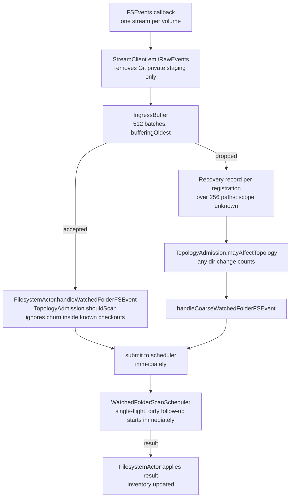
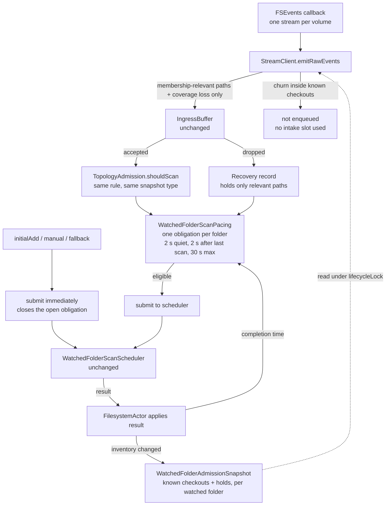
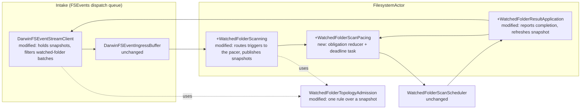

# FSEvents overload: Program Design

Realizes [the Specification](2026-11-04-fsevents-overload-specification.md) (R1–R8 over E1–E8), authorized by [the Requirements](2026-11-04-fsevents-overload-requirements.md). Proof strategy: [the Verification Design](2026-11-04-fsevents-overload-verification-design.md). Source anchors are at `main` `e196a7ec6`, under `Sources/AgentStudio/Core/RuntimeEventSystem/Filesystem/` unless stated otherwise.

## What changes, in one picture

**Today:** the rule that ignores churn inside known checkouts runs only after the bounded 512-batch intake. When the intake overflows, a weaker rule takes over, and the scan is submitted immediately, with no pacing.



**Target:** the same rule runs at the source, before the intake, using a snapshot of the known checkouts. Every change-driven scan then goes through a per-folder debounce that reuses `FilesystemActor`'s existing debounce pattern. The scheduler is unchanged.



### Why this is better

| | Today | Target |
| --- | --- | --- |
| A build inside a known checkout (100k+ changes) | fills the intake; on overflow, becomes "rescan the whole folder", over and over | filtered at the source; uses no intake slot; **0 scans** |
| A worktree created or removed | about 59k recovery records in 10 min; back-to-back scans | one obligation; scanned **once** after 2 s of quiet, at most once more if the burst outlasts 30 s |
| A continuous 10-minute burst of new checkouts | back-to-back scans for the whole burst | about one scan every 30 s |
| OS reports dropped events | immediate scan, then a follow-up for every burst after it | one paced scan; never skipped |
| User adds a folder or refreshes | immediate | immediate, unchanged |
| Measuring it | recovery records only | each scan logged with reason, wait and folded-trigger count |

The fix applies the rule the architecture doc already states ("directory changes inside a known checkout do not request a full scan"). It applies it where the loss happens, and reuses a debounce the codebase already trusts. The scheduler, where the separate crash (LUNA-514) lives, isn't touched.

## Structure decision

**Selected:** relevance moves to the source, and pacing goes in `FilesystemActor`.
- **Source relevance:** the stream client filters watched-folder batches with the existing topology rule, against an immutable snapshot that `FilesystemActor` publishes.
- **Pacing:** a per-folder debounce, modeled on the Git-lane debounce at `FilesystemActor.swift:525-657`.
- **Explicit demands** stay immediate.
- **The scheduler** is unchanged.

| Alternative | Why not |
| --- | --- |
| Pacing inside `WatchedFolderScanScheduler` (a future `readyAt` plus a deadline task) | The architecture doc assigns debounce to `FilesystemActor` (workspace_data_architecture 420-430). The proven debounce pattern lives there. The scheduler is under an open corruption investigation (LUNA-514), and adding time state to its `SchedulingStateStore` touches exactly that code. |
| Keep the topology relevance only through overflow, with no source filter | R1 would hold under overload, but irrelevant churn would still take up intake slots and push out relevant batches. That keeps the 274-registration fan-out pressure. |
| Retain recovery records across drains inside `IngressBuffer` (as first proposed) | Redundant: the pacer's per-folder obligation is the one durable home for recovery intent (E6), and the buffer's record stays transport only. |
| Native FSEvents exclusions, a larger buffer, or a longer stream latency | Non-goals. They move pressure around without fixing what the overflow path does. |

**Cost:**
- One new interface method on `FSEventStreamClient`; its test fakes change.
- One new pure reducer and one deadline task in `FilesystemActor`.
- Per-callback prefix checks on the FSEvents dispatch queue.
- Discovery of a new checkout during churn waits up to 2–30 s.

**What would reopen the choice:**
- Post-change telemetry shows more than 2 watched-folder scans per worktree create/remove.
- The source filter measurably costs callback time: over 1 ms median per callback in the ingress snapshot.
- A missed discovery appears that's traceable to a stale snapshot.

## Entities and where they live

| E | Semantic owner | Home (`new`/`modified`/`existing`) | Type home | Shape at boundaries | Kind | Convention |
| --- | --- | --- | --- | --- | --- | --- |
| E1 Watched folder | `FilesystemActor` | existing: `watchedFolderScanState.registrationsBySourceID` | `FilesystemSourceID`, `FilesystemWatchedFolderRegistration` | `FilesystemSourceID` to the scheduler; legacy routing `UUID` to the stream client (`sourceIDByLegacyCallbackRoutingID`) | persisted (watch list) | existing |
| E2 Known checkout | `FilesystemActor` (inventory) | existing: `inventoryBySourceID[...].repoGroups`. **New:** projection `WatchedFolderAdmissionSnapshot` | `RepoScanner.RepoScanGroup`; new `WatchedFolderAdmissionSnapshot` in `WatchedFolderTopologyAdmission.swift` | `WatchedFolderAdmissionSnapshot { canonicalRoot: String, lexicalRoot: String, casePolicy: FilesystemVolumeCasePolicy, knownCheckoutPaths: Set<String> /* comparison form, holds included */ }`, a `Sendable` value from actor to client | derived | Swift value types, `Sendable` |
| E3 File change | OS, via `DarwinFSEventStreamClient` | existing | `FSEventBatch`, `FSEventObservation` | unchanged | transient | existing |
| E4 Membership-relevant change | `WatchedFolderTopologyAdmission` (sole rule owner) | modified: `shouldScan` and `mayAffectTopology` re-expressed over the snapshot | new closed enum `WatchedFolderPathRelevance { case relevant, irrelevant }`, plus `filterBatch(_:snapshot:) -> FSEventBatch?` | an `FSEventBatch` with only relevant paths and observations, or `nil` | derived | pure static functions, as today |
| E5 Coverage loss | `DarwinFSEventStreamClient` / `DarwinFSEventIngressBuffer` | existing | `FSEventObservation.hasCoverageLoss`, `FSEventOverflowRecovery` | unchanged | transient | existing |
| E6 Recovery obligation | `FilesystemActor` | **new**: `WatchedFolderScanPacing` in `FilesystemActor+WatchedFolderScanPacing.swift`, held in `watchedFolderScanState.pacing` | `struct WatchedFolderScanPacing`, `struct PacedScanObligation { firstUnservedTriggerAt: Duration; lastTriggerAt: Duration; foldedTriggerCount: Int; reasons: WatchedFolderScanTriggerReasons }` | none: it never crosses an actor boundary | in-memory | mirrors `PendingWorktreeChanges` |
| E7 Scan | `WatchedFolderScanScheduler` | existing, unchanged | `WatchedFolderScanRequest`, `WatchedFolderScanCause` | unchanged | in-memory | existing |
| E8 Explicit scan demand | `FilesystemActor` | existing | `WatchedFolderScanCause.initialAdd`, `.manual`, `.fallback` | unchanged | — | existing |

Policy constants (`AppPolicies.WatchedFolderScanning`, modified): `changeQuietPeriod = .seconds(2)`, `minimumGapAfterScan = .seconds(2)`, `maximumChangeDeferral = .seconds(30)`. These are behavior, so they're policies and not styles.

## Components



| Component | Job | Owns | Consumers | Reason to change |
| --- | --- | --- | --- | --- |
| `WatchedFolderTopologyAdmission` | decides membership relevance | the only relevance rule (E4) | stream client, `FilesystemActor` | the discovery contract changes |
| `DarwinFSEventStreamClient` | turns callbacks into batches | the latest admission snapshot per watched-folder registration | ingress buffer | the intake shape changes |
| `WatchedFolderScanPacing` | decides when a change-driven scan may be submitted | E6, one open obligation per folder | `FilesystemActor+WatchedFolderScanning` | the pacing policy changes |
| `FilesystemActor+WatchedFolderScanning` | receives triggers, submits scans | trigger routing; snapshot publication | ingress loop, result application | scan admission changes |
| `WatchedFolderScanScheduler` | runs scans, with single-flight and the concurrency limit | E7 | `FilesystemActor` | unchanged here |

**Forbidden edges:**
- The stream client never calls the actor. It only reads an immutable snapshot the actor pushed.
- The pacer never touches the scheduler's state.
- No path or file name goes into telemetry.

## Interfaces

**`FSEventStreamClient.updateWatchedFolderAdmission(worktreeId: UUID, snapshot: WatchedFolderAdmissionSnapshot?)`** (new requirement on the protocol)
- Replaces the snapshot for one watched-folder registration atomically, under `lifecycleLock`.
- `nil` clears it, so that registration's batches are unfiltered, as today.
- Takes effect for callbacks that start after it returns. A callback already running may use the previous snapshot.

**`WatchedFolderTopologyAdmission.filterBatch(_ batch: FSEventBatch, snapshot: WatchedFolderAdmissionSnapshot) -> FSEventBatch?`** (new; pure)
- Keeps every observation with `hasCoverageLoss` and every path or observation that `shouldScan` would count. Returns `nil` when nothing remains.
- `shouldScan(_:snapshot:)` becomes `filterBatch(...) != nil`, so there is one rule.
- `mayAffectTopology` stays for already-filtered retained recoveries. Their paths are relevant by construction.

**`WatchedFolderScanPacing`** (new; pure reducer, fed explicit `now` values):

```swift
mutating func recordTrigger(_ sourceID: FilesystemSourceID, reason: WatchedFolderScanTriggerReason, at now: Duration)
mutating func recordSubmission(_ sourceID: FilesystemSourceID, at now: Duration)   // the obligation is served
mutating func recordCompletion(_ sourceID: FilesystemSourceID, at now: Duration)
mutating func removeFolder(_ sourceID: FilesystemSourceID)
func decision(at now: Duration) -> WatchedFolderPacingDecision
enum WatchedFolderPacingDecision: Equatable { case submit([FilesystemSourceID]), wait(until: Duration), idle }
enum WatchedFolderScanTriggerReason: Equatable { case relevantChange, nativeCoverageLoss, intakeCoverageLoss }
```

**Eligibility, for each folder with an open obligation:**

- **(a) Paced:** `now ≥ lastTriggerAt + changeQuietPeriod`, and `now ≥ lastCompletedAt + minimumGapAfterScan`, and no submitted scan is still awaiting its result.
- **(b) Forced:** `now ≥ firstUnservedTriggerAt + maximumChangeDeferral`, whatever is in flight. The scheduler's existing single-flight merges it into the running scan's dirty follow-up.

## The main path, step by step

**Trigger to obligation**
1. An FSEvents callback runs `DarwinFSEventStreamClient.emitRawEvents` (`DarwinFSEventStreamClient.swift:619-650`).
2. For a registration that has a snapshot, `filterBatch` runs first. A `nil` result means **no yield**.
3. A surviving batch, carrying only relevant paths and coverage-loss observations, reaches `ingressBuffer.yield`. That's unchanged.
4. The `FilesystemActor` ingress loop calls `handleWatchedFolderFSEvent` (`FilesystemActor+WatchedFolderScanning.swift:161`). `shouldScan(batch, snapshot)` is true there, so it calls `pacing.recordTrigger(.relevantChange or .nativeCoverageLoss)` and schedules the pacing deadline. **It doesn't submit.**
5. An overflow recovery for a watched folder (`FilesystemActor.swift:456-483`) takes the same route. Retained paths go to `handleWatchedFolderFSEvent`. A coarse recovery calls `recordTrigger(.intakeCoverageLoss)` in place of `handleCoarseWatchedFolderFSEvent`'s direct submit.

**Deadline to scan**

6. The pacing task sleeps on `schedulingClock` until the decision's `wait(until:)`. It's one reschedulable task, the same pattern as `drainPendingChanges` (`FilesystemActor.swift:525-570`).
7. On `.submit(ids)`, each source calls the existing `submitWatchedFolderScan(cause: .callback)`. On `.accepted` comes `recordSubmission`, and the `watched_scan` telemetry record with phase `submitted`.
8. The scheduler runs it, as today.

**Result to pacer**

9. `applyWatchedFolderScanResult` (`FilesystemActor+WatchedFolderResultApplication.swift:98`) calls `pacing.recordCompletion`.
10. When `inventoryBySourceID` changed (`:139-152`), it rebuilds `WatchedFolderAdmissionSnapshot` and calls `updateWatchedFolderAdmission`.
11. It records `watched_scan` with phase `completed`.

**Explicit demands:** `initialAdd`, `manual` and `fallback` submit immediately, as today, then call `recordSubmission`, which closes any open obligation the scan covers (R6).

**Holds:** a change to `publicationHoldPathsByID` republishes the snapshot, because held paths count as known checkouts. Registration and unregistration publish or clear the snapshot, and `removeFolder` drops the obligation.

## The obligation's lifecycle

```mermaid
stateDiagram-v2
  [*] --> None
  None --> Open: recordTrigger
  Open --> Open: recordTrigger (folds; lastTriggerAt moves)
  Open --> Submitted: decision = submit (paced or forced) / explicit demand
  Submitted --> Open: recordTrigger after submission (new interval)
  Submitted --> None: recordCompletion with no new trigger
  Open --> None: removeFolder (unwatched)
  Submitted --> None: removeFolder
```



**Illegal states:**
- Two open obligations for one folder can't exist: it's a dictionary keyed by `FilesystemSourceID`.
- A scan submitted before a trigger can't close that trigger: `recordTrigger` after `recordSubmission` reopens the obligation.

## Failure, recovery and concurrency

| Situation | Detection | Behavior | Owner |
| --- | --- | --- | --- |
| A stale snapshot (a new checkout isn't in it yet) | — | Changes inside the new checkout count as relevant, so an extra paced scan runs. That errs toward safety. | `TopologyAdmission` |
| A stale snapshot (a removed checkout is still in it) | — | The root's own removal or rename isn't "strictly inside", so it stays relevant and triggers a scan. | `TopologyAdmission` |
| A callback races a snapshot update | — | It uses either snapshot. Both are safe, by the two rows above. | stream client |
| A submitted scan never yields a result (stale drop, cancellation) | none needed | The forced rule (b) ignores in-flight, so a scan still happens within 30 s. The worst case is one forced scan per 30 s per folder. | `WatchedFolderScanPacing` |
| The scheduler rejects a submission (shutdown, generation exhausted) | `.rejected` | The obligation stays open. Shutdown clears all pacing state and cancels the task. | `FilesystemActor` |
| The pacing task sleep fails | thrown error | It's logged and rescheduled, as in `drainPendingChanges`. | `FilesystemActor` |
| OS coverage loss arrives with only in-checkout paths | `hasCoverageLoss` | Always kept by `filterBatch`, so the obligation opens (R5). | `TopologyAdmission` |
| The folder is unwatched while an obligation is open | registration removal | `removeFolder`; nothing is published. | `FilesystemActor` |

**Concurrency:**
- All pacing state is actor-isolated in `FilesystemActor`.
- The snapshot is an immutable `Sendable` value. It's handed over under the client's existing `lifecycleLock`, the same lock that guards `streamByWorktreeId`.
- No new MainActor work.
- Ordering across folders isn't promised.

## Cross-cutting

- **Performance:** the source filter is O(paths × checkout-path depth) Set lookups on the FSEvents dispatch queue. That's acceptable because it replaces enqueueing those paths at all. The proof is in the ingress snapshot's callback timing, plus V9.
- **Privacy:** `watched_scan` records carry `diagnosticTag(sourceID)` (the existing process-seeded tag), reason, wait in ms, folded-trigger count and duration. No paths.
- **Observability (R8):** a new `performance.filesystem.watched_scan` event through the existing `performanceTraceRecorder`, with phase `submitted` or `completed`. Its reason values are `relevantChange`, `nativeCoverageLoss`, `intakeCoverageLoss`, `initialAdd`, `manual` and `fallback`.
- **Security, accessibility:** not applicable. There's no new input surface.

## Trace table

| U | R | E | Owner | Interface | Shape and home | State | Failure | Proof |
| --- | --- | --- | --- | --- | --- | --- | --- | --- |
| U1 U2 | R1 irrelevant changes start no scan | E1 E2 E3 E4 E7 | `WatchedFolderTopologyAdmission` + stream client | `filterBatch`, `updateWatchedFolderAdmission` | `WatchedFolderAdmissionSnapshot` (TopologyAdmission.swift) | snapshot per registration (client) | stale snapshot over-scans | seam: `filterBatch` pure; client with injected stream factory + saturated buffer |
| U3 U7 | R2 one obligation, kept until covered | E1 E4 E5 E6 E7 | `WatchedFolderScanPacing` | `recordTrigger/Submission/Completion` | `PacedScanObligation` (+WatchedFolderScanPacing.swift) | Open/Submitted/None | rejection keeps obligation | seam: pure reducer with explicit `now` |
| U3 U4 | R3 debounced pacing | E1 E6 E7 | `WatchedFolderScanPacing` | `decision(at:)` | `WatchedFolderPacingDecision` | lastTriggerAt, lastCompletedAt | sleep failure retried | seam: reducer + `FilesystemActor` with injected clock |
| U4 U7 | R4 bounded delay | E1 E6 E7 | `WatchedFolderScanPacing` | `decision(at:)` forced branch | same | firstUnservedTriggerAt | lost result → forced scan | seam: reducer with explicit `now` |
| U7 | R5 lost events always reconciled | E1 E5 E6 | `TopologyAdmission` + pacing | `filterBatch` keeps coverage loss; `recordTrigger(.native/.intakeCoverageLoss)` | `WatchedFolderScanTriggerReason` | Open | — | seam: `filterBatch` + actor overflow path with fake client |
| U7 | R6 explicit demands unpaced | E6 E7 E8 | `FilesystemActor+WatchedFolderScanning` | existing submit + `recordSubmission` | `WatchedFolderScanCause` (existing) | Submitted | — | seam: actor with injected clock + fake scheduler submission |
| U7 | R7 discovery stays correct | E1 E2 E4 E7 | existing result application (unchanged) | existing | existing | inventory | over-scan only | seam: existing watched-folder admission/application tests extended |
| U5 | R8 scans observable | E1 E5 E6 E7 | `FilesystemActor` | `performanceTraceRecorder.record(.watchedFolderScan, …)` | attribute set in `AgentStudioOTLPRepoExplorerTaxonomy` | — | recorder fail-open | seam: recorder fake in actor tests; production VictoriaLogs |

Deviations and unresolved decisions: none. The Lead composed "min 2s / max 30" into the R3/R4 debounce (Specification R3), and the owner can correct it.
