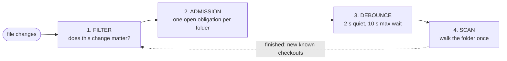
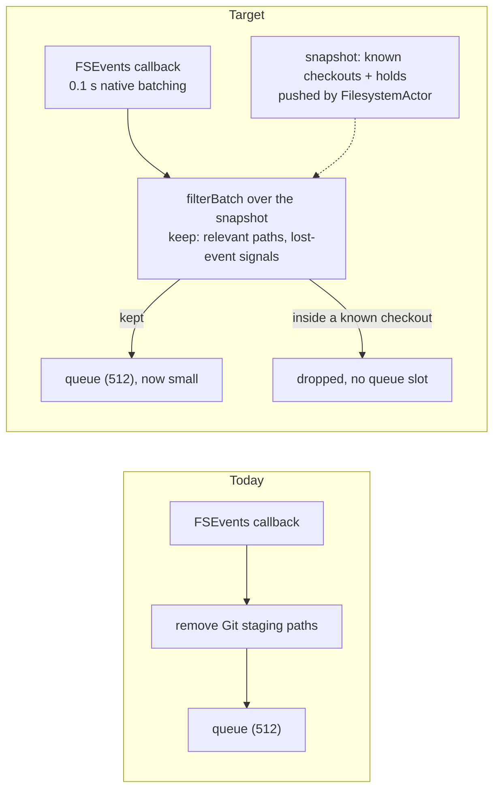
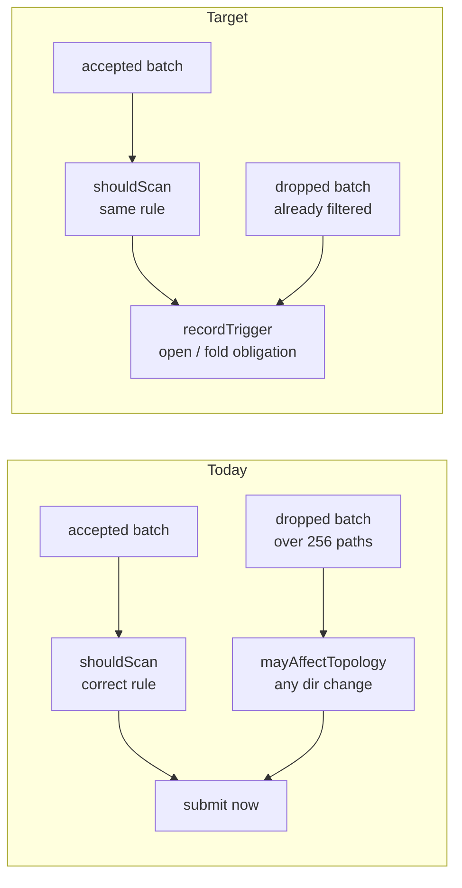
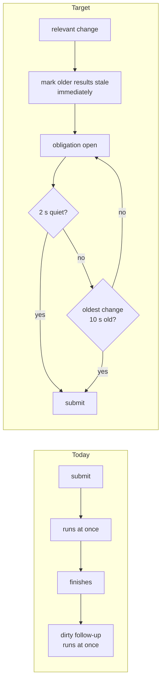
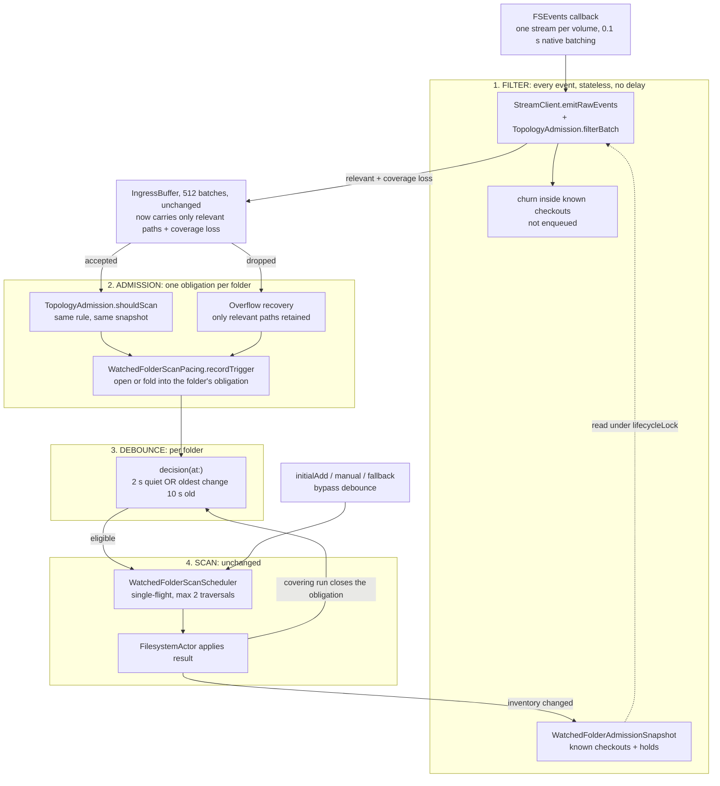
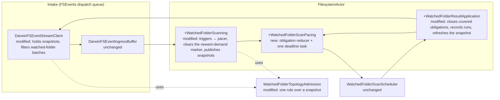
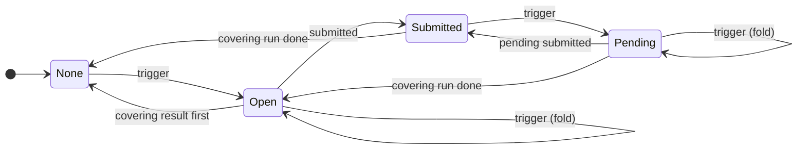

# FSEvents overload: Program Design

Realizes [the Specification](2026-11-04-fsevents-overload-specification.md) (R1–R8 over E1–E8), authorized by [the Requirements](2026-11-04-fsevents-overload-requirements.md). Proof strategy: [the Verification Design](2026-11-04-fsevents-overload-verification-design.md).

**Delivery boundary (U11):** this is the **Swift stopgap**. The tiers, the injected platform-neutral source and the directory-level discovery stream are the daemon spec's, which follows the sunclaw measurements. Source anchors are at `main` `e196a7ec6`, under `Sources/AgentStudio/Core/RuntimeEventSystem/Filesystem/` unless stated otherwise.

## What changes: four blocks

Every file change passes through four blocks. The fix changes what happens **inside** each block, not the order of the blocks.



| Block | Today | Target |
| --- | --- | --- |
| **1. Filter** | Removes only Git's private staging paths. Every build file still enters the 512-slot queue. | Drops changes strictly inside known checkouts **before** the queue, using the same rule that admission uses. Lost-event signals always pass. |
| **2. Admission** | The rule is right for accepted batches. On overflow, a weaker rule treats any directory change as relevant. | One rule everywhere. Every relevant change opens or folds into the folder's single obligation. |
| **3. Debounce** | **None.** Scans are submitted immediately, and follow-ups start back to back. | Per folder: 2 s of quiet, or eligible once the oldest change is 10 s old. A relevant change marks older results stale **immediately**. Explicit demands (add folder, refresh) skip the debounce. |
| **4. Scan** | Single-flight and at most 2 traversals. | Unchanged. |

### Block 1: Filter



**Why the debounce sits after the filter, not in it:** the filter has to see every event, because a debounce keeps only the latest and could drop the one event that matters, such as a `.git` marker appearing mid-build. The filter is cheap per event, and FSEvents already batches callbacks at 0.1 s. Waiting pays off only in front of the expensive step, the scan, after the filter has shrunk the input. That's the Selection Rule's order: classify the input, then choose the mechanism.

### Block 2: Admission



### Block 3: Debounce



### Block 4: Scan

Unchanged: `WatchedFolderScanScheduler` keeps per-folder single-flight, one merged follow-up and at most 2 concurrent traversals. A finished run feeds back in two ways: it updates the known-checkout snapshot the Filter uses, and it closes the folder's obligation, which restores trusted absence, once it covers every trigger.

<details>
<summary>The full target pipeline in one drawing (all blocks, with code owners)</summary>



</details>

### Why this is better

| | Today | Target |
| --- | --- | --- |
| A build inside a known checkout (100k+ changes) | fills the intake; on overflow, becomes "rescan the whole folder", over and over | filtered at the source; uses no intake slot; **0 scans** |
| A worktree created or removed | about 59k recovery records in 10 min; back-to-back scans | one obligation; scanned **once** after 2 s of quiet, at most 1 + ⌈duration / 10 s⌉ runs |
| A continuous 10-minute burst of new checkouts | back-to-back scans for the whole burst | about one scan every 10 s |
| OS reports dropped events | immediate scan, then a follow-up for every burst after it | one paced scan; never skipped |
| A worktree restored while an older scan that missed it finishes | the older result can mark it gone | the change marks older results stale at once, so it can't |
| User adds a folder or refreshes | immediate | immediate, unchanged |
| Measuring it | recovery records only | each scan logged with reason, wait and folded-trigger count |

The fix applies the rule the architecture doc already states ("directory changes inside a known checkout do not request a full scan"). It applies it where the loss happens, and reuses a debounce the codebase already trusts. The scheduler, where the separate crash (LUNA-514) lives, isn't touched.

## Structure decision

**Selected:** relevance moves to the source, and pacing goes in `FilesystemActor`.
- **Source relevance:** the stream client filters watched-folder batches with the existing topology rule, against an immutable snapshot that `FilesystemActor` publishes.
- **Pacing:** a per-folder debounce, modeled on the Git-lane debounce at `FilesystemActor.swift:525-657`.
- **Explicit demands** stay immediate.
- **The scheduler** is unchanged.

| Alternative | Why not |
| --- | --- |
| Pacing inside `WatchedFolderScanScheduler` (a future `readyAt` plus a deadline task) | The architecture doc assigns debounce to `FilesystemActor` (workspace_data_architecture 420-430). The proven debounce pattern lives there. The scheduler is under an open corruption investigation (LUNA-514), and adding time state to its `SchedulingStateStore` touches exactly that code. |
| Keep the topology relevance only through overflow, with no source filter | R1 would hold under overload, but irrelevant churn would still take up intake slots and push out relevant batches. That keeps the 274-registration fan-out pressure. |
| Retain recovery records across drains inside `IngressBuffer` (as first proposed) | Redundant: the pacer's per-folder obligation is the one durable home for recovery intent (E6), and the buffer's record stays transport only. |
| Stale-absence protection through a new "unsettled" store consulted by each reader | The four readers already compare against one newest-demand marker (`ResultApplication:110-119, 135, 218-219, 244-246`). Clearing it at trigger time protects all four with no new state. |
| Native FSEvents exclusions, a larger buffer, or a longer stream latency | Non-goals. They move pressure around without fixing what the overflow path does. |

**Cost:**
- One new interface method on `FSEventStreamClient`; its test fakes change.
- One new pure reducer and one deadline task in `FilesystemActor`.
- Per-callback prefix checks on the FSEvents dispatch queue.
- Discovery of a new checkout during churn waits up to 2–10 s, plus the run's duration.

**What would reopen the choice:**
- Post-change telemetry shows completed runs exceeding the trigger-trace bound (1 + k + ⌈D/10⌉) on the V9 workload.
- The source filter measurably costs callback time: over 1 ms median per callback in the ingress snapshot.
- A missed discovery appears that's traceable to a stale snapshot.

## Entities and where they live

| E | Semantic owner | Home (`new`/`modified`/`existing`) | Type home | Shape at boundaries | Kind | Convention |
| --- | --- | --- | --- | --- | --- | --- |
| E1 Watched folder | `FilesystemActor` | existing: `watchedFolderScanState.registrationsBySourceID` | `FilesystemSourceID`, `FilesystemWatchedFolderRegistration` | `FilesystemSourceID` to the scheduler; legacy routing `UUID` to the stream client | persisted (watch list) | existing |
| E2 Known checkout | `FilesystemActor` (inventory) | existing: `inventoryBySourceID[...].repoGroups` and `publicationHoldPathsByID`. **New:** projection `WatchedFolderAdmissionSnapshot` | `RepoScanner.RepoScanGroup`; new `WatchedFolderAdmissionSnapshot` in `WatchedFolderTopologyAdmission.swift` | `WatchedFolderAdmissionSnapshot { canonicalRoot: String; lexicalRoot: String; casePolicy: FilesystemVolumeCasePolicy; knownCheckoutPaths: Set<String> /* comparison form, holds included */; maxScanDepth: Int }`, a `Sendable` value from actor to client | derived | Swift value types, `Sendable` |
| E3 File change | OS, via `DarwinFSEventStreamClient` | existing | `FSEventBatch`, `FSEventObservation` | unchanged | transient | existing |
| E4 Membership-relevant change | `WatchedFolderTopologyAdmission` (sole rule owner) | modified: the existing `shouldScan` rules re-expressed per path over the snapshot, plus the scanner bounds for (c) | `filterBatch(_:snapshot:) -> FSEventBatch?`; `shouldScan(_:snapshot:)`; the routine and discovery-sensitive Git sets stay where they are (`:7-14`, `:69-87`) | an `FSEventBatch` holding only relevant paths and observations, or `nil` | derived | pure static functions, as today |
| E5 Coverage loss | `DarwinFSEventStreamClient` / `DarwinFSEventIngressBuffer` | existing | `FSEventObservation.hasCoverageLoss`, `FSEventOverflowRecovery` | unchanged | transient | existing |
| E6 Recovery obligation | `FilesystemActor` | **new**: `WatchedFolderScanPacing` in `FilesystemActor+WatchedFolderScanPacing.swift`, held in `watchedFolderScanState.pacing` | `struct WatchedFolderScanPacing`; `enum PacedScanObligation { case open(OpenInterval), submitted(InFlightSubmission, pendingInterval: OpenInterval?) }`; `struct OpenInterval { firstTriggerAt: Duration; lastTriggerAt: Duration; triggerRevision: UInt64; foldedTriggerCount: Int; quietGapCount: Int; intervalOrdinal: UInt64; reasons: WatchedFolderScanTriggerReasons }`, plus per obligation `obligationOrdinal`, `openedAt` and the completed change-driven run count; `struct InFlightSubmission { submissionSequence: UInt64; coveredRevision: UInt64; cause: WatchedFolderScanCause; reservedAt: Duration }`, registered **synchronously before** `await submit`, for every cause; `triggerRevisionBySourceID: [FilesystemSourceID: UInt64]`, which increases on every relevant trigger | none: it never crosses an actor boundary | in-memory | mirrors `PendingWorktreeChanges` |
| E7 Scan run | `WatchedFolderScanScheduler` | existing, unchanged | `ScheduledWatchedFolderScanResult` (carries `demandCoverage` and the run's `scanRunGeneration`) | unchanged | in-memory | existing |
| E8 Explicit scan demand | `FilesystemActor` | existing | `WatchedFolderScanCause.initialAdd`, `.manual`, `.fallback`; retention selective scans | unchanged | — | existing |
| (R7 marker) newest-demand marker | `FilesystemActor` | **modified meaning**: `watchedFolderScanState.latestDemandCoverageBySourceID` | `[FilesystemSourceID: WatchedFolderScanDemandCoverage]`; an absent key now also means "a trigger is unsubmitted" | read by `ResultApplication:110-119, 135, 218-219, 244-246` | in-memory | existing |

Policy constants (`AppPolicies.WatchedFolderScanning`, modified): `changeDebounce = .seconds(2)` and `changeMaximumWait = .seconds(10)`. They're behavior, so they're policies and not styles.

## Components



| Component | Job | Owns | Consumers | Reason to change |
| --- | --- | --- | --- | --- |
| `WatchedFolderTopologyAdmission` | decides membership relevance | the only relevance rule (E4) | stream client, `FilesystemActor` | the discovery contract changes |
| `DarwinFSEventStreamClient` | turns callbacks into batches | the latest admission snapshot per watched-folder registration | ingress buffer | the intake shape changes |
| `WatchedFolderScanPacing` | decides when a change-driven demand may be submitted, and when an obligation is served | E6 | `FilesystemActor+WatchedFolderScanning`, `+ResultApplication` | the debounce policy changes |
| `FilesystemActor+WatchedFolderScanning` | receives triggers, invalidates stale authority, submits demands | trigger routing; the newest-demand marker; snapshot publication | ingress loop | scan admission changes |
| `FilesystemActor+WatchedFolderResultApplication` | applies completed runs | inventory and negative authority (existing); now also closing obligations and run telemetry | scheduler result drain | result semantics change |
| `WatchedFolderScanScheduler` | runs scans, with single-flight and the 2-traversal limit | E7 | `FilesystemActor` | unchanged here |

**Forbidden edges:**
- The stream client never calls the actor. It only reads the immutable snapshot the actor pushed.
- The pacer never touches the scheduler's state.
- No path or file name goes into telemetry.

## Interfaces

**`FSEventStreamClient.updateWatchedFolderAdmission(worktreeId: UUID, snapshot: WatchedFolderAdmissionSnapshot?)`** (new requirement on the protocol)
- Replaces the snapshot for one watched-folder registration atomically, under the client's `lifecycleLock`.
- `nil` clears it, so that registration's batches are unfiltered, as today.
- Applies to callbacks that start after it returns.

**`WatchedFolderTopologyAdmission.filterBatch(_ batch: FSEventBatch, snapshot: WatchedFolderAdmissionSnapshot) -> FSEventBatch?`** (new; pure)
- Keeps every coverage-loss observation, and every path or observation that matches E4(a)–(d) under the existing rule. (c) is additionally bounded to `depth(path relative to canonicalRoot) ≤ maxScanDepth`, with no hidden path component other than a final `.git`.
- Returns `nil` when nothing remains.
- `shouldScan(_:snapshot:)` becomes `filterBatch(...) != nil`, so accepted and dropped batches use one rule.
- `mayAffectTopology` remains only for retained recoveries, which hold already-filtered paths.

**`WatchedFolderScanPacing`** (new; a pure reducer, fed explicit `now` values):

```swift
mutating func recordTrigger(_ id: FilesystemSourceID, reason: WatchedFolderScanTriggerReason, at now: Duration) -> UInt64  // new revision
func decision(at now: Duration) -> WatchedFolderPacingDecision
mutating func recordAccepted(_ id: FilesystemSourceID, coveredRevision: UInt64, coverage: WatchedFolderScanDemandCoverage, at now: Duration)
mutating func recordRunCompleted(_ id: FilesystemSourceID, coverage: WatchedFolderScanDemandCoverage) -> WatchedFolderPacingClosure
mutating func removeFolder(_ id: FilesystemSourceID)
enum WatchedFolderPacingDecision: Equatable { case submit([(FilesystemSourceID, coveredRevision: UInt64)]), wait(until: Duration), idle }
enum WatchedFolderPacingClosure: Equatable { case closed, stillOpen, notCovered }
enum WatchedFolderScanTriggerReason: Equatable { case relevantChange, nativeCoverageLoss, intakeCoverageLoss }
```

**Eligibility:** an `open` interval is eligible when `now ≥ lastTriggerAt + changeDebounce`, or when `now ≥ firstTriggerAt + changeMaximumWait`. A folder whose obligation is `submitted` with no pending interval isn't eligible. A pending interval on a `submitted` folder becomes eligible by the same rule, and its submission merges in the scheduler as a dirty follow-up. Its covering run is that dirty run.

**One submission protocol, for every cause.** It reuses the existing `submissionSequence`, which is reserved synchronously in `watchedFolderScanRequest` (`FilesystemActor+WatchedFolderScanning.swift:340-360`). A result covers every submission for its folder **up to `result.request.submissionSequence`**, because merged demands keep the newest request (`WatchedFolderScanSchedulerState.swift:9-18`). The publication-hold code already uses the same ordering (`FilesystemActor+PublicationHold.swift:54-66`).

| Event | Rule (callback, initialAdd, manual, fallback and retention alike) |
| --- | --- |
| reserve (before `await`) | record `InFlightSubmission(seq, coveredRevision = current triggerRevision)` |
| acceptance returns | set `latestDemandCoverageBySourceID = coverage` **only if** `triggerRevision == coveredRevision`, the registration is unchanged, and the marker isn't already at or past this coverage. Otherwise, leave it. |
| a result arrives (in either order relative to acceptance) | Let `s` be the newest in-flight submission with `seq ≤ result.request.submissionSequence`. The result **is current** only if all three hold: (1) `triggerRevision == s.coveredRevision`; (2) the registration is unchanged; (3) **no newer demand exists**, meaning no in-flight or accepted submission with `seq > result.request.submissionSequence`, and the marker isn't past `result.demandCoverage` by `throughDemandGeneration`. **The marker never moves backwards.** If current, set the marker to `result.demandCoverage` before the inventory reduction, settle every in-flight submission up to `s`, and close the obligation. Otherwise, apply positive-only. Settle only the submissions this result covers, and leave a newer submission's work open: an old result never closes, or restores authority over, a newer demand. |
| a trigger | `triggerRevision += 1`, clear the marker, open or fold the interval |

Whichever comes first, the acceptance or the result, the final state is the same: the covering result is authoritative exactly once, and the obligation is closed exactly once. A later acceptance for an already-settled submission is a no-op.

## The main path, step by step

**Trigger, invalidation and obligation**
1. An FSEvents callback runs `DarwinFSEventStreamClient.emitRawEvents` (`:619-650`).
2. For a registration with a snapshot, `filterBatch` runs first. A `nil` result means **no yield**.
3. A surviving batch reaches `ingressBuffer.yield`, unchanged.
4. The `FilesystemActor` ingress loop calls `handleWatchedFolderFSEvent` (`FilesystemActor+WatchedFolderScanning.swift:161`). When `shouldScan(batch, snapshot)` is true, it does two things:
   - **(a) R7, at once:** it removes `latestDemandCoverageBySourceID[sourceID]`. From this instant, `mayReplaceNegativeSpace` (`ResultApplication:117-119`), authoritative coverage (`:135`), currentness (`:218-219`) and overlapping completeness (`:244-246`) are false for every earlier result. Earlier results can still add positive discoveries.
   - **(b)** It calls `pacing.recordTrigger(...)` and reschedules the pacing deadline. **It doesn't submit.**
5. A watched-folder overflow recovery (`FilesystemActor.swift:456-483`) takes the same route. Retained paths go through step 4. A coarse recovery runs 4(a), then `recordTrigger(.intakeCoverageLoss)`, in place of `handleCoarseWatchedFolderFSEvent`'s direct submit.

**Deadline to submission**

6. One pacing task sleeps on `schedulingClock` until `decision`'s `wait(until:)`. This is the `drainPendingChanges` pattern (`FilesystemActor.swift:525-570`).
7. On `.submit`, each folder goes through the submission protocol above with `cause: .callback`: reserve, then `await submit`, then the acceptance rule. Record a `watched_scan_demand` record.

**Run to closure**

8. The scheduler runs it, unchanged, possibly merging several demands into one run or a dirty follow-up.
9. `applyWatchedFolderScanResult` (`ResultApplication:98`) first runs the protocol's **result rule**: decide currency, then set the marker if current. Then it reduces the inventory exactly as today (negative authority only when the marker equals `result.demandCoverage`), closes the obligation through `pacing.recordRunCompleted`, and records `watched_scan_run` with `scanRunGeneration`.
10. When the inventory changed (`:139-152`), it rebuilds the snapshot and calls `updateWatchedFolderAdmission`.

**Explicit demands:** `initialAdd`, `manual`, `fallback` and retention scans submit at t+0, as today, but through the **same** submission protocol. Their acceptance no longer restores the marker unconditionally (today's `:101-104` and `:324-327`). The revision rule above applies, so an old explicit acceptance can't undo a newer trigger's invalidation (R6, R7). Their completed run closes any obligation it covers.

**Holds and registration:**
- A change to `publicationHoldPathsByID` republishes the snapshot.
- Registering a folder publishes its snapshot.
- Unregistering clears the snapshot and calls `removeFolder`.

## The obligation's lifecycle



**Reading it:**
- "Pending" is short for `SubmittedWithPending`: a submitted scan is running, and newer triggers are waiting behind it.
- Every trigger clears the newest-demand marker.
- "Submitted" means an explicit or a paced demand was accepted, under the submission protocol.
- "Covering" means the result covers the newest in-flight submission, and no trigger came after it.
- From **any** state, `removeFolder` (the folder is unwatched) goes straight to None.

**Illegal states:**
- Two obligations per folder can't exist: the state is keyed by `FilesystemSourceID`.
- A submission can't close a later trigger: closure compares revisions.
- A result can't certify absence while a trigger is unsubmitted: only the result rule or the acceptance rule sets the marker, and both check `triggerRevision`.
- No arrival order makes a covering result count twice or not at all, because settlement is keyed by `submissionSequence`.
- An older result can't regain negative authority after a newer demand: both rules keep the marker monotonic, and the result rule also requires that no newer submission exists (workspace_data_architecture 350-356).

## Failure, recovery and concurrency

| Situation | Behavior | Owner |
| --- | --- | --- |
| A stale snapshot: a new checkout isn't in it yet | Its interior changes count as relevant, so an extra paced run happens (errs safe) | `TopologyAdmission` |
| A stale snapshot: a removed checkout is still in it | The root's own removal or rename isn't "strictly inside", so it stays relevant | `TopologyAdmission` |
| A trigger arrives during `await submit` (any cause) | The acceptance rule sees `triggerRevision ≠ coveredRevision`, so the marker stays cleared and the interval stays pending | `FilesystemActor` |
| The result arrives before the acceptance | The result rule settles it from the in-flight record, so authority and closure happen once. The late acceptance is a no-op. | `FilesystemActor` |
| A run is stale-dropped or superseded | Its demand survives as dirty (`WatchedFolderScanScheduler.swift:845-857`, `preserveDirtyAfterStaleCompletion :891-900`), so a later completed run covers it; the obligation stays `submitted` until then | scheduler (existing) |
| A registration is retired, or the scheduler shuts down or rejects | `removeFolder` or `.rejected`: the obligation is dropped with its registration; on rejection it stays open, and the next decision retries | `FilesystemActor` |
| A long single-flight run | The pending interval waits for it; R4 grants eligibility, not a start | scheduler (existing) |
| The pacing sleep fails | It's logged and rescheduled, as in `drainPendingChanges` | `FilesystemActor` |
| OS coverage loss with only in-checkout paths | `filterBatch` always keeps it (R5) | `TopologyAdmission` |

**Concurrency:**
- Pacing and the marker are actor-isolated in `FilesystemActor`.
- The snapshot is an immutable `Sendable` value, handed over under the client's existing `lifecycleLock`.
- No new main-actor work.

## Cross-cutting

- **Performance:** the source filter costs O(paths × path depth) Set lookups on the FSEvents queue, in place of enqueueing those paths. It's measured in ingress callback timing and V9.
- **Telemetry (R8):** two new `performanceTraceRecorder` events.
  - `performance.filesystem.watched_scan_demand`: folder tag, `obligationOrdinal` (per folder, increments when an obligation opens), `intervalOrdinal`, reason, `firstTriggerOffsetMs` and `lastTriggerOffsetMs` (monotonic milliseconds since the obligation opened), `quietGapCount` (gaps of 2 s or more between recorded triggers in this interval), folded-trigger count, `obligationWaitMs` (submission time minus the obligation's open time), `submissionSequence`.
  - `performance.filesystem.watched_scan_run`: folder tag, `scanRunGeneration`, the `submissionSequence` and demand generation it covers, duration, and `obligationOrdinal` when it closed one.
  - `performance.filesystem.watched_scan_obligation`: folder tag, `obligationOrdinal`, phase `closed`, `spanMs` (first to last recorded trigger), total `quietGapCount`, the run generation that closed it, and the count of completed change-driven runs attributed to it. This is the record V9 computes 1 + k + ⌈D/10⌉ from, and compares against.
  - Runs are counted from completed results. A cancelled run without a result is not counted (a stated limit).
  - Folder tags use the existing process-seeded `diagnosticTag`; no paths.
- **Security, accessibility:** not applicable.

## Trace table

| U | R | E | Owner | Interface | Shape and home | State | Failure | Proof |
| --- | --- | --- | --- | --- | --- | --- | --- | --- |
| U1 U2 | R1 | E1–E4, E7 | `WatchedFolderTopologyAdmission` + stream client | `filterBatch`, `updateWatchedFolderAdmission` | `WatchedFolderAdmissionSnapshot` (TopologyAdmission.swift) | snapshot per registration (client) | a stale snapshot over-scans | seam: `filterBatch` pure; client with injected stream factory and a capacity-1 buffer; actor fixture |
| U3 U7 | R2 | E1, E4–E7 | `WatchedFolderScanPacing` + the submission protocol in `FilesystemActor` | `recordTrigger / recordRunCompleted`; reserve, acceptance and result rules | `PacedScanObligation`, `InFlightSubmission` (+WatchedFolderScanPacing.swift) | None / Open / Submitted / SubmittedWithPending | in-flight trigger; result before acceptance; stale drop; rejection | seam: reducer; actor fixture with the existing acceptance gate (`FilesystemActorWatchedFolderTestSupport.swift:99-129`) and a held result, in both orders |
| U3 U4 | R3 | E1, E6 | `WatchedFolderScanPacing` | `decision(at:)` debounce branch | `WatchedFolderPacingDecision` | `lastTriggerAt` | sleep failure retried | seam: reducer + actor on `TestPushClock` |
| U4 U7 | R4 | E1, E6, E7 | `WatchedFolderScanPacing` | `decision(at:)` maximum-wait branch | same | `firstTriggerAt` | long run: eligibility only | seam: reducer + actor on `TestPushClock` |
| U7 | R5 | E1, E5, E6 | `TopologyAdmission` + pacing | `filterBatch` keeps coverage loss; `recordTrigger(.native/.intakeCoverageLoss)` | `WatchedFolderScanTriggerReason` | Open | — | seam: `filterBatch` + actor overflow path with fake client |
| U7 | R6 | E6–E8 | `FilesystemActor+WatchedFolderScanning` | the same submission protocol at t+0 | `WatchedFolderScanCause` (existing) | Submitted | an old explicit acceptance after a newer trigger | seam: actor fixture with the acceptance gate, for manual (tracked) and fallback (untracked) |
| U7 | R7 | E1, E2, E4–E7 | `FilesystemActor` (marker) + existing result application | marker cleared in step 4(a); set only by the acceptance and result rules | `latestDemandCoverageBySourceID` (existing) | marker present / absent | an explicit or callback acceptance after a newer trigger; a result first | seam: actor + **real scanner** in temp repos, with the acceptance gate and a held result; own and overlapping receipt queries |
| U5 | R8 | E1, E5–E7 | `FilesystemActor` (the pacer supplies the trigger-trace fields) | `performanceTraceRecorder.record(.watchedScanDemand / .watchedScanRun / .watchedScanObligation, …)` | attribute set in `AgentStudioOTLPRepoExplorerTaxonomy` | — | recorder fail-open | seam: recorder fake in actor tests; marker-scoped Victoria in the V9 workload |

The daemon spec (tiers U8, injected platform-neutral source U9, directory-level discovery stream) follows the sunclaw measurements, as a separate document in this set.
