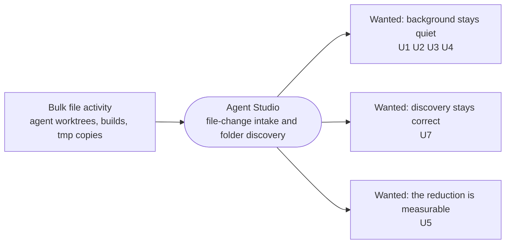

# FSEvents overload: Requirements

Linear: [LUNA-581](https://linear.app/askluna/issue/LUNA-581/fsevents-overload-amplifies-watched-folder-rescans). Specification: [2026-11-04-fsevents-overload-specification.md](2026-11-04-fsevents-overload-specification.md).

## Who is affected and what hurts today

**The owner, as the daily user of Agent Studio.** Agents create and remove worktrees, run builds and copy `tmp/` folders inside watched folders around the clock, often while nobody is at the machine. Each of these operations changes 100k+ files at once. The production app (v0.0.124) answers those bursts by rescanning whole watched folders over and over, with nobody using it:

- **Observed:** one worktree removal (about 150k deletes plus 150k copies) produced 59,151 coarse overflow recoveries in 10 minutes. In one hour, 67,827 intake batches were dropped and 66,364 accepted. Source: production VictoriaLogs, `service.version` 0.0.124, 2026-11-04 13:45–14:45 UTC.
- **Observed:** the Nov 3 crash's fault log shows the scheduler cycling through a scan's candidates continuously, at about 818k transitions in 29 h, while the owner was away.
- **Cost:** constant background CPU and disk work, and much more exposure for the separate scheduler crash ([LUNA-514](https://linear.app/askluna/issue/LUNA-514)), which happens during this churn.

**Downstream consumers of discovery.** The sidebar's repository and worktree list, and repository retention, rely on watched-folder scans to learn that a checkout appeared, moved or disappeared. They must keep getting correct results.

## What the owner asked for

| ID | Need, in the owner's words | Where it was said | Authority | Priority |
| --- | --- | --- | --- | --- |
| U1 | "make sure we don't do excess work walking the tree" | chat, 2026-11-04 | authorized | must, owner |
| U2 | "make sure that we don't look at files that don't matter. So these are all filters" | chat, 2026-11-04 | authorized | must, owner |
| U3 | "you have to have admission, then a debounce afterwards on how and what the downstream events may happen based on the input" | chat, 2026-11-04 | authorized | must, owner |
| U4 | Re-scan pacing: "min 2s. max 30." | page comment `02b7d273`, 2026-11-04 | authorized | must, owner |
| U5 | "why the fuck do you not check the logs with code and add logging and tracing?" The fix must be observable in telemetry. | chat, 2026-11-04 | authorized | must, owner |
| U6 | "i want full change and design to properly fix this": a complete fix of the FSEvents-to-scanner pipeline, not a minimal patch | chat, 2026-11-04 | authorized | must, owner |
| U7 | Discovery stays correct: a new, moved or removed checkout still reaches the sidebar and retention, and lost events never silently drop a directory move | existing contract, [workspace_data_architecture.md:342-348](../../architecture/state/workspace_data_architecture.md) | authorized (existing normative contract) | must, contract |

## Goal boundary

- **Goal:** a burst of file activity inside watched folders costs at most a small, bounded number of watched-folder scans. Changes that can't affect discovery cost none. Discovery results stay correct.
- **Existing foundation to keep:** one physical FSEvents stream per volume, the scheduler's per-folder single-flight with one merged follow-up, at most 2 concurrent traversals, stale-result validation, and the bounded scanner (depth 4, stops at `.git` markers).
- **What's missing:** irrelevant changes are filtered only after the bounded intake. Overflow recovery skips the known-checkout rule. Recovery intent is cleared on every drain. Follow-up scans have no pacing.
- **May change:** the filesystem intake and watched-folder scanning code under `Sources/AgentStudio/Core/RuntimeEventSystem/Filesystem/`, with related policy constants and telemetry.
- **Protected:**
  - the discovery, retention and negative-space contracts;
  - the Git working-tree status lane's existing behavior (it must not regress);
  - the scanner's traversal bounds;
  - production identity and data.
- **Acceptable complexity:** changes in the existing owners. A new mechanism is acceptable when Program Design names the rule it satisfies. No new app-wide atoms, bus events or coordinators.
- **Acceptable evidence:** RED-first tests at the existing owners, plus before/after production-class telemetry for the same worktree create/remove workload.

### Owner deliverable expectations

The owner asked to see "what we want to do and why this will be better" and "diagram needed". The Program Design shows the target pipeline next to today's, with diagrams, and the owner review page renders it. This shapes how the design is presented. It isn't product behavior.

## Non-goals

- **Root-causing or fixing the scheduler table corruption (LUNA-514).** That stays a separate investigation. This work only removes the churn it rides on.
- **Incremental or journal-replay scanning** that avoids whole-folder scans for path-scoped changes. That's a separate design.
- **Changing the Git working-tree status refresh cadence.** Burst pressure on that lane (observed: 258 pending status requests) is a candidate follow-up, not part of this change.
- **Globally ignoring `.git`, `node_modules`, `tmp` or build directory names**, which would hide newly created repositories in a watched folder.
- **Gating watched-folder scans on what's visible.** A watched folder is a standing subscription.
- **Raising the queue size or the FSEvents latency** as the fix.
