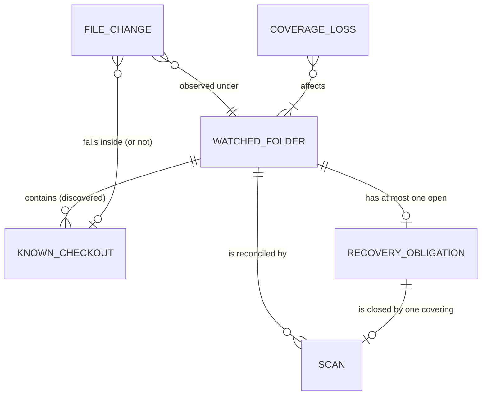

# FSEvents overload: Specification

Authorized by [the Requirements](2026-11-04-fsevents-overload-requirements.md) (U1–U7). Realized by [the Program Design](2026-11-04-fsevents-overload-program-design.md); proven per [the Verification Design](2026-11-04-fsevents-overload-verification-design.md).

## The problem in observable terms

| ID | Today | Who pays | Where it's observed |
| --- | --- | --- | --- |
| P1 | A burst of file changes inside known checkouts (builds, worktree copies) leads to repeated **whole watched-folder scans**, although such changes can't alter which checkouts exist | the owner: CPU, disk, crash exposure | production telemetry: 59,151 `overflow_coarse` recoveries in 10 min during one worktree removal |
| P2 | While a burst lasts, a folder is scanned back to back: each finished scan immediately starts its follow-up | the owner: sustained background work | fault-log ring: continuous scan cycling for 29 h |
| P3 | Telemetry counts recovery records but not watched-folder scans started or completed, or why they started, so the waste can't be measured | the owner, when diagnosing | the `stage_outcome` records carry no scan identity or reason |

Discovery is correct today. The obligations below keep it that way; they don't introduce correctness.

## Outcomes

- **O1:** Changes that can't affect which checkouts exist in a watched folder start no scan of it, even when the intake is overloaded. (P1; U1, U2)
- **O2:** A burst of relevant changes or lost events results in at most one scan per folder per quiet period, and never more often than the pacing allows. (P1, P2; U1, U3, U4)
- **O3:** Every change that can affect membership, and every lost-event signal, is still reconciled by a scan within a bounded delay. (U7)
- **O4:** Telemetry shows how many scans ran, for which folder and why, so the before and after can be compared. (P3; U5)

## Entities

| ID | Term | Identity rule | Relationships | Invariants | Observable states | Replaces | Basis |
| --- | --- | --- | --- | --- | --- | --- | --- |
| E1 | **Watched folder** | One persisted watch on one canonical folder path. Removing the watch and adding it back creates a new watched folder. | contains 0..n known checkouts; has at most one open recovery obligation; reconciled by 0..n scans | A watched folder is reconciled only while it is persistently watched | watched → unwatched | "watched root", "watched parent", "watched source" | U7, contract 342-348 |
| E2 | **Known checkout** | One repository checkout (clone or linked worktree) at one canonical root path, as last discovered in a watched folder | belongs to exactly 1 watched folder for this purpose | A path strictly inside a known checkout's root is "inside the checkout" | discovered → missing-pending-proof → absent (retention owns absence) | "known root", "checkout" | U7 |
| E3 | **File change** | One path-level change notification as the OS reports it (path plus event); the same path changing twice is two file changes | observed under 1..n watched folders; falls inside 0..1 known checkout | Carries only what the OS reported; never invented | — | "event", "FSEvent" | U2 |
| E4 | **Membership-relevant change** | A file change that can alter which checkouts exist in a watched folder: a Git marker appears or disappears, a known checkout or one of its ancestors moves or disappears, or a candidate directory appears **outside** every known checkout | a kind of file change | A change strictly inside a known checkout that isn't its Git marker isn't membership-relevant | — | "topology change" | contract 342-348 |
| E5 | **Coverage loss** | One occurrence of lost or uncertain change history for a scope: the OS reporting dropped or must-rescan events, or intake discarding change detail | affects 1..n watched folders | Can never be filtered away as irrelevant, because what was lost is unknown | — | "overflow", "drop", "MustScanSubDirs" | U7; Apple FSEvents guide |
| E6 | **Recovery obligation** | The one outstanding duty, per watched folder, to reconcile it after membership-relevant changes or coverage loss that no completed scan has yet covered | belongs to exactly 1 watched folder; closed by exactly 1 covering scan | At most one open per watched folder; further triggers fold into it; only a scan that **started after** the obligation's latest trigger closes it | open → scan pending → closed | "rescan intent", "dirty follow-up", "recovery debt" | U3, U7 |
| E7 | **Scan** | One traversal run of one watched folder | reconciles 1 watched folder; may close 1 recovery obligation | At most one running per watched folder | queued → running → completed / cancelled / superseded | "watched-folder scan", "rescan" | U1 |
| E8 | **Explicit scan demand** | A scan requested directly by the user or app lifecycle, not by file changes: adding a watched folder, a manual refresh, startup, or a retention check | targets 1 watched folder | Never delayed by pacing | — | "manual/initial/retention demand" | U7 (existing completion contracts) |

## Requirements

**R1. Irrelevant changes start no scan, even under overload.** When file changes under a watched folder are not membership-relevant (E4), the system must not start a scan (E7) of that watched folder because of them. This holds when the intake is overloaded and individual change details were discarded: losing detail for changes that were already known to be inside known checkouts must not turn them into a scan request. *Entities: E1, E2, E3, E4, E7. Basis: U1, U2, contract 342-348.*

**R2. One recovery obligation per folder, kept until covered.** When membership-relevant changes or coverage loss occur for a watched folder, the system must hold exactly one open recovery obligation (E6) for it. Further triggers before a covering scan completes fold into that obligation and create no other. It closes only when a scan that started after its latest trigger completes. *Entities: E1, E4, E5, E6, E7. Basis: U3, U7.*

**R3. Debounced pacing for change-driven scans.** While a recovery obligation is open, its scan must not start until (a) no new trigger for that folder has arrived for **2 seconds**, and (b) at least **2 seconds** have passed since that folder's previous scan completed. The only exception is (c) below, which ends the delay at 30 seconds. *Entities: E1, E6, E7. Basis: U3, U4.*

**R4. Bounded delay: never starved.** (c) If the oldest unserved trigger of an open obligation is **30 seconds** old, its scan must become eligible without waiting for quiet. It is still limited by the existing per-folder single-flight and the global traversal limit, and by nothing else. *Entities: E1, E6, E7. Basis: U4, U7.*

**R5. Lost events are always reconciled.** If coverage loss (E5) affects a watched folder, then the system must open or fold into its recovery obligation and reconcile it under R3 and R4. Coverage loss must never be discarded as irrelevant, whatever paths accompany it. *Entities: E1, E5, E6. Basis: U7, Apple FSEvents guide.*

**R6. Explicit demands are not paced.** An explicit scan demand (E8) must keep its current behavior and timing. Pacing applies only to change-driven obligations, and an explicit demand's scan may close an open obligation it covers. *Entities: E6, E7, E8. Basis: U7.*

**R7. Discovery stays correct.** Every membership-relevant change must be reflected in the published checkout set after the scan that covers it. Incomplete or deferred work must never publish absence. This keeps the existing negative-space and retention rules unchanged. *Entities: E1, E2, E4, E7. Basis: U7, contract 342-388.*

**R8. Scans are observable.** For each watched-folder scan, telemetry must record: the folder (by a non-reversible tag, never a path), why it started (change-driven, coverage loss, or which explicit demand), when it started and completed, how long its obligation waited, and how many triggers folded into it. Records must keep distinguishing intake drops from OS-reported loss. *Entities: E1, E5, E6, E7. Basis: U5.*

## Observable contract

| Situation | What the user and the app observe |
| --- | --- |
| A worktree is created or removed inside a watched folder (100k+ file changes in seconds) | At most 2 scans of that watched folder start for the operation: the one its marker change triggers, after the 2 s quiet, plus at most one more if the burst outlasts the 30 s bound. The new or removed worktree shows up within about 2–30 s after its marker changed, plus the scan's own duration. |
| A build writes heavily inside a known checkout | No scan of the watched folder starts. |
| A burst runs continuously for 10 minutes and keeps creating new checkouts | Scans run about every 30 s (R4), not back to back. Each one reflects the checkouts that exist when it runs. |
| The OS reports dropped events | One reconciliation scan, paced by R3 and R4. It's never skipped. |
| The user adds a watched folder or refreshes manually | Same timing as today (R6). |
| The folder is unwatched while an obligation is open | The obligation is dropped with the watch. Nothing is published for the removed watch. |

**Negative space:**
- There's no promise that a sub-second change appears in the sidebar within less than 2 s.
- There's no promise of ordering across different watched folders.
- There's no change to Git working-tree status refresh behavior.
- There's no promise about how many file changes the intake can absorb. The promise is about scans.

## Cross-cutting obligations

- **Performance:** for the worktree create/remove workload, watched-folder scans per operation are at most 2 (R1–R4). Compared with the v0.0.124 baseline on the same workload, coarse watched-folder recoveries must drop by at least 90%.
- **Reliability:** no coverage loss goes unreconciled (R5), and no obligation waits longer than 30 s plus single-flight queueing (R4).
- **Privacy:** telemetry carries folder tags, never paths or file names (R8).
- **Main thread:** none of this work may run on the main actor, under the existing performance-lane rule.
- **Security, accessibility, compatibility:** not applicable. There's no new external surface, input or persisted format.

## Proof obligations

| ID | Obligation | Decides pass or fail | Reference |
| --- | --- | --- | --- |
| V1 | R1 | Under a saturated intake (drops forced, more than 256 distinct paths), changes strictly inside known checkouts start **0** scans of the watched folder. A new Git marker, a removed checkout root and a new candidate outside known checkouts each still start one. | contract 342-348 |
| V2 | R2 | Many triggers, across many intake drains and while a scan is running, leave exactly one open obligation. A scan that started before the latest trigger does not close it. | R2 text |
| V3 | R3 | With a controlled clock: a scan doesn't start before 2 s of quiet, or within 2 s of the previous scan's completion. | U4: "min 2s" |
| V4 | R4 | With a controlled clock and a trigger every 1 s for 120 s: scans start at about 30 s intervals, with no gap over 30 s from the oldest unserved trigger, and no more than ⌈120/30⌉+1 scans in total. | U4: "max 30" |
| V5 | R5 | An OS dropped-events signal accompanied only by paths inside known checkouts still results in exactly one paced scan. | Apple FSEvents guide; U7 |
| V6 | R6 | Adding a folder and a manual refresh start their scans with the same timing as before the change. | current behavior |
| V7 | R7 | A checkout created during a burst appears after the covering scan. A deferred or incomplete scan publishes no absence. | contract 342-388 |
| V8 | R8 | Scan telemetry records the folder tag, reason, start, completion, obligation wait and folded-trigger count, with no paths. | U5 |
| V9 | Performance | For the same worktree create/remove workload, at most 2 watched-folder scans per operation, and coarse recoveries at least 90% below the v0.0.124 baseline. | v0.0.124 telemetry, 2026-11-04 |

## Requirement coverage

| U | E | P | O | R | V |
| --- | --- | --- | --- | --- | --- |
| U1, U2 | E1 E2 E3 E4 E7 | P1 | O1 | R1 | V1, V9 |
| U3, U7 | E1 E4 E5 E6 E7 | P1 P2 | O2 O3 | R2 | V2 |
| U3, U4 | E1 E6 E7 | P2 | O2 | R3 | V3 |
| U4, U7 | E1 E6 E7 | P2 | O2 O3 | R4 | V4 |
| U7 | E1 E5 E6 | — | O3 | R5 | V5 |
| U7 | E6 E7 E8 | — | O3 | R6 | V6 |
| U7 | E1 E2 E4 E7 | — | O3 | R7 | V7 |
| U5 | E1 E5 E6 E7 | P3 | O4 | R8 | V8 |
| U6 | — | — | — | all | covered by delivery scope, not one obligation |
