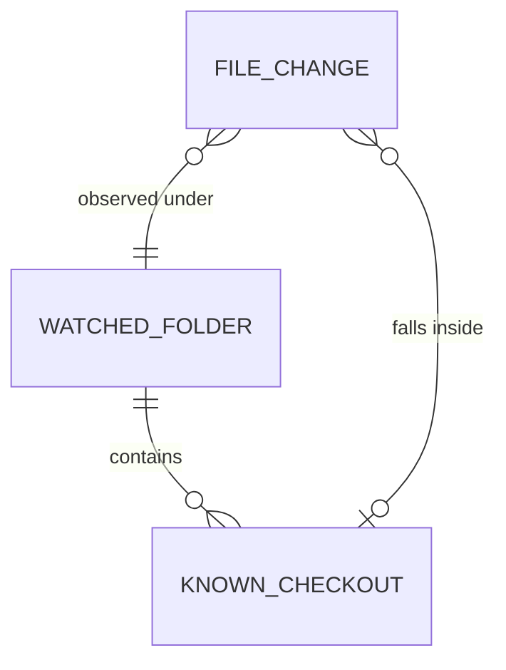
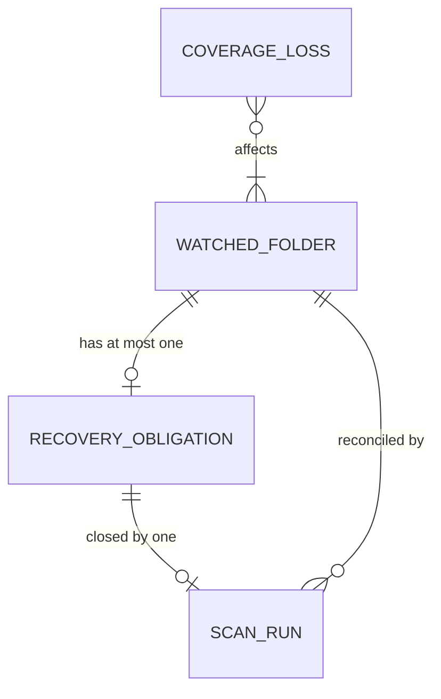

# FSEvents overload: Specification (Swift stopgap)

Authorized by [the Requirements](2026-11-04-fsevents-overload-requirements.md). Realized by [the Program Design](2026-11-04-fsevents-overload-program-design.md); proven per [the Verification Design](2026-11-04-fsevents-overload-verification-design.md).

**Delivery boundary (U11).** This Specification is the **Swift stopgap** that ships now: filter, discovery debounce, stale-evidence invalidation and scan-run telemetry for watched-folder discovery. The foreground/background tiers (U8), the injected platform-neutral source (U9) and directory-level discovery streams belong to the **daemon spec**, which follows the sunclaw measurements (U10). Nothing here constrains how the daemon realizes them.

## The problem in observable terms

| ID | Today | Who pays | Where it's observed |
| --- | --- | --- | --- |
| P1 | A burst of file changes inside known checkouts (builds, worktree copies) leads to repeated **whole watched-folder scans**, although such changes can't alter which checkouts exist | the owner: CPU, disk, crash exposure | production telemetry: 59,151 `overflow_coarse` recoveries in 10 min during one worktree removal |
| P2 | While a burst lasts, a folder is scanned back to back | the owner: sustained background work | fault-log ring: continuous scan cycling for 29 h |
| P3 | Telemetry counts recovery records, not actual scan runs, so the waste can't be measured | the owner, when diagnosing | the `stage_outcome` records carry no run identity |

Discovery is correct today. The obligations below keep it that way.

## Outcomes

- **O1:** Changes that can't affect which checkouts exist start no scan, even when the intake is overloaded. (P1; U1, U2)
- **O2:** A burst becomes a small, bounded number of scans per folder, paced by a 2 s debounce with a 10 s maximum wait. (P1, P2; U3, U4)
- **O3:** Membership-relevant changes and lost events are always reconciled, and while they're unreconciled, no older result is trusted as proof of absence. (U7)
- **O4:** Telemetry shows how many scans actually ran, for which folder and why. (P3; U5)

## Entities

| ID | Term | Identity rule | Relationships | Invariants | Observable states | Replaces | Basis |
| --- | --- | --- | --- | --- | --- | --- | --- |
| E1 | **Watched folder** | One persisted watch on one canonical folder path. Removing the watch and adding it back creates a new watched folder. | contains 0..n known checkouts; has at most one open recovery obligation; reconciled by 0..n scan runs | A watched folder is reconciled only while it is persistently watched | watched → unwatched | "watched root", "watched source" | U7 |
| E2 | **Known checkout** | One repository checkout (clone or linked worktree) at one canonical root path, as last discovered in a watched folder, including a destination still being created (a held path) | belongs to 1 watched folder for this purpose | A path strictly inside a known checkout's root is "inside the checkout" | discovered → missing-pending-proof → absent (retention owns absence) | "known root" | U7 |
| E3 | **File change** | One path-level change notification as the OS reports it; the same path changing twice is two file changes | observed under 1..n watched folders; falls inside 0..1 known checkout | Carries only what the OS reported | — | "event" | U2 |
| E4 | **Membership-relevant change** | A file change that **can** alter which checkouts exist: **(a)** a Git marker appears or disappears; **(b)** a known checkout, or an ancestor of one, moves or disappears; **(c)** a directory appears outside every known checkout **at a depth and place the scanner would visit** (within its traversal depth, not under a hidden directory other than a Git marker); **(d)** a **discovery-sensitive Git input** changes inside a known checkout: its `HEAD`, `config`, `commondir`, `gitdir`, any unrecognized entry under `.git`, or the removal or rename of its `objects` or `refs` directory. **Not relevant:** ordinary files and directories inside a known checkout, and **routine Git content** (`index`, `ORIG_HEAD`, `FETCH_HEAD`, `MERGE_HEAD`, `CHERRY_PICK_HEAD`, `REVERT_HEAD`, `REBASE_HEAD`, `AUTO_MERGE`, `BISECT_LOG`, `COMMIT_EDITMSG`, `packed-refs`, `*.lock`, and descendants of `objects/`, `refs/`, `logs/`, `modules/`, `rebase-merge/`, `rebase-apply/`, `sequencer/`). | a kind of file change | This is the existing watched-folder admission rule (workspace_data_architecture 342-348; `WatchedFolderTopologyAdmission`), extended only by (c)'s scanner bounds | — | "topology change" | U2, U7 |
| E5 | **Coverage loss** | One occurrence of lost or uncertain change history for a scope: the OS reporting dropped or must-rescan events, or intake discarding change detail | affects 1..n watched folders | Never filtered as irrelevant: what was lost is unknown | — | "overflow", "drop" | U7; Apple FSEvents guide |
| E6 | **Recovery obligation** | The one outstanding duty, per watched folder, to reconcile it after membership-relevant changes or coverage loss that no **completed covering scan run** has yet served | belongs to 1 watched folder; closed by exactly 1 covering scan run | At most one per folder; later triggers fold into it; it closes only when a scan run whose demand was submitted **after** its latest trigger **completes**. Submission alone never closes it. | open → submitted → closed | "rescan intent", "dirty follow-up" | U3, U7 |
| E7 | **Scan run** | One actual traversal of one watched folder, identified by the scheduler's run generation | reconciles 1 watched folder; may close 1 recovery obligation | At most one running per watched folder; several submitted demands may be served by one run | queued → running → completed / cancelled / superseded | "scan" | U1 |
| E8 | **Explicit scan demand** | A scan requested by the user or app lifecycle, not by file changes: adding a watched folder, a manual refresh, startup, the existing fallback rescan, or a retention check | targets 1 watched folder | Never delayed by the debounce | — | "manual/initial demand" | U7 |

## Requirements

**R1. Irrelevant changes start no scan, even under overload.** When file changes under a watched folder are not membership-relevant (E4), the system must not start a scan run (E7) of that folder because of them. This must hold the same way whether their batch was accepted or discarded by an overloaded intake. *E1–E4, E7. Basis: U1, U2, contract 342-348.*

**R2. One recovery obligation, closed only by a completed covering run.** When membership-relevant changes or coverage loss occur for a watched folder, the system must hold exactly one recovery obligation (E6) for it, folding later triggers into it. It must close only when a scan run whose demand was submitted after its latest trigger completes. A trigger arriving while a submission is in flight must keep the obligation open. *E1, E4–E7. Basis: U3, U7.*

**R3. Debounce.** A change-driven obligation's scan must not be submitted until no new trigger for that folder has arrived for **2 seconds**, except under R4. *E1, E6. Basis: U3, U4.*

**R4. Maximum wait.** If the oldest unserved trigger of an open obligation is **10 seconds** old, its scan must become **eligible** for submission without waiting for quiet. Its actual start remains limited by the existing per-folder single-flight and the global traversal limit. *E1, E6, E7. Basis: U4, U7.*

**R5. Lost events are always reconciled.** If coverage loss (E5) affects a watched folder, then the system must open or fold into its obligation, whatever paths accompany the loss. *E1, E5, E6. Basis: U7.*

**R6. Explicit demands are not debounced.** An explicit scan demand (E8) must keep its current timing. When its run completes and covers an open obligation's triggers, it closes that obligation. *E6–E8. Basis: U7.*

**R7. Stale results are never trusted as absence.** From the moment a membership-relevant trigger or coverage loss is recorded for a watched folder, every earlier scan result for that folder, and every observation depending on it (including an overlapping watched folder's), must be treated as **not authoritative for absence**. That lasts until a scan run submitted after that trigger completes. Positive discoveries from earlier results may still be published. *E1, E2, E4–E7. Basis: U7, workspace_data_architecture 350-356.*

**R8. Scan runs and demands are both observable, separately.** For each watched folder, telemetry must record: each submitted demand (folder tag, reason, obligation wait, folded-trigger count); and each **completed scan run** (folder tag, run generation, which demands it served, duration). Folders are identified by a non-reversible tag, never a path. *E1, E5–E7. Basis: U5.*

## Observable contract

| Situation | What the user and the app observe |
| --- | --- |
| Relevant triggers for a folder **as recorded at the app** span D seconds and contain k gaps of 2 s or more | Change-driven scan runs for that span: at most **1 + k + ⌈D / 10⌉**. This bounds the trigger stream the app observes, not the filesystem operation that produced it. Delivery can lag or bunch triggers under load, so one file operation can produce more recorded gaps. |
| A worktree is created or removed | It appears or disappears after the run that covers its last relevant trigger: about 2–10 s after that trigger reaches the app, plus the run's duration. |
| A build writes heavily inside a known checkout | No scan run starts for it. |
| A worktree is restored while an older scan that missed it is still finishing | The older result can't mark it absent; the covering run then confirms it. |
| The OS reports dropped events | One reconciliation run after the debounce. It's never skipped. |
| The user adds a watched folder or refreshes manually | Same timing as today. |
| The folder is unwatched while an obligation is open | The obligation is dropped, and nothing is published for the removed watch. |

**Negative space:**
- No promise that a change appears in the sidebar within less than 2 s.
- No ordering across folders.
- No promise of when a run actually starts once it's eligible, beyond the existing single-flight and the 2-traversal limit.
- No change to Git working-tree status refresh.
- The tiers and the daemon are out of scope here.

## Cross-cutting obligations

- **Performance:** for the V9 workload, the trigger-trace run bound holds, and coarse watched-folder recoveries drop by at least 90% against v0.0.124 on the same workload.
- **Reliability:** no coverage loss goes unreconciled (R5), and no stale negative evidence is used (R7).
- **Privacy:** folder tags only (R8).
- **Main thread:** no new main-actor work.
- **Security, accessibility, compatibility:** not applicable; there's no new external surface or persisted format.

## Proof obligations

| ID | Obligation | Decides pass or fail | Reference |
| --- | --- | --- | --- |
| V1 | R1 | Through both an accepted and a saturated intake (drops forced, more than 256 paths): routine content and ordinary files inside a known checkout, and directories deeper than the scanner's depth or under a hidden directory, start **0** runs. Each positive control still starts one: a new Git marker; a removed or renamed checkout root; a new candidate directory outside known checkouts within depth; `HEAD`, `config`, `commondir`, an unknown `.git` entry; removal of `objects/`. | E4 (the existing rule's tests at `WatchedFolderTopologyAdmissionTests` 60-133) |
| V2 | R2 | Triggers across many drains and during a running scan give exactly one obligation. A trigger during an in-flight submission keeps it open. A run submitted before the latest trigger doesn't close it. A stale-dropped run's demand still reaches a covering completion. | R2 text |
| V3 | R3 | With a controlled clock: submission no earlier than 2 s after the last trigger. | U4: "2s debounce" |
| V4 | R4 | With a controlled clock and a trigger every 1 s for 60 s: a submission becomes eligible at every 10 s of age, with at most ⌈60/10⌉+1 = 7 submissions in total. | U4: "max wait of 10s" |
| V5 | R5 | An OS dropped-events signal with only in-checkout paths opens exactly one obligation, giving one run. | Apple FSEvents guide; U7 |
| V6 | R6 | Add-folder and manual refresh submit at t+0, and their completed run closes a covered obligation. | current behavior |
| V7 | R7 | Hold a real scan after it passes a candidate directory, restore the candidate, record the trigger without advancing the clock, and complete the old scan: neither its own receipt nor an overlapping one certifies absence. After the covering run, authority returns. A non-overlapping root is unaffected. | workspace_data_architecture 350-356 |
| V8 | R8 | Demand and run records are both present, with the listed fields and no path in any value. | U5 |
| V9 | Performance | On the V9 workload (fixture worktree removal and creation), completed change-driven runs per folder are within **1 + k + ⌈D / 10⌉** computed from that folder's **recorded** trigger trace, including trailing runs until the obligation closes. The workload is valid only when the fixture's membership change is published, telemetry for the window is present, and the v0.0.124 baseline shows coarse recoveries for the same fixture. Coarse recoveries are at least 90% below that baseline. A cancelled run with no result isn't counted, and that's stated as a limit. | v0.0.124 telemetry; R3/R4 |

## Requirement coverage

| U | E | P | O | R | V |
| --- | --- | --- | --- | --- | --- |
| U1, U2 | E1–E4, E7 | P1 | O1 | R1 | V1, V9 |
| U3, U7 | E1, E4–E7 | P1, P2 | O2, O3 | R2 | V2 |
| U3, U4 | E1, E6 | P2 | O2 | R3 | V3 |
| U4, U7 | E1, E6, E7 | P2 | O2, O3 | R4 | V4 |
| U7 | E1, E5, E6 | — | O3 | R5 | V5 |
| U7 | E6–E8 | — | O3 | R6 | V6 |
| U7 | E1, E2, E4–E7 | — | O3 | R7 | V7 |
| U5 | E1, E5–E7 | P3 | O4 | R8 | V8 |
| U6, U10, U11 | — | — | — | delivery scope | the stopgap boundary above; the daemon spec follows |
| U8, U9 | — | — | — | — | **daemon spec** (not this document) |
