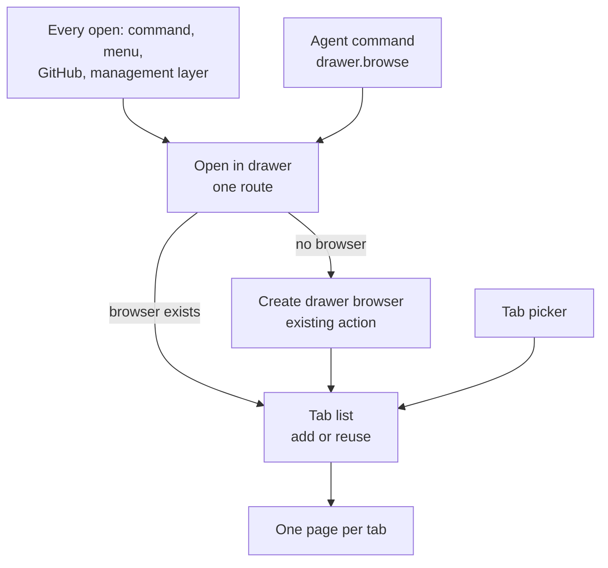
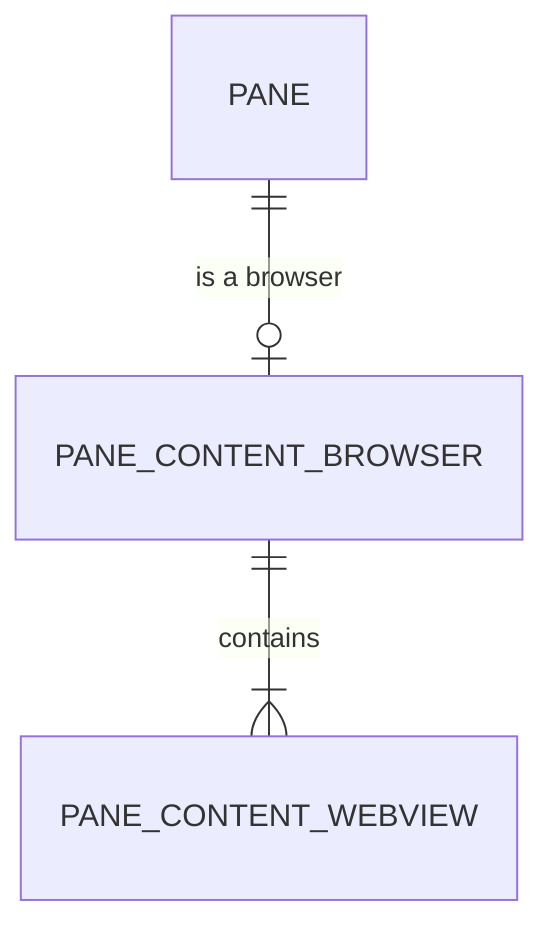
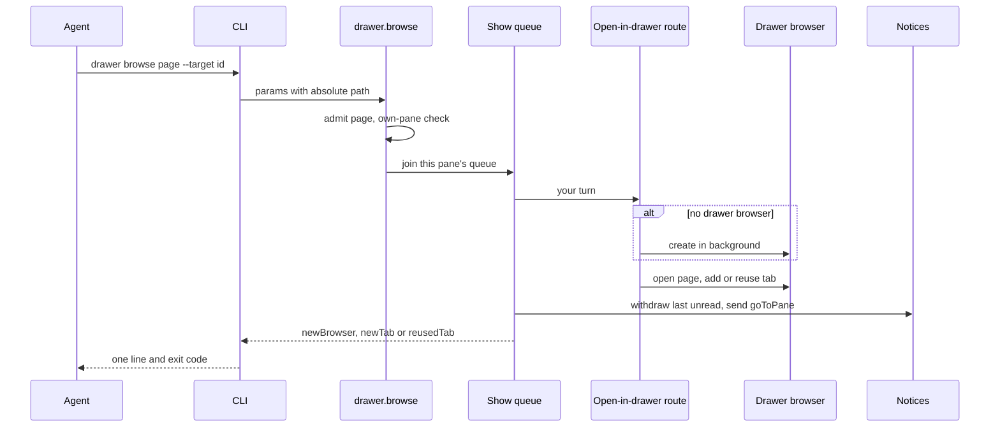

# Drawer browser: Program Design

Requirements: [requirements.md](requirements.md). Specification: [specification.md](specification.md).

A drawer already holds browser panes, and a browser pane already navigates. This design gives one browser pane many tabs, sends every way of opening a browser to the drawer, adds a picker, and adds one agent command. Tabs stay inside the pane, so the pane graph and drawer layout don't change.



## Current paths

| Behaviour | Path today | Anchor |
|---|---|---|
| Open a browser | `openWebview` creates a pane in a new workspace tab | `WorkspaceSurfaceCoordinator+ActionExecution.swift:90` |
| Open GitHub | `.insertPane(.newWebview)` splits the main row, or `openWebview` | `PaneTabViewController.swift:2066` |
| Management layer create | `.insertPane(.newWebview)` for the main row, `.addWebviewDrawerPane` for a drawer | `PaneTabViewController.swift:2576`, `:2626` |
| Add a drawer browser | `drawer.addPane` → `.addDrawerChildInBackground` → `executeAddWebviewDrawerPane` | `AgentStudioIPCLayoutAdapter.swift:119`, `WorkspaceSurfaceCoordinator+PaneInsertion.swift:185` |
| Detach from a drawer | `.detachDrawerPane` | `ActionValidator.swift:450` |
| One page per pane | `WebviewPaneController.page` | `WebviewPaneController.swift` |
| Save a browser | `snapshot()` → `syncPaneWebviewState` → table `pane_content_webview` | `WebviewPaneController.swift:190`, `WorkspaceCoreMigrations.swift:377` |
| Post or withdraw a notice | `PaneContextService.send`, `.withdraw` | `PaneContextService+Messages.swift:11`, `:166` |
| Go to a pane from a notice | `MessageAction.goToPane` → `focusTargetedDrawerPane` → `focusDrawerPaneAfterAdmission`, which expands the drawer | `PaneTabViewController.swift:4064` |
| Zoom side and height | `DrawerPresentationPreference.default`, `DrawerLayout.zoomOutlineHeightRatio` | `DrawerPresentationPreference.swift:21`, `DrawerLayout.swift:87` |

## Database changes

For the owner to approve. These are all the stored-data changes in this design. The old one-row browser table is replaced by two that match the domain: a browser contains webviews, and a webview is one tab.



**One migration, `019_browser_webviews`, in `WorkspaceCoreMigrations`:**

```sql
ALTER TABLE pane_content_webview RENAME TO pane_content_webview_old;

CREATE TABLE pane_content_browser (
    pane_id           TEXT PRIMARY KEY,
    active_webview_id TEXT NOT NULL,
    show_navigation   INTEGER NOT NULL CHECK (show_navigation IN (0, 1))
);

CREATE TABLE pane_content_webview (
    id              TEXT PRIMARY KEY,
    browser_pane_id TEXT NOT NULL,
    position        INTEGER NOT NULL,
    url             TEXT NOT NULL,
    title           TEXT NOT NULL
);

CREATE INDEX pane_content_webview_by_browser ON pane_content_webview(browser_pane_id, position);

-- Each existing browser becomes a browser with one webview. The webview reuses the pane id.
INSERT INTO pane_content_browser (pane_id, active_webview_id, show_navigation)
SELECT pane_id, pane_id, show_navigation FROM pane_content_webview_old;

INSERT INTO pane_content_webview (id, browser_pane_id, position, url, title)
SELECT pane_id, pane_id, 0, url, title FROM pane_content_webview_old;

DROP TABLE pane_content_webview_old;   -- its two triggers go with it

-- Undo records holding a browser in the old shape can't be read any more.
UPDATE workspace_undo_close SET state = 'expired', snapshot_payload = NULL
WHERE state = 'available'
  AND instr(snapshot_payload, CAST('"type":"webview"' AS BLOB)) > 0;
```

| Table | Before | After |
|---|---|---|
| `pane_content_browser` | none | one row per browser pane |
| `pane_content_webview` | one row per browser pane, keyed by `pane_id` | one row per tab, keyed by its own `id` |

New rows use UUIDv7 ids. This follows the schema rules: no triggers, no foreign keys or cascades, no SQL constraints except a boolean CHECK, and no JSON. That the pane is really a browser, and that `active_webview_id` is one of its webviews, are checked in Swift.

**Read and write.** `PaneContentRecord.webview` becomes `.browser(activeWebviewId, showNavigation, webviews)`. `decodeWebviewContent` reads the browser row and its webviews ordered by `position`. `deletePaneContentRows` deletes a pane's `pane_content_browser` row and its `pane_content_webview` rows in the same transaction. 

**Deleting panes.** These tables have no cascade from `pane`, so every route that removes panes must clear them first, in the same transaction. One shared repository function, `deleteBrowserContent(paneIds:)`, deletes the rows for a complete set of pane ids. `deletePanesNotIn` calls it with the removed pane set, including owned drawer children and the empty-snapshot case, before it deletes from `pane`. `deleteWorkspace` calls it with all of that workspace's panes before it deletes the workspace. The existing save already deletes a pane's content and inserts it again in one transaction, so closing a tab or changing the active tab can't leave stale rows.

**Removing saved main-layout browsers is not a migration.** A pure step normalizes the loaded workspace snapshot before composition prepares it. It removes each `.webview` pane outside a drawer, and with it anything that pane owns, its drawer children included, as closing that pane does. It also removes that pane from tab and arrangement references and cursors, and removes a tab left empty. Composition then sees a consistent snapshot, and the next normal save persists it. The step stays permanently, so no one-time flag is needed.

**Undo records holding a browser expire in the migration.** `workspace_undo_close.snapshot_payload` keeps its own JSON copy of closed panes, outside the browser tables, and the new `WebviewState` can't decode the old shape. One unreadable record fails the whole undo load, and launch stops when that load fails. Migration 019 therefore expires each available record whose payload holds a browser, marked by `"type":"webview"`. The payload is a BLOB, so the match is on bytes. No runtime code reads the old shape. Old browsers in the main layout can't return through undo either.

**What this costs:**

- It can't be undone. An older build can't read browsers after this, so downgrading isn't supported.
- Saved main-layout browsers are deleted, with their pages and any drawer they own.
- Undo is lost for a close that held a browser, at most the last 5 minutes, once, at the upgrade. That includes a terminal closed with a drawer browser, and its session is cleaned up as if undo had run out.
- A pane found only in such a record is not retired, because the migration can't reach the app's retirement step. Its saved scrollback file, restore reports and pane context stay on disk. This is a one-time leftover from those same 5 minutes. Backdating the record's deadline so normal expiry retires it fails after a reboot and with no boot clock, and fixing that means permanent code for a one-time case.
- Recently Closed isn't stored.

## The structural choice

| Option | Gain | Cost | Falsifier |
|---|---|---|---|
| **Tabs inside one browser pane** (selected) | Pane graph, drawer layout and focus don't change; "one browser per drawer" is true by construction | The controller holds several pages | Tabs need to sit side by side |
| Each tab is a drawer child, with a picker over them | Reuses panes | Fights the drawer's side-by-side layout, and every tab is a pane the graph, restore and focus must carry | none |

Same-page reuse needs no reload path: observed with `WebPage.load`, loading the same file shows rewritten content and adds no Back step.

## Saved tabs

Tabs survive a restart, by the owner's decision. `WebviewState` stays Core-owned. `url` and `title` are replaced by `tabs: [WebviewTabSnapshot]` and `activeTabId: UUID`, where `WebviewTabSnapshot` is `{id: UUID, url: URL, title: String}` in `Core/Models`. Features map `WebviewTabList` to and from it.

## Entity binding

| E | Semantic owner | Home | Type home | Shape at each boundary | Kind | Convention |
|---|---|---|---|---|---|---|
| E1 Page | `BrowserPageAddress` rule | new, `Sources/AgentStudio/Features/Webview` for normalizing; `Sources/AgentStudioProgrammaticControl` for the IPC shape | new `IPCDrawerBrowserPage` | CLI → IPC: closed enum, `web(url)` or `localHTML(absolutePath)` | derived per call | IPC params in `IPCQueryContracts.swift` |
| E2 Target pane | IPC target resolution and own-pane authorization | existing, `canonicalPaneTarget`, `validateDrawerParent` | existing handle string | CLI → IPC: `parentPaneHandle` as a canonical UUID | derived per call | existing handle rules |
| E3 Drawer | Workspace pane graph | existing, `Drawer` | existing | none new | persisted, existing | existing |
| E4 Drawer browser | Workspace pane graph, as a drawer child with `.webview` content | existing | existing `PaneContent.webview` | none new | persisted, existing | existing |
| E5 Browser tab | `WebviewPaneController` through a pure `WebviewTabList` | new, `Sources/AgentStudio/Features/Webview` | new `WebviewTab`, `WebviewTabList`; `WebviewState` gains `tabs` and `activeTabId` | Controller ↔ store: `WebviewState`. Store ↔ SQLite: `pane_content_browser` and `pane_content_webview` rows | persisted; SQLite via GRDB, both existing; migration tool existing | `WorkspaceCoreMigrations`, no triggers, no enum CHECKs |
| E6 Closed tab | `WebviewPaneController` | new, in `WebviewTabList` | new `WebviewClosedTab` | stays in memory | in memory | none found |
| E7 Browser notice | Pane context service | existing | existing `PaneMessageSendRequest` with `goToPane(child)` | existing | persisted, existing | existing |

## Components

| Component | Job | Consumers | Reason to change |
|---|---|---|---|
| `WebviewTabList` (new, pure) | Add, select, close, reopen, find a tab by page; no WebKit | Controller, tests | Tab rules |
| `WebviewTabPage` (new) | One loaded tab: its `WebPage`, its management script, and its URL and title observation | Controller | Per-page lifecycle |
| `WebviewPaneController` (modified) | Own the tab list and its loaded pages, show the active one, apply management state to all, send runtime commands to the active page, snapshot | Views, runtime | Tab lifecycle |
| Tab picker view (new) | Search, Open Tabs, Recently Closed, built from the shared popover parts below | Person | Picker UI |
| `AppCommand.showBrowserTabs` (new) | Catalog identity, label, icon, shortcut for the picker | Browser bar, command bar | Command rules |
| Open-in-drawer route (new, in `WorkspaceSurfaceCoordinator`) | The one way in: find or create the drawer browser, add or reuse a tab, and return `DrawerBrowserOpenResult` | `openWebview`, GitHub, management layer, `drawer.addPane`, `drawer.browse` | Open rules |
| Method `drawer.browse` and `AppCommand.showDrawerBrowser` (new) | Typed params, `.ownPane` eligibility, admission | CLI | IPC contract |
| Page admission (new) | http or https with a host, or a regular `.html` or `.htm` file, checked off the main actor | Method | File rule |
| Show queue (new, in the layout adapter) | Run opens for one pane one at a time, and remember its last notice | Method | Ordering |
| CLI verb `drawer browse` (new) | Flags, absolute paths, one line out | Agents | CLI wording |

The drawer's rule is enforced in `ActionValidator`: a `.webview` pane can't be inserted in the main layout, and `.detachDrawerPane` refuses a browser. `.insertPane(source: .newWebview)` and the new-tab code in `openWebview` are deleted, not left unused.

## Tab picker surface

The picker is a popover, like every other menu-like surface in the app. It owns no chrome and no key handling of its own. The first build hand-rolled these and was rejected: it broke the style guide's Shared Shell Controls rules, and Escape reached the drawer because no keyboard surface was registered.

| Part | Uses | Why |
|---|---|---|
| Presentation | SwiftUI `.popover(arrowEdge: .bottom)`, anchored on the picker control. With the navigation bar hidden, it anchors on a zero-size view at the top of the pane | The same route as the Messages and inbox popovers, with native chrome and shadow |
| Keyboard surface | `.transientKeyboardSurface` with a new `TransientKeyboardSurfaceKind.browserTabPicker(paneId:)`, dismissed by `AppShortcut.showBrowserTabs` | Escape and the same shortcut go to the picker, not the drawer |
| Panel | `PopoverPanel`, `.contentSized(maximumHeight:)`, search as its header | The list hugs its rows, so there is no empty block under them. It scrolls past the maximum |
| Search | `SidebarSearchField`, with a new `shortcutStyle` parameter that defaults to `.toolbarStamp`; the picker passes `.keycap` | The shortcut stays quiet, as in the reference. Sidebar search doesn't change |
| Section headers | `PopoverPanelSectionHeader` with `.content(count: nil)` | Readable sentence-case headers, as in the reference |
| Rows | `PopoverCompoundOptionSurface`, `isSelected` for the active tab, `isHighlighted` for the keyboard row | Shared inset highlight, not a full-bleed rectangle, and no hand-set bold |
| Close | `ToolbarActionButton` from `LocalActionSpec.browserCloseTab` | Shared glyph size, hit area, hover paint and tooltip |
| Keys | `SelectablePopoverKeyboardBridge` and `SelectablePopoverKeyboardRouter` | One owner for arrows, Return and Escape |
| Colors, sizes | `AppStyles` tokens only | No opacity or shadow literals in the view |

**Two changes to the shared keyboard parts.** Both default to current behaviour, so the two existing popovers don't change.

- The bridge takes `capturesFirstResponder`, default `true`. The picker passes `false`, because its search field keeps focus. Its key monitor already routes keys wherever focus is, so arrows and Return work while typing and the list needs no focus of its own.
- `SelectablePopoverAuxiliaryAction` gains a typed trigger: the existing unmodified character, or a chord matched on key code and modifiers. The router matches `Command-Delete` on key code 51 before its modifier passthrough. A plain character can't be used here, because it would eat search text.

**Off the main actor.** Filtering doesn't run in `body`. `WebviewTabPickerContents` is built by a `@concurrent nonisolated static` function from a `Sendable` snapshot of the tab list and the query, started by `.task(id:)`. The view holds the result as local state and reads it. The result also carries the keyboard items, so `body` derives nothing. `PopoverPanel`'s `openingContentIsReady` holds the opening height until the first result lands.

**Sizes.** Every value is an existing token, or a new `AppStyles.WorkspaceFocus.Webview` token where marked.

| Part | Value |
|---|---|
| Panel | 420 pt wide (existing token); `.contentSized(maximumHeight: 480)` (new); padding 12 from `PopoverPanel` |
| Search | `SidebarSearchField` as the panel header; `.keycap` hint |
| Heading | `.content(count: nil)`: 13 pt medium, primary |
| Row | Spacing 8 between icon, text and close; 4 between rows; the surface's own fill: 4% at rest, 8% highlighted, 12% active |
| Icon | 28 pt tile, `CornerRadius.bar`, `Fill.muted`, globe glyph at `Icon.compact` |
| Title | 13 pt regular, primary, one line, tail truncation |
| Address | 11 pt, secondary, one line, middle truncation |
| Close | `ToolbarActionButton`, `Button.compact` (24 pt) |

The picker control in the navigation bar keeps its neighbours' shape. Their shared styling isn't part of this work.

## Interface

```swift
public struct IPCDrawerBrowseParams: Codable, Equatable, Sendable {
    public let parentPaneHandle: String      // canonical pane UUID
    public let page: IPCDrawerBrowserPage    // web(url:) | localHTML(path:)
    public let correlationId: UUID?
}

public struct IPCDrawerBrowseResult: Codable, Equatable, Sendable {
    public let parentPaneId: UUID
    public let childPaneId: UUID
    public let tab: IPCDrawerBrowseTabOutcome    // newBrowser | newTab | reusedTab
    public let notice: IPCDrawerBrowseNotice     // posted | failed
    public let correlationId: UUID?
}
```

The open route returns one result to every caller:

```swift
struct DrawerBrowserOpenResult {
    let childPaneId: UUID               // the actual browser, new or existing
    let tab: DrawerBrowserTabOutcome    // newBrowser | newTab | reusedTab
}
```

IPC callers reach the workspace only through `WorkspaceActionExecutor`'s serialized gesture queue, and its `execute` calls return no route result. So the executor gets one typed entry point for this route:

```swift
func executeDrawerBrowserOpen(
    _ action: WorkspaceActionCommand,
    ownPaneAssertion: WorkspaceOwnPaneAssertion?
) async -> DrawerBrowserOpenOutcome    // opened(DrawerBrowserOpenResult) | rejected | outsideOwnPane
```

It runs in the same queue with the same validation as every other action, so the own-pane check still happens inside the gesture, after anything queued ahead of it. `drawer.addPane` and `drawer.browse` both use it. Neither reads the result back from workspace state.

`drawer.addPane` with a browser uses this route. It no longer requires its preassigned child to exist: it returns `childPaneId` from the result, so a second browser call adds a tab and returns the existing child. Terminal children are unchanged. It keeps background presentation and own-pane enforcement.

Refusals are closed errors: `unsupportedPage`, `fileNotFound`, `targetNotFound`, `notOwnPane`, `noActiveWindow`. Each maps to one line in the Specification's command table.

```swift
struct WebviewTabList {
    mutating func open(_ page: BrowserPageAddress, title: String) -> WebviewTabOpenResult   // added | reused
    mutating func select(_ id: WebviewTabId)
    mutating func close(_ id: WebviewTabId) -> WebviewTabCloseResult                        // closed | closedLast
    mutating func reopen(_ id: WebviewClosedTabId)
    mutating func update(_ id: WebviewTabId, url: URL, title: String)
}
```

## Flow



Person-driven opens enter at the route and expand the drawer as they do today. Agent opens use the background presentation, so the drawer and focus stay as they were.

## State

| State | Owner | Moves |
|---|---|---|
| Tab list | `WebviewTabList` | open, select, close, reopen; closing the last tab closes the pane through the existing close action |
| Loaded page | Controller | A restored tab loads when first selected, not at startup |
| Show queue | Layout adapter, in memory | One running show per pane; tail and last notice per pane |

Invalid states: an active tab id not in the list is unrepresentable through `WebviewTabList`'s API. Two tabs for one page can't come from `open`; navigating inside a tab can create one, and then `open` picks the first match.

### Tab order

`WebviewTabList` owns order as an array. `open` appends only when it adds a tab. A reused open selects the tab and leaves it where it is, so opening B in `[A, B, C]` keeps that order. `reopen` appends, and `close` removes, so order always has no gaps. Closing the active tab selects the next tab, or the previous one if it was last. Save writes each tab's array index as `position`, and load reads `ORDER BY position`. `position` has no other meaning, and nothing renumbers it in SQL.

### Pages and tabs

Each loaded tab has one `WebviewTabPage`, and inactive tabs keep running.

- **Management state.** Each `WebviewTabPage` owns its own user content controller and script. `setWebContentInteractionEnabled` applies to every loaded page, and a new page starts from the current state. So an inactive page can't keep interaction enabled and then become active.
- **Runtime commands.** `handleBrowserCommand` targets the active page. A command arriving with no loaded page loads the active tab first.
- **URL and title.** Each `WebviewTabPage` observes its own page, active or not, and writes committed URL and title changes to `WebviewTabList.update(id, url, title)`. Redirects, Back, Forward and link clicks all arrive this way, so `open` and picker search always use a tab's current address. Only committed navigations update it, so a failed load leaves the old address.
- **Creation.** The controller makes pages through an injected `WebviewTabPageFactory`, called only when a tab is first selected or opened. Tests count the calls.
- **Switch timing.** The controller records one marker-scoped performance event for each tab switch, `browser_tab_switch`, from selection to the Core Animation commit that mounts that tab's view. WebKit has no public first-paint signal, so this measures our side of the switch, not WebKit repainting an already loaded page. This is the proof seam for R29, and it reports timing only.
- **Close.** Closing a tab cancels its observation and interaction tasks and releases its page. Reopening creates a new page.

## Failure

| Failure | Detected by | Behaviour |
|---|---|---|
| Page refused, target unknown, not own pane | Admission or authorization | Nothing changes; closed error |
| Create fails | Action result | Error returned; queue released; last notice kept |
| Browser closed between checks | Graph recheck | Create once, and the sequence still replaces the notice |
| Page fails to load | The tab shows the browser's error | Tab stays; the person can close it |
| Notice fails | Send result | Page stays open; `notice: failed` |
| Withdraw refused because it was read | Withdraw result | Ignored; new notice posted |
| Open clicked after the browser closed | `goToPane` result | Existing "pane gone" feedback |
| A browser row has no webviews, or its active id is missing | Store load | Existing `malformedPaneContent` handling |

## Concurrency

The adapter runs on MainActor. A show chains onto its pane's tail in the same turn as it arrives, before any await, and the whole sequence runs as one turn in the queue. Shows for different panes run independently. A failed show releases the queue.

## Trust boundary

`drawer.browse` is `.ownPane`, like `drawer.addPane`, so no boundary changes. Local files reach a browser only through page admission. Server agents are out of bounds: their credential belongs to the pane that started their server, so they stay limited to that pane until the next design.

## Cutover

- Saved main-layout browsers are removed at load (R4), as set out in Database changes.
- The migration turns each existing browser into one tab, and expires undo records holding a browser.
- Drawers already holding several browsers keep them. New opens use the first in drawer order.

## Zoom default

`DrawerPresentationPreference.default.zoomSide` becomes `.bridge`, and `DrawerLayout.zoomOutlineHeightRatio` becomes `0.95`. Saved rows are kept, including height-only ones, and the hidden-Bridge fallback doesn't change. D-DP-1 in the drawer presentation spec is superseded.

## Trace

| U | R | E | Owner | Interface | Shape and home | State | Failure | Proof |
|---|---|---|---|---|---|---|---|---|
| U1 | R1 | E3, E4 | Open-in-drawer route | `openWebview` and callers | existing | none | unavailable with no main pane | route tests, real app |
| U1 | R2 | E4 | `ActionValidator` | action validation | existing | none | refused | validator tests |
| U2 | R3 | E4, E5 | Open-in-drawer route | route; `drawer.addPane` | `DrawerBrowserOpenResult` | tab list | none | route and registration tests |
| U1 | R4 | E4 | Snapshot normalizer | pure step before composition | workspace snapshot | none | none | normalizer tests, real app |
| U14 | R32 | E4 | Migration 019 | expires undo records holding a browser | `workspace_undo_close` | none | none | migration test, real app |
| U2 | R5 | E5 | Controller, `WebviewTabPage` | `WebviewTabList`, runtime commands, management state | `WebviewTab` | tab list, loaded pages | none | unit, real app with two tabs |
| U3 | R6 | E5 | `showBrowserTabs` | catalog command | existing | none | none | catalog test, real app |
| U3 | R7 | E5, E6 | Tab picker view | view model | `WebviewTab`, `WebviewClosedTab` | tab list | empty states | unit, real app |
| U3 | R8 | E5, E6 | `WebviewTabList` | `select`, `reopen`, `close` | closed results | tab list | none | unit |
| U3 | R9 | E5 | Tab picker view | shared keyboard bridge and router | none | none | none | router tests with real key events, real app |
| U15 | R33 to R39 | E5, E6 | Tab picker view | shared popover parts | none | none | none | approved image, real frames, taste pass |
| U2 | R10 | E4, E5 | Controller | `close` → `closedLast` | closed result | tab list | none | unit, real app |
| U3 | R30 | E5, E6 | `WebviewTabList` | `open`, `reopen`, `close` | array order, saved as `position` | tab list | none | unit, store round-trip |
| U2 | R31 | E5 | `WebviewTabList` | `close` | closed result | tab list | none | unit |
| U14 | R11 | E5, E6 | Store | browser codecs | `pane_content_browser`, `pane_content_webview` rows | persisted | `malformedPaneContent` | migration and round-trip tests, real app |
| U4 | R12 | E1, E5 | `WebviewTabList`, `WebviewTabPage` | `open`, `update` | `reused` | tab list | none | unit, real browser pane, navigate then open |
| U5 | R13 | E1, E2, E4 | Route | `drawer.browse` | `web(url)` | tab list | closed errors | real app |
| U6 | R14 | E1, E2, E4 | Route | `drawer.browse` | `localHTML(path)` | tab list | `fileNotFound` | real app |
| U7 | R15 | E1 | Page admission | `drawer.browse` | closed errors | none | `unsupportedPage` | unit |
| U8 | R16 | E2 | CLI verb | flags | argv | none | usage error | CLI test |
| U8 | R17 | E2 | CLI verb | env | string | none | missing-variable error | CLI test |
| U8 | R18 | E2 | Own-pane authorization | `.ownPane` | existing | none | refused | authorization test |
| U9 | R19 | E3 | Background presentation | `.addDrawerChildInBackground` | existing | unchanged | none | real app, responder check |
| U4, U9 | R20 | E5 | `WebviewTabList` | `open` | `WebviewTabOpenResult` | tab list | none | unit |
| U9, U10 | R21 | E7 | Show queue | send and withdraw | existing | last notice | `notice: failed` | adapter test with held interleaving |
| U9 | R22 | E3, E4, E7 | Message action runner | `goToPane` | existing | none | existing feedback | real app |
| U11 | R23 | E3 | Drawer preference | `default` | existing | existing | fallback unchanged | unit, real app |
| U11 | R24 | E3 | Drawer layout | ratio | existing | none | none | unit, real app |
| U13 | R25 | E4 | No new always-on work; tabs exist only inside a browser pane | none | none | none | none | resource comparison |
| U13 | R26 | E4, E5 | `WebviewTabPage` | none | none | loaded pages | none | resource comparison |
| U13 | R27 | E5 | `WebviewTabPage`, sharing the existing data store | none | none | loaded pages | none | resource comparison |
| U13 | R28 | E5 | Controller, through an injected `WebviewTabPageFactory` | factory | `WebviewTab` | loaded pages | none | allocation test: factory calls per tab |
| U13 | R29 | E5 | Controller, open route | `open`, `select` | none | tab list | none | resource comparison, timed switch |
