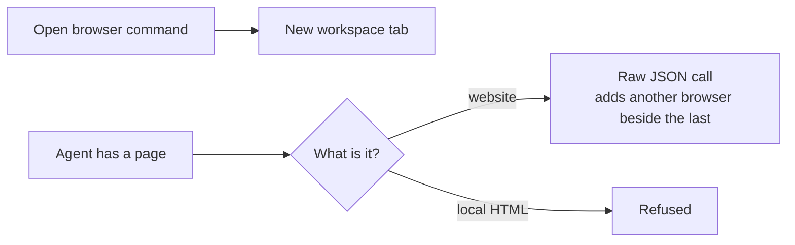
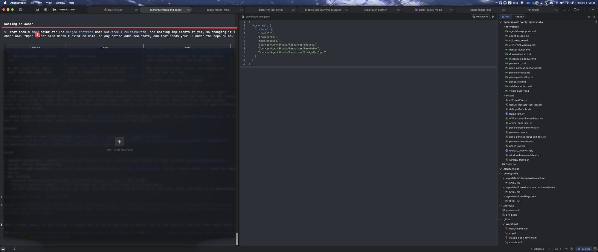
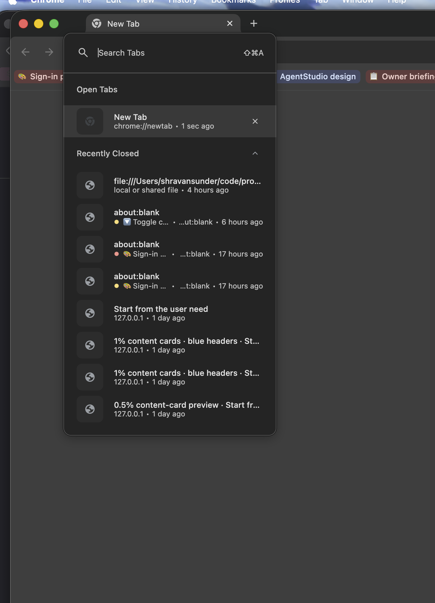

# Drawer browser: Requirements

The browser moves into the drawer. It stops being a workspace tab, it gets its own browser tabs with a picker, and the same link reuses its tab. An agent running in a main terminal pane can open a website or an HTML file there without taking the person's focus.

## Who this is for

- **The person** reads pages beside their terminal, and doesn't want browsers taking over workspace tabs or their focus.
- **The agent** runs in a main terminal pane and has a page to show.

## What happens today

| Pain | Evidence |
|---|---|
| Opening a browser creates a workspace tab or splits the main layout | `openWebview`, `openGitHubWebview` and the management layer's create action |
| Local HTML can't be shown in a drawer | The browser URL rule admits only http and https |
| Each call adds another browser, and drawer children sit side by side | `drawer.addPane` creates a new child every time |
| A browser pane shows one page, with no tabs and no way to find one | `WebviewPaneController` owns a single page |
| In Zoom the drawer covers the agent conversation | The default side is the terminal |

The Zoom drawer today, on the terminal side at 85% height. The owner's red line marks the height they want. The new default is the right side, over Bridge:

The tab picker the owner wants, shown here in Chrome: search, Open Tabs and Recently Closed.

## Needs

Authority for every row: **authorized**, by the owner on 2026-11-06 unless noted. All are required for this delivery.

| ID | Need | Why it matters | Owner's words |
|---|---|---|---|
| U1 | The browser is a pane in a drawer, not a workspace tab | Browsers support the work beside a terminal | "allow the webview tab not to be a tab, but a pane in drawer. remove it as a tab" |
| U2 | A drawer has one browser, which holds browser tabs | Nobody wants ten browsers side by side | "drawers only get one browser"; "browser tabs" |
| U3 | The person can pick browser tabs from a picker, like Chrome's Search Tabs | Tabs need to be findable without a tab strip | "allow picking 'browser tabs' in there" |
| U15 | The picker looks and behaves like the app's own popovers, and reads as cleanly as the reference | A hand-made surface looks sloppy and its keys break | "the button and design is sloppy are you following shared components and standards" |
| U4 | The same link reuses its tab | No duplicate tabs | "make sure the same link is opened in the same tab reused" |
| U5 | An agent can open a website in the drawer browser | Agents point the person at pages | "or open websites" |
| U6 | An agent can open a local HTML file there | Agents write Demistify pages for the person to read | "opening html files" |
| U7 | Anything else is refused | Keeps it small and honest | "only allow html files, or browser" |
| U8 | The agent names its target pane, by pane ID or from its environment. Any main pane in the app may be named, so an agent running in a server can reach the pane showing it | No implicit pane. A server agent's own credential belongs to the pane that started its server, so naming the pane is the only way to reach the right one | "--target paneid or --target-env"; "AGENTSTUDIO_PANE_ID"; 2026-11-07: "i want to target it yes" |
| U9 | Opening a page doesn't take the person's focus | Agents must not hijack the screen | 2026-09-27 decision |
| U10 | Repeating an open doesn't pile up notices | A looping agent must not create noise | "dedupe" |
| U11 | In Zoom the drawer opens on the Bridge side, the right side, by default, at 95% height | The drawer stops covering the agent conversation | "in full screen it should open on the bridge side by default" |
| U12 | No tech debt | This must not be rebuilt later | "i dont want to create tech debt for this" |
| U14 | Browser tabs survive a restart | Losing tabs would feel like a bug | "yes it should" |
| U13 | CPU, memory and performance stay the same or lower | Agent Studio runs all day beside many agents | "make sure that cpu and performance resource usage is same or lower resource usage" |

## Limits and non-goals

- Server agents reach a pane only by naming it with `--target`. Linking a server session to its pane automatically is the next design: "remote server thing is out of bounds".
- No Bridge work, and `agentstudio open` stays reserved for it.
- No multi-worktree.
- No file types other than HTML in the agent command.
- No visible tab strip. Tabs are reached through the picker.
- No browser in the main layout from now on. Ones already saved there are removed: "yeah its fine remove them".
