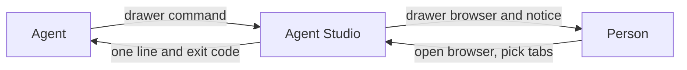
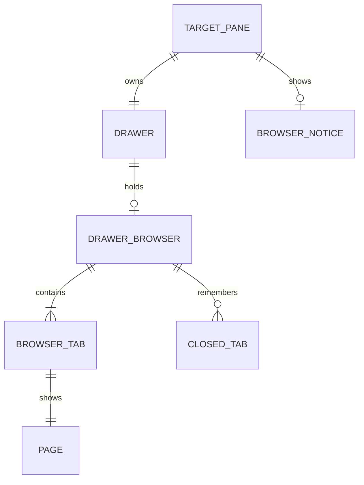

# Drawer browser: Specification

Requirements: [requirements.md](requirements.md). This document says what must be observably true. It names no internal structure.



## Entities



| ID | Term | Identity rule | Relationships | Invariants | States | Basis |
|---|---|---|---|---|---|---|
| E1 | Page | A web address or a local HTML file. Two pages are the same when their normalized addresses match, ignoring any `#fragment`. A relative path is made absolute against the caller's working directory first. | Shown by browser tabs | An agent's page is an http or https address with a host, or an existing regular file ending `.html` or `.htm` | none | U4, U5, U6, U7 |
| E2 | Target pane | The pane the agent names, by pane ID. It must be the caller's own main pane. | Owns one drawer | Always named explicitly | found, not found | U8 |
| E3 | Drawer | The one drawer of a main pane | Belongs to one pane; holds at most one drawer browser | Unchanged in meaning | collapsed, expanded | U2 |
| E4 | Drawer browser | The browser pane in a drawer | Belongs to one drawer; contains one or more browser tabs | At most one per drawer, for anything created from now on | absent, present | U1, U2 |
| E5 | Browser tab | One page held by a drawer browser | Belongs to one drawer browser | At most one open tab per page in a drawer browser when opened by link; exactly one tab is active | open, active, closed | U2, U3, U4 |
| E6 | Closed tab | A tab closed in this app run, which can be reopened | Belongs to one drawer browser | Newest first; reopening removes it from the list | none | U3 |
| E7 | Browser notice | The notice saying the drawer browser has a page | Belongs to one target pane | At most one unread per target pane while the app runs | unread, read, withdrawn | U9, U10 |

## Obligations

### Browser in the drawer

| ID | Obligation | Basis | Entities |
|---|---|---|---|
| R1 | Every way of opening a browser MUST open it in a drawer, in the drawer of the active main pane. If there is no main pane, the command MUST be unavailable. | U1 | E3, E4 |
| R2 | No browser MUST be created in the main layout, and a drawer browser MUST NOT be movable into it. | U1 | E4 |
| R3 | If the drawer has a browser, opening another MUST add a tab to it. It MUST NOT add a second browser. | U2 | E4, E5 |
| R4 | A browser saved in the main layout MUST be removed at launch, with anything its pane owns, as closing that pane does. If it was the only pane in its tab, the tab MUST close. Its page is not kept. | U1 | E4 |

### Browser tabs

| ID | Obligation | Basis | Entities |
|---|---|---|---|
| R5 | A drawer browser MUST show one active tab, and keep its other tabs available. | U2 | E5 |
| R6 | The person MUST be able to open a tab picker from the browser, by control and by keyboard. | U3 | E5 |
| R7 | The picker MUST show a search field, Open Tabs and Recently Closed, each row with title and address. Search MUST filter both lists by title or address. | U3 | E5, E6 |
| R8 | Choosing an open tab MUST make it active. Choosing a closed tab MUST reopen it. A row's close control MUST close that tab and move it to Recently Closed. | U3 | E5, E6 |
| R9 | The picker MUST be fully usable by keyboard. | U3 | E5 |
| R30 | Tabs MUST keep a stable order: a new or reopened tab goes last, and closing one closes the gap. Open Tabs MUST show that order, and Recently Closed newest first. | U3 | E5, E6 |
| R31 | Closing the active tab MUST make the next tab active, or the previous one if it was last. | U2 | E5 |
| R10 | Closing the last tab MUST close the drawer browser. | U2 | E4, E5 |
| R11 | Open tabs MUST survive an app restart, with the same active tab. Recently Closed need not. | U14 | E5, E6 |
| R12 | Opening a page that an open tab already shows MUST make that tab active and load its current content, adding no tab. | U4 | E1, E5 |

### Agent command

| ID | Obligation | Basis | Entities |
|---|---|---|---|
| R13 | The command MUST open an http or https page in the target pane's drawer browser. | U5 | E1, E2, E4 |
| R14 | The command MUST open a local `.html` or `.htm` file there. | U6 | E1, E2, E4 |
| R15 | The command MUST refuse any other target without changing any pane. | U7 | E1 |
| R16 | The command MUST require exactly one of `--target <pane id>` or `--target-env`, and MUST NOT fall back to any implicit pane. | U8 | E2 |
| R17 | `--target-env` MUST read `AGENTSTUDIO_PANE_ID`, and MUST fail if it is missing. | U8 | E2 |
| R18 | A target that isn't the caller's own main pane MUST be refused without changing any pane. | U8 | E2 |
| R19 | The command MUST NOT expand a collapsed drawer and MUST NOT move keyboard focus. | U9 | E3 |
| R20 | The page MUST become the active tab of the drawer browser. Other tabs MUST NOT change. | U4, U9 | E5 |
| R21 | Each successful open MUST leave one unread browser notice in the target pane, replacing any earlier unread one. | U9, U10 | E7 |
| R22 | Clicking Open on a browser notice MUST expand the drawer and select the drawer browser. If it is gone, it MUST say so. | U9 | E3, E4, E7 |

### Zoom

| ID | Obligation | Basis | Entities |
|---|---|---|---|
| R23 | In Pane Zoom, a pane with no saved side choice MUST open its drawer on the Bridge side, the right side of the layout. A saved choice MUST be kept. When Bridge is hidden the drawer MUST still fall back to the terminal side without changing the saved choice. | U11 | E3 |
| R24 | In Pane Zoom the drawer outline MUST be 95% of the height of its side, connector included. | U11 | E3 |

### Resources

| ID | Obligation | Basis | Entities |
|---|---|---|---|
| R25 | With no drawer browser open, CPU and memory MUST pass the resource comparison against the baseline. | U13 | E4 |
| R26 | With one quiet page open, CPU and memory MUST pass the comparison against one browser pane on the baseline. | U13 | E4, E5 |
| R27 | With five quiet pages open as tabs, CPU and memory MUST pass the comparison against five browser panes on the baseline. | U13 | E5 |
| R28 | A restored tab MUST create no page until it is first selected. | U13 | E5 |
| R29 | Opening a page in a drawer browser MUST pass the opening comparison against `drawer.addPane` on the baseline. Switching to a loaded tab MUST mount its view within 100 ms, measured to the Core Animation commit. | U13 | E5 |

**The resource comparison.** The baseline is a build of `origin/main` at the branch point, on the same machine. Scope is the app and its WebKit processes together. A quiet page is a static HTML page with no scripts, timers or animation, the same bytes for both builds, served from a loopback HTTP server, because the baseline can only open http and https. Before collecting data, each run confirms the page opened on both builds. Each case runs three times, alternating builds, for 60 seconds after a 30-second settle, and compares medians. A case passes when the median is no more than 5% above the baseline, or 0.5 CPU percentage points for CPU, whichever is larger. These limits are the Lead's proposal, set near run-to-run noise.

**The opening comparison.** Opening time runs from the moment the command is issued to the moment the loopback server receives the request for that page, which is the same event on both builds. Ten opens per build, each into a fresh drawer, comparing medians. It passes when the median is no more than 5% or 20 ms above the baseline, whichever is larger. CPU and memory samples don't decide this.

## The command

The name is the Lead's working name.

```text
agentstudio drawer browse <page> (--target <pane id> | --target-env)
```

| Result | Line | Exit |
|---|---|---|
| New browser | `opened in a new drawer browser; notice posted` | 0 |
| New tab | `opened in a new browser tab; notice posted` | 0 |
| Existing tab | `reused the open browser tab; notice posted` | 0 |
| Not HTML or a URL | `not supported: only HTML files and URLs` | non-zero |
| File missing | `not found: <path>` | non-zero |
| No target flag, or both | `choose one of --target or --target-env` | non-zero |
| Env variable missing | `AGENTSTUDIO_PANE_ID is not set; use --target` | non-zero |
| Pane unknown | `pane not found: <id>` | non-zero |
| Not the caller's own main pane | `not your pane: <id>` | non-zero |
| No open window | `Agent Studio has no open window` | non-zero |
| App unreachable | `Agent Studio is not reachable` | non-zero |

A refused call changes nothing. "Opened" means the browser accepted the page, not that it finished rendering. If the page opens but the notice fails, the command exits 0 and says the notice failed.

## Cross-cutting

- **Security.** The agent command's only effects are on the drawer browser and one notice in the caller's own pane. Local files are limited to HTML by page admission. Pages run in the browser pane, not in Bridge.
- **Persistence.** Open tabs are saved with the browser pane. Recently Closed is not saved. The saved form of a browser pane changes.
- **Concurrency.** Two opens at once for one pane still leave one drawer browser, one tab per page and one unread notice.
- **Accessibility.** The picker is keyboard navigable.
- **Compatibility.** `drawer.addPane` with a browser adds a tab when the drawer already has one. `agentstudio open` stays unused.
- **Performance.** Covered by R25 to R29.
- **Privacy, compliance.** Not applicable beyond existing pane behaviour.

## Proof obligations

| ID | Decides | Reference |
|---|---|---|
| V1 | R1, R2, R3: each opening route lands in the drawer; none reaches the main layout; a second open adds a tab | Spec R1 to R3 |
| V2 | R4: a saved main-layout browser is gone after upgrade, and a tab it emptied is closed | R4 |
| V3 | R5 to R10, R30, R31: picker contents, order, search, select, close, reopen, last-tab close, keyboard only | Those obligations; the reference picture |
| V4 | R11: tabs and active tab survive a restart | R11 |
| V5 | R12, R20: opening the same page reuses its tab and shows rewritten content; other tabs unchanged | R12, R20 |
| V6 | R13, R14: a website and a Demistify page render | Real debug app |
| V7 | R15 to R18: refused targets and flag rules, with nothing changed | The command table |
| V8 | R19: focus, drawer state and the keyboard responder are unchanged | Before and after state |
| V9 | R21, R22: one unread notice under repeats and overlap, and Open behaviour | R21, R22 |
| V10 | R23, R24: side and height in Zoom, with a saved choice and hidden Bridge | R23, R24 |
| V11 | R25, R26, R27: the resource comparison. R29: the opening comparison and the switch time | The baseline build, under those rules |
| V12 | R28: unselected restored tabs create no page | Zero pages created |

## Coverage

| U | R | V |
|---|---|---|
| U1 | R1, R2, R4 | V1, V2 |
| U2 | R3, R5, R10, R31 | V1, V3 |
| U14 | R11 | V4 |
| U3 | R6, R7, R8, R9, R30 | V3 |
| U4 | R12, R20 | V5 |
| U5 | R13 | V6 |
| U6 | R14 | V6 |
| U7 | R15 | V7 |
| U8 | R16, R17, R18 | V7 |
| U9 | R19, R20, R21, R22 | V8, V9 |
| U10 | R21 | V9 |
| U11 | R23, R24 | V10 |
| U12 | Limits on all rows | Review |
| U13 | R25, R26, R27, R28, R29 | V11, V12 |
