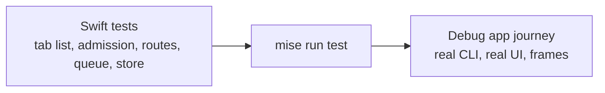

# Drawer browser: Verification Design

Requirements: [requirements.md](requirements.md). Specification: [specification.md](specification.md). Program Design: [program-design.md](program-design.md).

Proof has two levels: fast tests for logic, then one journey through the actual CLI and UI against an isolated debug build. Nothing here touches the production app. `mise run test` is required before the PR is ready. UI work also gets real frames for a taste check.

## Rows

| U | R, V | Target | Route | Passing condition |
|---|---|---|---|---|
| U1 | R1, V1 | Swift test, debug app | Route tests, journey 1 | Menu, command bar, GitHub and management layer all land in the active pane's drawer; unavailable with no main pane |
| U1 | R2, V1 | Swift test | Validator tests | Inserting a browser in the main layout and detaching one are refused |
| U2 | R3, V1 | Swift test, debug app | Route tests, registration test, journey 2 | A second open adds a tab and no second browser. A second `drawer.addPane` browser call returns the existing child, not an error |
| U1 | R4, V2 | Swift test, debug app | Normalizer tests, journey 3 | For a browser-only tab, a mixed tab, and a browser owning a terminal drawer: the browser and what it owns are gone, a tab it emptied is closed, unrelated panes are unchanged, startup succeeds, and a relaunch stays consistent |
| U2 | R5, V3 | Swift test, debug app | Tab list tests, journey 4 and 12 | One tab is active, and the others keep their pages. With two loaded tabs, a management-mode change reaches both, and a runtime reload hits the active tab only |
| U13 | R25, V11 | Swift test, review | Tab page test | A mode change during a load reapplies once when loading ends, using a real load, and no `Task.yield` loop remains in the Webview feature |
| U3 | R6, R7, R8, V3 | Swift test, debug app | Tab list tests, journey 4 | Picker opens by control and by shortcut; search filters both lists; select, close and reopen work; matches the reference picture's structure |
| U3 | R9, V3 | Swift test, debug app | Router tests with real key events, a mounted search field and monitor test, journey 5 | Every picker action works with the keyboard alone, while typing in search, including arrow events carrying `.function`. Escape and the same shortcut close the picker and leave the drawer open |
| U3 | R7, R9, V3 | Swift test | Picker request tests with forced out-of-order completion | A late result for an old query never replaces the current rows, and nothing applies after dismissal |
| U15 | R33 to R39, V14 | Debug app, review | Journey 15, independent review | First opening with delayed preparation has the right height, and P1 to P3 filtering keeps it. States P1 to P6 at three window widths match the approved image, with functional and taste verdicts per original. Review finds no hand-built panel, row, close control or key handling, and no literal colors or filtering in `body` |
| U2 | R10, V3 | Swift test, debug app | Tab list tests, journey 4 | Closing the last tab closes the browser |
| U3, U2 | R30, R31, V3 | Swift test | Tab list and store tests | New and reopened tabs go last; a reused open keeps order, so `[A, B, C]` stays the same after opening B; closing leaves no gap; order survives a reload; closing the active tab selects the next, or the previous if it was last |
| U14 | R11, V4 | Swift test | Deletion tests | Removing a pane, an owned drawer browser, an empty snapshot and a whole workspace leaves no rows in either table, and another workspace's rows remain |
| U14 | R11, V4 | Swift test, debug app | Migration and store tests, journey 6 | Legacy database with browser rows migrates, then a real repository load, two saves that close a tab and change the active tab, and a reload return exactly those tabs; tabs return after a relaunch |
| U14 | R32, V13 | Swift test, debug app | Migration test, journey 14 | A database at the version before 019, holding an available tab close and pane close with a real old-shape browser and one close with no browser: after the real migration the two browser records are expired, the other stays available, undo recovery succeeds and the expired closes' sessions are cleaned up. The debug app launches from such a database |
| U4 | R12, R20, V5 | Swift test, debug app | Tab list tests, journey 7 | Same link: same tab active, rewritten content shown, no new tab; other tabs unchanged. After a tab navigates from X to Y, opening Y reuses it, opening X adds a tab, and picker search finds Y, including for an inactive tab that finished loading |
| U5, U6 | R13, R14, V6 | Debug app | Journey 8 | An HTTPS page and a Demistify page render with their diagrams |
| U7 | R15, V7 | Swift test | Admission tests | `.md`, a missing file and `ftp:` are refused; nothing changes |
| U8 | R16, R17, R18, V7 | Swift test, debug app | CLI and authorization tests; a real cross-pane run | Each command-table line and exit code. An agent in pane A opens a page in main pane B's drawer, and the notice lands in B; A is unchanged. A drawer child or drawer terminal target is refused, and so is a caller with no credential. Every other method keeps its eligibility |
| U9 | R19, V8 | Debug app | Journey 9 | For a new browser and a new tab: focused pane, drawer state and keyboard responder unchanged, and typed text lands in the same input. Fails on a build that changes only the responder. |
| U9, U10 | R21, V9 | Swift test, debug app | Adapter test with a held interleaving, journey 10 | Repeats leave one unread notice, including two opens held mid-sequence, a browser that closes, and a failed create with another open queued |
| U9 | R22, V9 | Debug app | Journey 10 | Open expands the drawer on the browser; after closing it reports the pane is gone |
| U11 | R23, R24, V10 | Swift test, debug app | Preference and geometry tests, journey 11 | Default is the right side; a saved choice stays; hidden Bridge falls back and keeps it; outline is 95% of the side |
| U13 | R25, R26, R27, R29, V11 | Debug app against a baseline build | Journey 13 | Each case passes the Specification's resource comparison; opening passes the opening comparison; switching to a loaded tab takes under 100 ms; each run first confirms the page opened on both builds |
| U13 | R28, V12 | Swift test | Controller allocation test | With restored tabs, the page factory is called only for the selected tab, and once more when another is first selected |
| U12 | Review | Diff | Independent review | No second open path, no compatibility shim, `.newWebview` insert source deleted |

## Journey

Run on an isolated debug app, targeted by PID, under `verify-agentstudio` rules.

1. Open a browser from each entry point.
2. Open a second page.
3. Launch with a saved main-layout browser: alone in a tab, beside a terminal, and owning a drawer. Relaunch.
4. Use the picker with the mouse: search, select, close, reopen, close the last tab.
5. Repeat the picker with the keyboard only.
6. Relaunch and check tabs.
7. Open the same link again, after rewriting the file.
8. Run the agent command with an HTTPS page and a local Demistify page.
9. Record focus and the keyboard responder before and after, and type into the focused input.
10. Repeat opens, click Open, close the browser, click an old notice.
11. Enter Zoom on a new pane, a pane with a saved side, and with Bridge hidden.
12. With two loaded tabs, toggle management mode, then make the inactive tab active and check it respects the mode. Send a runtime reload and check which tab it hits.
13. Serve the quiet page from a loopback HTTP server. Run the resource comparison for no browser, one page, and five pages as tabs against five browser panes, measuring the app and its WebKit processes together. Run the opening comparison, timing to the server receiving the request. Read tab-switch time from the switch timing event. Baseline is the merge base of the delivered head with `origin/main`. WebKit processes count only when attributed to the debug app under test, through macOS process responsibility and the app's own resource coalition. CPU is the coalition's cumulative CPU over the window, which keeps the CPU of processes that exited, and any change in its tasks started or exited counts invalidates the run. Both builds launch through LaunchServices with terminals and agents held constant. Closing a browser pane must retire its WebContent and Networking processes; the GPU process may stay until the app exits. Every row must finish observed. If attribution can't be shown, the comparison hasn't run and delivery stays blocked until it can. Local-file rendering stays in journey 8.
14. Launch from a database at the version before 019 that holds an available undo record with an old browser. Launch succeeds, that close is no longer offered for undo, and a close with no browser still is.
15. Open the picker from the control and the shortcut, with the navigation bar shown and hidden, and hold each state P1 to P6. Start once from a focused page and once from a focused terminal. Close it by Escape, the same shortcut, clicking outside and clicking the control, and check it doesn't reopen and focus returns to where it was.

Capture real frames of the picker and the drawer browser at three widths. Judge every original under `verify-agentstudio` `references/visual-quality.md`, with separate functional and taste verdicts. A failed taste row fails acceptance. Frames go to the owner beside the reference before test hardening.

## Limits

- Comments surviving a relaunch in a Demistify page isn't part of this proof.
- Tab-switch timing stops at the Core Animation commit. WebKit's own repaint isn't measured, because it has no public signal.
- Tests follow the repo's wait rules: no polling or sleeps, only owner facts.
