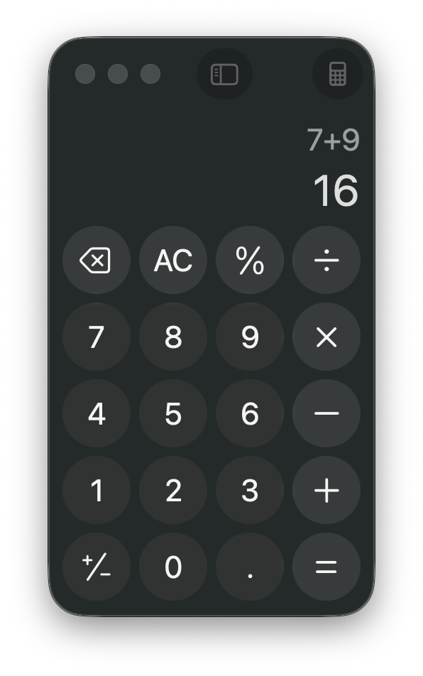

# Agent Desktop in a macOS test VM

Research and setup assessment for AgentStudio · 2026-11-01.

## The answer

**This is a useful way to run native UI journeys on a separate desktop while you keep using the host.** Put the app, its fixtures and `agent-desktop` inside a macOS guest. Drive that guest through its own accessibility tree, then verify the resulting state. The VM gives the separate operating-system session; `agent-desktop` supplies semantic desktop control.

It is a good candidate for AgentStudio’s menus, tabs, sidebar controls, popovers, dialogs and multi-step user journeys when those controls expose useful AX attributes. It complements the existing Swift Testing, IPC and BridgeWeb tests. It does not establish terminal-pixel correctness or native-host performance by reading an accessibility tree.

**Verified setup:** a prepared golden image and two disposable macOS 26.6.2 worker guests are installed. Both workers ran at the same time and passed separate semantic Calculator journeys. A guest-only screenshot was captured. They are now stopped and ready for on-demand use. AgentStudio-specific journeys and host-locked operation remain unverified.

## What the post gets right—and what needs qualification

| Claim | Checked interpretation |
| --- | --- |
| The host remains usable | A guest has its own desktop, WindowServer, apps and focus. Guest-targeted automation need not use the host’s pointer. Initial VM installation and permission setup are separate work. |
| “Headless by default” | The released tool uses semantic AX actions and disallows focus stealing/cursor movement by default. It still needs a usable guest GUI session. This does not mean macOS without WindowServer or guaranteed progress with the guest locked. |
| Stable element refs | Refs such as `@snapshot:e8` are scoped to a snapshot and namespace. They are not permanent test selectors. Refresh after UI changes; handle stale/ambiguous refs. |
| AX success means a click worked | The tool’s own macOS guide explicitly warns that a successful AX return can have no effect. Read the resulting state before declaring success. |
| No pixel matching required | True for semantic actions and state assertions exposed by AX. Screenshots remain useful for geometry, truncation, paint, terminal rendering and animation. |
| The agent cannot access host data | Only within the configured boundary. Do not share host folders, clipboard, devices, personal accounts or credentials. Default NAT can still reach host services. A host agent using SSH retains its host tool permissions; the VM does not automatically confine that agent. |
| Parallel test desktops | Plan conservatively for two concurrent macOS guests on Apple Silicon, subject to Apple/platform rules and available resources. Parallel tests within one guest still share its focus, windows, clipboard and AX namespace. |
| Reset makes runs reproducible | A stopped, prepared golden image and fresh worker clones give repeatable starting state. Keep the guest OS, app/tool versions, fixture and image digest pinned. TCC grants and login-session state belong in that prepared image. |

The native `agent-desktop` CLI does not require a cloud model. Its optional JEV helper is separate and can send screen descriptions to a provider. A Linux cloud desktop can exercise Linux or browser surfaces; it cannot substitute for macOS AppKit, TCC, WindowServer or macOS Ghostty behavior.

## How it helps AgentStudio testing

| Test question | Useful approach | What it establishes |
| --- | --- | --- |
| Does a user command change the intended pane or tab? | In-guest AX action plus guest IPC/state observation, followed by a new AX snapshot | A real UI entry point and its visible semantic outcome |
| Do sidebar and Arrangements show the same status/chips? | Inspect both mounted surfaces and correlate them with the same guest pane/session identity | Displayed semantics, if those values are exposed through AX |
| Does a Messages popover open with the expected rows and controls? | Open it in the guest, inspect the actual popover surface, assert its content | Functional presentation; a screenshot is still needed for clipping, spacing and height |
| Do keyboard, hover, drag or resize paths work? | A separate guest-only headed journey when AX has no equivalent | Guest input behavior, without making the host desktop the test target |
| Is terminal output correct? | PTY/terminal/IPC observations; use guest screenshots for pixels | AX alone is not a general terminal transcript or Metal-rendering oracle |
| Is the popover faster or pane movement smoother? | Marker-scoped measurements and appropriate frame evidence | VM timing cannot be treated as native-host performance acceptance |
| Are scheduler, SQLite or protocol rules correct? | Keep the current focused Swift Testing/integration lanes | A GUI VM adds little to tests whose behavior has no desktop dependency |

The existing test inventory’s 415 background candidates are a static classification, not VM-runtime qualification. Keep the repository’s process isolation and assertion strength. Moving a suite into a VM does not cure a blocked cooperative-pool thread, a missing completion fact or a timing-dependent test.

### A sensible first lane

Use **one UI journey at a time per guest**. Two guests can host two independent journeys; each needs separate app data, repositories, sockets and fixtures. Session names in `agent-desktop` help scope refs/traces but do not create another desktop.

Keep fast non-GUI tests in the existing runner. Start VM coverage with a small functional journey—launch the app with disposable guest data, find a control by role/name, act on its current ref, then read the actual outcome. Add visual checks only where the question needs pixels. Preserve physical-input/activation cases as distinct from semantic AX cases.

This is an evaluation recommendation, not an approved change to AgentStudio’s test topology or required gates. The installed CLI exposes polling `--wait-for` switches; adopting those is not automatically compatible with the repository’s event/fact-based test-wait rules. Permanent integration needs to preserve those rules rather than hide a missing completion signal.

## Why Tart for this experiment

Tart provides a documented CLI for pulling macOS images, setting resources, running without a host UI window and making APFS copy-on-write clones. The current official repository is `openai/tart`; the old `cirruslabs/tart` URL redirects there. This experiment uses its signed released app bundle, not a rebuilt hypervisor.

| Option | Fit for this task | Evaluation limit |
| --- | --- | --- |
| Tart | Scriptable images, lifecycle, resource settings and worker cloning suit repeatable test runs | Installed locally for this experiment; a registry-client problem required a bounded transport workaround |
| VirtualBuddy | A friendly GUI route for creating and operating macOS guests | Reviewed its official project/release metadata; not installed or exercised here |
| macosvm | A small CLI with explicit restore/configuration and ephemeral-image options | Its own README calls it an experimental expert tool; no setup/runtime comparison performed |
| UTM/custom VZ app | Other possible guest hosts | Not evaluated; no claim that switching host automatically fixes app AX coverage |

Tart 2.41.1 ships under FSL-1.1-ALv2, which explicitly includes internal use. It is not the same license as `agent-desktop`’s Apache-2.0. No licensing review for a commercial VM-hosting product is implied.

The host has an Apple M4 Max, 64 GB RAM and 16 CPU cores. The initial worker budget is 4 vCPUs, 8 GB RAM and a fixed 1280×800 display. This is a conservative pilot configuration, not a measured optimal allocation.

## The isolation boundary

Run `agent-desktop` **inside** the guest. A copy on the host would inspect the host’s accessibility universe; reading the VM viewer window is not equivalent to querying guest controls.

For the lab, omit shared directories and disable clipboard, audio and USB pass-through. Do not sign into personal iCloud or bring host credentials into the guest. Bring in only the app and disposable test inputs. Export only intended test results.

Networking is a separate choice. Tart’s default NAT is convenient for bootstrap but is not a network air gap. Its documentation says host services can be reachable; Softnet offers a different isolation model and adds another dependency. This pilot does not certify an untrusted-agent security sandbox. To confine a model’s whole execution environment, its agent harness/tool endpoint must also live inside the guest or be restricted to guest-only operations.

A VM is the useful desktop/OS boundary. It does not remove every integration channel or make a host-side agent’s other tools disappear.

## Reproducible setup

Pinned tools:

- `agent-desktop v1.0.2`, Apple Silicon archive; the CLI reports JSON envelope version `2.5`.
- `Tart 2.41.1`, its complete signed `tart.app` bundle.
- Official macOS Tahoe base image, manifest digest `sha256:4aaa751fa7538902d73c767f27a066fc87e83f183069da4e4b5022863abd4c77`.
- Image manifest: approximately 26.4 GB compressed and a 50 GB logical disk.

The tools and VM storage are task-local under the primary checkout’s ignored `tmp/test-labs/2026-11-01-agent-desktop-vm/`. No global CLI install or personal `~/.tart` cache is needed. All subsequent Tart operations must set `TART_HOME` to that lab’s `tart-home` and `TART_NO_AUTO_PRUNE=1`.

### Bootstrap and freeze

1. Import the pinned base image and configure its resources.
2. Boot a guest GUI login session; do not confuse `--no-graphics` on the host viewer with a guest without a desktop.
3. Install both the native `agent-desktop` executable and matching macOS helper inside the guest.
4. Run guest `permissions` and `status`. Grant Accessibility inside the guest through normal macOS consent. Screen Recording is only needed for screenshot evidence.
5. Run a guest-only observe → act → observe smoke on a disposable built-in app, then on an isolated AgentStudio build.
6. Shut the prepared guest down before naming/freezing it as the golden image.
7. Clone a fresh worker for each independent UI journey. Keep the golden image unchanged.

The UI consent step is real platform setup. A CLI responding to `version` does not prove AX permission, and a successful action response does not prove the resulting UI state.

### Commands

The companion [lab.sh](lab.sh) sets the isolated paths. It does not change the host’s Accessibility/TCC configuration.

```bash
# From the repository root:
docs/wip/2026-11-01-agent-desktop-vm-testing/lab.sh status
docs/wip/2026-11-01-agent-desktop-vm-testing/lab.sh configure
docs/wip/2026-11-01-agent-desktop-vm-testing/lab.sh start
```

The start command deliberately disables host clipboard/audio/USB sharing and opens no host VM window. Its private log may include guest connection information; do not publish it.

The tested launcher enables Tart’s **experimental VNC endpoint** for optional viewing. The AX commands use the guest command channel, and the viewer was not used for these smokes. Treat that viewing endpoint as experimental; removing its flag or using a different viewer configuration was not tested here.

Once the guest has the tool and permissions, the basic loop is:

```bash
# These commands run INSIDE the guest:
agent-desktop version
agent-desktop permissions
agent-desktop status
agent-desktop launch com.apple.calculator
agent-desktop snapshot --app Calculator -i --compact
# Use a qualified ref from that actual snapshot:
agent-desktop click @snapshot:e8
agent-desktop snapshot --app Calculator -i --compact
```

The ref above is illustrative. It is never a reusable test identifier. Use a fresh observed ref, inspect `ok`, branch on the documented delivery/retry disposition, and verify the new state.


### Run the prepared workers

The golden image and workers are already provisioned. From the repository root, start worker 1 in a host Terminal (or an approved host execution route):

```bash
docs/wip/2026-11-01-agent-desktop-vm-testing/lab.sh start
```

That command stays attached to the VM process. In another terminal, run guest-only commands:

```bash
LAB=docs/wip/2026-11-01-agent-desktop-vm-testing/lab.sh
"$LAB" guest /Users/admin/agent-desktop/bin/agent-desktop permissions
"$LAB" guest /Users/admin/agent-desktop/bin/agent-desktop launch com.apple.calculator
"$LAB" guest /Users/admin/agent-desktop/bin/agent-desktop snapshot --app Calculator -i --compact
```

To select the second prepared worker, set `AS_AGENT_DESKTOP_VM=agentstudio-ax-worker-2` on the same launcher. Start it in another terminal for a separate guest desktop. To create another stopped worker, `lab.sh clone NEW_NAME` always clones the golden image.

For a normal guest shutdown:

```bash
docs/wip/2026-11-01-agent-desktop-vm-testing/lab.sh guest /usr/bin/sudo -n /sbin/shutdown -h now
docs/wip/2026-11-01-agent-desktop-vm-testing/lab.sh status
```

The guest command channel may report “Transport became inactive” as shutdown completes. Verify the VM process ended and `status` reports `stopped`; do not turn an arbitrary failed guest command into success. `lab.sh stop` is the VM-host stop command for the selected disposable worker.

If you open a VNC viewer from the private connection information, its clipboard integration is another channel to review; Tart’s `--no-clipboard` flag does not certify a separate viewer’s settings.

## Setup results

<!-- SETUP_RESULTS -->
**Working guest setup verified.** The lab retains one stopped golden image and two stopped disposable worker clones. The default launcher targets worker 1, so routine tests do not modify the golden image.

| Check | Actual result |
| --- | --- |
| Tool integrity | Both release archive SHA-256 values matched. Agent Desktop’s GitHub build attestation verified. Tart’s signed app passed strict signature verification. |
| Host and guest | Host: macOS 26.5.2, Apple M4 Max, 64 GB. Guest: macOS 26.6.2 / build 25G83. |
| Guest command context | Tart’s preinstalled guest agent ran as the guest’s logged-in test user. No personal SSH key or shared host folder was used. |
| Guest permissions | Accessibility and Screen Recording reported granted in the tested guest-agent context. Automation remained unknown. No host AX grant or guest TCC-database edit was made. |
| First semantic smoke | Guest Calculator performed `7 + 9`; a fresh AX snapshot reported `16`. |
| Resettable parallel workers | Both cloned workers were running together. Worker 1 reported `16`; worker 2 independently reported `8` from `3 + 5`. Fresh observations after both runs retained those separate results. |
| Action verification | Click responses were `delivered_unverified`; final UI values supplied the effect evidence. Each action used a fresh snapshot ref. No `--headed` flag or physical host UI command was used. |
| Visual evidence | A PNG of worker 1’s Calculator was captured inside the guest and transferred over the guest command channel. It shows `7+9` and `16`; the app window was visible and not focused in the observed guest state. |
| Retirement | All three local VMs are stopped. The temporary registry mirror exited. Both worker VM-run processes exited 0 after guest shutdown. |
| Storage | Host free space was about 227 GiB before provisioning and 195 GiB afterward. APFS clones share blocks; do not sum the VM list’s per-image sizes as physical consumption. |

The ordinary sandboxed hypervisor launch aborted; approved host execution booted the guests. Use a normal host Terminal or the host’s approved execution route for `lab.sh start`. Guest commands through the running VM control channel succeeded from the ordinary task environment.

The direct native Tart registry pull timed out both inside and outside the agent sandbox. A native HTTPS probe reached the registry, so general connectivity was not the explanation. Provisioning succeeded through a temporary loopback-only, read-only mirror serving the exact pinned public OCI manifest and its allowed blob digests, with external fetches over HTTPS and the manifest bytes verified against the pinned digest. The mirror was shut down after import. Future local worker clones do not need that mirror.

The image is prepared for this test context, not a certification of a fresh macOS image’s permissions. A different in-guest launcher may need its own normal consent. Host-locked operation, AgentStudio-specific AX coverage, headed input, animation/performance correctness and untrusted-agent security confinement were **not** tested.



*Actual guest-only capture after the semantic AX smoke. This is Calculator evidence, not an AgentStudio rendering or performance result.*
<!-- END_SETUP_RESULTS -->

## Evidence and sources

The report distinguishes source/documentation, host preflight and guest runtime proof. No guest UI result is claimed until it appears in the setup-results section.

- [Agent Desktop official repository, pinned inspected main](https://github.com/vercel-labs/agent-desktop/tree/9eb9b296192fcb70bda25e918cd6dd66abfa3d0d).
- [Released v1.0.2 source](https://github.com/vercel-labs/agent-desktop/tree/a47ed664e0db00d1d4df364eb3fe8a5599882f3c) and [release archive](https://github.com/vercel-labs/agent-desktop/releases/tag/v1.0.2).
- [Installation and permissions](https://github.com/vercel-labs/agent-desktop/blob/9eb9b296192fcb70bda25e918cd6dd66abfa3d0d/docs/install.md), [core agent skill](https://github.com/vercel-labs/agent-desktop/blob/9eb9b296192fcb70bda25e918cd6dd66abfa3d0d/skills/agent-desktop/SKILL.md) and [macOS behavior](https://github.com/vercel-labs/agent-desktop/blob/9eb9b296192fcb70bda25e918cd6dd66abfa3d0d/skills/agent-desktop-macos/SKILL.md).
- [Released interaction policy](https://github.com/vercel-labs/agent-desktop/blob/a47ed664e0db00d1d4df364eb3fe8a5599882f3c/crates/core/src/actions/interaction_policy.rs): default focus-steal/cursor permissions are false. Runtime behavior of every action was not audited.
- [Tart official source](https://github.com/openai/tart), [quick start](https://tart.run/quick-start/) and [release 2.41.1](https://github.com/openai/tart/releases/tag/2.41.1).
- [Tart configuration](https://github.com/openai/tart/blob/bcc8084a22b1ab1cc7162626537d1c6cd794cdba/Sources/tart/Config.swift), [network/share flags](https://github.com/openai/tart/blob/bcc8084a22b1ab1cc7162626537d1c6cd794cdba/Sources/tart/Commands/Run.swift), [NAT/host access FAQ](https://tart.run/faq/) and [license](https://github.com/openai/tart/blob/bcc8084a22b1ab1cc7162626537d1c6cd794cdba/LICENSE).
- [VirtualBuddy](https://github.com/insidegui/VirtualBuddy), [macosvm](https://github.com/s-u/macosvm/blob/c21fd7414bab38b0a2474b351b90378bdef98325/README.md).
- [Apple: running macOS on Apple Silicon](https://developer.apple.com/documentation/virtualization/running-macos-in-a-virtual-machine-on-apple-silicon), [Mac graphics device](https://developer.apple.com/documentation/virtualization/vzmacgraphicsdeviceconfiguration), and [Apple Developer Forums discussion of the macOS guest cap](https://developer.apple.com/forums/thread/845455). The pilot has not independently exercised two simultaneous macOS guests.
- AgentStudio’s [existing testing architecture](../../architecture/testing/testing_architecture.md) remains the owner of repository test lanes and proof rules.

**Research limits:** DeepWiki was not advertised. A Perplexity synthesis failed to identify the named repository and was not used as proof. Decisive project claims were checked against the official repositories, released binary docs and primary platform material. Recent releases/commits show active maintenance, not a reliability guarantee. Native guest permissions, UI behavior, visual quality and performance require the actual guest experiment.
